# 시작

<!--
  single mode 원고 — 본문 + 부록 A·B·C + 참고, 120분(2026.11.13 금 09:00 시작 · 종료 시각 검증 필요), 화면 3:2. 장 수는 README «폴더» 절이 소유.
  대상: 기록관 종사자, 코딩 경험 없음(2026.05 국가기록원 「생성형 인공지능 역량 강화」와 같은 층).
  🔴 강의 PC 의 VS Code + Claude Code 연동은 담당자가 미리 해 둔다(사용자 확인 2026.11.07). 이 덱은 그 다음부터 다룸.
  🔴 실습 주제는 가상의 «한빛기록관» — 실제 기관 정보 · 실제 기록물 · 개인정보를 넣지 않는다.
  🔴 비밀값(Supabase secret 키 · DB 비밀번호 · Google Client Secret)은 슬라이드 · 화면 · 파일 · 채팅에 노출하지 않는다.
  제목 구조: `# 챕터` 는 단독 장 + `---`(H1 과 H2 를 한 장에 두면 목차 카드로 바뀌어 사라짐 — MidShare 2026.10.25 실측). 장 제목은 전부 `##`.
  발표자 노트: 진행 멘트 · 시간 · 시연 지시는 ArchivesHomepage_note.md 의 `## {slug}`. 본문은 청중이 읽는 문장만(~함/~임, 금지어 여러분 · 오늘 · Let's).
  [줄임] = 시간이 모자랄 때 먼저 접는 장(노트에 표시).
  프롬프트 전문은 같은 폴더 실습_프롬프트.md 와 글자까지 같게 유지한다 — 한쪽만 고치면 현장에서 복사하는 쪽이 낡는다.
  부록 A · B · C 는 수업 중 진행하지 않음 — 먼저 끝난 사람 · 이미 아는 사람이 스스로 따라 하는 용도.
  메뉴 이름(Supabase · Cloudflare · Google Cloud)은 2026.11.07 기준. 강의 전날 리허설로 한 번 더 확인.
  🎬 모션그래픽(2026.11.08 사용자 지시 — mp4 가 아니라 웹에서 도는 JS):
    3D(three.js r159, 로컬 보관) 5장 — img/mg3d/mg.htm?scene=<이름> 을 `#layout-_mg` 장의 iframe 으로 실음(img/ 라 빌드가 slide/img/ 로 복사).
      iframe 은 Reveal 의 slide:start 메시지로 처음부터 재생, PDF(decktape)에서는 끝 프레임. pointer-events:none — 클릭이 키보드 진행을 빼앗지 않게.
    2D 1장 — mg/md (KOICA 중간공유회 MidShare mg/02-markdown 사본, 3:2 · 한빛기록관 예시로 바꿈).
  🖼️ ig: img/ig-01~09 는 코드 렌더(SVG 원본 ig-src/). md-*.png 는 KOICA MidShare 사본.
  📝 3장 Markdown 은 KOICA 중간공유회 특강(MidShare.md «# Markdown», 2026.11.06)에서 가져옴 — 팀 과제 사례는 한빛기록관 예로 바꾸고, «작업 하나 = 이슈 하나»(Git 전제)는 뺐다.
-->

<!-- ═══ 시작 — 09:00 ~ 09:08 ═══ -->

---

#layout-_mg
#id-mg-overview

## 전체 그림 — 네 조각이 이어짐

<iframe class="mg3d" src="./img/mg3d/mg.htm?scene=overview" title="전체 그림 — 3D 모션그래픽" style="display:block;width:1920px;height:1280px;border:0;pointer-events:none;"></iframe>

---

## 2시간 뒤 손에 남는 것
#id-goal

::: htmlart compare
* **내 PC 안에서만** / 지금까지
  - 파일을 더블클릭해야 열림
  - 만든 사람만 볼 수 있음
  - 글을 남겨도 새로고침하면 사라짐
* **인터넷 주소로** / 이번 2시간
  - 주소만 알면 휴대폰으로도 열림
  - 누구나 방명록을 남길 수 있음
  - 남긴 글이 인터넷 장부에 저장됨
:::

---

## 완성 모습 — 가상의 «한빛기록관»
#id-final

::: htmlart block
* 맨 위 — 기관 이름과 한 줄 소개
* 소개 카드 3장 — 소장 기록 · 열람 안내 · 오시는 길
* 방명록 — 이름과 한 줄을 남기면 모두에게 보임
* 주소 — https://이름.pages.dev (휴대폰으로 접속)
:::

---

## 네 조각으로 만듦 <!-- nosplit -->
#id-parts

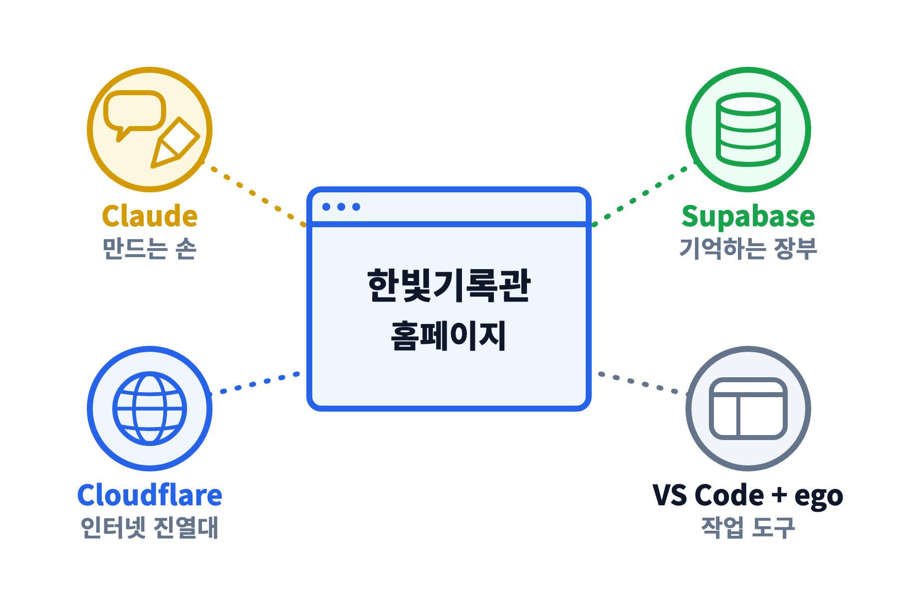

* Claude 가 만들고, Supabase 가 기억하고, Cloudflare 가 보여 줌 — VS Code 와 ego 는 작업 도구

---

## 왜 이 조합인가
#id-why

::: htmlart compare
* **서버를 직접 빌리면** / 예전 방식
  - 서버 임대 · 설치 · 보안 패치를 직접 함
  - 매달 비용이 나감
  - 고장 나면 직접 고침
* **Supabase + Cloudflare** / 이번 방식
  - 가입만 하면 바로 씀 (무료 범위)
  - 저장은 Supabase, 공개는 Cloudflare 가 맡음
  - 남은 일은 화면 만들기 — Claude 가 함
:::

---

## 2시간 흐름
#id-flow

::: htmlart block
* 09:08 구구단 → 09:22 준비 → 09:40 Markdown
* 09:50 휴식 10분
* 10:00 만들기 → 10:15 저장 → 10:35 공개
* 10:50 정리 · 질의응답
:::

* 먼저 끝난 사람은 **부록 A · B · C** 로 먼저 진행

---

## 실습 약속
#id-rules

::: htmlart numbered
* 실제 기록물 · 개인정보는 넣지 않음
  - 가상의 «한빛기록관» 으로 실습
* 비밀 키는 어디에도 붙여 넣지 않음
  - secret 키 · DB 비밀번호 · Client Secret
* 실제 기관 서비스는 별도 검토가 먼저
  - 보안 · 개인정보 · 기록관리 규정
* 실습이 끝나면 정리함
  - 방명록 비우기 · 프로젝트 일시정지
:::

---

<!-- ═══ 1. 냅다 구구단 — 09:08 ~ 09:22 ═══ -->

# 1. 냅다 구구단 — 내 PC 에서 바로

---

#layout-_mg
#id-mg-gugudan

## 냅다 구구단 — 내 PC 에서 바로

<iframe class="mg3d" src="./img/mg3d/mg.htm?scene=gugudan" title="냅다 구구단 — 3D 모션그래픽" style="display:block;width:1920px;height:1280px;border:0;pointer-events:none;"></iframe>

---

## 지금 바로 — 폴더 하나, 말 한 줄
#id-gu-start

::: htmlart numbered
* 바탕화면에 gugudan 폴더 만들기
* VS Code 에서 File → Open Folder
* 오른쪽 위 아이콘으로 Claude 패널 열기
* 프롬프트 ⓪ 을 붙여 넣고 Enter
:::

* 폴더를 열어야 Claude 가 그 안에서만 일함 — 폴더 없이 시작하지 않음

---

## 프롬프트 ⓪ 구구단 홈페이지
#id-gu-prompt

```text
이 폴더에 index.html 한 파일로 구구단 연습 홈페이지를 만들어 줘.
- 2단부터 9단까지 버튼 — 누르면 그 단의 표가 나옴
- «퀴즈» 버튼 — 문제 10개를 내고 맞힌 개수를 점수로 보여 줌
- 큰 글씨, 밝은 색, 휴대폰에서도 보기 좋게
- 설치가 필요 없는 HTML · CSS · JavaScript 만 사용
```

* 가입도 설정도 없이 — **VS Code 와 Claude 만으로** 1~2분이면 나옴

---

## Claude 가 허락을 물을 때
#id-approve

::: htmlart compare
* **허락해도 되는 것** / 이 폴더 안
  - 파일 만들기 · 고치기
  - 만든 결과 보여 주기
* **멈추고 읽을 것** / 폴더 밖 · 되돌리기 어려운 일
  - 다른 폴더의 파일 지우기
  - 프로그램 설치 · 비밀번호 입력
  - 모르면 «이게 무슨 작업이야?» 하고 물음
:::

---

## 결과 보기 — 더블클릭
#id-gu-open

::: htmlart numbered
* 탐색기에서 gugudan 폴더 열기
* index.html 더블클릭 — 기본 브라우저로 열림
* 2단 ~ 9단 버튼과 퀴즈를 눌러 보기
* 주소창 확인 — file:///C:/… 로 시작함
:::

* `file:///` = 인터넷 주소가 아니라 **내 PC 안의 파일**을 보는 중

---

## 말로 고치기 — 한 번에 하나씩
#id-gu-refine

::: htmlart numbered
* 색 바꾸기
  - «7단은 빨간색으로 바꿔 줘»
* 퀴즈 늘리기
  - «퀴즈를 20문제로 늘려 줘»
* 재미 더하기
  - «맞히면 축하 문구를 크게 보여 줘»
* 되돌리기
  - «방금 바꾼 것 되돌려 줘»
:::

* 고칠 곳 하나 · 원하는 모양 하나 — 한 번에 하나씩 말하고 F5 로 확인

---

## 해 보면 생기는 질문 세 가지
#id-gu-questions

::: htmlart numbered
* 옆 사람 휴대폰으로 열 수 있나?
  - ✕ 주소가 file:/// — 내 PC 안의 파일임
* 새로고침하면 퀴즈 점수는?
  - ✕ 사라짐 — 기억해 두는 곳이 없음
* 다른 사람 점수와 견줄 수 있나?
  - ✕ 모두가 같이 쓰는 장부가 없음
:::

---

## 내 PC 안 · 인터넷 주소 <!-- nosplit -->
#id-gu-local

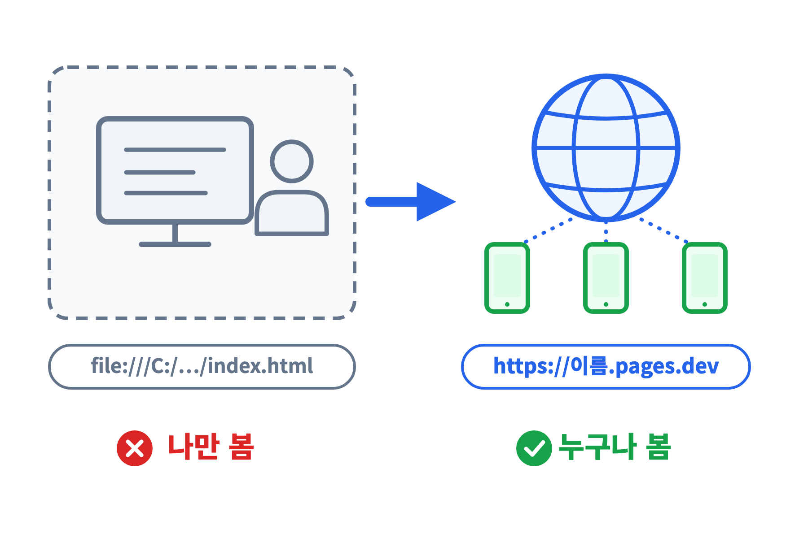

* 만드는 일은 Claude 가 끝냈음 — 남은 것은 **밖으로 꺼내는 일**

---

## 필요한 두 가지 — 공개와 저장 <!-- nosplit -->
#id-gu-needs

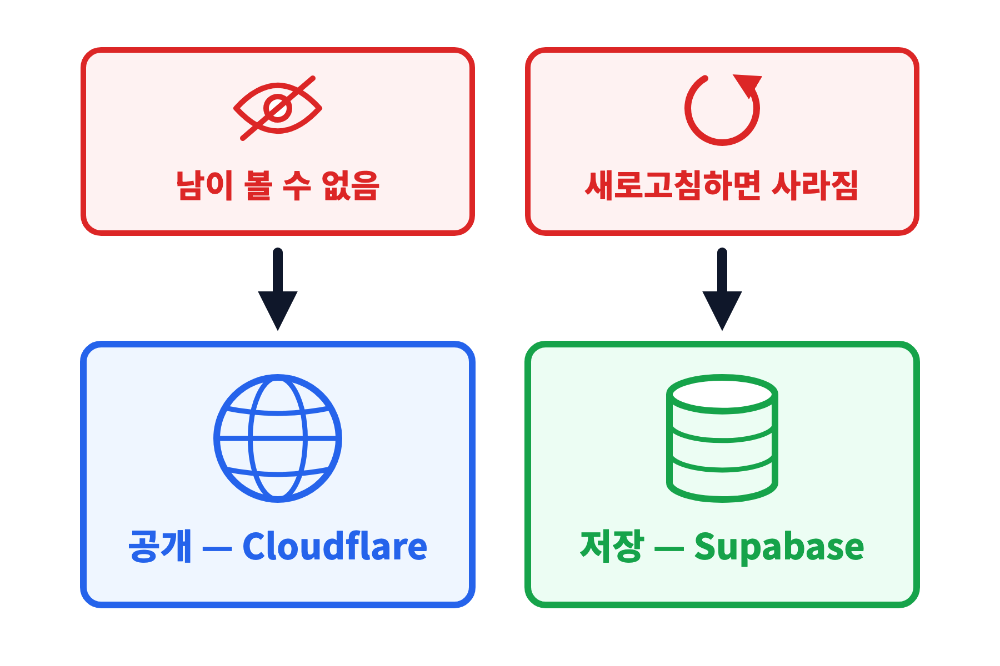

* 공개는 **Cloudflare**, 저장은 **Supabase** — 둘 다 가입과 설정이 필요함

---

## 설정이 어려운 곳은 ego 로
#id-gu-ego

::: htmlart workflow
* 사람
  - 가입 · 로그인
* ego 창
  - 로그인 상태가 남음
* Claude
  - 메뉴 찾기 · 클릭
* 결과
  - 화면 · 표 확인
* 사람
  - 읽고 승인
:::

* 메뉴가 많고 자주 바뀌는 설정 화면 — 사람은 **문을 열고**, 클릭은 Claude 에게 맡김

---

<!-- ═══ 2. 준비 — 09:22 ~ 09:40 ═══ -->

# 2. 준비 — ego 와 계정

---

#layout-_mg
#id-mg-ego

## 설정은 ego 에서

<iframe class="mg3d" src="./img/mg3d/mg.htm?scene=ego" title="설정은 ego 에서 — 3D 모션그래픽" style="display:block;width:1920px;height:1280px;border:0;pointer-events:none;"></iframe>

---

## 담당자가 해 둔 것 · 지금 할 것
#id-prep-split

::: htmlart compare
* **담당자가 해 둔 것** / 사전 설정
  - VS Code 설치
  - Claude Code 확장 연결 · 로그인
  - VS Code 오른쪽에 Claude 패널이 열림
* **지금 할 것** / 18분
  - ego (lite) 설치
  - GitHub · Supabase · Cloudflare 가입
  - Supabase 프로젝트 하나 만들기
:::

---

## ego (lite) — 사람이 열고, AI 가 이어서 <!-- nosplit -->
#id-ego

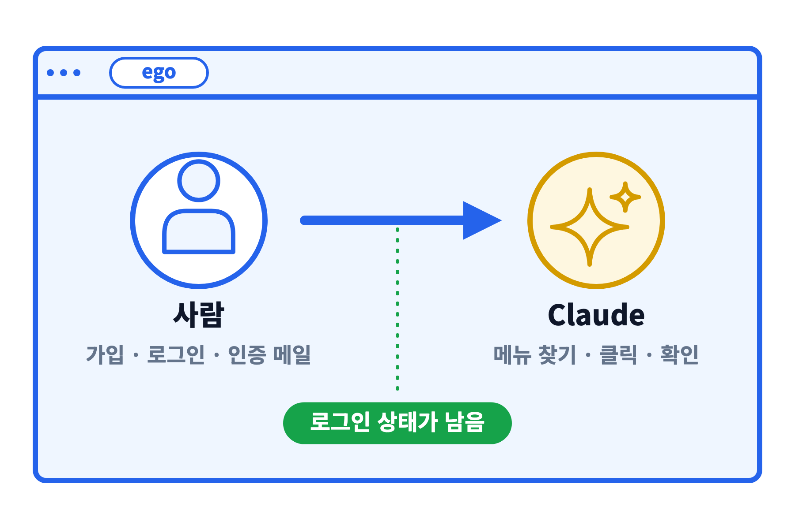

* Chrome 과 같은 모양의 무료 브라우저(Windows 판은 베타) — 가입 · 확인 · 테스트를 한 창에서 끝냄

---

## 설치 ① 내려받기 <!-- nosplit -->
#id-ego-download

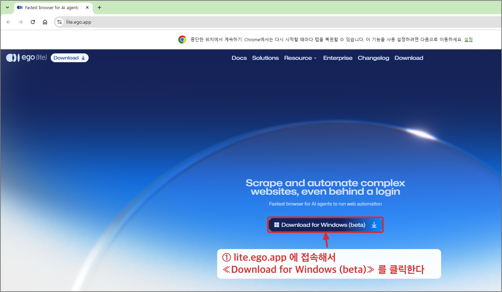

* lite.ego.app 접속 → «Download for Windows (beta)» → 내려받은 egoliteSetup 실행

---

## 설치 ② 보안 경고 넘기기 <!-- nosplit -->
#id-ego-smartscreen

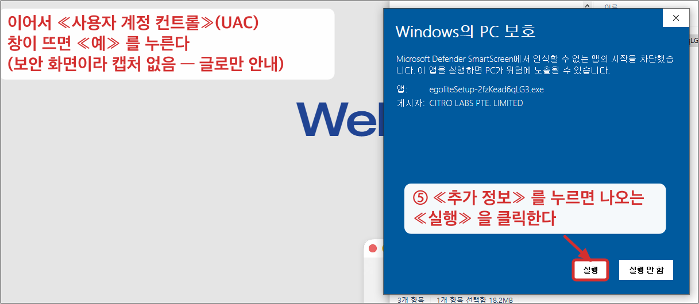

* «추가 정보» → «실행» → 사용자 계정 컨트롤 «예» — 그다음 설치는 자동

---

## 설치 ③ 첫 실행 설정 <!-- nosplit -->
#id-ego-onboard

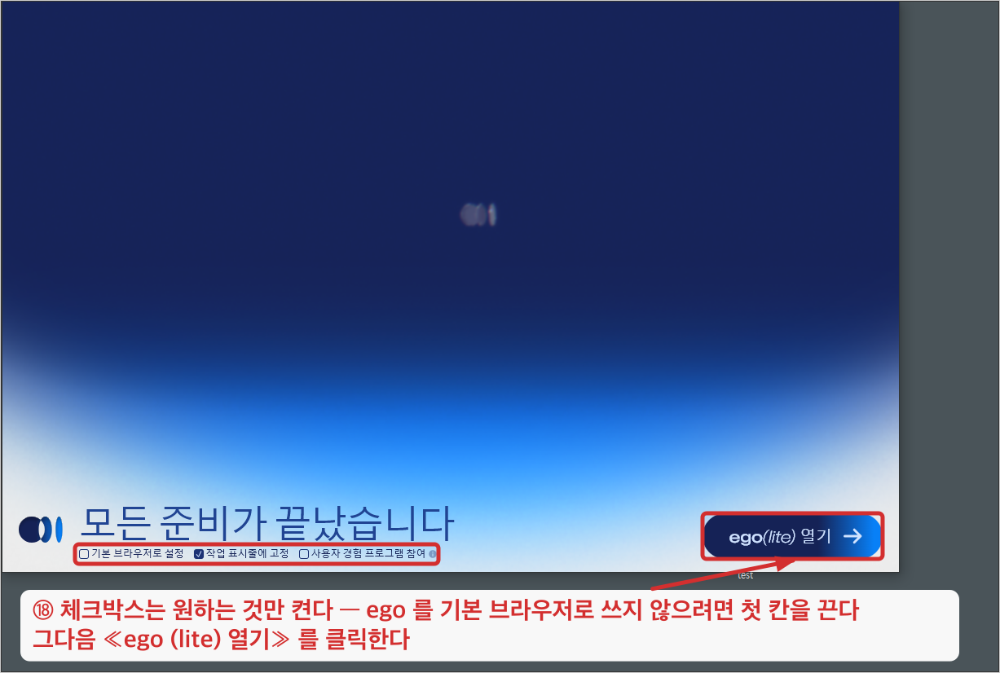

* 시작하기 → 다음 × 3 → 데이터 가져오기 «나중에 설정» → 소식 · 설문 «건너뛰기» → «ego (lite) 열기»

---

## 설치 끝 — 이 창이 열리면 됨 <!-- nosplit -->
#id-ego-done

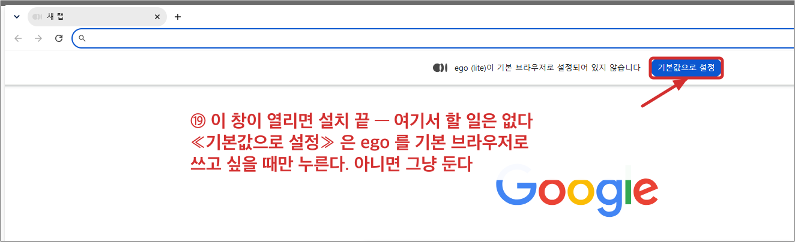

* «기본값으로 설정» 은 누르지 않아도 됨 — ego 를 기본 브라우저로 쓰고 싶을 때만

---

## 설치 뒤 — VS Code 를 한 번 껐다 켬
#id-ego-restart

::: htmlart numbered
* VS Code 창을 닫고 다시 열기
  - 그래야 Claude 가 새로 깔린 ego 를 찾음
* File → Open Recent 로 gugudan 폴더
* Claude 에게 ego 연결 확인을 부탁
  - 실습 자료의 «ego 연결 확인» 프롬프트
* «ego-browser ready» 가 나오면 준비 끝
:::

* 안 나오면 그대로 진행해도 됨 — ego 에 맡기는 길만 빼고 **모든 실습은 사람이 직접** 할 수 있음

---

## 가입 순서 — ego 창에서 하나씩
#id-signup

::: htmlart numbered
* GitHub — 이메일 · 인증 코드
* Supabase — Continue with GitHub
* Cloudflare — 이메일 · 인증 메일
:::

* 세 곳 모두 **ego 창에서** 가입 — 로그인 상태가 ego 에 남아 Claude 가 이어서 쓸 수 있음

---

## 가입이 막히는 곳
#id-signup-trouble

::: htmlart block
* 인증 메일이 안 옴 — 스팸함 · 프로모션함 확인, 1분 뒤 재발송
* 사람 확인 퍼즐 — 끝까지 풀어야 다음 단계로 감
* 기관 메일이 막힘 — 개인 메일로 가입
* 비밀번호 — 세 곳 모두 다르게 정하고 안전한 곳에 적어 둠
:::

---

## Supabase 프로젝트 미리 만들기
#id-sb-new

::: htmlart numbered
* New project
* 이름 — archives-homepage
* Region — Northeast Asia (Seoul)
* Database Password — Generate
  - 화면 밖 안전한 곳에 따로 보관
* Create new project
  - 1~2분 걸림 — 만드는 동안 다음 실습
:::

---

<!-- ═══ 3. Markdown — 09:40 ~ 09:50 (KOICA 중간공유회 특강 챕터) ═══ -->

# 3. Markdown — AI 에게 주는 요청서

---

#layout-_mg
#id-mg-markdown

## Markdown — 사람도 AI 도 같은 문서를 읽음

```mg
src: mg/md
```

---

## Markdown — AI 의 문서 포맷
#id-md-format

* 비유: AI 가 가장 잘 알아듣는 **「메모 양식」**
* 사람과 AI 가 **같은 문서**로 소통함
* 기호 몇 개로 쓰는 쉬운 문서

::: htmlart venn
* 사람이 읽음
  - 보기 쉬운 문서
* AI 가 읽음
  - 구조가 뚜렷한 문서
:::

---

## Markdown 이란?
#id-md-what

* **일반 텍스트에 기호를 붙여** 제목·목록·강조를 표시하는 문서 방식 — 2004년 존 그루버가 만듦
* 글꼴·색 같은 **서식이 아니라 구조**(제목·목록·표)를 적음
* 파일 이름은 `.md` — 어떤 편집기에서도 열림
* 프로그램이 읽어 **웹 화면·슬라이드로 바꿀 수 있음**

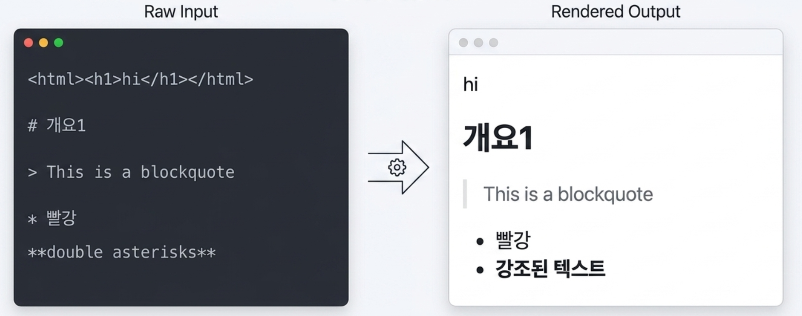

---

## 기호 몇 개로 쓰는 쉬운 문서
#id-md-syntax

<!-- 기호 범례 — 줄머리 기호라 br 로 줄을 나눠 실제 Markdown 문서 모양으로 둠(KOICA 판 그대로). 아래 좌우 대조는 한빛기록관 예로 바꿈 -->
::: htmlart annotate
* target: #&nbsp;제목<br>-&nbsp;목록 &#42;&#42;굵게&#42;&#42;<br>>&nbsp;인용
* over purple: # → 큰 제목
* under blue: - → 글머리 목록
* over green: &#42;&#42;굵게&#42;&#42; → 굵은 글씨
* under red: > → 인용 블록
:::

<!-- 본문 | 미리보기 좌우 대조 — VS Code 편집기 탭과 미리보기 탭 모양. 위 범례의 기호 넷(# - ** >)을 예시가 모두 씀.
     오른쪽은 슬라이드 안에서 # 이 새 장을 만들지 않게 HTML 로 씀 -->
<div class="md-compare" style="display:flex;gap:4%;align-items:flex-start;text-align:left;">
<div style="flex:0 0 48%;max-width:48%;border:1px solid #d4d4d4;border-radius:8px;overflow:hidden;">
<div style="font-size:0.5em;background:#ececec;color:#555;padding:4px 14px;border-bottom:1px solid #d4d4d4;">VS Code 편집기 — <b style="color:#333;">한빛기록관.md</b></div>
<div style="padding:10px 22px;font-size:0.7em;line-height:1.5;background:#f5f6f8;font-family:ui-monospace,Menlo,monospace;">
<div style="color:#0b4fbf;font-weight:700;">#&nbsp;한빛기록관 홈페이지</div>
<div><span style="color:#8a6d00;">-</span>&nbsp;소개 카드 3장</div>
<div><span style="color:#8a6d00;">-</span>&nbsp;방명록에 <span style="color:#1a7f37;">&#42;&#42;한 줄&#42;&#42;</span> 남기기</div>
<div><span style="color:#c0392b;">&gt;</span>&nbsp;휴대폰에서도 보기 좋게</div>
</div>
</div>
<div style="flex:0 0 48%;max-width:48%;border:1px solid #d4d4d4;border-radius:8px;overflow:hidden;">
<div style="font-size:0.5em;background:#ececec;color:#555;padding:4px 14px;border-bottom:1px solid #d4d4d4;">VS Code 미리보기 — 옆에 띄우기 <b style="color:#333;">Ctrl+K V</b></div>
<div class="md-render-demo" style="padding:10px 22px;font-size:0.7em;line-height:1.5;background:#fff;font-family:-apple-system,'Apple SD Gothic Neo','Noto Sans KR',sans-serif;">
<div style="font-size:1.4em;font-weight:800;line-height:1.3;padding-bottom:.1em;margin-bottom:.2em;border-bottom:1px solid #ddd;">한빛기록관 홈페이지</div>
<div style="padding-left:.6em;">•&nbsp; 소개 카드 3장</div>
<div style="padding-left:.6em;">•&nbsp; 방명록에 <span style="font-weight:800;color:#111;">한 줄</span> 남기기</div>
<div style="margin-top:.2em;border-left:4px solid #ccc;padding-left:.6em;color:#666;">휴대폰에서도 보기 좋게</div>
</div>
</div>
</div>

* VS Code 한 화면에서 **쓰면서 바로 확인**함

---

## 왜 AI 가 잘 알아듣나
#id-md-why-ai

::: htmlart hexagon
* 구조가 뚜렷함
  - 기호로 제목·목록·표를 구분
* 텍스트만
  - 서식 없이 내용에 집중
* 그대로 주고받음
  - AI 의 답변도 같은 기호
* 제목을 달아 요청
  - 목표 · 조건 · 완료 기준
:::

---

## 워드·한글 파일과 무엇이 다른가
#id-md-vs-doc

::: htmlart compare
* **워드·한글** / .docx · .hwp
  - 서식이 섞인 파일
  - 변경 비교는 전용 기능으로
  - AI 와는 복사·변환이 필요
  - 해당 프로그램이 있어야 열림
* **Markdown** / .md
  - 일반 텍스트
  - Git 으로 줄 단위 비교
  - AI 가 그대로 읽고 씀
  - 어떤 편집기든 열림
:::

* 일반 텍스트라 **오래 지나도 어떤 프로그램으로든 열림** — 기록 보존 관점에서도 유리한 형식

---

## 어디에 쓰이나
#id-md-where

::: htmlart matrix
* README
  - 프로젝트를 소개하는 첫 장
* 기획 · 요구사항
  - AI 에게 주는 요청서
* AI 지침 파일
  - ex) CLAUDE.md — 매 대화 시작 때 읽음
* 이슈 · 보고
  - 작업의 기록
:::

---

## 지침 파일 — AI 에게 맡기는 «프로젝트 사용 설명서»
#id-md-guide

::: htmlart process
* CLAUDE.md 작성
  - 프로젝트의 규칙과 배경
* AI 가 읽음
  - 매 대화 시작 때
* 설명 반복 없음
  - 대화마다 다시 말하지 않음
* 저장소로 공유
  - 팀이 같은 지침을 씀
:::

* ex) «방명록 글은 200자 이내 · 실제 기관명 금지» 를 적어 두면 매번 말하지 않아도 지킴

---

## 기획과 요청을 적어 두면 AI 가 정확히 이해함
#id-md-write-down

::: htmlart compare
* **말로만 한 요청** / 흩어짐
  - 대화가 끝나면 사라짐
  - 무엇을 시켰는지 다시 찾기 어려움
* **적어 둔 요청** / 남음
  - AI 가 정확히 이해함
  - 나중에 다시 읽기 쉬움
:::

---

## 홈페이지 요구사항 한 장 — 이렇게 시작함
#id-md-reqdoc

<!-- KOICA 판 «팀 과제의 요구사항 한 장» 을 한빛기록관 예로 바꿈. 네 칸(무엇을 · 어디에 · 어떤 모양 · 끝난 기준)은 ig-05 · 프롬프트 ① 과 같은 틀 -->
<div class="md-compare" style="display:flex;gap:4%;align-items:flex-start;text-align:left;">
<div style="flex:0 0 48%;max-width:48%;border:1px solid #d4d4d4;border-radius:8px;overflow:hidden;">
<div style="font-size:0.5em;background:#ececec;color:#555;padding:4px 14px;border-bottom:1px solid #d4d4d4;">VS Code 편집기 — <b style="color:#333;">요구사항.md</b></div>
<div style="padding:18px 26px;font-size:1.05em;line-height:1.7;background:#f5f6f8;font-family:ui-monospace,Menlo,monospace;">
<div style="color:#0b4fbf;font-weight:700;">#&nbsp;한빛기록관 — 요구사항</div>
<div><span style="color:#8a6d00;">-</span>&nbsp;무엇을: 소개 + 방명록</div>
<div><span style="color:#8a6d00;">-</span>&nbsp;어디에: site/index.html</div>
<div><span style="color:#8a6d00;">-</span>&nbsp;모양: 휴대폰 · <span style="color:#1a7f37;">&#42;&#42;차분한 남색&#42;&#42;</span></div>
<div><span style="color:#c0392b;">&gt;</span>&nbsp;끝난 기준: 휴대폰에서 글이 남음</div>
</div>
</div>
<div style="flex:0 0 48%;max-width:48%;border:1px solid #d4d4d4;border-radius:8px;overflow:hidden;">
<div style="font-size:0.5em;background:#ececec;color:#555;padding:4px 14px;border-bottom:1px solid #d4d4d4;">VS Code 미리보기 — AI 에게 주는 첫 요청서</div>
<div class="md-render-demo" style="padding:18px 26px;font-size:1.05em;line-height:1.7;background:#fff;font-family:-apple-system,'Apple SD Gothic Neo','Noto Sans KR',sans-serif;">
<div style="font-size:1.4em;font-weight:800;line-height:1.3;padding-bottom:.1em;margin-bottom:.2em;border-bottom:1px solid #ddd;">한빛기록관 — 요구사항</div>
<div style="padding-left:.6em;">•&nbsp; 무엇을: 소개 + 방명록</div>
<div style="padding-left:.6em;">•&nbsp; 어디에: site/index.html</div>
<div style="padding-left:.6em;">•&nbsp; 모양: 휴대폰 · <span style="font-weight:800;color:#111;">차분한 남색</span></div>
<div style="margin-top:.2em;border-left:4px solid #ccc;padding-left:.6em;color:#666;">끝난 기준: 휴대폰에서 글이 남음</div>
</div>
</div>
</div>

* 네 줄 — **무엇을 · 어디에 · 어떤 모양 · 끝난 기준** — 이 AI 에게 주는 첫 요청서임

---

## 코드를 읽고 쓴 설계 문서의 함정
#id-md-trap

::: htmlart compare
* **코드 → 문서** / 거꾸로
  - 만들어진 코드를 보고 씀
  - 코드가 기준이 됨
  - 설계가 코드를 이끌지 못함
* **문서 → 코드** / 바로
  - 기준 문서를 먼저 씀
  - 문서가 기준이 됨
  - 설계가 코드를 이끎
:::

* 기준 문서는 코드보다 **먼저** 있어야 함

---

## 요구사항 → 설계 → 이슈 → 변경 <!-- nosplit -->
#id-md-chain

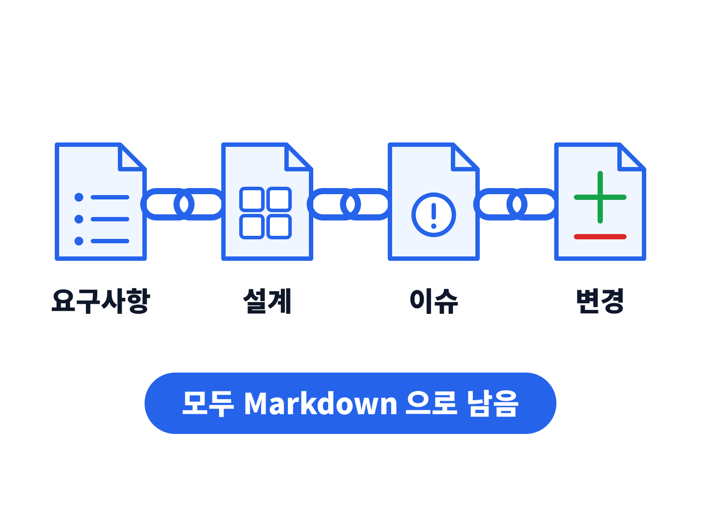

* 요청 · 변경의 이유가 문서로 남음 — **기록관리와 같은 원리**

---

## Markdown 정리 — 한 장 요약
#id-md-summary

::: htmlart hexagon
* 메모 양식
  - 사람과 AI 가 함께 읽음
* 적어 둔 요청
  - 남고 다시 읽힘
* 요구사항에서 시작
  - 사슬이 변경까지 이어짐
:::

---

## 휴식 10분
#id-break

::: htmlart block
* ☕ 09:50 ~ 10:00 휴식
* 쉬는 동안 맞출 것 — ego 설치 · 가입 3곳 · Supabase 프로젝트
* 10:00 — «4. 만들기» 로 이어짐
:::

* 세 가지 중 끝나지 않은 것이 있으면 손을 들면 같이 맞춤

---

<!-- ═══ 4. 만들기 — 10:00 ~ 10:15 ═══ -->

# 4. 만들기 — 말로 홈페이지

---

## 작업 폴더 열기 — 구구단과 같은 방법
#id-open-folder

::: htmlart numbered
* 바탕화면에 archives-homepage 폴더 만들기
* File → Open Folder 로 그 폴더 열기
* 오른쪽 위 아이콘으로 Claude 패널 열기
* 프롬프트를 붙여 넣고 Enter
:::

* 구구단과 섞이지 않게 **새 폴더** — 폴더 하나에 홈페이지 하나

---

## 요청의 네 칸 — 프롬프트 ① 도 같은 틀 <!-- nosplit -->
#id-request-4

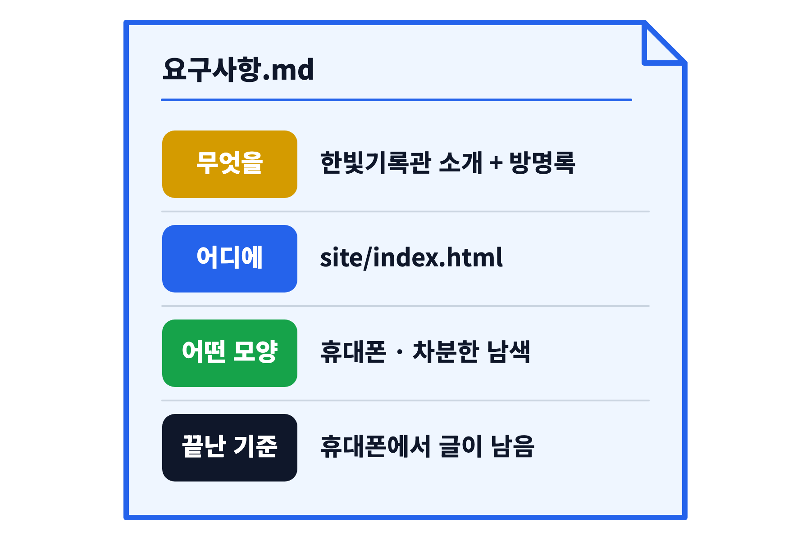

* 프롬프트 ① 의 줄머리 `-` 도 Markdown 목록 — 적어 두면 **다음에도 그대로 다시 씀**

---

## 프롬프트 ① 홈페이지 뼈대
#id-prompt1

```text
site 폴더에 index.html 한 파일로 가상의 «한빛기록관» 소개 홈페이지를 만들어 줘.
- 맨 위: 기관 이름과 한 줄 소개
- 가운데: 소장 기록 · 열람 안내 · 오시는 길 — 카드 3장
- 아래: 방명록 자리 — 이름 · 한 줄 입력칸, «남기기» 버튼, 글 목록 (저장은 아직 안 해도 됨)
- 휴대폰에서도 보기 좋게, 한국어, 차분한 남색 계열
- 설치가 필요 없는 HTML · CSS · JavaScript 만 사용
```

* 문장은 바꿔도 됨 — **무엇을 · 어디에 · 어떤 모양으로** 만 분명하면 됨

---

## 결과 보기
#id-preview

::: htmlart numbered
* 탐색기에서 site 폴더 열기
* index.html 을 ego 창에 끌어 놓기
* F12 → 기기 아이콘 — 휴대폰 크기로 보기
:::

* ego 창 위쪽 주소가 `file:///…/index.html` 이면 내 PC 의 파일을 보는 중

---

## 말로 다듬기
#id-refine

::: htmlart numbered
* 제목을 더 크게, 카드에 아이콘을 넣어 줘
* 글씨가 작아 — 어르신도 읽기 쉽게 키워 줘
* 오시는 길 카드에 운영 시간을 추가해 줘
* 방금 바꾼 것 되돌려 줘
:::

* 고칠 곳 하나 · 원하는 모양 하나 — 한 번에 하나씩 말할수록 정확함

---

## 막히면 — 만들기 편
#id-stuck-1

::: htmlart block
* 화면이 하얗게 나옴 — F12 → Console 의 빨간 글자를 복사해 Claude 에게 붙여 넣음
* 원하던 모양이 아님 — 무엇이 어떻게 다른지 한 문장으로 다시 말함
* 엉망이 됨 — «처음 만든 상태로 되돌려 줘»
* 답이 오래 멈춤 — 패널의 중지 버튼을 누르고 다시 요청
:::

---

<!-- ═══ 5. 저장 — 10:15 ~ 10:35 ═══ -->

# 5. 저장 — Supabase 방명록

---

#layout-_mg
#id-mg-supabase

## 저장 — Supabase

<iframe class="mg3d" src="./img/mg3d/mg.htm?scene=supabase" title="저장 — Supabase 3D 모션그래픽" style="display:block;width:1920px;height:1280px;border:0;pointer-events:none;"></iframe>

---

## 지금 방명록의 한계
#id-limit

::: htmlart compare
* **지금** / 화면 안에만 있음
  - 새로고침하면 글이 사라짐
  - 내 PC 에서만 보임
* **Supabase 연결 뒤** / 인터넷 장부에 적힘
  - 새로고침해도 남음
  - 누가 접속해도 같은 글이 보임
:::

* 구구단 퀴즈 점수가 사라진 것과 같은 이유 — **기억해 두는 곳**이 없었음

---

## Supabase — 인터넷 위의 엑셀
#id-sb-what

::: htmlart matrix
* 표(Table) = 엑셀 시트
* 행(Row) = 방명록 글 한 건
* SQL = 표를 만드는 주문서
* RLS = 표에 거는 자물쇠
:::

* 무료로 프로젝트 2개까지 — 이번 실습은 1개

---

## 방명록이 저장되는 길 <!-- nosplit -->
#id-sb-flow

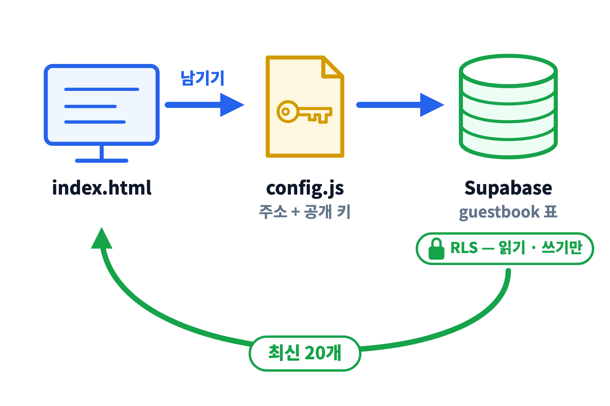

* 화면은 Claude 가, 표는 SQL 이, 둘을 잇는 두 값은 **config.js** 가 맡음

---

## 방명록 표 설계
#id-table

| 칸         | 뜻               | 예               |
| :--------- | :--------------- | :--------------- |
| id         | 글 번호 (자동)   | 1                |
| name       | 이름             | 방문객           |
| message    | 한 줄            | 잘 보고 갑니다   |
| created_at | 작성 시각 (자동) | 2026-11-13 10:20 |

* 표 이름은 **guestbook** — 이름 · 칸 이름은 영어 소문자로 둠

---

## 프롬프트 ② 표를 만드는 SQL
#id-prompt2

```text
방명록 글을 Supabase 에 저장하려고 해. SQL Editor 에 붙여 넣을 SQL 을 supabase.sql 파일로 만들어 줘.
- 표 이름 guestbook: id, name, message, created_at
- name 은 20자, message 는 200자 이내
- RLS 를 켜고, 누구나 읽기 · 쓰기만 가능 (수정 · 삭제는 불가)
- 브라우저용 공개 키(anon)로 쓸 수 있게 필요한 grant 도 포함
- 각 줄에 한국어 주석
```

---

## SQL 실행
#id-sql-run

::: htmlart numbered
* supabase.sql 전체 복사
* SQL Editor → New query
* 붙여 넣고 Run → «Success» 확인
* Table Editor 에서 guestbook 표 확인
:::

* 경고 창이 뜨면 바로 누르지 말고 — 경고 문장을 Claude 에게 붙여 넣어 무슨 뜻인지 물음

---

## 어려우면 — SQL 실행을 ego 에 맡기기
#id-sql-ego

```text
ego-browser skill 을 먼저 실행해 사용법을 읽고, ego 로 Supabase 의 archives-homepage 프로젝트 SQL Editor 를 열어 supabase.sql 을 실행해 줘.
- 로그인 · 비밀번호 입력 · 경고 창 승인이 필요하면 멈추고 나에게 물어
- 끝나면 Table Editor 에서 guestbook 표가 보이는지 확인해 알려 줘
```

* 사람은 **ego 에서 Supabase 에 로그인만** 해 두면 됨 — 경고 창은 Claude 가 묻고 사람이 판단

---

## RLS — 표에 거는 자물쇠
#id-rls

::: htmlart compare
* **RLS 꺼짐** / 열쇠만 있으면 전부
  - 공개 키로 읽기 · 쓰기 · 고치기 · 지우기
  - 누구나 남의 글을 지울 수 있음
* **RLS 켜짐 + 정책** / 허락한 것만
  - 읽기 · 쓰기만 허락
  - 고치기 · 지우기는 막힘
:::

---

## 열쇠는 두 개 <!-- nosplit -->
#id-keys

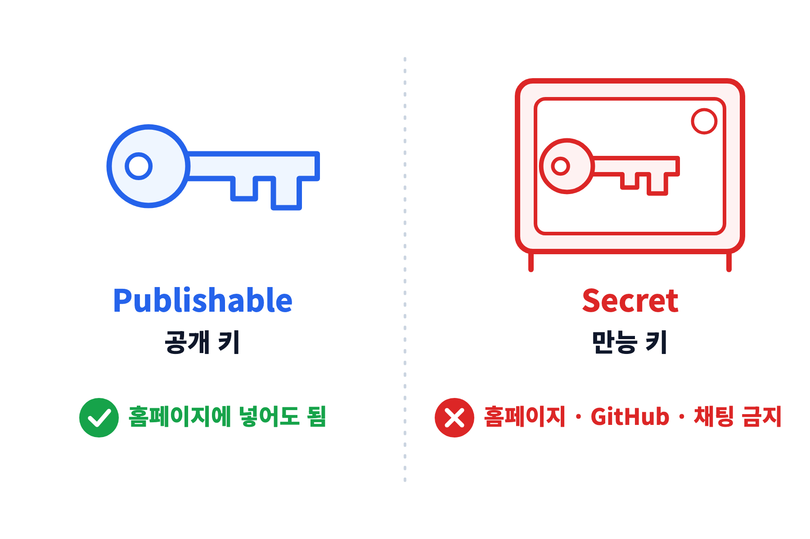

* 찾는 곳 — **Project Settings → API Keys** · 예전 이름은 anon(공개) · service_role(만능) (메뉴 이름은 바뀔 수 있음)

---

## 프롬프트 ③ 화면과 연결
#id-prompt3

```text
site/index.html 의 방명록을 Supabase 의 guestbook 표와 연결해 줘.
- 주소와 공개 키는 site/config.js 에 따로 두고, 내가 붙여 넣을 자리를 비워 둬
- supabase-js 는 CDN 으로 불러와 줘 (설치 없이)
- «남기기»를 누르면 저장하고, 최신 20개를 새 글이 위로 오게 보여 줘
- 실패하면 이유를 화면에 한국어로 보여 줘
```

---

## config.js 에 두 값 넣기
#id-config

::: htmlart numbered
* Project URL 복사
* Publishable key 복사
* site/config.js 빈자리에 붙여 넣기
* Ctrl + S 로 저장
:::

* 어려우면 Claude 에게 «이 주소와 키를 config.js 에 넣어 줘» 하고 두 값을 붙여 넣어도 됨 — **publishable 키만**

---

## 어려우면 — 두 값 옮기기도 ego 에 맡기기
#id-config-ego

```text
ego 로 Supabase 의 archives-homepage 프로젝트 Project Settings → API Keys 를 열어 Project URL 과 publishable 키(sb_publishable_ 로 시작)를 읽어 site/config.js 에 넣어 줘.
- secret 키(sb_secret_)는 읽지도 쓰지도 마
- 넣은 뒤 config.js 내용을 보여 줘
```

* 키를 사람이 복사하지 않아 **잘못 복사할 일이 없음** — 대신 결과를 눈으로 확인

---

## 확인 — 새로고침해도 남는가
#id-check-db

::: htmlart numbered
* ego 창에서 index.html 새로고침
* 방명록에 이름 · 한 줄 남기기
* 다시 새로고침 — 글이 남아 있으면 성공
* Table Editor 에도 같은 글이 보임
:::

---

## 막히면 — 저장 편
#id-stuck-2

::: htmlart block
* row-level security · permission denied — 정책 · 권한 문제, 오류 문장을 그대로 Claude 에게
* Invalid API key — 키를 잘못 복사함, publishable 키를 다시 복사
* 글 목록이 비어 있음 — Table Editor 에서 표 이름이 guestbook 인지 확인
* 아무 반응 없음 — F12 → Console 의 빨간 글자를 Claude 에게
:::

---

<!-- ═══ 6. 공개 — 10:35 ~ 10:50 ═══ -->

# 6. 공개 — Cloudflare

---

#layout-_mg
#id-mg-cloudflare

## 공개 — Cloudflare

<iframe class="mg3d" src="./img/mg3d/mg.htm?scene=cloudflare" title="공개 — Cloudflare 3D 모션그래픽" style="display:block;width:1920px;height:1280px;border:0;pointer-events:none;"></iframe>

---

## Cloudflare Pages — 인터넷 진열대
#id-pages

::: htmlart matrix
* 폴더를 올리면 주소가 생김
* 주소 = 이름.pages.dev
* 무료 · 서버 관리 없음
* 고치면 다시 올리기만
:::

---

## 폴더 하나가 주소가 되기까지 <!-- nosplit -->
#id-deploy-path

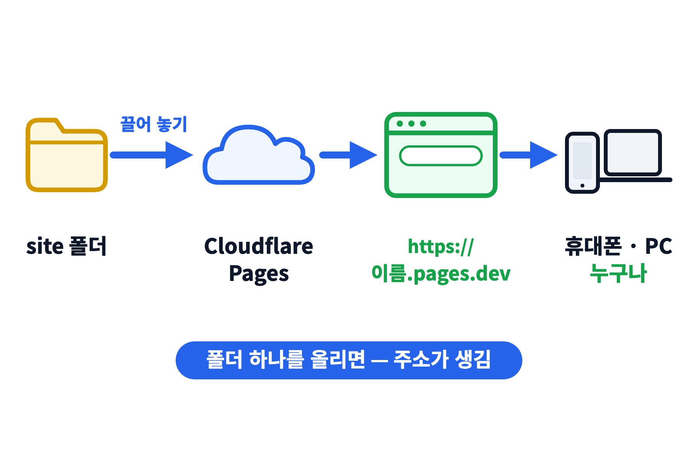

* 구구단의 `file:///` 주소가 **`https://` 주소**로 바뀌는 순간

---

## 올리는 순서
#id-upload

::: htmlart numbered
* 왼쪽 메뉴 Workers & Pages → Create
* Pages → Upload assets (직접 올리기)
* 프로젝트 이름 정하기 — 주소가 됨
* site 폴더를 끌어 놓고 Deploy
:::

* 메뉴 이름은 Cloudflare 업데이트로 바뀔 수 있음 — «Pages» · «Upload» 가 들어간 버튼을 찾음

---

## 올릴 것 · 올리지 않을 것
#id-what-upload

::: htmlart compare
* **올리는 것** / site 폴더
  - index.html
  - config.js (공개 키만 들어 있음)
* **올리지 않는 것** / 내 PC 에만
  - supabase.sql
  - 비밀번호 · secret 키를 적은 메모
:::

---

## 확인 — 휴대폰으로 접속
#id-phone

::: htmlart numbered
* 받은 주소(…pages.dev)를 휴대폰으로 열기
* 옆 사람 주소에 방명록 남기기
* 내 주소에 옆 사람 글이 보이면 완성
* 주소가 안 열리면 1~2분 뒤 다시
:::

---

## 고친 뒤 다시 올리기
#id-redeploy

::: htmlart numbered
* Claude 에게 수정 요청
* ego 로 확인
* 다시 올리기 — Create new deployment
* site 폴더를 끌어 놓고 휴대폰으로 확인
:::

* 고칠 때마다 1 → 4 반복 — 이 반복을 자동으로 하는 방법이 부록 A

---

<!-- ═══ 7. 정리 — 10:50 ~ 11:00 ═══ -->

# 7. 정리

---

## 2시간 동안 한 일
#id-recap

::: htmlart numbered
* 구구단 — 내 PC 안에서 1분 만에
* 계정 — ego 와 가입 세 곳
* 화면 — 요청서대로 만든 홈페이지
* 저장 — Supabase 방명록
* 공개 — pages.dev 주소
:::

---

## 앞으로 — 말로 고치는 홈페이지 <!-- nosplit -->
#id-cycle

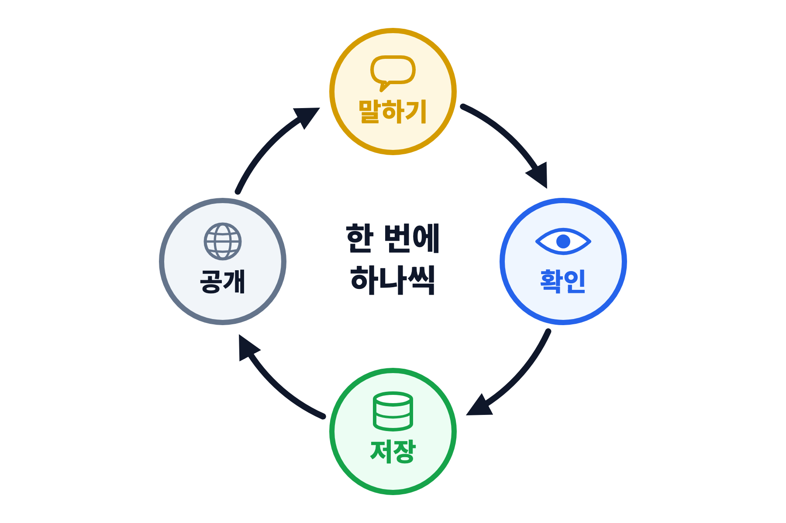

* 구구단에도 같은 순환을 붙일 수 있음 — 점수판은 Supabase, 주소는 Cloudflare

---

## 더 해 보고 싶다면 — 부록
#id-next

::: htmlart bracket
* 부록 A — GitHub 연동
  - 고치고 올리면 자동으로 배포
* 부록 B — Google 로그인
  - 로그인한 사람만 글쓰기
* 부록 C — 프롬프트 한 장
  - 만들기부터 공개까지 자동으로
:::

* 수업 중에는 다루지 않음 — 이미 익숙한 사람은 부록을 보며 스스로 진행

---

## 실습 뒤 정리
#id-cleanup

::: htmlart numbered
* 방명록 글 지우기
  - Table Editor 에서 행 삭제
* 쓰지 않으면 Supabase 프로젝트 일시정지
  - 무료 프로젝트는 오래 안 쓰면 자동 정지
* Cloudflare 프로젝트는 무료로 남음
  - 필요 없으면 Delete
* 비밀번호 메모는 안전한 곳으로
:::

---

## 질의응답
#id-qna

::: htmlart callout
* 💬 질의응답
* **막힌 화면을 그대로 보여 주기**
* 오류 문장|화면 캡처|하려던 일
:::

---

<!-- ═══ 부록 A — GitHub 연동 (수업 중 진행 안 함) ═══ -->

# 부록 A — GitHub 연동

---

## 왜 GitHub 를 붙이나
#id-a-why

::: htmlart compare
* **직접 올리기** / 지금 방식
  - 고칠 때마다 폴더를 다시 끌어 놓음
  - 무엇이 바뀌었는지 기록이 없음
* **GitHub 연동** / 부록 A
  - Claude 가 올리면(push) 자동으로 배포
  - 바뀐 기록이 모두 남고 되돌릴 수 있음
:::

---

## 주의 — Pages 프로젝트를 새로 만듦
#id-a-warn

::: htmlart block
* 직접 올리기로 만든 Pages 프로젝트는 Git 연동으로 바꿀 수 없음
* Git 연동용 Pages 프로젝트를 새로 만듦 — 주소가 바뀜
* 새 주소가 동작하면 옛 프로젝트는 지워도 됨
* Google 로그인(부록 B)을 붙였다면 새 주소를 다시 등록
:::

---

## A-1 저장소 만들기
#id-a-repo

::: htmlart numbered
* ego 에서 GitHub → New repository
* 이름 — archives-homepage
* Private 선택
  - 공개 저장소에는 비밀값이 영원히 남음
* Create repository → 주소 복사
:::

---

## A-2 프롬프트 — 저장소에 올리기
#id-a-push

```text
이 폴더를 git 저장소로 만들고, GitHub 의 archives-homepage 저장소에 올려 줘.
- 저장소 주소: https://github.com/<내 아이디>/archives-homepage
- git 이 설치돼 있지 않으면 설치 방법부터 알려 줘
- 비밀번호 · secret 키가 든 파일은 올리지 마
```

* 처음 올릴 때 GitHub 로그인 창이 뜸 — 사람이 로그인하고 승인

---

## A-3 Cloudflare 와 연결
#id-a-connect

::: htmlart numbered
* Create → Pages → Connect to Git
* GitHub 승인 → 저장소 선택
* 빌드 설정
  - Framework preset None · Build command 비움 · Build output directory site
* Save and Deploy
:::

---

## A-4 이후 — 말하면 배포까지
#id-a-loop

::: htmlart numbered
* Claude 에게 수정 요청
* «커밋 · 푸시해 줘»
* Cloudflare 가 자동으로 배포 (1~2분)
* 주소에서 확인
:::

* ex) «제목 색을 바꾸고 커밋 · 푸시해 줘» — 한 문장으로 수정부터 배포까지

---

<!-- ═══ 부록 B — Google 로그인 (수업 중 진행 안 함) ═══ -->

# 부록 B — Google 로그인

---

## 무엇이 달라지나
#id-b-what

::: htmlart compare
* **지금** / 누구나 글쓰기
  - 이름을 아무렇게나 적을 수 있음
  - 장난 글을 막기 어려움
* **Google 로그인 뒤** / 로그인한 사람만
  - Google 계정 이름이 자동으로 들어감
  - 읽기는 누구나, 쓰기는 로그인한 사람만
:::

---

## 세 곳을 잇는 흐름
#id-b-flow

::: htmlart process
* 홈페이지
  - 로그인 버튼
* Google
  - 계정 확인
* Supabase
  - 로그인 처리
* 홈페이지
  - 글쓰기 허용
:::

* 준비 순서 — Google 쪽 클라이언트 → Supabase 설정 → Claude 프롬프트

---

## B-1 Google 클라이언트 만들기
#id-b-google

::: htmlart numbered
* 새 프로젝트 만들기
  - console.cloud.google.com
* Google Auth Platform → 시작하기
  - 대상 «외부» · 테스트 사용자에 내 메일
* Clients → Create client
  - 유형 «웹 애플리케이션»
* 주소 두 개 등록 (다음 장)
* Client ID · Client Secret 복사
:::

---

## B-2 주소 두 개 — 틀리면 로그인이 안 됨
#id-b-uris

| 칸                     | 넣을 주소                                    |
| :--------------------- | :------------------------------------------- |
| 승인된 JavaScript 원본 | `https://내주소.pages.dev`                   |
| 승인된 리디렉션 URI    | `https://<ref>.supabase.co/auth/v1/callback` |

* `<ref>` = Supabase Project URL 의 앞부분 — 끝에 `/` 를 붙이지 않음
* Google 쪽 저장 뒤 반영까지 몇 분 걸릴 수 있음

---

## B-3 Supabase 쪽 설정
#id-b-supabase

::: htmlart numbered
* Google 켜기
  - Authentication → Sign In / Providers
* Client ID · Secret 붙여 넣기 → Save
* 돌아올 주소 등록
  - Authentication → URL Configuration
  - Site URL · Redirect URLs 에 pages.dev 주소
* Client Secret 은 Supabase 에만
  - 홈페이지 · GitHub · 채팅 금지
:::

---

## B-4 프롬프트 — 로그인 붙이기
#id-b-prompt

```text
방명록에 Google 로그인을 붙여 줘.
- 위쪽에 «Google 로 로그인» · «로그아웃» 버튼
- 로그인한 사람만 글을 쓸 수 있고, 이름은 Google 계정 이름으로 자동 입력
- guestbook 표에 작성자 계정(user_id) 칸을 더하고, 본인 계정으로만 쓰게 하는 RLS 정책을 supabase.sql 에 추가
- 로그인 뒤 돌아올 주소는 지금 열린 페이지 주소로
```

* 새 SQL 실행 → 다시 올리기 → **pages.dev 주소에서** 확인 (내 PC 파일로는 로그인 확인이 안 됨)

---

<!-- ═══ 부록 C — 프롬프트 한 장 자동 실행 (수업 중 진행 안 함) ═══ -->

# 부록 C — 프롬프트 한 장 자동 실행

---

## 사람의 일 · Claude 의 일
#id-c-split

::: htmlart compare
* **사람만 할 수 있는 것** / 먼저 끝내 둠
  - 가입 · 로그인 · 인증 메일
  - 결제 · 비밀번호 입력
  - 결과 확인과 승인
* **Claude 에게 맡길 것** / 프롬프트 한 장
  - 화면 · SQL · 설정 파일 만들기
  - SQL 실행 · 배포 명령
  - 브라우저로 결과 확인
:::

---

## 사전 준비 — 한 번만 <!-- nosplit -->
#id-c-prep

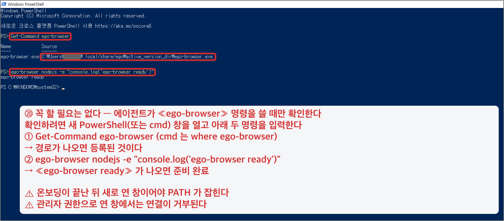

* ego 로그인 유지 → Node.js 설치 → `npx wrangler login` → 위 화면처럼 «ego-browser ready» 확인

---

## PROMPT.md — 다섯 칸
#id-c-prompt

::: htmlart block
* 목표 — 무엇을 만들어 어디에 공개하나
* 재료 — 쓸 서비스 · 프로젝트 이름 · 폴더
* 순서 — 만들기 → SQL → 연결 → 배포 → 확인
* 지킬 것 — 비밀값 금지 · 멈추고 물을 자리
* 끝난 기준 — 주소에서 글이 저장되면 완료
:::

* 전문은 실습 자료 «실습_프롬프트.md» 부록 C — 복사해 폴더에 PROMPT.md 로 저장

---

## 실행 — 한 줄이면 됨
#id-c-run

```text
PROMPT.md 대로 처음부터 끝까지 진행해 줘. 단계가 끝날 때마다 한 줄로 보고해 줘.
```

::: htmlart block
* 승인 창은 처음엔 하나씩 읽고 누름 — 자동 승인은 익숙해진 뒤
* Claude 가 멈추고 물으면 — 사람이 로그인 · 결제를 처리하고 «계속»
* 끝나면 받은 주소를 직접 열어 확인
:::

---

<!-- ═══ 참고 ═══ -->

# 참고

---

## 참고 링크
#id-links

| 무엇                         | 주소                                                                 |
| :--------------------------- | :------------------------------------------------------------------- |
| ego (lite) 내려받기          | https://lite.ego.app                                                 |
| Supabase 대시보드            | https://supabase.com/dashboard                                       |
| Supabase API 키 설명         | https://supabase.com/docs/guides/api/api-keys                        |
| Supabase Google 로그인       | https://supabase.com/docs/guides/auth/social-login/auth-google       |
| Cloudflare Pages 직접 올리기 | https://developers.cloudflare.com/pages/get-started/direct-upload/   |
| Cloudflare Pages Git 연동    | https://developers.cloudflare.com/pages/get-started/git-integration/ |
| Google Cloud 콘솔            | https://console.cloud.google.com                                     |

* 메뉴 이름 · 화면은 2026.11 기준 — 서비스 업데이트로 바뀔 수 있음
