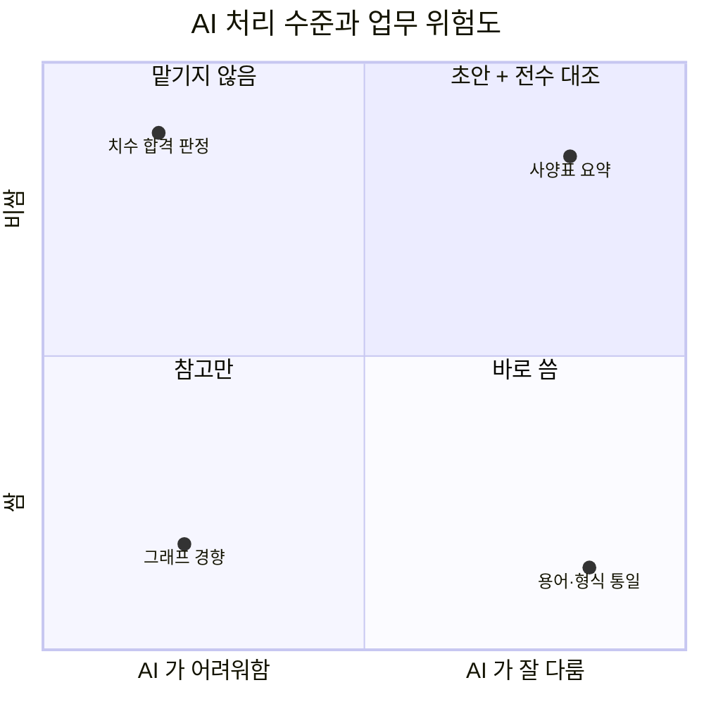
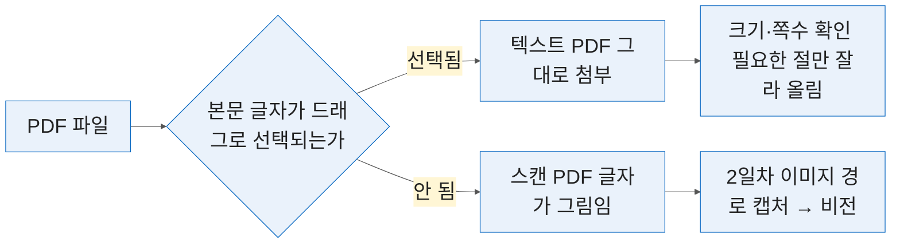

# 1일차 — 생성형 AI R&D 활용과 사양서 요약
#layout-chapter

::: part
Day 1.
:::

---

#id-mg-flow
#layout-_mg

## 6일 강의 흐름 — 읽기에서 쌓기까지

```mg
src: mg/00-flow
```

---

#id-mg-day1
#layout-_mg

## 읽기 — 사양서 한 권이 표 한 장으로

```mg
src: mg/01-day1
```

---

## 1-0. 여는 절 — 6일 강의 흐름
#layout-contents-full

::: htmlart timeline
* 1일차 — **읽기**
  - 사양서·매뉴얼·표준을 요약하고 핵심을 표로 뽑음
* 2일차 — **보기**
  - 도면을 이미지로 올려 부품·치수·기호를 읽힘
* 3일차 — **찾기**
  - 특허·논문·표준을 검색하고 여러 자료를 묶어 물음
* 4일차 — **쓰기**
  - 기술 보고서·시험 성적서·영문 초록을 초안으로 받음
* 5일차 — **남기기**
  - 명세서 초안을 쓰고 표준 개정을 추적함
* 6일차 — **쌓기**
  - 사내 문서를 지식베이스로 묶고 검증을 표준화함
:::

---

### 이 과정의 두 원칙 — 검증을 붙임, 순서를 바꿈
#layout-contents
#id-two-principles

* 설계·R&D 에서는 틀린 치수 하나, 틀린 청구항 한 줄이 그대로 사고가 됨.
* 그래서 이 과정의 모든 실습에는 검증 포인트가 붙음. 무엇을 확인해야 제대로 된 것인지를 실습마다 명시함.
* AI 는 담당자의 판단을 대신하지 않음. 다만 판단에 들어가기까지의 시간을 줄임.
* 바뀌는 것은 속도가 아니라 순서임. 전부 읽고 판단하던 일이, 먼저 추려 놓고 확인하는 일로 바뀜.

::: htmlart compare
* 검증을 붙임
  - 그대로 쓰지 않음
  - 실습마다 확인 지점을 명시함
* 순서를 바꿈
  - 먼저 추리고 확인함
  - 전부 읽고 판단하지 않음
:::

---

### 6일 동안 쓰는 도구 — 브라우저, 지급 계정, 설치 3종
#layout-contents
#id-tools-overview

* 코드는 직접 쓰지 않음. 시켜서 받고, 복붙해 돌리고, 맞는지 확인함.

::: cards
* **ChatGPT**
  - 지급 계정 1인 1개. 문서·이미지 분석과 표 생성의 주력 도구
* **Gemini Notebook**
  - 개인 구글 계정. 여러 자료를 묶어 출처와 함께 답하게 함
* **설치 3종**
  - VSCode+Codex(1일차) | Tesseract — 도면 글자 인식(2일차) | Obsidian — 문서 정리(5일차)
* **검색 사이트**
  - KIPRIS·Google Patents·Google Scholar. 로그인 없이 조회함
:::

---

### VSCode 와 Codex — 코드는 AI 가 쓰고 우리는 돌려서 확인함
#layout-contents
#id-vscode-codex

지급 계정으로 Codex 를 함께 쓸 수 있음. Codex 는 VSCode 안에서 한국어 지시를 받아 코드를 대신 쓰고 실행까지 하는 도구임.

::: htmlart process
* 자연어로 시킴
  - 「불량 행만 골라 표로」
* AI 가 씀
  - 읽지 않아도 됨
* 돌려서 봄
  - 승인하면 그 자리에서 실행
* 맞는지 봄
  - 합계·건수를 원본과 대조
:::

* 문법을 배우지 않음. 무엇을 시킬지 정하고, 나온 결과가 맞는지 가려내는 것만 함.
* 쓰는 자리는 셋임 — 3일차 시험 데이터 정리 스크립트, 3일차 특허 자료 수집, 4일차 합격 판정 로직.

---

### VsCode 란 무엇인가 — 개발자 도구이자 고급 편집기
#layout-contents
#id-coa-vscode-what

VSCode 는 Microsoft 가 만든 무료 편집기임. 개발자 도구로 알려져 있으나 설치와 사용에 자격이 필요하지 않아 일반 실무자도 그대로 씀.

::: htmlart hexagon
* 개발자 도구
  - Microsoft 가 배포하는 무료 도구. 라이선스 비용이 없음
* 경량 편집기
  - Windows·macOS·Linux 어디서나 같은 화면으로 동작함
* 프로그래머 전용 아님
  - 코딩을 하지 않는 사람도 파일 편집기로 씀
:::

* 이 과정에서 VSCode 를 쓰는 이유는 코딩이 아니라 **Codex 를 담을 그릇**이 필요해서임.

---

### VSCode 주요 기능 5종 — 이 과정에서 실제로 쓰는 것은 둘
#layout-contents-full
#id-coa-vscode-features

::: htmlart bracket
* 코드 편집
  - 자동 완성·구문 강조·들여쓰기
  - 플러그인으로 언어·프레임워크 확장
* 디버깅
  - 중단점을 걸고 변수 값을 확인함
  - 이 과정에서는 쓰지 않음
* Git 통합
  - 변경 내역 추적·비교·병합
  - 이 과정에서는 쓰지 않음
* 플러그인 생태계
  - 확장 아키텍처. **Codex 가 여기로 들어옴**
* 통합 터미널
  - 편집기 안에서 명령을 실행함
  - **Codex 가 만든 스크립트가 여기서 돌아감**
:::

* 다섯 중 이 과정이 쓰는 것은 **플러그인 생태계와 통합 터미널** 둘임. 나머지는 알아 두되 손대지 않음.

---

### VSCode 내려받기 — `code.visualstudio.com`
#layout-contents
#id-coa-vscode-download


* 접속하면 쓰는 OS 에 맞는 버튼이 먼저 보임. macOS 면 `Download Mac Universal`, Windows 면 Windows 설치 파일임.
* 사내망에서 막히면 사전 배포한 설치 파일을 씀. 실습 P1-0-3 의 폴백임.

---

### 🖥️ 시연 — Codex 가 안 열리면 무엇으로 가는가
#layout-contents
#id-codex-fallback

::: htmlart callout
* 📌 막혔을 때
* **안 되면 손을 듦** | 혼자 붙잡지 않음
* **안내에 따라 넘어감** | 다 같이 감
* 만든 것은 먼저 저장함
:::

* 🚫 Gemini Code Assist 는 쓰지 않음. 설치는 되고 로그인에서 멈춰 시간만 버림.

---

### 🙋 실습 P1-0-1 — ChatGPT 지급 계정 로그인과 첫 질의
#layout-exercise-small
#id-ex-p1-0-1

* **시간** 8분 | **목표** 지급 계정으로 로그인해 첫 답을 받음
* 단계 — `chatgpt.com` 우상단 **Log in** → 지급 계정 → 프롬프트 실행
* **완료조건** 세 문장 답변 ✅ 로그아웃이면 업로드가 막힘 | 단축키 `Ctrl+/`


```text
너는 기계설계 분야의 기술 문서를 검토하는 선임 엔지니어다.
공차와 표면조도의 차이를 실무자에게 설명하듯 세 문장으로 정리하라.
```

---

### 🙋 실습 P1-0-2 — Google 개인 계정과 Gemini Notebook 진입
#layout-exercise-small
#id-ex-p1-0-2

* **시간** 7분 | **목표** 3일차에 쓸 노트북 자리를 미리 열어 둠
* 단계 — `notebook.google.com` **주소가 바뀜** → 빈 노트북 생성 → 소스 추가 버튼 확인
* **완료조건** 소스 추가 화면이 열림 ✅ 자료를 넣는 것은 3일차임


---

### 🙋 실습 P1-0-3 — VSCode 와 Codex 설치·로그인, 첫 지시 한 줄
#layout-exercise
#id-ex-p1-0-3

* **시간** 12분 | **목표** AI 가 쓴 코드를 내 PC 에서 돌릴 곳 만듦
* 단계 — **폴더 열기** → `Ctrl+Shift+X` → **Codex** ① 플랜 확인 ② 설치 → **Sign in with ChatGPT** 로 지급 계정 인증 (CLI 불필요)
* **완료조건** `hello.txt` 가 생성됨 ✅ 🔴 막히면 손을 듦


```text
지금 열린 폴더에 hello.txt 를 만들고 오늘 날짜를 한 줄 써 줘.
```

---

### 🙋 실습 P1-0-4 — 10개 도메인 접속 점검표
#layout-exercise-small
#id-ex-p1-0-4

* **시간** 6분 | **목표** 6일 동안 쓸 도메인이 전부 열리는지 미리 확인함
* 단계 — 아래 도메인을 차례로 열기 → 안 열리는 곳 표시 → 사내망 차단 여부 확인
* **완료조건** 표의 도메인이 전부 열림 ✅ 막히는 곳이 있으면 즉시 손을 듦

| 일차    | 도메인                                               |
| :------ | :--------------------------------------------------- |
| 1일차   | `chatgpt.com`, `notebook.google.com`                 |
| 1일차   | `gemini.google.com`, `drive.google.com`              |
| 1일차   | `marketplace.visualstudio.com`, `antigravity.google` |
| 3~4일차 | `patents.google.com`, `kipris.or.kr`                 |
| 3~4일차 | `scholar.google.com`, `gamma.app`                    |

---

## 1-1. R&D 데이터와 LLM·비전 LLM 의 능력·한계
#layout-contents

기획서나 보고서는 문장으로 되어 있어 AI 가 비교적 잘 다룸. R&D 자료는 성격이 다름.

::: htmlart tab
* 도면
  - 그림 안의 숫자가 의미를 가짐
  - 글자를 읽는 방식으로는 닿지 않음
* 사양서
  - 표가 본문이고 조건은 각주에 숨음
  - 표만 옮기면 조건이 떨어져 나감
* 시험 데이터
  - 수식과 단위가 붙어 있음
  - 하나만 틀려도 결론이 뒤집힘
:::

핵심은 한 문서 안에 성격이 다른 자료가 섞여 있다는 것임. 그래서 문서 단위가 아니라 자료 종류 단위로 다뤄야 함.

---

### 인공지능의 탄생 — 1956년 다트머스 회의
#layout-contents
#id-coa-ai-birth

AI 기술은 1956년 다트머스 회의에서 공식적으로 시작됨.

::: htmlart radial
* 기계가 인간처럼 학습하고 문제를 해결할 수 있는 능력
* 1956년 다트머스 회의
  - 제안서 1955.08.31 · 4인 서명
  - 매카시 · 민스키 · 로체스터 · 섀넌
* 70년째 바뀌지 않은 정의
* 지금 쓰는 도구도 이 위에 있음
:::

* 제안서에 **「artificial intelligence」라는 말이 처음 쓰임**. 2개월 10인 연구를 제안한 17쪽짜리 문서였고, 서명자는 매카시·민스키·로체스터·섀넌 네 사람임.
* 지금 쓰는 도구는 그 정의의 최신 구현일 뿐이고, **학습한 것을 흉내 내는 성질**은 그대로임.
* 이 성질이 뒤에 나올 한계와 직결됨 — 배운 적 없는 사내 사양서는 그럴듯하게 지어낼 수 있음.

---

### 인공지능의 발전 역사 — 두 번의 겨울과 세 번째 붐
#layout-contents-full
#id-coa-ai-history


* 1960년대는 **기호주의**였음. 규칙 기반 시스템과 전문가 시스템이 개발됨.
* 1980년대에 **기계 학습**의 초석이 마련되며 컴퓨터가 데이터로 배우기 시작함.
* 2010년대 **딥러닝**이 제3차 붐을 열었고 알파고·챗GPT 가 그 끝에 있음.

---

### AI 가 사회에 미친 영향 — 의료·교육·금융
#layout-contents
#id-coa-ai-society

::: cards
* **의료**
  - 딥마인드가 안과 스캔을 읽고 **전문의에게 보낼지를 권고**함 (Nature Medicine 2018)
* **교육**
  - 맞춤형 학습 경험과 온라인 플랫폼으로 접근성이 높아짐
* **금융**
  - 사기 탐지·알고리즘 트레이딩·개인화 상담에서 효율과 안정성을 높임
:::

* 의료 사례의 요점은 **AI 가 진단을 확정하지 않는다**는 것임. 판독 결과로 「전문의에게 보낼 것인가」를 권고하고 확정은 사람이 함.
* 세 분야 모두 **판단의 근거를 사람이 다시 확인하는 구조**를 유지함. 이 과정이 잡으려는 태도와 같음.

---

### AI 가 산업에 미친 변화 — 제조업이 첫 자리
#layout-contents
#id-coa-ai-industry

::: htmlart block
* 제조업 — 생산 공정 최적화·품질 향상·유지보수 예측
* 자동차 — 자율 주행의 핵심 역할
* 소매·마케팅 — 행동 분석·맞춤 추천·서비스 자동화
:::

* 제조 현장에서 AI 가 먼저 닿은 곳은 **공정과 설비**임. 이 과정이 다루는 것은 그 앞단의 자료 — 사양서·도면·표준임.
* 설비를 바꾸지 않아도 **자료를 읽는 시간**은 지금부터 줄일 수 있음.

---

### DeepLearning 이해 — 신경망·역전파·활성화 함수
#layout-contents
#id-coa-deeplearning

::: htmlart arrow
* 학습된 모델
* 신경망 구조
  - 입력층·은닉층·출력층
* 역전파 알고리즘
  - 오차를 줄이도록 가중치를 조정함
* 활성화 함수
  - 비선형성을 넣어 복잡한 패턴을 다룸
:::

* 내부 구조를 외울 필요는 없음. 다만 **오차를 줄이는 방향으로 학습한다**는 점이 뒤의 한계를 설명함 — 평균적으로 그럴듯한 답이 나오고, 드문 예외는 뭉개짐.
* 사양서의 **각주 조건**이 바로 그 드문 예외임.

---

### LLM 의 의미와 정의
#layout-contents
#id-coa-llm-def

LLM 은 Large Language Models 의 약자로 대규모 언어 모델을 뜻함.

::: htmlart bracket
* 의미 — 이름이 말하는 것
  - Large — 방대한 텍스트 데이터를 학습함
  - Language — 자연어 이해(NLU)와 생성(NLG)
  - Models — 학습으로 만들어진 모델임
* 정의 — 무엇으로 만들어졌나
  - 수십억 개의 파라미터로 구축된 알고리즘
  - 배운 것의 범위 안에서만 답함
  - 사내 자료는 그 범위 밖임
:::

* 「대규모」는 학습한 텍스트의 양을 가리킴. 그 안에 **우리 회사 사양서는 들어 있지 않음**.
* 그래서 우리 자료는 **올려서** 읽히는 것이고, 올리지 않은 것은 아는 척할 뿐임.

---

### LLM 의 기본 원리 — 무엇을 배우고 무엇을 하는가
#layout-contents
#id-coa-llm-principle

::: htmlart tab
* 학습 프로세스 — 무엇을 배웠나
  - 딥러닝으로 인터넷 텍스트를 학습함
  - 문맥·문법·의미를 함께 익힘
  - 우리 사내 문서는 여기 없음
* 능력 — 무엇을 하나
  - 질문에 답하고 주제에 맞춰 글을 씀
  - 번역·요약·감정 분석도 수행함
  - 요약이 이 과정의 1일차 주제임
:::

* 왼쪽이 **배운 것**, 오른쪽이 **하는 것**임. 둘 사이가 벌어지는 자리에서 환각이 생김.

---

### LLM 이 인공지능 발전에서 차지하는 위치
#layout-contents-full
#id-coa-llm-position

::: htmlart step
* 혁신적인 발전
  - 자연어 처리(NLP)를 앞당기고 상호작용 방식을 바꿈
* 응용 분야의 확장
  - 고객 서비스·콘텐츠·교육·의료로 번짐
* 미래 지향적 기술
  - 대화가 곧 인터페이스가 됨
:::

* 실무자에게 중요한 변화는 하나임 — **도구를 배우는 대신 말로 시키게 됐다는 것**. 그래서 1-2 에서 그 말을 다듬음.

---

### ChatGpt 란 무엇인가 — GPT 라는 이름의 뜻
#layout-contents
#id-coa-chatgpt-what

::: htmlart compare
* **대화형 AI 모델**
  - OpenAI 가 개발함
  - 대화를 생성하고 이해함
* **GPT = Generative Pre-trained Transformer**
  - Generative — 생성함
  - Pre-trained — 미리 학습됨
  - Transformer — 문맥을 다루는 구조
:::

* **Pre-trained** 가 핵심임. **미리** 배운 것으로 답하므로, 미리 배우지 못한 우리 자료는 올려 줘야 함.

---

### ChatGpt 의 기능과 활용 영역
#layout-contents
#id-coa-chatgpt-usage

::: htmlart radial
* ChatGPT
* 자동 응답 시스템
  - 고객 서비스·챗봇의 대화 기능
* 내용 생성
  - 문서·이메일·보고서 작성
* 개인화 서비스
  - 추천 시스템·개인 비서
:::

* 셋 중 R&D 실무에 바로 닿는 것은 **내용 생성**임. 4일차 기술 보고서·성적서가 그 자리임.

---

### ChatGpt 의 장점 — 속도·정확성·다양성
#layout-contents
#id-coa-chatgpt-merit

::: htmlart block
* 빠른 응답 속도 — 실시간 대화에 적합함
* 높은 정확성 — 맥락을 이해해 자연스러운 대화를 생성함
* 다양한 대화 생성 — 여러 주제와 스타일을 다룸
:::

* ⚠️ 여기서 말하는 **「정확성」은 문장의 자연스러움**이지 수치의 정확성이 아님. 이 둘을 구분하지 못하면 표의 숫자를 그대로 믿게 됨.

---

### 업무에서 ChatGpt 를 쓰는 자리 — 실제 사례
#layout-contents
#id-coa-chatgpt-cases

::: cards
* **고객 서비스**
  - 챗봇 문의 응대·예약 시스템 운영
* **글 작성 보조**
  - 이메일·보고서에서 텍스트 생성을 도움
* **학습 및 연구**
  - 자료를 읽고 정리하는 일에 쓰임
:::

* 이 과정이 서는 자리는 셋째임 — **읽고 정리하는 일**. 사양서·매뉴얼·표준이 그 대상임.

---

### ChatGpt 의 한계 3종 — 왜 틀리는가
#layout-contents
#id-coa-chatgpt-limit

::: htmlart funnel
* 긴 문맥을 통째로 넣음
* 일관성이 흐트러짐
* 일부 정보가 조용히 빠짐
* 배운 범위 안의 답만 남음
:::

* 앞서 본 **환각·오독·단위**가 「어떻게 틀리는가」라면, 이 셋은 「왜 틀리는가」임.
* 🔴 **선택적 이해**가 사양서에서 가장 위험함 — 각주와 단서 조항이 떨어져 나가는 자리가 바로 여기임.
* 그래서 1-3 에서 문서를 통째로 올리지 않고 **절 단위로 쪼개** 요약함.

---

### R&D 데이터 5종 — 텍스트·표·도면·이미지·수식
#layout-contents-full

::: htmlart bracket
* 문자로 된 것
  - 텍스트 — 기술 보고서·회의록·특허 명세
  - 표 — 사양서·시험 성적서·BOM
* 그림으로 된 것
  - 도면 — 부품도·조립도·회로도
  - 이미지 — 현미경 사진·파단면·그래프 캡처
* 기호로 된 것
  - 수식 — 응력 계산·열전달·통계 처리
  - 단위 — 환산·유효숫자·공차 기호
:::

* 한 건의 사양서 안에 다섯 종류가 모두 들어 있는 경우가 흔함.
* 올리기 전에 이 문서에서 내가 꺼내려는 것이 어느 종류인가를 먼저 정하면 질문이 짧아짐.

---

### 종류별 AI 처리 수준과 대표 오류 — 부시 도면·데이터시트로 봄
#layout-contents-full

| 종류   | 예시                           | AI 처리 수준 | 대표 오류         |
| :----- | :----------------------------- | :----------- | :---------------- |
| 텍스트 | 기술 보고서·회의록·특허 명세   | 높음         | 전문 용어 오역    |
| 표     | 사양서·시험 성적서·BOM         | 중간         | 병합 셀·각주 누락 |
| 도면   | 부품도·조립도·회로도           | 낮음         | 치수·공차 오독    |
| 이미지 | 현미경 사진·파단면·그래프 캡처 | 낮음         | 정성 판단 불가    |
| 수식   | 응력 계산·열전달·통계 처리     | 중간         | 단위 환산 실수    |

* 낮음이 못 쓴다는 뜻은 아님. 처리 수준이 낮을수록 사람이 확인할 항목이 늘어남.

---

### 텍스트 LLM 과 비전 LLM 은 무엇이 다른가
#layout-contents

::: htmlart compare
* **텍스트 LLM** / 문서의 글자를 읽음
  - 긴 문서의 요약·비교에 강함
  - 표를 다시 표로 옮기는 일을 잘함
  - 그림 속 숫자는 보지 못함
* **비전 LLM** / 이미지를 함께 봄
  - 도면·사진·그래프를 읽음
  - 현행 ChatGPT·Gemini 모델이 해당함
  - 정밀도가 낮아 반드시 검증함
:::

* 두 가지는 별개 서비스가 아님. 같은 서비스 안에 둘 다 들어 있음.

---

### 같은 서비스, 다른 동작 — 무엇을 올렸는가가 가름
#layout-contents

* 같은 ChatGPT 창에 PDF 를 올리면 텍스트 처리가, 이미지를 올리면 비전 처리가 돎. 모드를 고르는 것은 올린 파일의 형식임.
* 결과가 이상할 때 프롬프트부터 고치면 원인을 놓침. 무엇을 올렸는지를 먼저 봄.


* 이 그래프를 읽히려면 캡처해 이미지로 올려야 함. 1-3 에서 다시 다룸.

---

### LLM 이 틀리는 세 가지 방식 — 환각·오독·단위(kg/cm² ↔ N/mm²)
#layout-contents

::: htmlart block
* 환각 — 없는 것을 만들어 냄
* 오독 — 있는 것을 잘못 읽음
* 단위 — 읽은 것을 잘못 옮김
:::

* 환각은 원문에 없는 항목·쪽수·규격을 그럴듯하게 지어내는 것임. 문장이 자연스러워 눈에 잘 띄지 않음.
* 오독은 표의 병합 셀을 한 행으로 합치거나, 범위 값 `-40 ~ +85` 를 한쪽만 남기는 식으로 생김.
* 단위는 셋 중 가장 위험함. 숫자는 맞는데 단위가 틀리면 사람도 잘 잡아내지 못함.
* 세 가지 모두 "모른다고 답할 길"을 열어 주면 크게 줄어듦. 그 방법은 1-2 에서 문장으로 만듦.

---

### AI 처리 수준과 업무 위험도의 2×2
#layout-contents
#id-risk-matrix

::: columns

::: column {width="62%"}

:::

::: column {width="34%"}
* 축이 그림에 적혀 있음. 오른쪽으로 갈수록 AI 가 잘 다루고, 위로 갈수록 틀렸을 때 비쌈.
* 점은 실제 업무임. 자기 일이 어느 칸에 오는지를 찍어 보는 것이 여기서 할 일임.
* 판단이 갈리는 곳은 **오른쪽 위**임. 잘 되기 때문에 그대로 쓰고 싶어지는 자리이자, 틀리면 비싼 자리임.
:::

:::

---

### 맡길 것·초안만 받을 것·맡기지 않을 것
#layout-contents

::: cards
* **🟢 믿고 맡길 수 있음**
  - 긴 문서의 구조 파악, 용어·정의 찾기, 번역 초안, 문장을 표로 바꾸는 형식 변환
* **🟡 초안만 받음**
  - 사양 비교표 작성, 도면에서 부품·치수 추출, 계산과 단위 환산. 반드시 원본과 대조함
* **🚫 맡기지 않음**
  - 합격·불합격 최종 판정, 안전 관련 설계 결정, 특허 등록 가능성 판단
:::

* 구분 기준은 자료의 형식이 아니라 책임 소재임. 결과에 서명하는 사람이 누구인가로 나눔.

---

### 책임은 옮겨지지 않음 — 검증 포인트라는 장치
#layout-contents-full

::: columns

::: column {width="48%"}
::: htmlart radial
* 책임은 옮겨지지 않음
* 검증 포인트를 미리 정함
* 전수가 어려우면 표본
* 확인한 사람과 시점을 남김
* 쓴 사실은 근거가 아님
:::
:::

::: column {width="48%"}
* 검증 포인트란 무엇을 확인하면 제대로 된 것인가를 미리 정해 두는 장치임. 확인할 항목이 정해져 있어야 확인이 실제로 일어남.
* AI 를 썼다는 사실은 책임의 근거가 되지 않음. 검토 기록만이 근거가 됨.
* 그래서 이 과정의 실습은 산출물과 확인 항목을 함께 만듦.
* 회사 규정으로 올릴 때 맨바닥에서 시작하지 않아도 됨 — **ISO/IEC 42001**(AI 경영시스템)과 **NIST AI RMF** 가 이미 같은 구조를 표준으로 갖고 있음. 사내 지침의 뼈대로 그대로 씀.
:::

:::

---

### 🙋 실습 P1-1-1 — 내 업무 자료를 3구분으로 나누기
#layout-exercise
#id-ex-p1-1-1

* **시간** 8분 | **목표** 도구를 익히는 게 아니라 **내 업무에 선을 그음** — 남은 5일의 실습 범위가 여기서 정해짐
* 단계
    - 평소 다루는 업무 자료의 **이름** 5~10개를 적음. 실물은 올리지 않음
    - 예시 — 부품 데이터시트, 조립 도면, 시험 성적서, 작업 표준서, 회의록, 고객 요구사항 문서
    - 각각을 맡길 것 / 초안만 / 맡기지 않을 것으로 **먼저 스스로** 나눠 봄
* **완료조건** 내 손으로 나눈 3구분 목록이 손에 있음 ✅

---

### 🙋 실습 P1-1-2 — 분류 프롬프트 실행과 결과 읽기
#layout-exercise
#id-ex-p1-1-2

```text
나는 제조기업의 설계·R&D 담당자다. 아래 업무 자료를 세 구분으로 나눠라.
(1) 맡길 수 있는 것 (2) 초안만 받고 사람이 대조할 것 (3) 맡기지 않을 것

이유를 한 줄씩 달되, 자료의 형식이 아니라 책임 소재를 근거로 적어라.
애매하면 (2)에 넣고 "판단 보류"라 표시하라.

[업무 자료 목록]
```

* **시간** 9분 | **목표** AI 와 내 3구분이 **갈리는 곳** 찾기 | **단계** 프롬프트 실행 → 비교
* **완료조건** 내 판단과 다른 항목에 표시함 ✅

---

### 🙋 실습 P1-1-3 — ChatGPT 계정 로그인과 첫 프롬프트 작성
#layout-exercise-small
#id-ex-p1-1-3

* **시간** 8분 | **목표** 지급 계정으로 들어가 프롬프트 한 벌을 직접 써 봄
* 단계 — `chatgpt.com` 접속 → 지급 계정 로그인 → 아래 프롬프트 실행 → 답을 눈으로 확인
* **완료조건** 답이 세 문장으로 돌아옴 ✅ 로그인 상태가 아니면 파일 업로드가 막힘

```text
너는 기계설계 분야의 기술 문서를 검토하는 선임 엔지니어다.
미끄럼 베어링 부시에서 공차와 표면조도가 각각 무엇을 보장하는지 세 문장으로 정리하라.
```

---

### 🙋 실습 P1-1-4 — Gemini 가입과 기본 질의
#layout-exercise-small
#id-ex-p1-1-4

* **시간** 7분 | **목표** 같은 질문을 다른 모델에 던져 답이 갈리는 것을 봄
* 단계 — `gemini.google.com` 접속 → 개인 구글 계정 로그인 → P1-1-3 과 **같은 프롬프트** 실행
* **완료조건** 두 답을 나란히 놓고 다른 곳을 한 군데 이상 찾아냄 ✅

* 같은 질문에 다른 답이 나오는 것이 정상임. **어느 쪽이 맞는지는 원문이 정함**.

---

### 🙋 실습 P1-1-5 — 두 문서의 요소를 합쳐 새 문서 만들기
#layout-exercise-small
#id-ex-p1-1-5

* **시간** 10분 | **목표** 서로 다른 두 자료에서 요소를 뽑아 하나로 합치는 작업을 익힘
* 단계 — MBI·GGB 데이터시트 2건 첨부 → 항목·값·조건 추출 → 한 비교 서술로 합치기
* **완료조건** 합친 글에 **두 출처가 모두 표시**되어 있음 ✅ 출처 없는 문장이 섞이면 실패임

```text
아래 두 자료에서 각각 항목·값·조건을 뽑아 하나의 설명으로 합쳐라.
문장마다 어느 자료에서 나온 것인지 [A] [B] 로 표시하라.
두 자료에 없는 내용은 쓰지 마라.
```

---

### 🙋 실습 P1-1-6 — 목차를 주고 글을 길게 쓰게 하기
#layout-exercise-small
#id-ex-p1-1-6

* **시간** 10분 | **목표** 구조를 먼저 주면 글이 어떻게 달라지는지 확인함
* 단계 — 기술 검토서 목차 4절을 먼저 제시 → 절마다 상세 내용을 쓰게 함 → 전체를 이어 붙임
* **완료조건** 절 제목이 지시한 그대로 유지됨 ✅ 절을 임의로 늘리거나 합치면 실패임

* 목차를 주지 않으면 길이는 늘어도 **구조가 매번 달라짐**. 4일차 기술 보고서가 이 방식을 그대로 씀.

---

### 🙋 실습 P1-1-7 — 외부 문서를 가져와 정리하기
#layout-exercise-small
#id-ex-p1-1-7

* **시간** 10분 | **목표** 외부 자료의 핵심을 추출·요약하는 경로를 확인함
* 단계 — 공개 기술 자료 1건 선택 → **파일로 내려받아 첨부** → 핵심 항목 추출 요청
* **완료조건** 요약이 원문 쪽수를 함께 댐 ✅ 🔴 **URL 만 주면 못 읽는 사이트가 있음** — Naver·나무위키가 대표적임

* 🔴 **URL 붙여넣기보다 파일 첨부가 안전함.** 로그인·스크립트로 막힌 페이지는 주소만으로 열리지 않고, 그때 AI 는 못 읽었다고 말하는 대신 **지어냄**.

---

### ✅ 검증 P1-1 — 안전·인증 자료가 어디로 갔는가
#layout-exercise-small
#id-verify-p1-1

::: htmlart numbered
* 안전·인증이 (3)에 갔는가
* (1)에 그림·수식이 있는가
* 이유가 책임 소재인가
:::

---

## 1-2. 용어·수식을 지키고 근거를 대게 하는 프롬프트
#layout-contents

현장에서 가장 자주 나오는 불만임.

* 같은 질문인데 날마다 답이 달라짐.
* 같은 자료를 줬는데 옆자리 동료와 결과가 다름.

원인은 대개 모델이 아니라 질문에 있음. 맥락과 형식을 지정하지 않으면 AI 가 매번 다르게 추측하기 때문임.

* 같은 질문이라도 답의 모양을 정해 주면 흔들리는 폭이 크게 줄어듦.
* 이 절에서는 그 "모양"을 만드는 요소를 여섯 가지로 나눠 봄.

---

### 프롬프트 엔지니어링이란 — 정의와 목적
#layout-contents
#id-coa-pe-def

::: htmlart compare
* **정의**
  - 질문이나 명령을 최적화하는 과정임
  - AI 로부터 원하는 응답을 효과적으로 얻어냄
* **목적**
  - 응답 정확도를 높임
  - 의도에 맞는 결과를 얻도록 설계함
:::

* 「최적화」는 말을 꾸미는 것이 아니라 **빠진 조건을 채우는 것**임. R&D 문서에서 빠지기 쉬운 조건은 단위·기준·출처 셋임.

---

### 프롬프트 엔지니어링을 보는 세 가지 각도
#layout-contents
#id-coa-pe-views

::: htmlart venn
* 지시로 보기
  - 원하는 결과를 얻도록 명령어를 만드는 기술
* 성능으로 보기
  - 모델 성능을 끌어내도록 최적화하는 과정
* 소통으로 보기
  - AI 와 효과적으로 소통하는 방법
:::

* 세 각도 모두 같은 것을 말함 — **받고 싶은 것을 먼저 정하고 그것을 문장으로 옮김**.

---

### 프롬프트 엔지니어링의 원리 4가지
#layout-contents-full
#id-coa-pe-principle

::: htmlart numbered
* 학습 데이터 위에서 작동함
  - 프롬프트는 그 지식을 꺼내 쓰도록 지시함
* 명확하고 구체적이어야 함
  - 모호한 지시는 이해하지 못할 수 있음
* 프롬프트가 성능을 가름
  - 잘 설계하면 정확성과 효율이 오름
* 반복하는 과정임
  - 여러 벌을 실험하고 다듬어야 닿음
:::

* 네 번째가 실무에서 가장 자주 잊힘. **한 번에 맞는 프롬프트는 드물고**, 쓸 만해진 것을 저장해 두는 사람이 다음에도 같은 품질을 얻음.

---

### 페르소나(Persona)란 — 고대 연극의 가면
#layout-contents
#id-coa-persona


* **어원** — 고대 연극에서 배우가 쓰던 **가면**을 뜻하는 라틴어 `persona` 임.
* **뜻** — 가면에서 배역으로, 다시 심리학에서 **타인에게 비치는 외적 성격**으로 옮겨 감.
* 프롬프트에서 Persona 를 지정하는 것은 **AI 에게 쓸 가면을 정해 주는 일**임. 「선임 엔지니어」와 「마케터」는 같은 자료를 두고 다른 곳을 봄.

---

### 프롬프트 6대 기본 요소
#layout-contents-full
#id-coa-pe-six

| 요소               | 무엇을 정하는가                                    |
| :----------------- | :------------------------------------------------- |
| Persona (페르소나) | AI 가 취할 인격이나 역할을 정의함                  |
| Context (맥락)     | 프롬프트가 제시되는 상황·배경 정보를 명시함        |
| Example (예시)     | 원하는 응답 형식·내용의 구체적 예시를 제공함       |
| Form (형식)        | 받고자 하는 정보의 형태를 지정함 (목록·요약·상세)  |
| Tone (톤)          | 응답의 어조나 성격을 지정함 (친절·전문적·유머러스) |
| Task (과제)        | 요청하는 구체적인 작업이나 목표를 명시함           |

* 여섯 중 하나라도 비면 AI 가 **임의로 채움**. 그 자리가 매번 달라져 결과가 흔들림.

---

### 6대 요소의 실제 예 — 일반 업무와 R&D 문장
#layout-contents-full
#id-coa-pe-examples

| 요소    | 여행 계획 수립        | 기술 지원 요청          | R&D 사양 검토                |
| :------ | :-------------------- | :---------------------- | :--------------------------- |
| Persona | 여행 컨설턴트         | IT 지원 팀              | 사양서를 검토하는 선임       |
| Context | 2주간의 유럽 여행     | 소프트웨어 오류 해결    | 대상은 건설기계용 부시       |
| Example | 방문 도시·예산 계획   | 오류 코드와 해결책      | 「정격 하중 · 24 kN · p.17」 |
| Form    | 단계별 여행 일정표    | 단계별 문제 해결 가이드 | 항목·값·근거 3열 표          |
| Tone    | 친절하고 상세한       | 전문적이고 명확한       | 사실 중심. 추정과 확인 구분  |
| Task    | 일정과 예산 계획 제공 | 오류 해결 지침 제공     | 4.2절 핵심 사양을 표로       |

* 왼쪽 둘은 일반적인 예시이고 오른쪽이 이 과정의 문장임. **Form 과 Tone 에서 가장 크게 갈림**.

---

### 프롬프트 6대 요소와 R&D 문장으로 바꿔 쓰기
#layout-contents-full

::: columns

::: column {width="40%"}
::: htmlart bracket
* 역할과 상황
  - Persona — 답하는 쪽과 묻는 쪽의 역할
  - Context — 대상·용도·제약을 밝힘
* 형태와 어조
  - Example — 원하는 출력의 견본
  - Form — 표·목록·문단 중 무엇으로
  - Tone — 사실 중심 어조를 지정
* 작업 지시
  - Task — 작업을 동사로 끝맺음
  - Form 이 흔들림을 가장 줄임
:::
:::

::: column {width="56%"}
| 요소    | 일반 예시    | R&D 문장                     |
| :------ | :----------- | :--------------------------- |
| Persona | 너는 분석가  | 사양서를 검토하는 선임       |
| Context | 건강이 염려  | 대상은 건설기계용 부시       |
| Example | (생략)       | 「정격 하중 · 24 kN · p.17」 |
| Form    | 마크다운으로 | 항목·값·근거 3열 표          |
| Tone    | 친절하게     | 사실 중심. 추정·확인 구분    |
| Task    | 분석해 줘    | 4.2절 핵심 사양을 표로       |
:::

:::

* 가장 크게 달라지는 것은 Form 과 Tone 임. 표 형태와 사실 중심 어조가 R&D 문서의 기본값임.
* **Persona** 는 앞서 본 **가면**임. 가면이 정해져야 용어 수준과 설명 깊이가 따라옴.

---

### R&D 용어를 지키게 하는 법 — 부시·핀 용어집을 먼저 줌
#layout-contents

AI 는 전문 용어를 일반어로 바꾸는 습성이 있음. `공차`를 `오차`로, `표면조도`를 `표면 거칠기`로 바꿔 놓으면 문서 전체를 다시 손봐야 함.

```text
아래 용어는 원문 표기를 그대로 유지하라. 동의어로 바꾸지 마라.
공차, 표면조도, 열처리 경도, 직각도, 진원도

정의가 필요하면 괄호로 덧붙이되 본문 표기는 바꾸지 마라.
```

* 용어 목록을 미리 만들어 두고 매번 붙이는 것이 가장 확실함. 부서 공용 용어집 10~20개면 충분함.
* 영문 약어는 풀어쓰지 말라고 함께 지정함. `BOM`·`Ra`·`GD&T` 가 풀어쓰기 대상이 되면 표가 길어짐.

---

### 수식·단위가 위험한 이유와 검산시키는 한 문장 — PV 값과 허용하중
#layout-contents

숫자가 맞아 보이는데 단위가 틀린 경우가 가장 위험함.

| 위험 유형 | 실제로 생기는 일               | 방어 문장               |
| :-------- | :----------------------------- | :---------------------- |
| 단위 누락 | `인장강도 450` — MPa 인지 불명 | 단위 병기를 명시 요구   |
| 자동 환산 | mm 를 cm 로 임의 변환          | "환산하지 마라" 명시    |
| 유효숫자  | `0.05` 를 `0.1` 로 반올림      | "원문 자릿수 유지" 명시 |
| 기호 소실 | `±0.02` 가 `0.02` 로 바뀜      | 공차 기호 보존 요구     |

환산이 꼭 필요하면 막는 대신 과정을 적게 함. 환산식이 보이면 틀린 곳을 바로 찾음.

```text
단위 환산이 필요한 항목은 아래 형식으로 적어라.
원래 값과 단위 → 환산식 → 환산 결과와 단위

환산식을 적을 수 없는 항목은 환산하지 말고 원문 그대로 두어라.
```


---

### 근거를 강제하고 미기재를 미기재라 답하게 함
#layout-contents

```text
답의 각 항목마다 근거가 된 원문의 쪽 번호와 문장을 함께 제시하라.
원문에서 찾을 수 없는 항목은 "원문에 없음"이라고 명시하고 추측하지 마라.
기재는 있으나 조건이 불명확하면 "조건 불명"이라고 구분해 적어라.
```

::: htmlart block
* 쪽 번호를 함께 쓰게 함
* 없으면 없다고 쓰게 함
* 「조건 불명」을 따로 구분함
* 「원문에 없음」이 0건이면 의심함
:::

* 쪽 번호를 함께 적게 하면 확인할 위치가 답 안에 들어옴. 「미기재」와 「조건 불명」을 나눠 두면 다음에 확인할 것이 표 안에 드러남.
* 핵심은 모른다고 답할 길을 열어 주는 것임. 빈칸을 두지 말라고만 하면 AI 는 유사 제품의 일반값으로 칸을 채움.

---

### 프롬프트 패턴 6종 — Zero/Few-shot·CoT·Role·Constraint·Self-Refine
#layout-contents-full

::: htmlart numbered
* Zero-shot — 예시 없이 지시만 줌. 빠른 초안용
* Few-shot — 견본 2~3쌍을 주어 형식을 고정함
* CoT — 단계별로 풀게 함. 계산·비교용
* Role — 역할을 부여해 용어 수준과 설명 깊이를 맞춤
* Constraint — 길이·형식·금지어를 못 박음
* Self-Refine — 1차 답을 스스로 다시 쓰게 함
:::

* 실무에서는 Role + Constraint + Form 세 가지 조합이면 대부분 충분함.
* 계산이나 비교가 어려운 작업에 CoT 를 더하고, 양식을 통일해야 할 때 Few-shot 을 더함.

---

### 좋은 프롬프트와 나쁜 프롬프트
#layout-contents

::: htmlart compare
* **나쁜 프롬프트** / 이 사양서 요약해 줘
  - 무엇을 뽑을지 정해져 있지 않음
  - 답의 형태가 매번 달라짐
  - 근거를 댈 의무가 없음
* **좋은 프롬프트** / 항목을 정하고 형식을 지정함
  - 뽑을 항목 5개를 명시함
  - 항목·값·근거 쪽수 3열 표로 받음
  - 없는 항목은 「원문에 없음」으로 적게 함
:::

* 차이는 길이가 아니라 검증 가능성임. 오른쪽은 답을 받은 뒤 무엇을 확인할지가 이미 정해져 있음.

---

### 프롬프트 기법의 위와 아래 — 4개념 한눈에 비교
#layout-contents-full
#id-four-concepts

지금까지 배운 것은 넷 중 하나임. 나머지 셋을 알아야 어디까지 갈 수 있는지가 보임.

::: columns

::: column {width="49%"}
::: htmlart bracket
* 바이브 코딩
  - 떠오르는 대로 시키고 즉시 결과를 봄
  - 빠르지만 다음에 같은 것을 다시 만들 수 없음
* 프롬프트 엔지니어링
  - 한 번의 질문을 정교하게 다듬음 — 1-2 에서 배운 것
  - 재사용이 어려움. 매번 다시 씀
* 하네스
  - 규칙·자료·절차를 파일로 갖춰 두고 매번 자동으로 불러 씀
  - 신입에게 사규와 체크리스트를 갖춰 주는 것과 같음
* Agentic Engineering
  - 위 셋을 얹어 다음 달에도 같은 결과가 나오게 만듦
  - 이 과정이 향하는 곳
:::
:::

::: column {width="47%"}
| 개념        | 입력 | 재현성 | 재사용 |
| :---------- | :--- | :----- | :----- |
| 바이브 코딩 | 즉흥 | 없음   | 불가   |
| 프롬프트    | 문장 | 낮음   | 수동   |
| 하네스      | 규칙 | 높음   | 자동   |
| Agentic     | 문서 | 높음   | 자동   |
:::

:::

* 「프롬프트 엔지니어링은 입문, Agentic Engineering 은 졸업」임.

---

### Agentic Coding 의 흐름 — 시키면 스스로 돌아감
#layout-contents

한 번 시키면 AI 가 혼자 여러 단계를 돎. 단발 질문과 다른 점이 여기임.

::: htmlart cycle
* 의도를 말함
* 계획을 세움
* 도구를 씀
* 우리가 검증함
:::

* 의도는 「규격 밖 측정값만 표로」 한 줄이면 됨. 계획 단계에서 파일·기준·조건을 정하고, 도구 단계에서 읽기·작성·실행을 반복함. 마지막에 건수·합계를 원본과 대조함.
* 한 바퀴에 보통 수십 초임. 그 사이 화면에 코드와 실행 결과가 지나감. 읽어도 되고 안 읽어도 됨.
* 단발 질문과의 차이는 스스로 고쳐 가며 반복한다는 점임. 그래서 결과가 더 좋고, 그래서 검증이 더 중요함.
* 이 「생각하고 → 도구를 쓰고 → 결과를 보고 → 다시 생각하는」 반복에는 이름이 있음. **ReAct** 라 부르며 지금 나오는 에이전트 도구가 대부분 이 구조임. 이름을 알아 두면 도구를 고를 때 설명서를 읽을 수 있음.

---

### 왜 Agentic Engineering 인가 — 재현되지 않으면 일이 아님
#layout-contents

* 시험 데이터는 매달 같은 형식으로 옴. 대화로 끝난 작업은 다음 달에 재현되지 않음.
* 반면 AI 가 만든 스크립트 한 벌은 다음 달 파일에 그대로 돌아감. 결과도 같음.

| 이번 달에 한 일               | 다음 달                        |
| :---------------------------- | :----------------------------- |
| ChatGPT 대화로 표를 받았음    | 다시 올리고 다시 설명해야 함   |
| Codex 가 정리 스크립트를 썼음 | 파일만 바꿔 다시 돌리면 끝임   |

* 세 번째 달부터 남음. 정리 규칙·용어집·판정 기준을 파일로 남기는 것이 이 과정의 습관임.

---

### 세 번째 달부터 남음 — 월별 소요 시간으로 보면
#layout-contents-full
#id-agentic-months-chart

```chart
{
  "type": "bar",
  "data": {
    "labels": ["1개월", "2개월", "3개월", "4개월"],
    "datasets": [
      {
        "label": "대화로 매달 새로 정리",
        "data": [60, 60, 60, 60],
        "backgroundColor": "rgba(200,37,6,0.75)"
      },
      {
        "label": "Codex 스크립트 — 첫 달만 만들고 재사용",
        "data": [90, 5, 5, 5],
        "backgroundColor": "rgba(3,101,192,0.75)"
      }
    ]
  },
  "options": {
    "aspectRatio": 1.5,
    "plugins": {
      "title": { "display": true, "text": "같은 시험 데이터 정리에 드는 시간 — 월별 (예시 값)", "font": { "size": 28 } },
      "legend": { "position": "bottom", "labels": { "font": { "size": 24 } } }
    },
    "scales": {
      "x": { "ticks": { "font": { "size": 24 } } },
      "y": { "beginAtZero": true, "title": { "display": true, "text": "소요 시간 (분)", "font": { "size": 26 } }, "ticks": { "font": { "size": 24 } } }
    }
  }
}
```

* 첫 달은 스크립트 쪽이 **더 오래 걸림** — 규칙을 말로 정하고 결과를 대조하는 시간이 듦.
* 둘째 달부터 뒤집힘. 파일만 바꿔 다시 돌리면 5분이고, 셋째 달부터 누적으로 앞섬.
* 막대의 차이가 곧 「재현되는가」의 값임. 3일차 시험 데이터 정리와 4일차 판정 로직이 이 파란 막대를 실제로 만드는 자리임.

---

### 🙋 실습 P1-2-1 — 부시 용어집을 붙인 요약 프롬프트 만들기
#layout-exercise
#id-ex-p1-2-1

* **시간** 10분 | **목표** 용어가 바뀌지 않는 요약 프롬프트 **한 벌**을 손에 넣음
* 단계
    - 사양서 PDF 1건 준비
    - 본인 업무 용어 10개를 고름 — **표기가 흔들리는 것부터**
    - 아래 틀의 `[제품군]`·`[용어 10개]` 를 채워 실행
* **완료조건** 3열 표가 나오고 용어가 원문 표기 그대로임 ✅

```text
너는 사양서를 검토하는 선임 엔지니어다. 대상은 [제품군] 이다.
첨부한 사양서의 핵심 사양을 3열 표(항목·값·근거 쪽수)로 정리하라.

용어는 원문 표기를 유지하라: [용어 10개]
단위는 원문 그대로 쓰고 환산하지 마라.
찾을 수 없으면 "원문에 없음"이라 적고 추측하지 마라.
```

---

### 🙋 실습 P1-2-2 — 같은 질문을 근거 강제 전후로 두 번 던지기
#layout-exercise
#id-ex-p1-2-2

* **시간** 10분 | **목표** 근거 강제 한 문장이 답을 **얼마나 바꾸는지** 눈으로 봄
* 단계 — 같은 사양서에 같은 질문을 두 번. 1차는 근거 강제 없이, 2차는 넣고

```text
[1차] 첨부한 사양서의 핵심 사양 5개를 표로 정리하라.

[2차] 같은 것을 항목·값·근거 쪽수 3열 표로 정리하라.
      각 항목의 근거 쪽 번호를 적고,
      찾을 수 없으면 "원문에 없음"이라 적어라.
```

* **완료조건** 답변 2건을 나란히 놓고 **항목 수와 값이 달라진 자리**를 짚었음 ✅

---

### ✅ 검증 P1-2 — 답이 댄 쪽수가 실제로 맞는가
#layout-exercise-small
#id-verify-p1-2

::: htmlart numbered
* 쪽수 2~3개가 맞는가
* 용어가 안 바뀌었는가
* 「원문에 없음」이 있는가
:::

---

## 1-3. 사양서 PDF 자동 요약과 핵심 사양 추출
#layout-contents

한 번에 "요약해 줘"라고 하면 두루뭉술한 답이 나옴. 나눠서 물음.

::: htmlart process
* 구조를 뽑음
* 읽을 절을 고름
* 절 단위로 요약함
* 핵심 사양을 표로 고정함
* 원문과 대조함
:::

* 구조를 먼저 보면 어디를 읽어야 할지가 정해지고, 그 뒤의 요약이 정확해짐.
* 순서를 건너뛰고 바로 표를 요구하면, AI 가 문서 전체를 평균 낸 값을 채워 넣음.

---

### 업로드 전에 확인할 것 — 용량·페이지·스캔 여부
#layout-contents-full
#id-upload-precheck

* 스캔 PDF 는 글자가 아니라 그림임. 본문 텍스트를 드래그해 보면 바로 알 수 있음.
* 선택되지 않으면 스캔본이고, 이 경우 텍스트 추출이 되지 않음. 처리 경로가 달라짐.



* 판정은 드래그 한 번임 — 선택되면 텍스트 경로, 안 되면 스캔본이고 처리 경로가 통째로 달라짐. 스캔본을 다루는 방법은 2일차에서 이미지 처리와 함께 다룸.

---

### 🔴 PDF 안의 그림은 버려짐 — 텍스트만 추출됨
#layout-contents
#id-pdf-image-dropped

::: htmlart callout
* 🔴 PDF 안의 그림은 버려짐
* **텍스트만 추출됨** | 그림은 사라짐
* 오류 메시지가 뜨지 않아 알아채기 어려움
* 도면은 PNG·JPG 로 캡처해 올림
:::

* PDF 를 첨부하면 본문 텍스트만 뽑혀 들어감. 그림은 따로 캡처해 올려야 함.
* 추측이 아니라 **제조사가 문서로 밝힌 동작**임 — 도움말 원문이 *"extract digital text from the file and **discard any images**"* 라고 적고 있음. 「버려진다」는 그 `discard` 를 옮긴 말임.
* 도면이 든 PDF 를 올려 놓고 도면을 읽어 달라고 하면 그럴듯한 답이 돌아오지만 근거가 없음.
* 사양서 본문은 텍스트라 문제없음. 문제는 도면·그래프가 든 파일임. 2일차 실습 전체가 이 규칙 위에 섬.
* 기업용(Enterprise) 계약에서는 PDF 를 그림째 훑는 기능이 따로 있음. **이 과정의 계정에는 없음** — 사내 도입을 검토할 때 확인할 항목임.

---

### ChatGPT 파일 업로드 한도와 그 안에서 사는 법
#layout-contents-full
#id-upload-limits

| 항목        | 한도              | 실무에서 하는 일                      |
| :---------- | :---------------- | :------------------------------------ |
| 파일 크기   | 512MB             | 사양서 PDF 는 대개 여유가 있음        |
| 문서 분량   | 파일당 200만 토큰 | 매뉴얼 전권은 절 단위로 잘라 올림     |
| 표 데이터   | 약 50MB           | 시험 데이터는 필요한 열만 남겨 올림   |
| 이미지      | 20MB              | 도면 캡처는 그대로 올라감             |
| 업로드 횟수 | 3시간에 80개      | 실패한 업로드도 횟수에 포함됨         |
| 누적 보관   | 계정당 25GB       | 오래된 대화를 지우면 같이 비워짐      |

* 횟수 한도가 가장 먼저 닿음. 실패한 업로드도 횟수에 들어가므로 올릴 파일을 미리 정리해 둠.
* **분량 상한은 크기가 아니라 토큰으로 걸림.** 200MB 짜리 얇은 표는 통과해도 30MB 짜리 두꺼운 매뉴얼은 걸릴 수 있음 — 크기만 보고 판단하지 않음.

---

### 1단계 — 목차와 구조부터 뽑음
#layout-contents

```text
첨부한 사양서의 목차 구조를 3단계까지 정리하라.
각 절이 무엇을 다루는지 한 줄로 요약하고, 쪽 범위를 함께 적어라.
```


* 결과에서 읽을 절 3~4개를 사람이 고름 — ex) ① 물성 ② 허용하중
* 쪽 범위를 함께 받아 두면 다음 단계에서 절을 지정할 수 있음.

---

### 2단계 — 필요한 절만 골라 요약함
#layout-contents

```text
위 목차에서 2.3절(물성)과 3.3절(허용하중 한계)만 요약하라.
각 항목은 "항목 — 값 — 조건" 형태로 적고,
조건이 없으면 "조건 명시 없음"이라 적어라.
```

* 조건이 없으면 없다고 적게 함. 값은 조건과 함께여야 의미가 있음.
* `최대하중 140 N/mm²` 와 `최대하중 140 N/mm² (동하중)` 는 다른 정보임. 조건이 빠지면 뒤에서 되살릴 수 없음.

---

### 3단계 — 핵심 사양을 표로 고정함 (허용하중·미끄럼속도·마찰계수·온도범위)
#layout-contents-full

```text
아래 항목만 3열 표(항목·값·근거 쪽수)로 뽑아라.
허용하중(정하중·동하중), 미끄럼속도, 마찰계수, 동작 온도 범위, 열전도율

원문에 없는 항목은 "원문에 없음"이라 적어라.
단위는 원문 표기를 그대로 쓰고 환산하지 마라.
범위 값은 양쪽 끝을 모두 적어라.
```


* 항목을 미리 정해 주는 것이 이 단계의 핵심임. 정하지 않으면 매번 다른 표가 나옴.
* 항목 목록은 한 번 만들어 두면 경쟁사 사양서에도 그대로 쓸 수 있음. 2일차 비교표가 여기서 이어짐.

---

### 자주 틀리는 자리 — 각주·PV 조건부 사양·쉼표 소수점
#layout-contents

| 자리        | 실제로 생기는 일                         | 결과                     |
| :---------- | :--------------------------------------- | :----------------------- |
| 각주와 단서 | 표 아래 작은 글씨의 조건을 통째로 빠뜨림 | `60°C 기준` 이 사라짐    |
| PV 조건부   | ① 속도 구간별 값을 하나로 합침           | 저속 값이 전 구간에 퍼짐 |
| 쉼표 소수점 | 유럽식 `0,1` 을 `01` 이나 `1` 로 읽음    | 자릿수가 열 배로 틀림    |
| 단위 혼재   | ② `Kg/cm²`·`N/mm²` 를 한 축에 놓음       | 약 10배 차이가 묻힘      |


---

### PV 조건부 사양을 그래프로 봄 — 속도가 오르면 허용 면압이 내려감
#layout-contents-full
#id-pv-chart

::: columns

::: column {width="54%"}
```chart
{
  "type": "line",
  "data": {
    "labels": ["0.05", "0.1", "0.2", "0.5", "1.0"],
    "datasets": [
      {
        "label": "허용 면압 p (N/mm²)",
        "data": [30, 20, 12, 5, 2.5],
        "borderColor": "#0365C0",
        "backgroundColor": "rgba(3,101,192,0.15)",
        "borderWidth": 5,
        "pointRadius": 8,
        "tension": 0.3,
        "fill": true
      }
    ]
  },
  "options": {
    "aspectRatio": 1.5,
    "plugins": {
      "title": { "display": true, "text": "미끄럼속도 v 에 따른 허용 면압 — PV 한계 (예시 값)", "font": { "size": 28 } },
      "legend": { "position": "bottom", "labels": { "font": { "size": 24 } } }
    },
    "scales": {
      "x": { "title": { "display": true, "text": "미끄럼속도 v (m/s)", "font": { "size": 26 } }, "ticks": { "font": { "size": 24 } } },
      "y": { "beginAtZero": true, "title": { "display": true, "text": "허용 면압 p (N/mm²)", "font": { "size": 26 } }, "ticks": { "font": { "size": 24 } } }
    }
  }
}
```
:::

::: column {width="42%"}
* 허용 하중은 **하나의 값이 아님.** 속도가 오르면 허용 면압이 내려가고 그 곱(p×v)에 한계가 있음 — 「PV 조건부」 표가 있는 이유임.
* 「30 N/mm²」 한 값만 뽑으면 **0.05 m/s 조건**이 떨어져 나감. 1 m/s 에 쓰면 열 배 넘게 초과함.
* 그래서 3열 표에 **조건 열**이 필요함. 「속도 구간이 다르면 행을 나눠라」 를 프롬프트에 넣음.
:::

:::

---

### 🙋 실습 P1-3-1 — 부시 데이터시트 업로드와 구조 추출
#layout-exercise
#id-ex-p1-3-1

* **시간** 10분 | **목표** 다 읽지 않고 **어디를 읽을지** 먼저 정함
* 단계 — 크기·쪽수·**본문 글자 선택 여부** 확인 → ① `+`·② 첨부 → 아래 프롬프트
* **완료조건** 3단계 목차와 쪽 범위가 나왔음 ✅ 🔴 URL 은 막히는 곳이 있음 — **파일로 첨부**함


```text
첨부한 데이터시트의 목차 구조를 3단계까지 정리하라.
각 절을 한 줄로 요약하고 쪽 범위를 함께 적어라.
목차가 없으면 절 제목으로 구성하고 밝혀라.
```

---

### 🙋 실습 P1-3-2 — 절 단위 요약과 핵심 사양 표
#layout-exercise
#id-ex-p1-3-2

```text
[2단계] 지정한 절만 "항목 — 값 — 조건" 형태로 요약하라.
        조건이 없으면 "조건 명시 없음"이라 적어라.

[3단계] 핵심 사양 5개를 항목·값·근거 쪽수 3열 표로 뽑아라.
        없으면 "원문에 없음", 단위는 환산 금지, 범위는 양끝 모두.
```

* **시간** 10분 | **목표** 고른 절만 요약해 표로 고정 | **단계** 2단계 → 3단계
* **완료조건** 절별 요약과 3열 표가 나옴 ✅ 🔴 2단계를 건너뛰면 **조건이 빠짐**

---

### ✅ 검증 P1-3 — 표의 수치를 원문과 대조
#layout-exercise-small
#id-verify-p1-3

::: htmlart numbered
* 수치 2~3개가 맞는가
* 각주 조건이 남았는가
* 범위가 양끝을 담는가
:::

---

## 1-4. 매뉴얼 챕터 요약과 표준 조항 추출
#layout-contents

사양서보다 매뉴얼이 어려움. 이유는 셋임.

::: htmlart arrow
* 챕터별로 나눠 형식을 달리함
* 분량이 크고 절마다 성격이 다름
  - 한 번에 요약하면 평균만 남음
* 필요한 순간이 다름
  - 설치·고장 진단을 함께 요약하면 둘 다 얕아짐
* 주의·경고는 요약 대상이 아님
  - 안전 문구는 표현 자체가 내용임
:::

---

### 챕터마다 형식이 다름 — 절차·경고·부품표
#layout-contents-full

::: columns

::: column {width="52%"}
::: htmlart tab
* 순서가 의미를 갖는 챕터
  - 설치·조립 절차 — 번호 목록으로 받음
  - 정기 점검 — 주기와 함께 받음
* 표로 받아야 하는 챕터
  - 사양·규격 — 항목·값·조건 3열
  - 부품표 — 품번·명칭·수량
* 손대지 않는 챕터
  - 주의·경고 — 원문 그대로 인용시킴
  - 안전 기준 — 요약하면 뜻이 바뀜
:::
:::

::: column {width="44%"}

:::

:::

* 요청 형식을 챕터 성격에 맞추는 것만으로 결과가 크게 달라짐.

---

### 챕터별 요약 템플릿 3종
#layout-contents-full

::: cards
* **절차형**
  - 번호 목록으로 받음. 각 단계에 필요한 공구와 주의 사항을 함께 적게 함
* **표형**
  - 항목·값·조건 3열로 받음. 조건이 없으면 「조건 명시 없음」이라 적게 함
* **진단형**
  - 증상·원인·조치 3열로 받음. 현장에서는 증상부터 거꾸로 찾기 때문임
:::

```text
아래 챕터를 [절차형 / 표형 / 진단형] 으로 정리하라.
주의·경고 문구는 요약하지 말고 원문 그대로 인용하라.
```

---

### 표준 조항은 왜 요약이 어려운가
#layout-contents

* 조항 번호가 곧 주소임. 번호를 살려야 나중에 원문을 찾아갈 수 있음.
* 서술어 하나가 강제 수준을 가름. 「해야 한다」와 「할 수 있다」는 실무 판단이 다름.
* 정의 조항이 다른 조항의 뜻을 바꿈. 용어 정의를 건너뛰면 본문 해석이 흔들림.


* 개정 이력이 머리말에 박혀 있음. 무엇이 바뀌었는지는 본문이 아니라 여기서 먼저 봄.
* 표준 원문은 저작권 보호 대상이라 배포하지 않음. 표준번호와 조항 번호로 인용함.

---

### 강제 수준을 놓치면 생기는 일 — shall·should·may
#layout-contents

::: htmlart pyramid
* shall — 해야 한다
  - 필수. 지키지 않으면 부적합
* should — 하는 게 좋다
  - 권장. 대안이 허용됨
* may — 할 수 있다
  - 선택. 강제되지 않음
:::

* 지키지 않으면 부적합이 되는 것은 shall 뿐임. should 는 대안이 허용되고, may 는 강제되지 않음.
* 권장을 필수로 오해하면 과설계가 되고, 필수를 권장으로 오해하면 부적합이 됨.
* 묻지 않으면 전부 「요구사항」으로 뭉쳐 나옴. 표에 강제 수준 열을 따로 두고, 한국어 「~하여야 한다」·「~하는 것이 좋다」·「~할 수 있다」도 구분해 적게 함.
* 🔴 **`must` 는 이 셋 중 어디에도 없음.** ISO 규정에서 `must` 는 요구사항이 아니라 **법령처럼 표준 밖에서 오는 제약**을 가리킴. 「must 니까 필수」로 읽으면 근거를 잘못 대게 됨 — 표준이 정한 필수는 `shall` 뿐임.

---

### 조항 원문에 주해를 달게 함
#layout-contents

::: columns

::: column {width="50%"}
::: htmlart bracket
* 필수 — shall
  - 「Ra 3.2 이하여야 한다」
  - 어미 「~하여야 한다」
* 조건 — 범위 한정
  - 「필요시」
  - 빼고 읽으면 필수로 오해
* 선택 — may
  - 「1.6 도 적용할 수 있다」
  - 어미 「~할 수 있다」
:::
:::

::: column {width="46%"}
* 위는 표면 거칠기 조항임. 한 줄에 강제 수준이 둘 섞이는 경우가 흔함 — 앞은 필수, 뒤는 선택임.
* 「필요시」 같은 조건절이 끼면 선택 쪽에 붙음. 조건을 빼고 읽으면 필수로 오해함.
* 요약만 받으면 이 구분이 사라짐. 원문을 먼저 내놓고 그 위에 주해를 달게 하면 남음.
* 강제 수준이 갈리는 자리를 색으로 갈라 두면 표로 옮길 때 섞이지 않음.
:::

:::

---

### KS·ISO 조항에서 핵심을 뽑는 프롬프트 — ISO 3547 로 연습함
#layout-contents

```text
아래는 [표준번호] 의 [조항번호] 조항 내용이다.

조항 번호, 제목, 요구사항 요지, 강제 수준을 4열 표로 정리하라.
강제 수준은 필수 / 권장 / 선택 중 하나로 적고,
근거가 된 서술어를 괄호 안에 그대로 옮겨라.
원문에 없는 조항을 표에 추가하지 마라.
```

* 마지막 줄이 없으면 관련 조항을 스스로 덧붙이는 일이 생김. 표만 보면 구분되지 않음.
* 근거 서술어를 괄호로 남기게 하면 강제 수준을 사람이 다시 판정할 수 있음.

---

### 🙋 실습 P1-4-1 — 틸트 버킷 매뉴얼 챕터 요약
#layout-exercise
#id-ex-p1-4-1

* **시간** 10분 | **목표** 매뉴얼 한 챕터를 **현장에서 바로 쓰는 형태**로 바꿈
* 단계 — Digga 매뉴얼 12장(고장 진단) 첨부 → 프롬프트 실행

```text
첨부한 매뉴얼의 고장 진단 챕터를 "증상 — 원인 — 조치" 3열 표로 정리하라.

주의·경고는 요약하지 말고 원문 그대로 인용하라.
원문에 없는 증상·조치를 추가하지 말고, 필요한 공구·부품을 함께 적어라.
```

* **완료조건** 증상·원인·조치 3열 표 + 주의·경고가 **원문 그대로** 인용됨 ✅

---

### 🙋 실습 P1-4-2 — 표준 조항 강제 수준 표 만들기
#layout-exercise
#id-ex-p1-4-2

* **시간** 10분 | **목표** 조항을 강제 수준까지 갈라 표로 만듦
* 단계 — 배포된 ISO 3547-2 요약본 사용 · 원문 미배포 — **조항은 번호로 인용**함

```text
아래는 [표준번호] 의 조항 요약이다.

조항번호·제목·요지·강제수준을 4열 표로 정리하라.
강제 수준은 필수 / 권장 / 선택 중 하나로 적고, 근거 서술어를 괄호에 옮겨라.
원문에 없는 조항을 추가하지 마라.
```

* **완료조건** 4열 표가 나오고 각 행의 강제 수준 옆에 **근거 서술어**가 붙어 있음 ✅

---

### ✅ 검증 P1-4 — shall 과 should 가 뒤바뀌지 않았는가
#layout-exercise-small
#id-verify-p1-4

::: htmlart numbered
* 강제 수준이 맞는가
* 경고가 원문 그대로인가
* 없는 조항이 생겼는가
:::

---

## 1-5. 닫는 절 — 1일차 정리
#layout-summary

::: htmlart process
* 구조를 봄
* 필요한 곳만 읽음
* 표로 고정하고 대조함
* 2일차도 같은 순서임
:::

---

### 1일차에 손에 넣은 프롬프트 4벌
#layout-summary

::: cards
* **용어 고정**
  - 지정한 용어를 동의어로 바꾸지 못하게 하고 단위 환산을 막음
* **근거 강제**
  - 항목마다 쪽 번호를 붙이게 하고 없으면 「원문에 없음」이라 적게 함
* **3단계 요약**
  - 구조 추출 → 절 요약 → 핵심 사양 표. 순서를 나눠 물음
* **강제 수준 표**
  - 조항번호·제목·요지·강제수준 4열. 근거 서술어를 함께 남김
:::

* 네 벌 모두 내 업무 용어와 항목 목록으로 채워 두면 그대로 재사용됨.

---

### 1일차 산출물과 보관 위치
#layout-summary

::: htmlart timeline
* 3구분 분류표
  - `1-1_자료3구분` → 5일차 볼트 분류의 입력
* 용어집·사양 표
  - `1-2_용어집`·`1-3_사양표` → 2일차 비교표의 기준축
* 강제 수준 표
  - `1-4_강제수준표` → 5일차 개정 추적의 기준
:::

---

### 자주 나온 질문
#layout-contents
#id-faq

* 회사 도면과 사양서를 올려도 되는가 — 이 과정의 실습 자료는 전부 공개 자료와 가상 데이터임. 사내 자료의 외부 업로드는 회사 정책을 먼저 확인함.
* 올린 자료가 학습에 쓰이는가 — **설정에서 끌 수 있음**(「모두를 위한 모델 개선」). 개인 계정은 기본값이 켜져 있는 경우가 있어 **쓰기 전에 한 번 확인**함. 기업용 계약은 애초에 학습에 쓰지 않음.
* 답이 매번 다른데 고정할 수 없는가 — 완전히 고정되지는 않음. 다만 형식과 항목을 지정하면 실무에서 쓸 수 있는 수준까지 좁혀짐.
* 표가 깨져서 나옴 — 원본 표의 병합 셀이 원인인 경우가 많음. 표를 이미지로 캡처해 올리는 방법은 2일차에서 다룸.
* 요약이 너무 짧음 — 분량이 아니라 항목을 지정함. 「5개 항목을 표로」가 「자세히」보다 정확함.

---

### 🎬 다음 시간 예고 — 부시 도면 읽기
#layout-contents
#id-next-day

::: htmlart compare
* **1일차 — 글자 읽기** / 텍스트 LLM
  - 사양서·매뉴얼·표준 조항
  - 요약·표 고정·근거 대조
* **2일차 — 그림 읽기** / 비전 LLM
  - 부시 도면·치수·기하공차
  - 여러 사양서를 한 표로 비교
:::

* 같은 도구에 **무엇을 올리는가**가 바뀜. 1-1 에서 본 「올린 파일이 동작을 정한다」가 2일차의 전제임.
