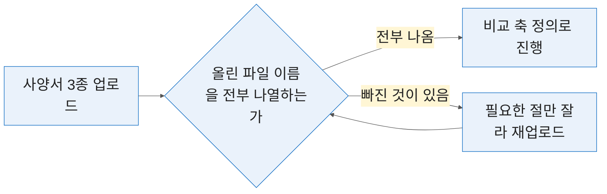
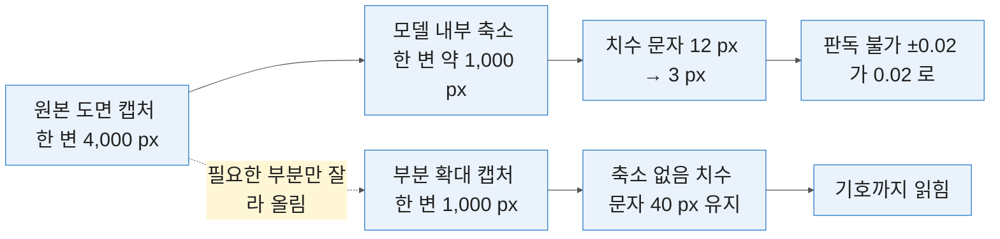
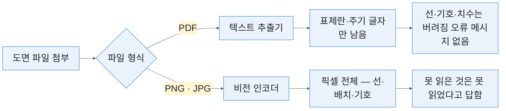
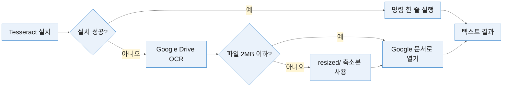

# 2일차 — 경쟁 사양 비교와 비전 LLM 도면 해석
#layout-chapter

::: part
Day 2.
:::

---

#id-mg-day2
#layout-_mg

## 보기 — 도면 속 부품번호를 차이로 검증

```mg
src: mg/02-day2
```

---

## 2-0. 여는 절 — 2일차의 제1 규칙
#layout-contents-full

1일차가 **글자를 읽는 시간**이었다면 2일차는 **그림을 읽는 시간**임. 같은 ChatGPT 창에 올리는 것이 PDF 에서 이미지로 바뀌고, 그것만으로 안에서 도는 경로가 달라짐.

| 교시 | 내용                                         | 형태      | 산출물                    |
| :--- | :------------------------------------------- | :-------- | :------------------------ |
| 1    | 여러 사양서를 한 표로 비교하고 차별점을 뽑음 | 실습 중심 | 3사 비교표 + 차별점 한 줄 |
| 2    | 비전 LLM 에 도면을 올려 요소를 읽힘          | 강의+실습 | 부품번호 목록 + 오독 건수 |
| 3    | 부품 리스트·치수·공차 기호를 구조화해 추출함 | 실습 중심 | BOM 표 + 치수 표 + 오독률 |
| 4    | 기계 OCR 과 비전 LLM 을 교차 검증함          | 실습 중심 | 두 결과 대조표            |

* 2일차 실습은 **절반쯤 실패함.** 비전 LLM 의 도면 해석은 완성된 기술이 아니고, 그 사실을 감추면 회사에서 더 크게 틀림.
* 그래서 2일차의 목표가 **검증**임. 어디까지 맞고 어디부터 틀리는지 직접 겪고 **숫자로 적어 두는 것**이 소득임 — 그 숫자가 6일차 환각 사례의 재료가 됨.

---

### 1일차는 읽었고 2일차는 비교하고 봄
#layout-contents
#id-day2-shift

::: htmlart step
* 1일차 — 읽기
  - 한 문서 안에서 필요한 것을 골라 요약함
* 2일차 1교시 — 비교하기
  - 여러 문서를 같은 축에 놓고 차이를 드러냄
* 2일차 2~4교시 — 보기
  - 글자가 아니라 그림에서 값을 꺼냄
:::

* 비교는 **문서가 여럿**이라 어렵고, 도면은 **글자가 아니라서** 어려움. 2일차는 그 둘을 차례로 다룸.
* 1일차의 3열 표(항목·값·근거 쪽수)가 그대로 1교시 비교표의 **기준축**이 됨. 1일차에 만든 항목 목록을 꺼내 두면 됨.
* 2~4교시는 같은 도면 세트를 세 번 다른 방식으로 읽음 — 해석·추출·대조. 같은 도면이라 결과를 서로 비교할 수 있음.

---

### 🔴 2일차의 제1 규칙 — 도면은 PDF 가 아니라 이미지로 올림
#layout-contents
#id-day2-rule1

::: htmlart compare
* **PDF 로 올리면** / 텍스트만 추출됨
  - 도면의 선·기호·치수가 통째로 버려짐
  - 표제란 글자만 남아 「읽었다」고 답함
  - 오류가 안 뜨는 것이 함정임
* **이미지로 올리면** / 비전 경로로 들어감
  - 선·기호·배치를 함께 봄
  - 해상도가 낮으면 못 읽는다고 답함
  - 못 읽은 것이 드러남
:::

* 🔴 **이 규칙을 놓치면 뒤 세 절의 실습이 통째로 실패함.** 답은 나오는데 전부 표제란에서 지어낸 것이 됨.
* 캡처해서 `png` 로 올림. PDF 를 열어 화면을 캡처하는 것이 가장 빠르고, 필요한 부분만 잘라 올리면 더 잘 읽음.
* 1일차 1-3 에서 본 「PDF 안의 그림은 버려짐」의 실물이 2일차 전체임. 왜 그런지는 2-2 에서 경로를 그림으로 봄.

---

### 2일차 4시간의 역할 분담 — 비교·읽기·뽑기·대조
#layout-contents
#id-day2-roles

::: htmlart chevron
* 비교
  - 사양서 3종을 한 축에
* 읽기
  - 도면에서 요소를 알아봄
* 뽑기
  - BOM 과 치수를 표로
* 대조
  - 기계와 LLM 의 결과를 맞댐
:::

* 세 절이 전부 도면이라 같아 보이지만 **하는 일이 다름** — 2-2 는 해석, 2-3 은 추출, 2-4 는 검증임.
* 앞 절의 결과가 뒤 절의 입력임. 2-2 에서 센 오독 건수가 2-3 의 기준이 되고, 2-3 의 오독률이 2-4 교차 검증의 비교값이 됨.
* 실습 도면은 세 절이 같은 세트(특허 공보 7장 + 공개 CAD 6장)를 씀. 도면이 같아야 방법 차이가 보임.

---

### 검증이 2일차의 주제임 — 생성물을 믿지 않는 법
#layout-contents
#id-day2-verify

::: htmlart callout
* 📌 세 번 물음
* **어디를 읽었나** | 위치를 적게 함
* **못 읽은 것은** | 「불명」을 강제함
* **다른 방법은** | 기계 OCR 과 대조함
:::

* 틀리는 지점을 알면 **그 앞까지는 쓸 수 있음.** 2일차는 그 경계를 찾는 시간임.
* 세 질문은 세 절에 하나씩 대응함 — 위치는 2-2, 불명은 2-3, 대조는 2-4 에서 실습으로 굳힘.
* 검증은 전수가 아님. 풍선 번호 개수·기호 생존 여부·위치 5개처럼 **몇 개만 보면 판정이 나는 지점**을 절마다 정해 둠.

---

### 🙋 실습 P2-0-1 — 특허 공보 도면·공개 도면 세트 내려받기
#layout-exercise-small
#id-ex-p2-0-1

* **시간** 5분 | **목표** 네 절에서 쓸 도면 13장을 로컬에 준비함
* 단계 — 배포 폴더 열기 → 원본 13장 확인 → `resized/` 폴더도 함께 확인
* **완료조건** 이미지 형식(PDF 아님)이고 확대하면 부품번호·치수가 읽힘 ✅

| 갈래              | 수량 | 담당                                    |
| :---------------- | ---: | :-------------------------------------- |
| 특허 공보 도면    |    7 | 부품번호·인출선·단면 — BOM 과 기호 오독 |
| 공개 CAD 도면     |    6 | 끼워맞춤·기하공차·표면조도·BOM 표       |
| `resized/` 축소본 |   13 | 2MB 제한 폴백용. 원본과 1:1             |

---

## 2-1. 여러 사양서의 비교표를 자동으로 만듦
#layout-contents

같은 부품인데 제조사마다 문서가 다름. 사람이 비교표를 만들 때 시간이 드는 이유가 바로 그 정리 작업임.

::: htmlart funnel
* 제조사별 사양서 원문
* 필요한 항목만 뽑아 나열
* 같은 뜻끼리 축으로 묶음
* 축에 값을 채운 비교표
* 차별점 한 줄
:::

* 이 절에서 얻어 갈 것은 둘임 — 서로 형식이 다른 사양서를 **같은 축**에 놓는 법, 그리고 비교표에서 **차별점이 드러나게** 만드는 법.
* 깔때기의 위 두 단은 AI 가 빠르고, 셋째 단(축으로 묶기)은 사람이 정해 줘야 함. 순서를 바꾸면 표는 나와도 쓸 수 없음.

---

### 사양서 비교가 실제로 어려운 이유
#layout-contents
#id-spec-hard

::: htmlart arrow
* 3종 비교에 반나절
  - 사람이 손으로 맞추면 드는 시간
* 이름이 다름
  - 허용하중 · Load capacity
* 단위가 다름
  - 250 N/mm² · 2,500 kg/cm²
* 위치가 다름
  - 한쪽은 표, 한쪽은 문장
:::

* 같은 항목인데 **이름이 다르고 단위가 다르고 위치가 다름.** 셋 중 하나만 걸려도 표 한 칸이 비거나 틀림.
* SKF 는 허용하중을 **그래프 안에만** 두고, MBI 는 `kg/cm²` 에 **속도 구간별 4갈래**로 적고, GGB 는 정하중·동하중 순서가 SKF 와 **반대**임. 1일차에 본 데이터시트 3종이 이 세 문제를 하나씩 갖고 있음.
* 이 정리를 사람이 하면 3종 비교에 반나절이 듦. 그 시간을 줄이되, **틀린 표를 빨리 만드는 것**이 되지 않게 하는 것이 이 절의 목적임.

---

### 항목 이름이 회사마다 다름
#layout-contents
#id-spec-naming

| 우리 표기  | A 사         | B 사               | C 사         |
| :--------- | :----------- | :----------------- | :----------- |
| 허용하중   | 정격하중     | Load capacity      | 최대 부하    |
| 미끄럼속도 | 허용 주속    | Sliding velocity   | PV 한계 속도 |
| 마찰계수   | 동마찰계수 µ | Coefficient (dyn.) | 마찰 특성    |
| 온도범위   | 사용 온도    | Operating Temp.    | 적용 온도대  |

* 이름이 다르면 **AI 도 같은 항목으로 묶지 못함.** 그래서 축을 사람이 먼저 정해 줘야 함.
* 표의 왼쪽 열이 곧 **비교 축**이고, 1일차 1-2 에서 만든 용어집이 그대로 이 열이 됨. 「우리 표기」를 먼저 고정하고 나머지는 AI 가 대응시키게 함.
* 대응이 애매한 것은 AI 가 「대응 불확실」이라 적게 함 — `PV 한계 속도` 가 `미끄럼속도` 와 같은 뜻인지는 사람이 원문 조건을 보고 정함.

---

### 순서를 뒤집음 — 비교 축을 먼저 정함
#layout-contents
#id-spec-axis

::: htmlart process
* 흔한 실패
  - 3종 올리고 「비교표 만들어 줘」
* 모델이 고름
  - 임의 항목으로 표가 나옴
* 축을 먼저 줌
  - 행을 내가 지정함
* 값만 채움
  - 빠진 항목이 드러남
:::

* 표의 **세로줄을 내가 정하는 것**이 핵심임. 모델에게 맡기면 정작 필요한 항목이 빠지고 「특징」 같은 서술 항목이 들어옴.
* 1일차 1-3 의 3단계 요약과 같은 원리임 — 구조를 먼저 주고 값을 채우게 함. 2일차는 문서가 셋이라 「구조」가 「축」이 될 뿐임.
* 축을 준 표는 다음 달 신제품 사양서가 와도 **그대로 다시 씀.** 축이 자산이고 표는 산출물임.

---

### 비교 축 설계 — 필수 항목과 선택 항목
#layout-contents-full
#id-spec-axis-design

::: htmlart bracket
* 반드시 넣는 축
  - 허용하중 — 제품 선정의 1차 기준
  - 미끄럼속도 — PV 한계와 짝을 이룸
  - 온도범위 — 조건부 사양이 붙는 자리
* 있으면 넣는 축
  - 마찰계수 — 측정 조건이 제각각임
  - 표면조도 — 상대재 사양에 걸림
* 넣지 않는 축
  - 가격·납기 — 사양서 밖의 정보임
  - 「특징」 같은 서술 항목 — 비교가 안 됨
:::

* 축은 **5~7개**가 적당함. 열 개를 넘기면 표가 화면을 넘고 대조도 힘들어짐.
* 「반드시」와 「있으면」을 가르는 기준은 **선정 판단에 쓰이는가**임. 허용하중 없이 부시를 고르지 않지만, 마찰계수는 조건이 맞을 때만 비교됨.

---

### 단위와 조건이 다른 값을 나란히 놓지 않는 법
#layout-contents
#id-spec-unit

::: htmlart tab
* 단위가 다를 때
  - 원문 표기를 유지하고 환산하지 않음
  - 환산은 사람이 마지막에 함
  - kN 과 kgf 를 그대로 나란히 둠
* 조건이 다를 때
  - PV 는 하중과 속도의 곱임
  - 조건이 빠지면 비교가 무의미함
  - 조건 열을 따로 둠
:::

* 허용하중을 `N/mm²` 와 `kg/cm²` 로 각각 적은 두 사양서를 그대로 비교하면 숫자가 **10 배** 차이로 보임. 다음 장이 그 그림임.
* 프롬프트에 **「단위는 원문 표기를 유지하고 환산하지 마라」** 를 넣음. 환산은 사람이 마지막에 하고, 환산식을 표 밖에 남김.
* 더 위험한 것은 **측정 조건**임. PV 값은 하중과 속도의 곱이라 어느 속도 구간에서 쟀는지가 빠지면 비교가 무의미함. 조건이 다른 값은 같은 줄에 놓지 않고 **조건 열을 따로 둠**.

---

### 같은 값이 10 배로 보임 — 단위를 그대로 둔 표와 환산한 표
#layout-contents-full
#id-spec-unit-chart

::: columns

::: column {width="54%"}
```chart
{
  "type": "bar",
  "data": {
    "labels": ["A 사 — 250 N/mm²", "B 사 — 2,500 kg/cm²"],
    "datasets": [
      {
        "label": "원문 숫자를 그대로 나란히 둠",
        "data": [250, 2500],
        "backgroundColor": "rgba(200,37,6,0.75)"
      },
      {
        "label": "사람이 N/mm² 로 환산한 뒤",
        "data": [250, 245],
        "backgroundColor": "rgba(3,101,192,0.75)"
      }
    ]
  },
  "options": {
    "aspectRatio": 1.5,
    "plugins": {
      "title": { "display": true, "text": "허용하중 2사 비교 — 단위 처리에 따라 (예시 값)", "font": { "size": 26 } },
      "legend": { "position": "bottom", "labels": { "font": { "size": 24 } } }
    },
    "scales": {
      "y": { "ticks": { "font": { "size": 24 } }, "title": { "display": true, "text": "표에 적힌 숫자", "font": { "size": 26 } }, "beginAtZero": true }
    }
  }
}
```
:::

::: column {width="42%"}
* 빨간 막대는 **원문 숫자를 그대로** 놓은 표임. B 사가 10 배 큰 것처럼 보임.
* 파란 막대는 사람이 `1 N/mm² ≈ 10.2 kg/cm²` 로 **환산한 뒤**임. 두 값은 사실상 같음.
* AI 에 환산을 맡기면 계수를 반올림하거나 `kgf` 와 `kg` 을 섞음. 환산식은 **표 밖에 사람이** 한 줄로 남김.
:::

:::

---

### 미기재를 강제하는 이유
#layout-contents
#id-spec-missing

::: htmlart explain
* 정보가 없다는 사실 자체가 정보임
* 빈칸을 허용하면 남의 값을 끌어옴
* 비슷한 항목을 억지로 대응시킴
* 「미기재」가 공개 안 한 항목을 드러냄
* 공개 안 한 것은 대개 자신 없는 사양
:::

* 프롬프트에 **「해당 사양이 없으면 미기재라 적고 빈칸으로 두지 마라」** 를 넣음.
* 1일차의 「원문에 없음」과 같은 장치임. 문서가 셋이 되면 위험이 하나 더 생김 — A 사에 없는 값을 **B 사 값으로 채우는** 일임. 빈칸 금지가 그것을 막음.
* 「미기재」 칸이 어느 회사에 몰리는지를 보면 **그 회사가 어느 사양을 공개하지 않는가**가 보임. 그것이 영업·구매에 넘길 정보임.

---

### 빈칸을 추측으로 채우면 생기는 일
#layout-contents
#id-spec-blank

::: htmlart compare
* **빈칸 허용** / 표는 예뻐짐
  - 모든 칸이 채워짐
  - 어느 값이 원문인지 모름
  - ✕ 없는 사양이 있는 것처럼 보임
* **미기재 강제** / 표에 구멍이 보임
  - 구멍이 곧 경쟁사의 침묵임
  - 확인할 곳이 명확해짐
  - ✓ 판단의 근거가 남음
:::

* 🔴 **「미기재」가 한 번도 없으면 지어냈을 가능성을 의심함.** 사양서 3종에서 모든 항목이 공개되는 일은 드묾.
* 채워진 표가 더 좋아 보이는 것이 함정임. 검토자는 구멍 난 표를 보면 묻고, 꽉 찬 표를 보면 넘어감.
* 검증 P2-1 에서 「미기재」 칸을 **원문에서 직접 찾아보는 것**이 이 장의 실습임.

---

### 차별점을 드러내는 한 줄
#layout-contents-full
#id-spec-diff

비교표를 만든 다음 이어서 물음. 표는 사실이고 차별점은 판단이라 **한 번에 시키지 않음**.

::: columns

::: column {width="50%"}
```text
위 비교표에서 우리 제품이 우위인 항목,
열위인 항목, 동등한 항목으로 나눠라.
우위·열위 판단의 근거가 된 수치를 함께 적어라.
판단이 애매한 항목은 "판단 보류"로 두고
이유를 적어라.
```
:::

::: column {width="46%"}
| 항목     | 판정 | 근거 수치           |
| :------- | :--- | :------------------ |
| 허용하중 | 우위 | 250 vs 140 N/mm²    |
| 온도범위 | 동등 | −200~+250 · +280 °C |
| 마찰계수 | 보류 | 측정 조건이 다름    |
| 표면조도 | 열위 | Ra 0.8 요구 vs 0.4  |
:::

:::

* **「판단 보류」를 허용**해야 억지 결론이 줄어듦. 측정 조건이 다르면 비교 자체가 성립하지 않음.
* 「우위」 판정에는 반드시 **두 수치**가 붙어야 함. 수치 없는 「우위」는 감상이고, 그 자리가 지어내기가 들어오는 문임.

---

### 여러 파일을 한 번에 올릴 때의 한도
#layout-contents
#id-spec-upload



* 한 대화에 올릴 수 있는 파일 수와 용량에 한도가 있음. 3종 비교는 대개 통과하나 **부록까지 올리면 걸림**.
* 걸리면 나오는 것은 오류가 아니라 **조용한 누락**임 — 일부만 읽고 답함. 1일차 「선택적 이해」가 파일 단위로 일어나는 것임.
* 그래서 올린 뒤 **「방금 올린 파일 이름을 전부 나열하라」** 로 먼저 확인함. 1일차 업로드 한도 표(파일 512MB · 3시간 80건)가 여기서도 그대로 적용됨.
* 용량이 크면 필요한 절만 잘라 올림. 사양서 전체가 필요한 경우는 드묾 — 1일차 1단계 목차 추출이 어느 절을 자를지 알려 줌.

---

### 🙋 실습 P2-1-1 — 사양서 3종 업로드와 비교 축 정의
#layout-exercise
#id-ex-p2-1-1

* **시간** 8분 | **목표** 축을 먼저 주고 값을 채우게 하는 순서를 몸에 익힘
* 단계 — 사양서 3종 첨부 → 파일명 나열로 업로드 확인 → 아래 프롬프트로 축 지정
* **완료조건** 지정한 축이 그대로 행이 됨 ✅ 축이 임의로 늘거나 합쳐지면 실패임

```text
아래 5개 항목을 행으로, 제조사 3곳을 열로 하는 비교표를 만들어라.
허용하중, 미끄럼속도, 마찰계수, 온도범위, 표면조도

각 칸에는 값과 근거 쪽수를 함께 적어라.
해당 사양이 없으면 "미기재"라고 적고 빈칸으로 두지 마라.
단위는 원문 표기를 유지하고 환산하지 마라.
```

---

### 🙋 실습 P2-1-2 — 비교표 생성과 미기재 확인
#layout-exercise
#id-ex-p2-1-2

* **시간** 8분 | **목표** 표의 구멍이 정보임을 확인함
* 단계 — 「미기재」 칸 세기 → 원문에서 찾기 → 우위·열위·동등 판정 요청 → `2-1_비교표.md` 저장
* **완료조건** 「미기재」가 실제로 원문에 없는 항목임을 2건 이상 확인함 ✅

```text
위 비교표에서 우리 제품이 우위인 항목, 열위인 항목, 동등한 항목으로 나눠라.
우위·열위 판단의 근거가 된 수치를 함께 적어라.
판단이 애매한 항목은 "판단 보류"로 두고 이유를 적어라.
```

---

### ✅ 검증 P2-1 — 원문 대조 3행 샘플링
#layout-exercise-small
#id-verify-p2-1

::: htmlart numbered
* 근거 쪽수를 직접 열어 3행 확인
* 단위가 원문 표기 그대로인지 확인
* 미기재 0 건이면 의심
:::

* **3행**만 대조함. SKF 행은 꼭 넣음 — 값이 그래프에만 있음.

---

## 2-2. 비전 LLM 의 도면 해석과 검증의 필요성
#layout-contents

이 절에서 얻어 갈 것은 둘임 — 도면을 **어떻게 올려야** 그나마 읽는지, 그리고 **무엇을 틀리는지** 유형으로 아는 것임.

::: htmlart tab
* 어떻게 올리는가
  - PDF 가 아니라 이미지로 올림
  - 해상도와 크롭이 정확도를 가름
  - 도면 한 장씩 나눠 올림
* 무엇을 틀리는가
  - 위치 오귀속 — 부위가 틀림
  - 기호 소실 — 공차가 사라짐
  - 없는 요소 생성 — 행이 늘어남
:::

* 왼쪽이 **올리기 전**의 일이고 오른쪽이 **받은 뒤**의 일임. 앞을 잘하면 뒤의 세 유형이 줄고, 뒤를 알면 앞을 어떻게 올려야 하는지가 정해짐.

---

### 비전 LLM 은 도면을 어떻게 보는가
#layout-contents
#id-vision-how


* 사람은 도면을 볼 때 **규칙을 알고** 봄. 해칭이 단면이고, 치수선의 화살표 끝이 대상이고, 공차 기호가 어디 붙는지를 앎.
* 비전 LLM 은 그 규칙을 배우지 않았음. **그림에서 글자와 형태를 알아보는 수준**임 — 사진 속 간판을 읽는 것과 같은 능력으로 도면을 봄.
* 그래서 숫자는 읽지만 그 숫자가 **어느 부위의 치수인지**는 자주 틀림. 이 차이가 뒤 세 절의 실패 유형을 전부 설명함.

---

### 픽셀을 본다는 말의 의미 — 해상도가 곧 정확도임
#layout-contents
#id-vision-pixel


* 비전 모델은 이미지를 일정 크기로 줄여서 봄. 원본이 크더라도 **내부에서 축소**되고, 그 크기는 사용자가 정할 수 없음.
* 축소되면 가장 먼저 사라지는 것이 **작은 글자** — 치수 문자와 공차 기호가 정확히 그 크기임. 부품 윤곽과 풍선 번호는 남고 `±0.02` 만 사라짐.
* 해법은 하나임 — **필요한 부분을 확대해서 다시 올림.** 다음 장이 그 과정을 그림으로 보여 줌.

---

### 축소가 치수 문자를 지우는 과정 — 전체 1장과 부분 확대
#layout-contents-full
#id-vision-downscale



* 위 줄이 **전체 1장**을 올렸을 때임. 도면 전체가 4,000 px 이면 모델 안에서 4 분의 1 로 줄고, 12 px 짜리 치수 문자는 3 px 이 되어 형태만 남음.
* 아래 줄이 **부분 확대**임. 읽고 싶은 영역을 1,000 px 안팎으로 잘라 올리면 축소가 거의 없고 문자가 40 px 로 유지됨.
* 픽셀 수치는 모델마다 다르나 **비율의 관계는 같음** — 잘라 올리는 만큼 문자가 커짐. 실무 순서는 **전체 1장으로 구조를 잡고 → 필요한 부분만 확대해 재질의** 임.
* 이것도 추측이 아님 — 제조사 개발 문서가 **이미지를 한 변 512 픽셀 격자로 잘라 처리한다**고 밝히고 있음. 도면 한 장이 그 격자 몇 칸에 들어가느냐가 곧 글자 크기임.

---

### 🔴 올리는 방법이 결과를 가름 — 텍스트 경로와 비전 경로
#layout-contents-full
#id-vision-upload



* 여는 절의 제1 규칙이 **왜** 그런지가 이 그림임. 같은 창에 올려도 파일 형식이 **들어가는 문**을 가름.
* 왼쪽 길의 함정은 **오류가 없다는 것**임. 표제란 글자로 그럴듯한 답이 나오므로 사람이 「읽었다」고 믿음.
* 오른쪽 길은 못 읽으면 못 읽었다고 하거나 「불명」이라 적을 수 있음. 검증할 수 있는 답은 오른쪽에서만 나옴.

---

### 캡처 규격 — 해상도·크롭·파일 크기
#layout-contents-full
#id-vision-capture

::: htmlart block
* 전체 1장 — 구조 파악용. 부품 배치와 번호까지만 기대함
* 부분 확대 — 치수·공차용. 읽고 싶은 영역만 잘라 올림
* 2MB 이하 — 폴백 경로(Google Drive OCR)의 상한임
* png 권장 — jpg 는 선이 뭉개져 가는 치수선이 사라짐
:::

* 실무 순서는 **전체 1장으로 구조를 잡고 → 필요한 부분만 확대해 재질의** 임. 한 장으로 다 하려는 것이 가장 흔한 실패임.
* 부분 확대는 **한 캡처에 치수 5개 안팎**이 적당함. 더 넣으면 다시 작아지고, 덜 넣으면 캡처 수가 늘어 업로드 한도에 닿음.
* 캡처 파일 이름에 **부위**를 적어 둠 — `pat09_내경부.png` 처럼. 답에 「위치」를 적게 할 때 그 이름이 곧 대조 기준이 됨.

---

### 🖥️ 시연 — 같은 도면, ChatGPT 와 Claude 의 답 비교
#layout-contents-full
#id-demo-vision-compare

* 같은 도면 한 장을 두 모델에 올려 같은 질문을 던짐. 답이 **어느 부분에서 갈리는지**를 봄.
* 대개 **부품번호는 비슷하게 읽고 치수에서 갈림.** 갈리는 자리가 곧 검증이 필요한 자리임.
* 🚫 실습에서는 한 모델만 씀. 두 모델 비교는 시연으로 충분함 — 계정이 둘 필요해짐.
* 요점은 어느 모델이 낫다가 아니라 **모델이 다르면 답도 다르다**는 사실임. 2-4 에서 「다른 방법」을 기계 OCR 로 바꿔 같은 원리를 씀.

---

### 틀리는 유형 ① 위치 오귀속 — 숫자는 맞는데 다른 부위에 붙음
#layout-contents
#id-err-position


* 숫자 자체는 도면에 있는 값임. 그런데 **그 숫자가 가리키는 부위**가 틀림. 내경 치수가 외경에 붙고, 핀 길이가 부시 길이로 적힘.
* 표는 그럴듯하게 나옴. 값이 실재하므로 검증 없이 넘어가기 쉬움 — 세 유형 중 가장 위험한 이유임.
* 잡는 법은 하나임 — **위치를 함께 적게 하고** 도면에서 짚어 봄. 「좌상·중앙·우하」처럼 거친 위치라도 대조에는 충분함.

---

### 틀리는 유형 ② 기호 소실 — ±0.02 가 0.02 로 떨어짐
#layout-contents
#id-err-symbol


* `±` 가 떨어지면 **공차가 없는 치수**로 읽힘. 값은 맞는데 의미가 바뀜 — 1일차 「기호 소실」 표의 도면판임.
* 끼워맞춤 ① `H11`·③ `m7` 은 문자나 숫자만 남거나 통째로 사라짐. 대소문자 구분이 사라지면 구멍 기준인지 축 기준인지가 뒤집힘.
* ② 표면조도 `√Ra3.2` 는 `3.2` 만 남음. 조도인지 치수인지 구분이 사라지고, 그 `3.2` 가 치수 표에 섞임.
* 프롬프트에 **「기호를 읽을 수 없으면 기호 판독 불가라고 적어라. 기호 없이 숫자만 적지 마라」** 를 넣음.

---

### 틀리는 유형 ③ 없는 요소를 만들어 냄
#layout-contents
#id-err-halluc


* 도면에 없는 부품을 **「일반적으로 있으니까」** 추가함. 부시 도면에 없는 시일·와셔가 BOM 에 들어옴 — 배운 것을 흉내 내는 성질이 도면에서 드러나는 자리임.
* 부품번호가 연속이 아니면 **빈 번호를 채워 넣기도** 함. `1, 2, 4` 를 보고 `3` 을 만들어 냄.
* 잡는 법 — **도면의 풍선 번호 개수와 BOM 행 수를 맞춰 봄.** 행이 더 많으면 지어낸 것임. 세는 데 30초면 됨.
* 프롬프트에 **「도면에 없는 항목을 표에 추가하지 마라」** 를 명시함.

---

### 세 유형을 한눈에 — 증상·원인·잡는 법
#layout-contents-full
#id-err-table

| 유형          | 증상                        | 왜 생기나                        | 잡는 법                     | 프롬프트 한 줄                 |
| :------------ | :-------------------------- | :------------------------------- | :-------------------------- | :----------------------------- |
| ① 위치 오귀속 | 값은 맞는데 부위가 틀림     | 인출선의 연결 규칙을 모름        | 위치 5개를 도면에서 짚음    | 「도면 상 위치를 함께 적어라」 |
| ② 기호 소실   | `±`·`H7`·`Ra` 가 떨어짐     | 작은 기호가 축소에서 먼저 사라짐 | 기호 살아 있는 행 비율을 셈 | 「기호 없이 숫자만 적지 마라」 |
| ③ 없는 요소   | BOM 행이 풍선 번호보다 많음 | 배운 도면의 평균으로 빈칸을 채움 | 풍선 번호 개수와 행 수 대조 | 「없는 항목을 추가하지 마라」  |

* 세 유형의 **원인이 전부 다름** — ①은 규칙 부재, ②는 해상도, ③은 흉내 내기. 그래서 잡는 법도 셋이고, 한 가지 검증으로 셋을 다 잡을 수 없음.
* 오른쪽 열 세 줄을 합친 것이 다음 장의 검증 프롬프트임. 실습 P2-2 부터 이 세 줄이 프롬프트마다 붙음.

---

### 검증을 프롬프트 안에 넣음 — 자신 없으면 불명이라 쓰게
#layout-contents
#id-vision-verify-prompt

::: htmlart callout
* 📌 함께 요구할 세 가지
* **값** | 읽어 낸 숫자
* **부위** | 그 값이 가리키는 곳
* **위치** | 도면 상 좌상·중앙·우하
:::

```text
각 행에 값·부위·도면 상 위치를 함께 적어라.
확실하지 않으면 "불명"이라 표시하고 추측하지 마라.
도면에 없는 항목을 표에 추가하지 마라.
```

* 위치를 적게 하는 것이 핵심임 — 사람이 대조할 때 **어디를 볼지**가 정해짐. 위치가 없는 표는 전수 대조를 요구하고, 전수 대조는 안 하게 됨.
* 「불명」은 실패가 아니라 **모델이 자기 한계를 보고한 것**임. 불명이 0건인 표가 오히려 위험함.

---

### 도면 해석 결과를 사람이 확인하는 순서
#layout-contents
#id-vision-check-order

::: htmlart process
* 개수 확인
  - 풍선 번호와 표 행 수
* 기호 확인
  - ±·H7·Ra 가 살아 있나
* 위치 확인
  - 5개만 도면에서 짚음
* 불명 확인
  - 0 건이면 의심함
:::

* 전수 검증은 하지 않음. **이 네 가지만** 보면 쓸 표인지 버릴 표인지 갈림. 순서도 이대로임 — 개수가 틀리면 나머지를 볼 필요가 없음.
* 네 단계가 세 유형에 대응함 — 개수는 ③, 기호는 ②, 위치는 ①, 불명은 셋 모두의 안전장치임.
* 확인 결과를 **오독 건수**로 적어 둠. 2-3·2-4 에서 같은 도면을 다시 읽으므로 이 숫자가 비교 기준이 됨.

---

### 🙋 실습 P2-2-1 — 도면 1장을 이미지로 올려 요소 읽히기
#layout-exercise
#id-ex-p2-2-1

* **시간** 8분 | **목표** 쉬운 도면 한 장으로 비전 경로의 기본 동작을 확인함
* 단계 — `pat09`(부시 단면·부품번호 7종) 캡처 → 이미지로 첨부 → 아래 프롬프트 실행
* **완료조건** 부품번호 목록이 나오고 못 읽은 것은 「불명」으로 표시됨 ✅

```text
첨부한 도면에서 부품번호와 그 부품이 가리키는 요소를 표로 정리하라.
각 행에 번호·요소·도면 상 위치(좌상/중앙/우하 등)를 함께 적어라.
확실하지 않으면 "불명"이라 표시하고 추측하지 마라.
도면에 없는 항목을 표에 추가하지 마라.
```

---

### 🙋 실습 P2-2-2 — 불명 표기를 강제한 재질의
#layout-exercise
#id-ex-p2-2-2

* **시간** 8분 | **목표** 난이도를 올려 세 유형의 오류를 직접 만나 봄
* 단계 — `pat14`(접미문자 `23A`/`23B`) 로 같은 질문 → 이어서 `pat13`(**반시계 90° 회전**) 으로 재질의
* **완료조건** 회전 도면에서 방향 보정이 필요함을 확인함 ✅ 접미문자가 뭉개지는 것을 확인함 ✅

* `pat14` 는 **접미문자**가 붙은 번호라 `23A`·`23B` 가 `23` 으로 합쳐지기 쉬움. `pat13` 은 도면이 **90° 돌아가** 있어 위치 표현을 「도면 기준」인지 「화면 기준」인지 먼저 정해 줘야 함.

---

### ✅ 검증 P2-2 — 오독 건수 세기
#layout-exercise-small
#id-verify-p2-2

::: htmlart numbered
* 행 수와 풍선 번호 대조
* 위치 5개를 도면에서 직접 짚음
* 「불명」 0 건이면 지어냄을 의심
:::

* 오독 건수를 **숫자로 적어 둠** — 3·4교시 대조의 기준값임.

---

## 2-3. 부품 리스트·치수·기호의 인식과 검증
#layout-contents

이 절에서 얻어 갈 것은 둘임 — 조립도에서 **부품 리스트(BOM)** 를 뽑는 법, 그리고 공차·표면조도 기호를 **살려서** 추출하는 법임.

::: htmlart hierarchy
* 조립 도면
  - 표제란·BOM
    - 부품번호·명칭·재질·수량
  - 치수와 기호
    - 공차·표면조도·데이텀
:::

* 왼쪽 가지는 **표**라 잘 읽히고, 오른쪽 가지는 **선 위에 떠 있는 글자**라 어려움. 같은 도면 안에서 난이도가 갈리므로 **따로 물음**.
* 2-2 가 「읽히는가」였다면 2-3 은 「표로 옮겨지는가」임. 열 구성을 먼저 주고 신뢰도까지 받는 **구조화 출력**이 이 절의 도구임.

---

### 부품 리스트 추출이 상대적으로 잘 되는 이유
#layout-contents
#id-bom-why

::: htmlart hexagon
* 표 형태로 모여 있음
* 격자로 배열됨
* 글자가 치수보다 큼
* 도면 형태와 겹치지 않음
:::

* 도면의 부품 리스트는 대개 **표 형태**로 한쪽에 있음. 표는 비전 LLM 이 비교적 잘 읽음 — 1일차의 「표는 중간」 판정이 도면 안에서도 성립함.
* 부품번호·명칭·재질·수량이 **격자로 배열**돼 있고 글자가 치수 문자보다 큼. 축소돼도 살아남는 크기임.
* 도면 형태와 겹치지 않아 선에 묻히지 않음. **BOM 추출은 2일차 실습 중 성공률이 가장 높은 작업**이고, 그래서 첫 실습으로 둠.

---

### 표제란과 BOM 은 표임 — 표는 LLM 이 잘 다룸
#layout-contents
#id-bom-table

::: htmlart balance
* 잘 읽힘 — 표
  - 표제란 · 도면번호 · 척도 · 재질
  - BOM · 부품번호 · 명칭 · 수량
  - PDF 로 올려도 이것은 나옴
* 못 읽음 — 표 밖
  - 치수 — 잘 읽힌다고 믿으면 안 됨
  - 표제란 답만 보고 「읽었다」고 착각함
  - 잘 되는 것부터 뽑고 어려운 것은 따로 물음
:::

* 표제란에는 도면번호·척도·투상법·재질이 들어감. 이것도 표라서 잘 읽힘 — 그래서 **PDF 로 올려도 표제란은 나옴**. 그 답을 보고 「읽었다」고 착각하는 자리임.
* BOM 이 잘 읽힌다고 치수까지 믿으면 안 됨. **같은 도면 안에서도 난이도가 다름.** 잘 되는 것부터 뽑고, 어려운 것은 따로 물음. 한 번에 다 요구하면 어려운 쪽이 뭉개짐.

---

### 치수는 왜 어려운가 — 인출선과 숫자의 거리
#layout-contents
#id-dim-hard

::: htmlart gear
* 치수 숫자
  - 치수선 위에 떠 있음
* 치수선
  - 가리키는 곳은 화살표 끝임
* 대상 형상
  - 숫자와 사이에 거리가 있음
:::

* 치수 숫자는 **치수선 위에 떠 있고**, 그 치수선이 가리키는 곳은 화살표 끝임. 세 톱니가 맞물려야 하나의 치수가 되는데, 모델은 **첫 톱니(숫자)만** 읽음.
* 숫자와 대상 사이에 **거리가 있음.** 비전 모델은 이 연결을 규칙으로 알지 못하고 「가까운 형상」에 붙임 — 유형 ①이 생기는 기제임.
* 인출선이 겹치거나 꺾이면 연결이 더 끊김. 조밀한 도면일수록 오귀속이 늘어남. 그래서 치수는 **부분 확대**로 올리고, 한 번에 몇 개만 물음.

---

### 공차 기호를 살리는 법
#layout-contents
#id-tol-keep

::: htmlart process
* 기호를 열거함
  - ±·H7·g6·Ra 를 미리 적어 줌
* 함께 적게 함
  - 숫자와 기호를 한 칸에
* 판독 불가
  - 「기호 판독 불가」
* 숫자만 금지
  - 기호 없는 값은 버림
:::

```text
치수를 추출할 때 아래 기호가 붙어 있으면 반드시 함께 적어라.
± (양측 공차), H7·h7·JS8 등 끼워맞춤 기호, √·Ra 등 표면조도 기호

기호를 읽을 수 없으면 "기호 판독 불가"라고 적어라. 기호 없이 숫자만 적지 마라.
```

* 기호 목록을 **미리 적어 주는 것**이 첫 단계임. 1일차 용어집과 같은 장치 — 찾을 것을 알려 주면 찾고, 안 알려 주면 숫자만 남김.

---

### 기하공차 기호 대조표
#layout-contents-full
#id-gtol-table

::: columns

::: column {width="46%"}

:::

::: column {width="50%"}
| 기호       | 이름   | 비전 LLM 인식       |
| :--------- | :----- | :------------------ |
| `⟋`        | 평행도 | 사선으로 오인함     |
| `◎`        | 동심도 | 원형 기호로 뭉갬    |
| `⌖`        | 위치도 | 십자로 읽기도 함    |
| `⏥`        | 평면도 | 평행사변형으로 봄   |
| 데이텀 `A` | 기준면 | **부품번호로 오인** |
:::

:::

* 🔴 **데이텀 오인이 가장 잦음** — `A` 하나가 BOM 의 부품번호로 들어감. `cad05` 에 끼워맞춤 6종과 데이텀이 함께 있음.
* 기호의 정본은 **ISO 1101**, 데이텀은 **ISO 5459** 임. AI 가 이름을 틀리면 이 두 번호로 되짚음. 미국계 고객 도면은 **ASME Y14.5** 일 수 있어 해석 규칙이 다름 — 어느 체계인지 먼저 확인함.

---

### 표면조도는 특히 어려움
#layout-contents-full
#id-roughness

::: columns

::: column {width="46%"}

:::

::: column {width="50%"}
| 표기        | 의미             | 비전 LLM 인식    |
| :---------- | :--------------- | :--------------- |
| `Ra 3.2`    | 산술평균거칠기   | 비교적 읽음      |
| `√` 위 숫자 | 가공기호 + 조도  | 숫자만 남음      |
| `▽▽▽`       | 구 표기 삼각기호 | **거의 못 읽음** |
:::

:::

* 구 도면일수록 삼각기호가 많아 인식률이 낮음 — 사람 눈이 빠름. ① 전체 지정 `√Ra3.2`·② 절삭조건표는 구석에 따로 있어 전체 1장에서 먼저 잡음.
* 🔴 **삼각기호는 지금 표준에 없음.** 현행은 **ISO 21920**(2021)이고 ISO 1302·4287 은 폐지됨. `▽▽▽` 는 관행이라 AI 에 「표준 기호」로 물으면 엉뚱한 답이 나옴.

---

### 도면 원문에 주해를 달게 해 어디를 읽었는지 밝힘
#layout-contents
#id-dim-annotate

::: htmlart bracket
* 값만 받으면
  - 어디서 나온 값인지 모름
  - 틀려도 추적이 안 됨
* 위치를 함께 받으면
  - 도면에서 짚을 수 있음
  - 오귀속이 드러남
* 불명을 함께 받으면
  - 못 읽은 자리가 보임
  - 사람이 볼 곳이 정해짐
:::

* 세 가지를 함께 요구하는 것이 **추적 가능한 답**을 만드는 최소 조건임. 1일차 「근거 쪽수」가 도면에서는 「도면 상 위치」가 됨.
* 위치 표기는 캡처 파일 이름과 짝을 맞춤 — `pat09_내경부.png` 에서 나온 값은 위치 열에 「내경부 확대」로 적히게 함. 파일 이름이 곧 주소가 됨.

---

### 구조화 출력 — 표 형식을 먼저 줌
#layout-contents-full
#id-structured-output

* 「표로 정리해 줘」만으로는 열 구성이 매번 달라짐. **열을 먼저 지정**함. 열이 고정되면 여러 도면의 결과를 **이어 붙일 수 있음.**

::: columns

::: column {width="42%"}
```text
아래 열 구성을 그대로 지켜 표로 정리하라.
열을 추가하거나 순서를 바꾸지 마라.

부품번호 | 명칭 | 재질 | 수량 | 근거 위치 | 신뢰도

신뢰도는 확실/보통/불명 셋 중 하나로 적어라.
```
:::

::: column {width="54%"}
| 부품번호 | 명칭 | 근거 위치 | 신뢰도 |
| :------- | :--- | :-------- | :----- |
| 1        | 부시 | BOM 1행   | 확실   |
| 2        | 핀   | BOM 2행   | 확실   |
| 3        | 시일 | BOM 3행   | 보통   |
| 4        | 불명 | 우하 확대 | 불명   |
:::

:::

* 오른쪽이 이 프롬프트가 낳는 표의 모양임(재질·수량 열 생략). 4번 행처럼 **불명이 불명으로 남은 것**이 정상이고, 그 행부터 사람이 봄.
* 열이 같으면 3일차 노트북에 **여러 도면의 BOM 을 한 표로** 올릴 수 있음. 열이 다르면 합칠 수 없음.

---

### 신뢰도 열을 함께 뽑게 하는 법
#layout-contents
#id-confidence

::: htmlart block
* 확실 — 글자가 선명하고 주변에 겹침이 없음
* 보통 — 읽히나 비슷한 글자와 혼동 가능함
* 불명 — 형태만 보이고 판독 불가함
:::

* 신뢰도가 있으면 **사람이 볼 순서**가 정해짐. 불명부터, 다음이 보통임. 확실은 표본만 봄.
* 세 등급의 **기준을 프롬프트에 적어 줌** — 위 세 줄 그대로임. 기준을 안 주면 모델이 전부 「확실」이라 적음.
* 신뢰도가 전부 「확실」이면 그 자체가 신호임 — 모델이 자기 확신을 못 재고 있음. 검증 P2-3 의 오독률과 신뢰도 분포를 나란히 놓으면 **모델의 자기 평가가 맞는지**도 보임.

---

### 🙋 실습 P2-3-1 — BOM 과 치수를 함께 뽑기
#layout-exercise
#id-ex-p2-3-1

* **시간** 8분 | **목표** 열을 먼저 주고 구조화 출력을 받는 순서를 익힘
* 단계 — `cad01`(BOM 표 보유) 캡처 첨부 → 6열 구성 지정 → BOM 과 치수를 각각 요청
* **완료조건** 지정한 6열이 그대로 나오고 신뢰도가 채워짐 ✅


```text
첨부한 조립도에서 두 가지를 추출하라.
(1) 부품 리스트 — 부품번호 | 명칭 | 재질 | 수량 | 근거 위치 | 신뢰도
(2) 주요 치수 — 치수값 | 부위 | 공차기호 | 근거 위치 | 신뢰도

기호를 읽을 수 없으면 "기호 판독 불가"라 적고 숫자만 적지 마라.
도면에 없는 항목을 추가하지 마라.
```

---

### 🙋 실습 P2-3-2 — 공차·표면조도 별도 재질의
#layout-exercise
#id-ex-p2-3-2

* **시간** 8분 | **목표** 어려운 것을 따로 물으면 결과가 달라지는 것을 확인함
* 단계 — `cad05` 부분 확대 → 공차만 요청 → `cad06` 으로 조도만 요청 → `2-3_부품번호사전.md` 저장
* **완료조건** 끼워맞춤 기호가 살아 있고 데이텀이 부품번호로 섞이지 않음 ✅

```text
첨부한 확대 캡처에서 끼워맞춤 기호와 기하공차만 추출하라.
치수값 | 끼워맞춤 기호 | 기하공차 기호 | 데이텀 | 근거 위치 | 신뢰도
데이텀 문자(A·B)는 부품번호가 아니다 — 부품 리스트에 넣지 마라.
```

* 한 번에 물었을 때와 **따로 물었을 때**를 비교함. 대개 따로 물은 쪽이 나음.

---

### ✅ 검증 P2-3 — 원본 대조로 오독률 계산
#layout-exercise-small
#id-verify-p2-3

::: htmlart numbered
* BOM 행 수와 풍선 번호 개수 대조
* 기호 살아 있는 행의 비율 계산
* 데이텀이 번호에 섞였나
:::

* 오독률을 **숫자로 남김.** 2-4 의 교차 검증에서 이 수치가 기준이 됨.

---

## 2-4. 도면 텍스트·부품번호 추출 — 기계와 LLM 의 교차 검증
#layout-contents

이 절에서 얻어 갈 것은 둘임 — 비전 LLM 이 못 읽는 자리를 **기계 OCR 이 보완**하는 구조, 그리고 두 결과를 **교차 검증**하는 절차임.

::: htmlart workflow
* 사람이 도면을 고름
* 기계 OCR 이 글자를 뽑음
* 비전 LLM 이 같은 도면을 읽음
* 두 결과를 나란히 놓음
* 사람이 불일치를 판정함
:::

* 양 끝이 사람이고 가운데가 도구 둘임. 두 도구가 **서로 다른 방식으로 틀리기 때문에** 맞대면 누락과 지어냄이 드러남.
* 2-2·2-3 의 오독 건수·오독률이 여기서 **비교 기준**이 됨. 같은 세트를 세 번째 방식으로 읽는 이유임.

---

### 이 절이 다루는 것 — 두 갈래의 텍스트 추출
#layout-contents
#id-ocr-two-ways

::: htmlart venn
* 규칙 기반 OCR
  - 글자를 빠짐없이 긁음
  - 의미를 모름
* 비전 LLM
  - 의미를 붙임
  - 놓치고 지어냄
:::

* 도면에서 글자를 꺼내는 길은 둘임 — **규칙 기반 OCR** 과 **비전 LLM** 임. 앞의 것은 글자를 빠짐없이 긁지만 의미를 모름. 뒤의 것은 의미를 붙이지만 놓치고 지어냄.
* 겹치는 부분이 「양쪽이 같은 글자를 읽은 것」이고, 그것은 믿어도 됨. 목적은 어느 쪽이 낫다가 아니라 **겹치지 않는 자리를 찾는 것**임.
* 앞 절에서 쓴 것이 뒤의 길이었음. 이 절에서 앞의 길을 더해 **둘을 맞댐**.

---

### OCR 이란 무엇인가 — 규칙 기반 글자 인식
#layout-contents
#id-ocr-what


* OCR 은 이미지에서 **글자 모양을 찾아 문자로 바꾸는** 기술임. 의미는 다루지 않음. 스캐너 소프트웨어가 30년 전부터 하던 일임.
* 학습된 언어 모델이 아니라 **글자 형태 인식**이라 지어내지 않음. 못 읽으면 빈칸이거나 깨진 글자가 나옴 — 틀려도 **틀린 티가 남**.
* 대신 **표·열 구조를 모름.** 결과는 문자열 목록이지 표가 아님. 이 성질이 비전 LLM 과 정확히 반대라 **보완재**가 됨.

---

### 규칙 기반 OCR 과 비전 LLM 은 경쟁이 아니라 보완임
#layout-contents
#id-ocr-vs-llm

::: htmlart compare
* **기계 OCR** / 빠짐없이 긁음
  - 글자를 통째로 뽑음
  - 누락이 적음
  - ✕ 의미를 모름 — 그냥 목록임
* **비전 LLM** / 의미를 붙임
  - 바로 쓸 수 있는 표로 정리함
  - 부품번호와 명칭을 묶음
  - ✕ 놓치고 지어냄
:::

* **OCR 로 전부 뽑고 비전 LLM 결과와 대조**하면 누락을 잡아낼 수 있음. 반대로 LLM 결과에만 있는 번호는 지어낸 것일 수 있음.
* 둘의 실패가 **서로 독립**이라는 것이 핵심임. 같은 종류의 도구 둘을 맞대면 같은 자리에서 같이 틀림 — 2-2 시연의 ChatGPT·Claude 비교가 그 한계였음.
* 도구 선택은 이렇게 갈림 — 부품번호 **전수**가 필요하면 OCR 먼저, 명칭·재질까지 **표**로 필요하면 LLM 먼저. 대개 둘 다 씀.

---

### 🔴 Tesseract 를 설치하고 명령 한 줄로 돌림
#layout-contents-full
#id-tesseract-run

::: columns

::: column {width="40%"}
::: htmlart block
* 설치 — 배포 파일을 실행함
* 실행 — 명령 한 줄을 복붙함
* 결과 — 텍스트 파일이 생김
:::
:::

::: column {width="56%"}
| 조각         | 뜻                                        |
| :----------- | :---------------------------------------- |
| `도면.png`   | 입력 이미지. 2-2 에서 캡처한 파일 그대로  |
| `결과`       | 출력 이름. `결과.txt` 가 만들어짐         |
| `-l kor+eng` | 한글·영문 동시 인식. 도면은 둘이 섞임     |
| `--psm 6`    | 「균일한 텍스트 블록」 가정. 표에 잘 맞음 |
:::

:::

```text
tesseract 도면.png 결과 -l kor+eng --psm 6
```

* 결과가 엉망이면 도면보다 **해상도**를 먼저 봄 — 제작사 기준은 **300 DPI 이상**. `--psm` 은 글자 배치 힌트라 표는 `6`, 흩어진 본체는 `11` 을 써 봄.
* 설치가 막히면 **Google Drive OCR 로 폴백**함. `resized/` 13장이 그 경로용으로 준비돼 있음.

---

### 🖥️ 시연 — PaddleOCR — 같은 일을 다른 스택으로 함
#layout-contents-full
#id-demo-paddleocr

* 터미널에서 PaddleOCR 을 돌려 같은 도면의 결과를 보여 줌. 명령과 출력을 그대로 띄움.
* 🚫 **실습으로 하지 않음** — Python 스택 의존에 24 명이 동시에 내려받으면 회선과 시간이 감당되지 않음.
* 보여 주는 이유는 하나임 — **설치형 OCR 이 무엇인지**를 가장 빨리 전달하는 방법이 화면이기 때문임.
* 한글 인식은 PaddleOCR 이 나은 편이고, 결과에 **글자 위치 좌표**가 붙어 나옴. 회사로 돌아가 선택할 때의 판단 재료로 남김 — 좌표가 필요하면 Paddle, 설치가 쉬워야 하면 Tesseract 임.

---

### 폴백 경로 — Google Drive OCR 과 2MB 제한
#layout-contents
#id-ocr-fallback



* 폴백이 **실물로 존재**함. `resized/` 13장이 원본과 1:1 로 준비돼 있어 되돌릴 비용이 0 임.
* **2MB 는 우리가 정한 값이 아니라 구글이 문서로 밝힌 상한**임. 같은 문서가 권하는 조건이 「글자 높이 10 px 이상·또렷한 대비」라 도면 전체보다 **부분 확대가 유리**한 것은 여기서도 같음.
* ⚠️ PDF 로 올리면 **앞쪽 10쪽까지만** 글자를 뽑음. 도면은 한 장씩 이미지로 올리는 편이 안전함.
* 어느 길로 가든 도착점은 같은 **텍스트 파일**임. 다음 장부터의 대조 절차는 경로와 무관하게 똑같이 돌아감.

---

### 무너지는 자리 — 표·열 형식과 부품번호
#layout-contents
#id-ocr-weak


| 혼동 쌍   | 도면에서 생기는 일         |
| :-------- | :------------------------- |
| `O` / `0` | 부품번호 `1O` 가 `10` 으로 |
| `I` / `1` | `PIN-I` 가 `PIN-1` 로      |
| `S` / `5` | `S45C` 가 `545C` 로        |
| `B` / `8` | `B7` 이 `87` 로            |

* OCR 결과는 **줄 단위 문자열**임. BOM 표를 읽어도 열 구분이 사라져 값이 한 줄로 이어짐.
* 부품번호는 **영문+숫자 조합**이라 위 네 쌍의 혼동이 잦음. 손글씨체(`pat06`)와 깨진 토큰(`cad04`)은 양쪽 다 고전함.
* 그래서 OCR 결과를 **그대로 쓰지 않음.** 대조용 재료로만 씀 — 표는 LLM 이, 전수는 OCR 이 맡음.

---

### 교차 검증의 판정 규칙 — 일치·불일치·양쪽 공백
#layout-contents-full
#id-cross-matrix


::: htmlart matrix
* 양쪽 일치
  - 믿고 넘어감. 사람이 볼 필요 없음
* OCR 만 있음
  - 비전 LLM 의 **누락** 후보. 도면에서 확인함
* LLM 만 있음
  - **지어냈을** 가능성. 반드시 확인함
* 양쪽 없음
  - 판독 불가 영역. 사람이 직접 읽음
:::

* 🔴 **「LLM 만 있음」 칸이 가장 위험함** — 그럴듯한 값이 표에 들어와 있는 상태임. 좌상 칸을 건너뛰는 것이 전수 검증을 차이 검증으로 줄이는 원리임.

---

### 실무에서 쓰는 순서 — 기계 먼저, LLM 나중
#layout-contents
#id-cross-order

::: htmlart process
* 기계 OCR
  - 모든 문자열을 긁음
* 비전 LLM
  - 표 형태 결과를 만듦
* 차집합
  - 한쪽에만 있는 항목을 추림
* 사람 확인
  - 차이 나는 것만 봄
:::

* 마지막이 핵심임 — **전수 검증이 아니라 차이만 보면 됨.** 이것이 검증 시간을 줄이는 구조임.
* 차집합을 구하는 것도 AI 에 시킬 수 있음 — 두 목록을 붙여 넣고 「한쪽에만 있는 번호를 두 열로 나눠라」 고 하면 됨. 다만 그 결과도 눈으로 한 번 훑음.
* 부품번호가 35종인 `pat12` 로 이 순서를 그대로 실습함. 매달 오는 도면이면 3일차 Codex 로 이 순서를 스크립트로 굳힐 수 있음.

---

### 🙋 실습 P2-4-1 — Tesseract 로 도면 텍스트 추출
#layout-exercise
#id-ex-p2-4-1

* **시간** 13분 (설치 5 + 실행 8) | **목표** 기계 OCR 을 직접 돌려 결과 파일을 만듦
* 단계 — 설치 → 도면을 `pat12.png` 로 복사 → 그 폴더에서 터미널 → 명령 복붙 → 결과 확인
* **완료조건** 결과 파일이 생기고 부품번호로 보이는 토큰이 들어 있음 ✅ 🔴 막히면 폴백으로 감

```text
tesseract pat12.png result -l kor+eng --psm 6
```

* `pat12` 는 부품번호가 **35 종**이라 누락을 세기 좋음. 숫자 토큰 수가 다음 실습의 비교 기준임.

---

### 🙋 실습 P2-4-2 — ChatGPT 비전으로 같은 도면 재추출
#layout-exercise
#id-ex-p2-4-2

* **시간** 8분 | **목표** 같은 도면을 비전 경로로 읽혀 두 결과를 나란히 놓음
* 단계 — `pat12` 이미지 첨부 → 부품번호만 목록으로 요청 → OCR 결과와 나란히 붙여 놓기
* **완료조건** 두 목록이 손에 있고 개수가 서로 다름을 확인함 ✅

```text
첨부한 도면에서 부품번호만 전부 나열하라.
번호 형식(숫자 또는 숫자+접미문자)이 아닌 것은 제외하라.
확실하지 않으면 "불명"으로 표시하고 추측하지 마라.
```

---

### ✅ 검증 P2-4 — 두 결과 대조표와 불일치 판정
#layout-exercise-small
#id-verify-p2-4

::: htmlart numbered
* 양쪽에 있는 번호를 지움
* 남은 것을 도면에서 직접 확인
* 오인식(`O`/`0`)과 실제 누락을 가름
:::

* 반대 방향도 봄 — **비전 결과에만 있는 번호는 지어낸 것**일 수 있음.

---

## 2-5. 닫는 절 — 2일차 정리
#layout-summary

2일차는 비교하고 보고 뽑고 대조했음. 네 가지가 각각 다른 일이었고, 마지막 하나가 앞의 셋을 지탱함.

::: htmlart callout
* 📌 대조가 앞의 셋을 지탱함
* **비교** | 축을 정해야 표가 나옴
* **해석** | 숫자는 읽고 부위는 틀림
* **추출** | 기호는 살려야 값이 남음
:::

---

### 2일차 정리 — 비교·해석·추출·대조
#layout-summary
#id-day2-wrap

::: htmlart process
* 비교
  - 축을 먼저 정해야 쓸 표가 나옴
* 해석
  - 숫자는 읽지만 부위는 자주 틀림
* 추출
  - BOM 은 잘 되고 기호는 검증해야 함
* 대조
  - 기계와 LLM 을 맞대면 누락이 드러남
:::

* 네 절에서 반복된 장치가 하나 있음 — **「없으면 없다고 적게 하는 것」**. 미기재·불명·기호 판독 불가, 표현은 달라도 같은 문임.
* 2일차의 검증은 **숫자로 남았음** — 오독 건수(2-2)·오독률(2-3)·대조표(2-4). 그 숫자가 6일차 환각 사례의 재료임.

---

### 2일차에 확인한 한계 네 가지
#layout-summary
#id-day2-limits

::: htmlart hexagon
* 위치 오귀속
  - 숫자는 맞고 부위가 틀림. 가장 위험함
* 기호 소실
  - ±·H7·Ra 가 숫자만 남음
* 없는 것 생성
  - 풍선 번호보다 BOM 행이 많아짐
* 해상도 한계
  - 전체 1장으로는 치수를 못 읽음
:::

* 네 가지를 **알고 있는 것만으로** 검증 시간이 크게 줄어듦. 무엇을 확인할지가 정해지면 확인이 실제로 일어남.
* 넷 중 셋은 프롬프트 한 줄로 줄고(위치·기호·없는 것), 하나는 올리는 방법으로 줄임(해상도). 어느 것도 0 이 되지는 않음.

---

### 회사로 돌아가서 쓸 도면 실습 체크리스트
#layout-summary
#id-day2-checklist

::: cards
* **올리기 전**
  - PDF 가 아니라 이미지인가 · 필요한 부분을 확대했는가 · 2MB 이하인가
* **물을 때**
  - 열을 먼저 줬는가 · 위치를 함께 요구했는가 · 불명을 허용했는가
* **받은 뒤**
  - 풍선 번호와 행 수가 같은가 · 기호가 살아 있는가 · 불명이 0 건은 아닌가
:::

* 아홉 항목이 2일차 네 절의 요약임. 회사 도면에 적용할 때는 보안 검토가 먼저이고, 로컬 설치형 OCR 은 외부로 나가지 않아 그 점에서 안전함.

---

### 🔗 2일차 산출물이 이어지는 자리
#layout-summary
#id-day2-handoff

::: htmlart timeline
* 3사 비교표
  - 2-1 산출 → 4-1 보고서 비교 절 · 5-4 볼트 문서
* BOM·부품번호 사전
  - 2-3 산출 → 3-1 대비표 항목명 · 3-3 노트북 소스
* 오독 건수·대조표
  - 2-2~2-4 산출 → 6-4 환각 사례 · 저감 전후 비교의 기준
:::

* **파일 위치를 적어 둠.** 3일차 1교시 대비표가 부품번호 사전에서 항목명을 가져옴.

---

### 자주 나온 질문
#layout-contents
#id-day2-faq

* **Q. 사내 도면을 올려도 되는가** — 보안 검토가 먼저임. 로컬 설치형 OCR 은 외부로 나가지 않아 이 점에서 안전함.
* **Q. 모델을 바꾸면 나아지는가** — 갈리는 자리가 달라질 뿐 검증은 여전히 필요함. 2-2 시연에서 본 그대로임.
* **Q. 도면이 여러 장이면** — 장마다 따로 돌리고 결과를 이어 붙임. 한 번에 올리면 뒤쪽이 뭉개짐. 열을 고정해 두면 이어 붙이기가 쉬움.
* **Q. 구 도면의 삼각기호는** — 거의 못 읽음. 그 부분은 사람이 읽는 것이 빠름.
* **Q. 매달 같은 도면 세트가 오면** — 3일차 Codex 로 「OCR → 차집합」 순서를 스크립트로 굳힐 수 있음. 다음 달엔 파일만 바꿈.

---

### 🎬 다음 시간 예고 — 밖에 있는 자료 찾기
#layout-contents
#id-day2-next

::: htmlart compare
* **2일차 — 그림 읽기** / 비전 LLM
  - 부시 도면·치수·기호
  - 기계와 LLM 의 교차 검증
* **3일차 — 밖에서 찾기** / 검색·수집
  - 특허 청구항·논문 실험 조건
  - 여러 자료를 한 노트북에
:::

* 2일차가 **한 장의 그림**을 읽는 시간이었다면, 3일차는 **밖에 있는 자료를 찾아오는** 시간임. 여러 자료를 한 노트북에 넣어 **출처와 함께** 답하게 함.
* 2일차에 만든 비교표와 BOM 표가 그 노트북의 첫 소스가 됨. 3일차 4교시에는 시험 데이터 정리에 Codex 를 씀.
