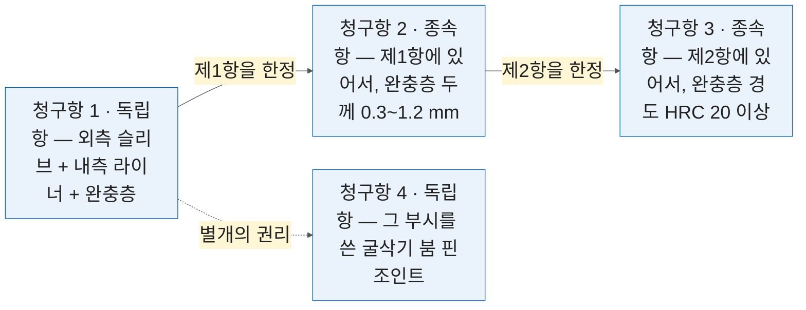
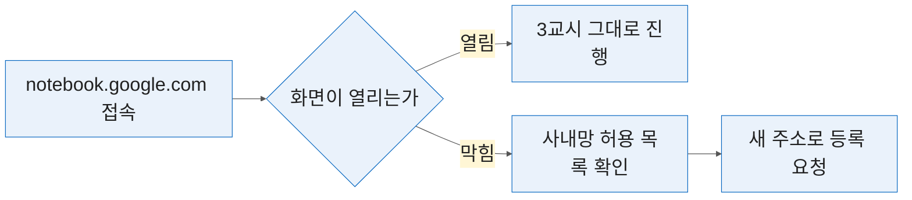
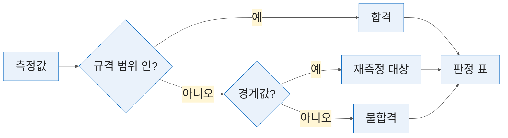

# 3일차 — 특허·논문·표준 검색과 통합 분석
#layout-chapter

::: part
Day 3.
:::

---

#id-mg-day3
#layout-_mg

## 찾기 — 답에 출처를 붙여 검증

```mg
src: mg/03-day3
```

---

## 3-0. 여는 절 — 밖에 있는 자료를 찾아옴
#layout-contents-full

2일차가 **한 장의 그림**이었다면 3일차는 **여러 문서를 한꺼번에** 다루는 시간임. 문서가 내 손에 없다는 것이 앞의 이틀과 다른 점임.

| 교시 | 내용                                     | 형태      | 산출물                          |
| :--- | :--------------------------------------- | :-------- | :------------------------------ |
| 1    | 특허 검색과 청구항 구성요소 분해         | 강의+실습 | 특허 3건 목록 + 구성요소 대비표 |
| 2    | 논문의 실험 조건·결과 추출               | 실습 중심 | 논문 3편 조건·결과 비교표       |
| 3    | 여러 자료를 한 노트북에 모아 출처와 함께 | 실습 중심 | 노트북 1개 + 인용 추적 결과     |
| 4    | 시험 데이터 정리와 그래프 자동 생성      | 실습 중심 | 정제 데이터 + 그래프 이미지 2종 |

* 🔴 **특허는 법률 문서임.** 3일차에 하는 청구항 분석은 **기술 검토를 위한 초안**이고, 침해 여부·등록 가능성 판단은 변리사의 영역임.
* 그래도 읽어야 함 — **어떤 특허를 변리사에게 넘길지 고르는 일**은 엔지니어의 몫임. 3일차는 그 선별 속도를 높임.

---

### 3일차는 내 손에 없는 자료를 찾아옴
#layout-contents
#id-day3-fetch

::: htmlart arrow
* 판단에 쓸 자료 묶음
* 특허 공보
  - KIPRIS · Google Patents
* 학술 논문
  - Google Scholar
* 사내 산출물
  - 1~2일차에 만든 표와 요약
:::

* 1·2일차는 **손에 있는 문서**를 다뤘음. 3일차는 **밖에서 가져오는 일**이 먼저임 — 가져온 뒤의 읽기·표 고정은 1일차 방식 그대로임.
* 세 갈래가 한 묶음으로 모이는 자리가 3교시 노트북임. 특허·논문·사내 표를 한 노트북에 넣어야 「우리 부시와 이 특허가 어디서 겹치는가」 같은 **문서를 가로지르는 질문**이 가능해짐.
* 밖에서 가져오는 자료에는 **저작권과 약관**이 붙어 있음. 1교시 후반이 그 경계를 다룸.

---

### 검색 3개는 무로그인, Notebook 만 구글 로그인
#layout-contents-full
#id-day3-accounts

::: cards
* **KIPRIS**
  - 무로그인. 국내 특허 원문을 한글 그대로 봄
* **Google Patents**
  - 무로그인. 해외 공보와 기계 번역
* **Google Scholar**
  - 무로그인. 논문 서지와 인용수
* **Gemini Notebook**
  - 개인 구글 계정 로그인 필요. 자료를 올려야 하므로
:::

* 3일차에 로그인이 필요한 것은 **마지막 하나뿐**임. 앞의 셋은 브라우저만 있으면 됨.
* 로그인이 없다는 것은 **저장·알림·대량 내려받기가 없다**는 뜻이기도 함. 그 경계는 1교시 「무로그인으로 되는 것과 안 되는 것」에서 표로 봄.

---

### 🔴 KIPRIS 가 영문으로 뜸 — 한국어 전환
#layout-contents
#id-kipris-lang


* 접속하면 **영문 화면**이 먼저 뜨는 경우가 있음. 그대로 쓰면 한글 원문 검색이 안 되고 국내 공보를 **영문 서지로만** 보게 되어 청구항 원문을 놓침.
* 우상단 언어 선택에서 **한국어로 전환**함. 전환 후 검색식과 결과 표기가 모두 한글이 됨.
* KIPRIS 를 쓰는 이유가 **한글 원문**이므로 이 한 단계가 뒤의 검색 전체를 좌우함. 여는 절 실습에서 먼저 확인함.

---

### 검색은 도구이고 판단은 사람임
#layout-contents
#id-day3-judgment

::: htmlart balance
* AI 에 맡기는 것
  - 수십 건에서 읽을 5건을 추림
  - 청구항을 구성요소로 쪼갬
  - 검색어 후보를 넓힘
* 사람이 하는 것
  - 침해 여부 판단
  - 회피 성립 결론
  - 출원 전략 결정
:::

* **왼쪽은 시간을 줄이고 오른쪽은 책임이 걸림.** 3일차 내내 이 경계를 지킴.
* 1일차 「맡길 것·초안만·맡기지 않을 것」의 3구분이 특허에서는 이렇게 갈림 — 선별은 맡기고, 분해는 초안만, 판단은 맡기지 않음.
* 논문도 같음 — 조건·결과 추출은 맡기고, 「우리 조건과 같은가」의 판단은 사람이 함.

---

### 🙋 실습 P3-0-1 — 4개 사이트 열어 보고 첫 검색 던지기
#layout-exercise-small
#id-ex-p3-0-1

* **시간** 5분 | **목표** 3일차에 쓸 네 사이트가 전부 열리는지 확인함
* 단계 — `kipris.or.kr` → **한국어 전환** → `patents.google.com` → `scholar.google.com` → `notebook.google.com`
* **완료조건** 네 곳이 다 열리고 KIPRIS 가 한국어임 ✅ 사내망에서 막히면 즉시 손을 듦

---

## 3-1. 특허 검색과 청구항 분석, 회피 설계 아이디어
#layout-contents

특허 검색은 **찾는 것보다 거르는 것이 일**임. 키워드로 검색하면 수십에서 수백 건이 나오고, 그중 읽어야 할 5건을 고르는 데 시간이 듦.

::: htmlart pyramid
* 읽을 5건
* 청구항까지 본 20건
* 제목·초록으로 거른 100건
* 키워드 검색 결과 수백 건
:::

* 제목만으로는 관련성 판단이 어렵고, 초록은 추상적이라 변별력이 낮음. 청구항까지 봐야 하는데 한 건에 10분씩 걸림.
* AI 가 잘하는 자리가 바로 **1차 선별**임 — 아래 두 층을 위 두 층으로 줄이는 일. 맨 위 5건을 읽고 판단하는 것은 사람임.
* 이 절의 후반은 검색 자체가 아니라 **자료를 가져오는 경로와 그 경계**임. 특허·표준 실무에서는 「해도 되는가」 판정이 기술보다 먼저임.

---

### 특허를 찾는 두 경로 — KIPRIS 와 Google Patents
#layout-contents
#id-patent-two


::: htmlart compare
* **KIPRIS** / 국내 중심
  - 한글 원문을 그대로 봄
  - 상세 검색 연산자가 강함
  - 국내 선행기술 검토에 씀
* **Google Patents** / 전 세계
  - 해외 공보와 기계 번역
  - 자연어 검색에 관대함
  - 기술 동향 파악에 씀
:::

* **국내 출원 검토는 KIPRIS, 해외 동향은 Google Patents** 로 나눠 씀.

---

### 검색어를 만들고 결과를 좁히는 순서 — CPC 분류로 좁힘
#layout-contents-full
#id-patent-narrow

::: columns

::: column {width="40%"}
::: htmlart funnel
* 키워드로 넓게 검색함
* 출원인·연도로 1차 축소
* CPC 분류 코드로 좁힘
* 제목·초록 목록만 남김
* AI 로 상·중·하 선별
:::
:::

::: column {width="56%"}
* **CPC 분류**는 기술 분야를 코드로 나눈 체계임. 부시·미끄럼 베어링은 `F16C33/04`, 건설기계 핀조인트 부시는 `E02F9/006` 에 모여 있어 코드 하나로 결과가 크게 줄어듦.
* `F16C` 는 **「축·베어링」** 묶음임. 유럽·미국 특허청이 함께 관리하는 국제 공통 코드라 **사이트를 옮겨도 같은 코드가 통함**.
* 키워드는 **동의어를 함께** 넣음 — 부시·부싱·슬리브 베어링·bush·bushing. 1일차 용어집의 영문 열이 여기서 검색어가 됨.
* 검색 결과의 제목·초록 목록을 붙여 넣고 아래처럼 물음.
:::

:::

```text
아래는 특허 검색 결과 목록이다. 내 관심 기술은 [기술 설명 2줄]이다.
각 건을 관련성 상·중·하로 분류하고 이유를 한 줄로 달아라.
'상'으로 분류한 건은 무엇이 겹치는지 구체적으로 적어라.
```

---

### 검색 결과 화면에서 먼저 볼 것 — 검색식·출원인·연도
#layout-contents
#id-patent-results-screen


* ① 왼쪽 위 **검색식 줄**의 `F16C` 가 적용된 분류임. 분류를 더하면 결과가 줄고, 빼면 늘어남 — 깔때기 셋째 단을 화면에서 조작하는 자리임.
* 목록에서 먼저 볼 것은 제목이 아니라 ② **출원인과 출원일**임. 두산인프라코어·캐터필러처럼 **현장 출원인**이면 우리 부위와 겹칠 가능성이 높고, 20년 넘은 것은 권리가 만료됐을 수 있음.
* 이 목록을 그대로 복사해 앞 장 프롬프트에 붙임. 화면을 긁는 프로그램을 쓰지 않음 — 이유는 뒤의 `robots.txt` 장에서 봄.

---

### 🔴 무로그인으로 되는 것과 안 되는 것
#layout-contents-full
#id-patent-nologin

| 동작                    | 무로그인 | 비고                          |
| :---------------------- | :------- | :---------------------------- |
| 검색·목록 조회          | 가능     | 3일차 실습은 전부 여기서 끝남 |
| 서지·초록 열람          | 가능     | 청구항 원문도 열림            |
| 공보 PDF 내려받기       | 대체로   | 일부 문서는 로그인 요구       |
| 검색식 저장·알림 설정   | **불가** | 계정이 필요함 — 3일차엔 안 씀 |
| 대량 내려받기(CSV 일괄) | **불가** | API 경로를 봐야 함            |

* 3일차 실습은 **무로그인 범위 안에서** 끝남. 계정을 만들 필요가 없음.
* 아래 두 줄이 회사로 돌아가서 필요해지는 것임 — 매달 같은 검색을 돌리려면 저장·알림이, 수백 건을 받으려면 대량 내려받기가 필요함. 그 답이 이 절 후반의 **공식 API** 임.

---

### 청구항의 구조 — 독립항 하나에 종속항이 매달림
#layout-contents
#id-claim-structure



* **독립항**은 홀로 서고, **종속항**은 「제N항에 있어서」로 시작해 앞 항을 **한정**함. 종속항은 독립항보다 항상 좁음.
* 침해는 **독립항의 구성요소가 모두 충족**될 때 성립함. 그래서 분석은 독립항부터 하고, 종속항은 「어디까지 좁혔는가」를 보는 용도임.
* WO2014129719A1 「이중 구조의 부시」가 이 모양임 — 부시 독립항 + 종속항 + 조립체 독립항. 위 값은 예시, 실물은 P3-1-2 에서 봄.

---

### 청구항 구조와 구성요소로 쪼개는 프롬프트
#layout-contents-full
#id-claim-split

* 청구항은 **구성요소가 모두 충족돼야** 침해가 성립함. 그래서 쪼개 보면 **어느 요소를 피할 수 있는지**가 보임. 독립항과 종속항 구분이 섞이면 분석이 무너짐.

::: columns

::: column {width="50%"}
```text
아래 청구항을 구성요소 단위로 분해해
번호를 붙여 나열하라.
각 구성요소가 필수인지,
종속항에서 한정되는 것인지 구분하라.
원문에 없는 요소를 추가하지 마라.
```
:::

::: column {width="46%"}
| #   | 구성요소     | 구분      | 원문 표현            |
| :-- | :----------- | :-------- | :------------------- |
| 1   | 외측 슬리브  | 필수      | 「외측 슬리브와」    |
| 2   | 내측 라이너  | 필수      | 「내측 라이너 및」   |
| 3   | 완충층       | 필수      | 「그 사이의 완충층」 |
| 4   | 두께 0.3~1.2 | 종속 한정 | 제2항                |
:::

:::

* 마지막 줄이 없으면 **일반적으로 있을 법한 요소**를 보태 놓음. 오른쪽 표처럼 「원문 표현」 열을 함께 받으면 지어낸 요소가 바로 드러남 — 원문에 그 어구가 없기 때문임.

---

### 구성요소 대비표와 회피 설계 아이디어를 얻는 질문
#layout-contents-full
#id-claim-compare

::: htmlart compare
* **AI 에 맡기는 것** / 범위를 좁힘
  - 구성요소 분해
  - 대체 가능한 방식 나열
  - 관련 선행기술 검색어 제안
  - ✓ 검토 대상을 추려 줌
* **맡기지 않는 것** / 책임이 걸림
  - 침해 여부 판단
  - 회피 성립 여부 결론
  - 출원 전략 결정
  - ✕ 변리사·법무 검토가 필수
:::

* 대비표는 **우리 제품의 구성요소**와 **청구항의 구성요소**를 나란히 놓은 표임. 겹치지 않는 칸이 검토 시작점임 — 필수 요소 하나가 우리 제품에 없으면 그 자리가 회피의 후보임.
* 회피 아이디어를 물을 때는 **「구성요소 3을 다른 방식으로 대체하는 안을 나열하라」** 처럼 요소 번호로 지목함. 「회피할 수 있는가」를 물으면 결론을 지어냄.

---

### 자료를 가져오는 세 경로 — 손 · 크롤링 · 공식 API
#layout-contents-full
#id-fetch-three

::: htmlart bracket
* 손으로 가져오기
  - 화면에서 복사하거나 PDF 를 내려받음
  - 건수가 적을 때 가장 빠르고 확실함
* 크롤링
  - 프로그램이 페이지를 훑어 긁어 옴
  - 🚫 **대상의 허락이 먼저임**
* 공식 API
  - 제공자가 열어 둔 창구로 받아 옴
  - 형식이 일정하고 약관이 명확함
:::

* 3일차 실습은 **첫 번째**로 함. 나머지 둘은 회사로 돌아가 자동화를 검토할 때의 선택지임.
* 판정 기준은 건수와 주기임 — 한 번에 10건이면 손, 매달 수백 건이면 API, 그 사이에서 API 가 없을 때만 크롤링을 **허락 확인 뒤에** 검토함.

---

### 크롤링과 스크래핑 — 같은 말로 쓰지만 다른 일임
#layout-contents-full
#id-crawl-vs-scrape

::: htmlart venn
* 크롤링 (crawling)
  - 링크를 따라 페이지를 찾아다님
  - 어떤 쪽이 있는지 모를 때 씀
  - 검색엔진 봇이 하는 일
* 공통
  - 프로그램이 대신 읽어 옴
  - 대상의 허락이 먼저임
* 스크래핑 (scraping)
  - 정한 쪽에서 값만 뽑아냄
  - 주소를 이미 알 때 씀
  - 표·목록을 표로 옮김
:::

* 실무에서는 둘을 묶어 **크롤링**이라 부르는 일이 많고 앞뒤 장에서도 그 통칭을 씀. 다만 **우리가 할 일은 대개 스크래핑**임 — 주소를 아는 몇 개 쪽에서 표를 옮겨 오는 일임.
* 구분이 실익을 갖는 자리는 **상대 서버의 부담**임. 크롤링은 쪽을 계속 넓혀 가고, 스크래핑은 정한 만큼만 받아 옴. 🚫 이름이 무엇이든 **허락 판정은 똑같음** — 뒤에 나오는 `robots.txt` 판정이 둘 다에 걸림.

---

### 크롤링의 기법 — 요청·파싱·페이지네이션·대기·에러 처리
#layout-contents-full
#id-crawl-how

::: htmlart process
* 요청
  - 페이지를 받아 옴
* 파싱
  - 필요한 부분만 골라냄
* 페이지네이션
  - 다음 쪽으로 넘어감
* 대기
  - 서버에 부담을 주지 않게 쉼
* 에러 처리
  - 실패한 건을 기록하고 재시도
:::

* 기법 자체는 어렵지 않음. **대기**를 빼먹으면 상대 서버에 부담을 주고 차단당함 — 교육장 24명이 **단일 IP** 를 쓰므로 한 사람의 연속 요청이 전원의 검색을 막을 수 있음.
* 이 다섯을 코드로 직접 짜지 않음. **Codex 에 개념으로 지시**하고 돌려서 결과를 검증함 — 1일차 agentic 이론을 적용하는 자리임. 지시문에 「요청 사이 2초 대기」·「실패 건은 목록으로 남겨라」 가 들어가야 함.

---

### 🔴 기법보다 대상이 먼저임 — `robots.txt` 와 약관을 엶
#layout-contents
#id-crawl-legal

::: htmlart numbered
* robots.txt 를 주소 끝에 붙여 엶
* 이용약관에서 자동 수집 조항을 찾음
* 둘 중 하나라도 막으면 중단함
:::

* 🚫 **기술적으로 가능한 것과 해도 되는 것은 다름.** 공개된 페이지라도 약관이 자동 수집을 금지하면 하지 않음.
* `robots.txt` 는 `사이트주소/robots.txt` 로 누구나 열 수 있는 **공개 선언문**임. `Disallow: /` 한 줄이면 전체 금지이고, 경로별로 허용·금지가 갈리기도 함. 다음 장이 실물임.
* 관행이 아니라 **국제 표준**임 — 1994년부터 쓰이다 2022년에 인터넷 표준 문서(RFC 9309)로 정식 등재됐음. 「몰랐다」가 성립하지 않는 이유임.
* ⚠️ **막지 않았다고 마음대로 써도 되는 것은 아님.** 국내에서는 남의 사이트에 쌓인 자료를 통째로 긁는 행위가 **저작권법의 데이터베이스제작자 권리**에 걸릴 수 있음 — 실제 분쟁이 있었던 영역임. `robots.txt` 는 **최소 조건**이지 허가증이 아님.
* 사내 자동화를 검토한다면 **공식 API 가 있는지부터** 봄. 있으면 그쪽이 정답임.

---

### KIPRIS 의 `robots.txt` — `Disallow: /` 한 줄이 전부임
#layout-contents
#id-kipris-robots


* ① `User-Agent: *` 는 「모든 프로그램에게」이고 그 아래 `Disallow: /` 는 「전체 경로 금지」임. 이 두 줄로 KIPRIS 는 **자동 수집 전면 금지**를 선언함.
* 그 아래 ② 검색엔진 봇 이름이 개별 허용으로 붙어 있음 — 예외는 **이름이 적힌 봇**뿐이고 우리 스크립트는 없음.
* 그래서 KIPRIS 는 **손으로 검색**하거나 다음 장의 **KIPRIS Plus OpenAPI** 로 감. Google Patents·Scholar 도 검색 결과 경로가 막혀 있어 같은 판정임.

---

### 세 사이트의 판정 — 손으로 검색하거나 API 로 감
#layout-contents-full
#id-robots-verdict

| 대상                   | `robots.txt` 판정                                     | 이 과정에서의 취급                     |
| :--------------------- | :---------------------------------------------------- | :------------------------------------- |
| 🚫 KIPRIS              | `User-Agent: *` / `Disallow: /` — **전면 금지**       | 손으로 검색 · **KIPRIS Plus OpenAPI**  |
| 🚫 Google Patents 검색 | `Disallow: /*` — **`/patent/` 상세만 허용**           | 결과 수집 금지 · 개별 문서 열람은 허용 |
| 🚫 Google Scholar      | `/search` · `/scholar` **금지**                       | 3-2 에서도 손으로 검색                 |
| ✅ 자사 사이트         | 자사 소유                                             | 회사로 돌아가서 쓸 1순위               |
| ✅ 공개 샘플 HTML      | 강사 배포본 — 제약 없음                               | 기법 실습·시연의 대상                  |

* 세 사이트 모두 **검색 결과**가 막혀 있음. 개별 특허 문서 페이지는 열리므로 「목록은 손으로, 문서는 링크로」가 실무 형태임.
* 검증 P3-1 의 세 번째 항목이 이 판정 연습임 — 배포한 공개 샘플로 함.

---

### 공식 경로 — KIPRIS Plus OpenAPI
#layout-contents-full
#id-kipris-api

::: columns

::: column {width="52%"}

:::

::: column {width="44%"}
::: htmlart cycle
* 검색식을 고정함
* 매달 같은 조건으로 조회
* 신규 건만 추려 받음
* 사람이 읽을 것을 고름
:::
:::

:::

* **KIPRIS Plus** 가 KIPRIS 공식 API 임. ① 목록에서 ② 신청하면 키를 받아 ③ 프로그램으로 조회할 수 있고, 형식이 일정해 **매달 같은 검색을 돌리는 일**에 맞음. 무료·유료 범위와 호출 한도는 현행 공지로 확인함.
* 3일차에는 쓰지 않음. 다만 **자동화가 필요해지면 크롤링이 아니라 이쪽**이라는 것을 기억함 — 키는 계정 단위라 24명 단일 IP 문제도 구조적으로 피함.

---

### 🙋 실습 P3-1-1 — KIPRIS 에서 부시·핀 관련 특허 3건 찾기
#layout-exercise
#id-ex-p3-1-1

* **시간** 8분 | **목표** 검색 → 축소 → 1차 선별을 한 번 돌림
* 단계 — 한국어 확인 → ① 「이중 구조 부시」 검색 → ② 국내·`F16C` 로 좁힘 → 목록 넣고 상·중·하 분류
* **완료조건** 「상」 판정 3건의 **원문을 실제로 열었음** ✅ 목록만 보고 끝내면 실패임


```text
아래는 특허 검색 결과 목록이다. 내 관심 기술은 건설기계용 미끄럼 베어링 부시다.
각 건을 관련성 상·중·하로 분류하고 이유를 한 줄로 달아라.
'상'으로 분류한 건은 무엇이 겹치는지 구체적으로 적어라.
```

---

### 🙋 실습 P3-1-2 — 청구항 구성요소 분해와 대비표
#layout-exercise
#id-ex-p3-1-2

* **시간** 8분 | **목표** 청구항 1항을 쪼개 제품과 맞대 봄
* 단계 — 「상」 1건 청구항 1항 복사 → 요소 분해 → 우리 제품과 대비표(`3-1_대비표.md`)
* **완료조건** 분해된 요소가 **원문 표현과 일치**함 ✅ 없는 요소가 추가되지 않음 ✅

```text
아래 청구항을 구성요소 단위로 분해해 번호를 붙여 나열하라.
각 구성요소가 필수인지, 종속항에서 한정되는 것인지 구분하라.
각 구성요소 옆에 원문의 해당 어구를 그대로 옮겨 적어라.
원문에 없는 요소를 추가하지 마라.
```

---

### ✅ 검증 P3-1 — 원문 청구항 대조와 `robots.txt` 판정
#layout-exercise-small
#id-verify-p3-1

::: htmlart numbered
* 분해 결과를 청구항 원문과 한 줄씩 대조
* 종속항 한정이 독립항으로 올라갔는지 확인
* `robots.txt` 를 열어 판정
:::

* 🔴 **AI 의 침해 판단을 결론으로 쓰지 않음.** 3일차 산출물은 변리사에게 넘길 **검토 대상 목록**임.

---

## 3-2. 논문의 핵심 요약과 실험 조건·결과 추출
#layout-contents

논문 전체를 읽을 시간은 없음. R&D 실무에서 필요한 것은 대개 셋임 — 어떤 **조건**에서 했는가, 어떤 **결과**가 나왔는가, 우리 조건과 **무엇이 다른가**.

::: htmlart explain
* 논문은 요약이 아니라 추출임
* 어떤 조건에서 했나
* 어떤 결과가 나왔나
* 우리 조건과 다른 점
:::

* 그래서 필요한 것은 요약이 아니라 **추출**임. 「이 논문이 무슨 내용인가」가 아니라 「하중 얼마·속도 얼마에서 마모율이 얼마였나」를 표로 받음.
* 2일차 사양서 비교와 **같은 원리**임 — 축을 먼저 정하고 값을 채우게 함. 논문에서는 축이 실험 조건임.

---

### 논문을 찾는 곳과 읽는 순서
#layout-contents
#id-paper-order

::: htmlart process
* 검색
  - Scholar 에서 키워드로
* 거르기
  - 인용수·연도로 축소
* 초록
  - 조건이 맞는지만 봄
* 본문 표
  - 조건·결과를 추출함
:::

* 본문을 통독하지 않음. **표와 실험 절**만 보면 대개 필요한 것이 나옴 — 논문의 결과 표는 사양서의 사양 표와 같은 자리임.
* 앞 두 단은 브라우저에서, 뒤 두 단은 ChatGPT 에서 함. 초록으로 「읽을지 말지」를 정한 논문만 PDF 로 올림.

---

### Google Scholar 검색 — 인용수와 연도로 거르기
#layout-contents
#id-scholar-filter


* 검색 결과에 ③ **인용수**가 함께 나옴. 같은 주제면 인용 많은 쪽이 먼저 볼 후보임. ① 연도 범위를 좁힘 — 재료·가공 분야는 **최근 10년**이면 충분함.
* 인용수가 높아도 **우리 조건과 다르면 쓸모가 없음** — 하중·속도 범위를 초록에서 먼저 확인함.
* 인용수는 품질 지표가 아니라 **주목도 지표**임. 최신 논문은 낮게 나오는 게 정상이고, 오른쪽 ② `[PDF]` 가 붙은 게 공개본임.

---

### 🔴 원문 PDF 가 유료인 경우가 많음 — 그때의 대안
#layout-contents
#id-paper-paywall

::: columns

::: column {width="36%"}

:::

::: column {width="60%"}
* 검색은 되는데 본문이 **유료 장벽**에 막히는 경우가 흔함. 이때 선택지는 셋임 — 공개본을 찾거나, 초록으로 끝내거나, 사내 구독으로 들어감.
* 초록으로 끝내는 것이 손해가 아님 — 조건이 우리와 다르면 본문이 있어도 쓸 데가 없음. 유료 논문 열 편보다 **조건이 맞는 공개본 세 편**이 나음.
* 국내 자료는 **RISS·ScienceON** 에 원문이 무료로 열려 있는 건이 상당수임. 학위논문과 국가 R&D 보고서가 특히 그러함 — Scholar 에서 막혔다고 포기하기 전에 한 번 더 찾아볼 곳임.
* 🚫 유료 논문을 우회해 받는 경로는 쓰지 않음.
:::

:::

---

### DBpia 와 국내 학술 DB
#layout-contents
#id-paper-kr


* 국내 학회 논문은 Scholar 에 ② **서지만 잡히고 ③ 본문이 안 열리는** 경우가 많음. 원문은 DBpia·KISS 가 갖고 대개 ① **기관 구독**이 필요함 (회사 확인 필요).
* 구독이 없어도 길이 있음 — **RISS**(학위논문·학술지)·**ScienceON**(국가 R&D 보고서)은 무료 공개분이 많고, 산업계 시험 데이터는 후자에 있음.
* 국내 논문은 **한글 용어**가 우리 문서와 맞아 용어집에 값을 함. 3일차 실습은 **Scholar 공개본**으로 진행함.

---

### 초록만으로 판단하지 않는 법
#layout-contents
#id-paper-abstract

::: htmlart funnel
* 검색 결과 전부
* 초록 — 읽을지 말지만 정함
* 하중·속도 범위가 겹치는 것
* 본문 표 — 값은 여기서 가져옴
:::

* 초록에는 **가장 좋은 결과만** 적히는 경우가 많음. 조건 범위와 실패 구간은 본문에 있음. 초록에 수치가 있어도 **측정 조건이 빠져 있으면** 우리 조건과 비교할 수 없음.
* 그래서 초록은 **읽을지 말지를 정하는 용도**로만 씀. 값은 본문 표에서 가져옴.
* 판단 기준 한 줄 — 「우리 하중·속도 범위와 겹치는가」. 겹치지 않으면 덮음. 부시라면 면압 수십 N/mm²·미끄럼속도 0.1 m/s 이하 구간이 우리 범위임.

---

### 실험 조건을 표로 뽑는 프롬프트 — 하중·속도·온도·윤활
#layout-contents-full
#id-paper-extract

* 미끄럼 베어링 시험은 조건 네 가지가 결과를 가름. 이 넷에 상대재를 더한 다섯을 축으로 고정함.

::: columns

::: column {width="50%"}
```text
첨부 논문에서 실험 조건과 결과를 표로 추출하라.
조건: 시험 하중, 미끄럼 속도, 온도, 윤활 상태,
      상대재 재질
결과: 측정 항목, 수치, 단위, 오차범위

논문에 명시되지 않은 항목은 "명시 없음"이라 적어라.
수치는 본문과 표에 있는 것만 쓰고
그래프에서 읽지 마라.
```
:::

::: column {width="46%"}
| 축         | 값               | 근거  |
| :--------- | :--------------- | :---- |
| 시험 하중  | 10 MPa           | 표 2  |
| 미끄럼속도 | 0.05 m/s         | 2.2절 |
| 온도       | 명시 없음        | —     |
| 윤활       | 무윤활           | 2.1절 |
| 상대재     | S45C, Ra 0.4     | 표 1  |
| 마모율     | 1.2×10⁻⁶ mm³/N·m | 표 3  |
:::

:::

* **「명시 없음」이 많은 논문**은 재현이 어려운 논문임. 그 자체가 판단 근거가 됨 — 온도를 안 적은 논문의 마모율은 우리 조건과 비교할 수 없음.

---

### 결과 수치를 옮길 때의 규칙 — 단위와 유효숫자
#layout-contents
#id-paper-number

::: htmlart bracket
* 그대로 가져오는 것
  - 단위 — MPa 를 바꾸지 않음
  - 오차범위 — `0.35 ± 0.04` 통째로
* 만들지 않는 것
  - 유효숫자 — `3.2` 를 `3.20` 으로 안 씀
  - 그래프에서 읽은 값
:::

* 단위를 **원문 그대로** 옮김. `MPa` 와 `N/mm²` 는 같은 값이지만 환산하는 순간 오류가 끼어듦. 1일차·2일차와 같은 규칙임.
* 유효숫자를 **늘리지 않음.** 원문이 `3.2` 면 `3.20` 으로 적지 않음 — 정밀도를 과장하는 것임. 오차범위를 함께 가져옴 — `0.35 ± 0.04` 에서 뒤를 떼면 값이 확정된 것처럼 보임.
* **그래프에서 값을 읽어 오게 하지 않음.** 본문이나 표에 없는 수치는 대부분 추정임. 1일차 SKF 카탈로그의 「그래프 안에만 있는 값」이 논문에서도 같은 함정임.

---

### 여러 논문의 조건을 한 표에 모으기
#layout-contents-full
#id-paper-merge

| 축         | 논문 A (2019)    | 논문 B (2021)     | 논문 C (2023)   |
| :--------- | :--------------- | :---------------- | :-------------- |
| 시험 하중  | 10 MPa · 표 2    | 5~20 MPa · 표 1   | 15 MPa · 3.1절  |
| 미끄럼속도 | 0.05 m/s · 2.2절 | 0.1 m/s · 표 1    | 명시 없음       |
| 윤활 상태  | 무윤활 · 2.1절   | 그리스 · 2.3절    | 무윤활 · 3.1절  |
| 상대재     | S45C · 표 1      | SCM440 · 표 1     | 명시 없음       |
| 마모율     | 1.2×10⁻⁶ · 표 3  | 0.8×10⁻⁶ · 그림 4 | 2.1×10⁻⁶ · 표 2 |

* 축을 먼저 고정하고(하중·속도·온도·윤활·상대재 + 마모율·마찰계수) 칸마다 **절 번호 또는 표 번호**를 요구함. 없으면 「명시 없음」임.
* 논문 B 의 마모율 근거가 **「그림 4」** 임 — 그래프에서 읽은 값이라 표에는 넣되 **비교에서는 뺌**. 근거 열이 있어야 이런 값을 골라낼 수 있음.
* 조건이 다르면 줄을 나눔 — 같은 논문도 하중 조건별로 행을 나눠야 논문 B 의 `5~20 MPa` 범위가 한 칸에 뭉개지지 않음.

---

### 🔴 없는 논문을 지어내는 현상
#layout-contents-full
#id-paper-halluc

::: columns

::: column {width="36%"}
::: htmlart block
* 제목이 그럴듯함
  - 실제로는 없음
* 저자·연도가 붙음
  - 실재 이름이 섞임
* DOI 까지 만듦
  - 열면 다른 논문
:::
:::

::: column {width="60%"}
* 🔴 **인용 정보는 반드시 직접 검색해 확인함.** 제목을 Scholar 에 그대로 붙여 넣어 나오는지 봄. DOI 는 `doi.org/` 뒤에 붙여 열어 봄.
* 지어낸 인용은 **형식이 완벽함** — 저자·연도·저널·권·호·쪽수까지 갖춤. 형식으로는 못 가르고 **실재 여부**로만 가름.
* 자료를 첨부해 「이 안에서만 답하라」고 하면 크게 줄어듦. 3-3 의 노트북이 그 구조임. 4일차 보고서 고찰 절에서 이 사고가 그대로 재현되므로 여기서 습관을 들임.
* **실제로 사고가 난 적이 있음.** 2023년 미국에서 변호사가 ChatGPT 가 지어낸 판례 6건을 법원에 제출했다가 제재를 받았음 — 형식이 완벽해 본인도 끝까지 몰랐던 것이 핵심임. 기술 보고서의 인용도 구조가 같음.
:::

:::

---

### 🙋 실습 P3-2-1 — Scholar 로 미끄럼 베어링 마모 논문 3편 수집
#layout-exercise
#id-ex-p3-2-1

* **시간** 8분 | **목표** 검색에서 공개본 확보까지 한 번 돌려 봄
* 단계 — Scholar 에서 키워드 검색 → 최근 10년으로 제한 → `[PDF]` 공개본 3편 확보
* **완료조건** 3편의 **본문 PDF 가 실제로 열림** ✅ 서지만 있으면 다른 논문으로 교체함

![Google Scholar 검색 결과 — `plain bearing bush wear` 로 검색하고 왼쪽에서 연도를 좁힌 상태. 오른쪽 `[PDF]` 가 붙은 것만 고름](img/scholar-search-results.png)

---

### 🙋 실습 P3-2-2 — 실험 조건·결과 비교표 작성
#layout-exercise
#id-ex-p3-2-2

* **시간** 8분 | **목표** 세 논문을 같은 축에 놓고 차이를 드러냄
* 단계 — 3편 첨부 → 위 프롬프트로 조건·결과 추출 → 한 표로 합치기
* **완료조건** 「명시 없음」이 실제로 원문에 없는 항목임을 2건 확인함 ✅

```text
첨부한 논문 3편에서 실험 조건과 결과를 하나의 표로 모아라.
행은 아래 축을 그대로 쓰고 열은 논문 3편으로 하라.
시험 하중 / 미끄럼 속도 / 온도 / 윤활 상태 / 상대재 재질 / 마모율 / 마찰계수

각 칸에 값과 근거(절 번호 또는 표 번호)를 함께 적어라.
논문에 명시되지 않은 항목은 "명시 없음" 이라 적어라.
수치는 본문과 표에 있는 것만 쓰고 그래프에서 읽지 마라.
```

---

### ✅ 검증 P3-2 — 인용 정보가 실재하는가
#layout-exercise-small
#id-verify-p3-2

::: htmlart numbered
* 제목을 Scholar 에 붙여 넣어 실재 확인
* 그래프 추정값이 아닌지 확인
* 단위와 오차범위가 원문 그대로인지 확인
:::

* **인용 3건을 직접 검색**함. 하나라도 안 나오면 나머지도 의심함.

---

## 3-3. 다중 자료 통합 Q&A 와 출처 검증
#layout-contents

여러 자료를 한자리에 모으면 **문서를 가로지르는 질문**이 가능해짐. 혼자 읽을 때는 잘 보이지 않던 **상충**이 드러남.

::: htmlart arrow
* 노트북 하나
* 특허 공보
  - 3-1 에서 고른 3건
* 논문 PDF
  - 3-2 에서 모은 3편
* 사양서·데이터시트
  - 1일차 산출물
* 도면 추출 결과
  - 2일차 산출물
:::

* 네 갈래가 한 노트북으로 모임. 여기서는 도구를 **쓰는** 데까지 하고, 답 옆에 인용이 왜 붙는지는 6일차에 원리로 다룸.
* 「A 사 사양서의 허용하중이 논문 B 의 시험 하중 범위에 드는가」 같은 질문이 이 절의 목표임. 문서 하나로는 못 묻는 질문임.

---

### 여러 자료를 한자리에 모으는 도구
#layout-contents
#id-nb-what


* Gemini Notebook 은 **올린 자료 안에서만** 답하는 도구임. 일반 챗봇과 결정적으로 다름 — 답의 각 문장에 **출처 표시**가 붙고, 자료에 없으면 **없다고 답함**.
* R&D 문서 작업에서 이 셋은 큰 차이를 만듦 — 지어내기가 구조적으로 줄어듦. 다만 **줄어드는 것이지 없어지는 것이 아님.** 출처 검증은 여전히 함.
* 1일차 P1-0-2 에서 빈 노트북을 만들어 둔 자리가 여기임. 그때 확인한 「소스 추가」 버튼이 3일차의 첫 동작임.

---

### 🔴 도메인이 바뀜 — notebook.google.com
#layout-contents
#id-nb-domain



* 예전 주소는 `notebooklm.google.com` 이었음. 지금은 **`notebook.google.com`** 임. 옛 주소를 쳐도 대개 넘어가지만, 사내망 허용 목록이 **옛 주소만** 등록돼 있으면 막힘.
* 방화벽 확인을 요청할 때는 **새 주소로** 요청함. 1일차 P1-0-2 에서 이미 확인한 곳임.
* 열리지 않으면 3교시가 통째로 막히므로 여는 절에서 미리 확인했음. 회사에서 도입할 때도 같은 확인이 먼저임.

---

### 노트북·소스·대화 — 3대 개념
#layout-contents-full
#id-nb-concepts

::: htmlart hierarchy
* 노트북
  - 소스
    - 올린 파일 하나하나
    - PDF · 문서 · 텍스트
  - 대화
    - 그 소스들에 던지는 질문
    - 답마다 출처가 붙음
:::

* **노트북 하나가 주제 하나**임. 관련 없는 자료를 한데 모으면 출처가 뒤섞여 검증이 어려워짐 — 「부시 사양」과 「회의록」은 다른 노트북임.
* 소스는 올린 뒤 켜고 끌 수 있음. 검증 P3-3 이 그 기능을 씀 — 소스 하나만 남기고 같은 질문을 던져 답이 바뀌는지 봄.

---

### 넣을 수 있는 것과 한도
#layout-contents-full
#id-nb-limits

| 갈래      | 넣을 수 있는 것                      | 한도와 조건                             |
| :-------- | :----------------------------------- | :-------------------------------------- |
| 문서      | PDF · 텍스트 · 마크다운 · 워드 · PPT | 3일차 실습의 주력                       |
| 스프레드  | 구글 시트 · CSV                      | 시트는 분량이 크면 잘림                 |
| 웹        | 링크 주소                            | **글자만 긁힘.** 로그인·유료 벽은 안 됨 |
| 미디어    | 유튜브 링크 · 오디오                 | **자막 있는 공개 영상만**               |
| 소스 수   | 노트북 하나에 **50개**(무료 기준)    | 요금제를 올리면 늘어남                  |
| 소스 크기 | 하나당 **50만 단어 또는 200MB**      | 요금제를 올려도 이 값은 그대로임        |

* 🔴 **사내 대외비 자료는 보안 검토가 먼저**임. 실습은 **본인 산출물**로만 함.
* 스캔 PDF 는 인용이 안 붙고 웹 링크는 **본문 글자만** 옴 — 2일차 OCR·1일차 「파일 첨부」와 같음.
* 드라이브의 구글 문서·시트는 **원본이 바뀌면 몇 분 안에 따라 바뀜**(PDF 는 안 바뀜).

---

### 🔴 생성물은 아껴 씀 — 주간 사용량 한도
#layout-contents-full
#id-nb-quota

::: columns

::: column {width="36%"}
::: htmlart step
* 질의응답
  - 가볍게 깎임
* 요약·브리핑
  - 무겁게 깎임
* 오디오 개요
  - 가장 무거움
:::
:::

::: column {width="60%"}
* 한도가 **「몇 번 썼나」가 아니라 「얼마나 무거운 일을 시켰나」** 로 매겨짐. 질문 길이·고른 기능·대화 길이가 모두 들어감.
* 그래서 실습은 **질의응답 위주**로 함. 생성 기능은 한 번만 눌러 보고 넘어감 — 한 번의 오디오 개요가 질문 수십 개 값임.
* **주 단위 한도**이고, 거기 닿기 전까지는 **5시간마다** 조금씩 되채워짐. 오전에 소진해도 오후에 일부 돌아옴.
* 남은 양은 **설정 > 사용량**에서 보고, 무거운 기능은 누르기 전에 **예상 소모량이 막대로 미리 뜸.** 누르기 전에 그 막대를 보는 습관을 들임.
* 그래도 막히면 **「나중에 생성」**으로 걸어 둘 수 있음. 몇 시간 뒤 알림이 옴 — 실습이 통째로 멈추지는 않음.
:::

:::

---

### 답변에 붙는 인용을 클릭함
#layout-contents
#id-nb-citation


* 답변 문장 끝에 **번호가 붙음.** 한 문장에 번호가 여럿이면 여러 소스를 합쳐 쓴 문장이고, 번호가 없으면 **모델이 스스로 덧붙인 문장**임.
* 특히 **숫자가 들어간 문장**의 번호를 봄. 숫자는 틀려도 문장이 자연스러움. 여러 자료를 종합한 문장은 **종합 과정에서 왜곡**될 수 있음.
* 붙었다고 맞는 것은 아님 — 다음 장에서 눌러서 확인함.

---

### 인용을 누르면 원문 구절이 열림
#layout-contents
#id-nb-citation-open


* 누르면 그 문장의 근거가 된 **원문 구절로 이동**하고 그 문단이 강조됨. 이동한 자리에 그 내용이 **정말 있는지**를 봄.
* 자주 어긋나는 자리는 셋임 — 조건절이 떨어져 나간 요약, 단위가 바뀐 숫자, 두 소스의 값을 하나로 합친 문장.
* 1일차 「근거 쪽수」·2일차 「도면 상 위치」가 노트북에서는 **클릭 한 번**이 됨. 확인 비용이 가장 낮은 도구이므로 검증을 거르지 않음.

---

### 출처 검증의 3단 확인
#layout-contents
#id-nb-verify3

::: htmlart numbered
* 인용을 눌러 원문 구절로 이동함
* 구절에 그 내용이 있는지 봄
* 숫자·단위가 원문과 같은지 대조함
:::

* **3건만** 확인함. 전수는 하지 않되 숫자가 든 문장을 우선함.
* 3단 중 하나라도 어긋나면 그 답 전체를 다시 봄 — 한 문장이 틀린 답은 다른 문장도 같은 방식으로 틀렸을 가능성이 높음.

---

### 소스를 빼면 답이 달라짐
#layout-contents
#id-nb-source-test

::: htmlart compare
* **소스 3개일 때** / 종합된 답
  - 여러 자료를 가로질러 답함
  - 상충이 드러남
  - 출처가 여럿 붙음
* **소스 1개만 남겼을 때** / 좁아진 답
  - 그 자료 안에서만 답함
  - 앞의 답과 달라지면 정상임
  - 달라지지 않으면 의심함
:::

* **소스를 빼도 답이 그대로면** 자료가 아니라 모델이 아는 것으로 답한 것임. 검증 P3-3 이 이 시험임.
* 이 조작이 노트북이 **어디서 답을 꺼내 오는지**를 눈으로 보는 방법임. 6일차에 그 동작의 이름(RAG)을 배움.

---

### 일반 챗봇과 무엇이 다른가
#layout-contents
#id-nb-vs-chat

::: htmlart venn
* 일반 챗봇
  - 배운 것 전체에서 답함
  - 출처가 없음
* 공통
  - 자연어로 묻고 답함
  - 요약·비교를 잘함
* 노트북
  - 올린 자료 안에서만 답함
  - 문장마다 출처가 붙음
:::

* 겹치는 부분은 **묻는 방식**이고, 갈리는 부분은 **근거의 범위**임.
* 그래서 쓰임이 갈림 — 일반 지식이나 초안이 필요하면 챗봇, **우리 자료에서 근거를 찾아야** 하면 노트북임. 6일차 「Gems 와 노트북」 판정도 같은 축임.

---

### 🙋 실습 P3-3-1 — 1~3일차 자료를 노트북 하나에 모으기
#layout-exercise
#id-ex-p3-3-1

* **시간** 8분 | **목표** 주제 하나짜리 노트북에 소스를 채움
* 단계 — 1일차 빈 노트북 열기 → 1일차 사양 표 · 2일차 BOM · 논문 3편을 ① 파일·④ 텍스트로 올리기
* **완료조건** 소스가 전부 올라가고 목록에 보임 ✅ 관련 없는 자료는 넣지 않음


---

### 🙋 실습 P3-3-2 — 통합 질의와 인용 추적
#layout-exercise
#id-ex-p3-3-2

* **시간** 8분 | **목표** 문서를 가로지르는 질문을 던지고 출처를 따라감
* 단계 — 아래 질의 실행 → 답변의 인용 3개 클릭 → 원문 구절 확인
* **완료조건** 인용 3건을 열어 내용이 맞음을 확인함 ✅

```text
업로드한 자료 전체에서 "허용하중" 과 "미끄럼속도" 에 관한 서술을 모아라.
자료별로 어떤 값과 조건을 제시하는지 표로 정리하고,
서로 상충하는 부분이 있으면 표시하라.
근거 문장의 출처를 각 행에 함께 적어라.
```

---

### ✅ 검증 P3-3 — 소스 1개만 남기고 재질의
#layout-exercise-small
#id-verify-p3-3

::: htmlart numbered
* 소스를 1개만 남기고 같은 질문을 던짐
* 답이 달라지면 자료를 보고 답한 것임
* 그대로면 모델이 답한 것임
:::

* 끝나면 끈 소스를 다시 켬 — **6일차까지** 씀.

---

## 3-4. 시험 데이터 정리와 그래프 자동 생성
#layout-contents

현장 데이터는 대개 지저분함. 측정자마다 입력 형식이 다르고, 빈 행과 메모가 섞이고, 단위가 열 제목에만 있거나 아예 없음.

::: htmlart radial
* 현장 시험 데이터
* 측정자마다 다른 형식
* 중간에 섞인 빈 행
* 셀에 적힌 메모
* 열 제목에만 있는 단위
* 쉼표로 찍은 소수점
:::

* 다섯 가지 전부 사람 눈에는 보이지만 프로그램에는 **오류**임. 정리란 이것을 프로그램이 읽을 수 있는 표로 바꾸는 일임.
* 3일차에서 유일하게 **밖에서 찾아오지 않는** 자료를 다룸. 손에 있는 데이터를 4일차 보고서의 재료로 만듦.

---

### 🔗 이 절의 산출물은 4일차 보고서의 입력임
#layout-contents
#id-day3-to-day4

::: htmlart step
* 3일차 3교시까지
  - 자료를 찾아 모음
* 3일차 4교시
  - 시험 데이터를 정리해 표와 그래프를 만듦
* 4일차 1교시
  - 그 표와 그래프로 보고서 초안을 씀
:::

* 3일차에 만든 것을 **저장해 두어야** 4일차로 이어짐. 마지막 장에서 보관 위치를 다시 짚음.
* 4일차 보고서의 「결과」 절은 **수치를 사람이 붙여 넣는** 절임. 그 수치가 3일차에 정제한 표에서 나오므로, 정제가 틀리면 보고서가 틀림.

---

### 시험 데이터가 지저분한 이유와 정리 전에 정할 것
#layout-contents
#id-data-messy

::: htmlart block
* 입력 형식이 제각각임 — `25`, `25.0`, `25℃`
* 빈 행과 메모가 섞여 있음
* 단위가 열 제목에만 있거나 없음
* 이상치가 오타인지 실제 불량인지 불분명함
:::

* AI 에 넘기기 전에 이 상태를 **그대로 알려 주는 것**이 중요함. 깨끗한 척하면 조용히 고쳐 버림 — `25℃` 를 `25` 로 바꾸는 것은 괜찮지만 `2.5` 를 `25` 로 바꾸면 사고임.
* 정리 전에 정할 것은 셋임 — **어느 열이 숫자여야 하는가**, **빈 행을 버릴 것인가 채울 것인가**, **이상치를 어떻게 표시할 것인가**. 이 셋을 규칙으로 적어 주는 것이 다음 장의 프롬프트임.

---

### Codex 로 정리 스크립트를 만들고 돌림 — 다음 달에도 씀
#layout-contents-full
#id-data-codex

* 1일차에 설치한 **Codex** 로 시연함. 정리 규칙을 말로 주면 스크립트를 만들어 줌.
* 채팅으로 정리하면 **이번 한 번**이고, 스크립트로 만들면 **다음 달 데이터에도 같은 규칙**이 적용됨. 결과가 같은지 확인하는 방법도 같음 — 같은 파일을 다시 돌려 **같은 값이 나오는지** 봄.

```text
첨부한 시험 데이터 엑셀을 정리하는 스크립트를 만들어 줘.
규칙: 온도 열에서 단위 문자를 떼고 숫자만 남긴다. 빈 행은 건너뛴다.
이상치는 지우지 말고 별도 열에 표시만 한다.
정리 전후 행 수를 화면에 찍어 줘.
```

| 방식                | 이번 달       | 다음 달                 | 규칙이 남는 곳 |
| :------------------ | :------------ | :---------------------- | :------------- |
| ChatGPT 데이터 분석 | 표를 받음     | 다시 올리고 다시 설명함 | 대화 안        |
| Codex 스크립트      | 스크립트 + 표 | 파일만 바꿔 다시 돌림   | 파일           |

---

### 파일을 넣고 파일을 받음
#layout-contents
#id-data-fileio

::: htmlart workflow
* 엑셀을 올림
* 안에서 읽고 계산함
* 결과를 파일로 내려받음
* 이름을 바꿔 저장함
* 위치를 적어 둠
:::

* ChatGPT 에 엑셀을 올리면 **그 안에서 읽고 계산**함. 결과도 파일로 내려받을 수 있음. 화면에 표로만 보여 주면 옮겨 적다 틀림. **파일로 받아** 원본과 나란히 둠.
* 내려받은 파일은 `3-4_시험데이터.xlsx` 처럼 **이름을 바꿔 저장**함. 원본을 덮어쓰지 않음.
* 4일차 보고서에 쓸 것이므로 **지금 만든 파일의 위치를 적어 둠**.

---

### 🔴 안에서 코드가 돌아감 — 읽어도 되고, 쓰지는 않음
#layout-contents
#id-data-code


* 파일을 올려 계산을 시키면 내부에서 **파이썬 코드가 실제로 실행**됨. 그 코드가 화면에 보이기도 함. **코드를 읽을 필요는 없음.** 다만 **무엇을 했는지 설명**은 요구함 — 몇 행을 버렸고 몇 행이 남았는지.
* 코드를 직접 쓰지 않음. 이 과정은 노코딩이고, 필요한 것은 **시키고 확인하는 일**임. 확인 방법은 하나임 — **합계와 건수를 원본과 대조**함.
* 1일차 「코드는 AI 가 쓰고 우리는 돌려서 확인한다」가 3일차에 처음 실제로 일어나는 자리임.

---

### 결측과 이상치를 어떻게 다루라 지시하는가
#layout-contents
#id-data-outlier

* 정리 요청은 **세 단계**로 나눔 — 진단 → 규칙 결정 → 정제. 1단계에서 **「아직 고치지 마라」** 를 넣음. 진단을 보고 규칙을 정해야 함.
* 🔴 **이상치를 지우라고 하지 않음.** 품질 데이터에서 이상치가 곧 불량인 경우가 많음. 「별도 표시하고 제외한 것과 포함한 것을 둘 다 보여 달라」로 요청함. **판단은 사람이 함.**

```text
첨부 엑셀의 데이터 구조를 진단하라.
결측·중복·이상치·형식 불일치가 각각 몇 건인지 세고 예시를 보여라.
아직 고치지는 마라.
```

| 진단 항목   | 건수 | 예시                   | 정할 규칙             |
| :---------- | ---: | :--------------------- | :-------------------- |
| 결측        |    3 | 온도 열 빈칸           | 그 행 제외, 건수 기록 |
| 중복        |    2 | 같은 시각 2행          | 뒤 행 제외            |
| 이상치      |    1 | 마모량 0.41 (평균 0.1) | **표시만**, 삭제 금지 |
| 형식 불일치 |    5 | `25℃` · `25.0`         | 숫자만 남김           |

---

### 이상치는 지우지 않고 표시만 함 — 그림으로 보면
#layout-contents-full
#id-data-outlier-chart

```d3
const pts = [
  {x: 100, y: 0.03}, {x: 200, y: 0.05}, {x: 300, y: 0.08}, {x: 400, y: 0.12},
  {x: 450, y: 0.13}, {x: 500, y: 0.15}, {x: 600, y: 0.19}, {x: 350, y: 0.41, out: true}
];
const w = 1500, h = 560;
const m = {top: 30, right: 60, bottom: 90, left: 140};
const W = w - m.left - m.right, H = h - m.top - m.bottom;
const svg = d3.select(el).append('svg').attr('viewBox', `0 0 ${w} ${h}`)
  .attr('width', '100%').attr('height', '100%');
const g = svg.append('g').attr('transform', `translate(${m.left},${m.top})`);
const x = d3.scaleLinear().domain([0, 700]).range([0, W]);
const y = d3.scaleLinear().domain([0, 0.5]).range([H, 0]);
const fs = '28px';
g.append('g').attr('transform', `translate(0,${H})`).call(d3.axisBottom(x).ticks(7))
  .selectAll('text').style('font-size', fs).style('fill', '#333');
g.append('g').call(d3.axisLeft(y).ticks(5))
  .selectAll('text').style('font-size', fs).style('fill', '#333');
g.selectAll('.domain, .tick line').style('stroke', '#888');
g.append('line').attr('x1', 0).attr('x2', W).attr('y1', y(0.2)).attr('y2', y(0.2))
  .attr('stroke', '#C82506').attr('stroke-dasharray', '10,8').attr('stroke-width', 4);
g.append('text').attr('x', W - 10).attr('y', y(0.2) - 14).attr('text-anchor', 'end')
  .text('규격 상한 0.20 mm').style('fill', '#C82506').style('font-size', fs);
g.selectAll('circle').data(pts).enter().append('circle')
  .attr('cx', d => x(d.x)).attr('cy', d => y(d.y)).attr('r', d => d.out ? 18 : 13)
  .attr('fill', d => d.out ? '#C82506' : '#0365C0').attr('opacity', 0.85);
const o = pts.find(d => d.out);
g.append('text').attr('x', x(o.x) + 28).attr('y', y(o.y) + 9)
  .text('이상치 — 지우지 않고 「표시」 열에 남김').style('fill', '#C82506').style('font-size', fs);
g.append('text').attr('x', W / 2).attr('y', H + 70).attr('text-anchor', 'middle')
  .text('시험 시간 (h)').style('fill', '#333').style('font-size', fs);
g.append('text').attr('transform', 'rotate(-90)').attr('x', -H / 2).attr('y', -90)
  .attr('text-anchor', 'middle').text('마모량 (mm)').style('fill', '#333').style('font-size', fs);
```

* 파란 점이 정상 추세이고 빨간 점이 이상치임(예시 데이터). 지우면 「350 h 에서 무슨 일이 있었는가」라는 **질문 자체가 사라짐** — 부시 시험에서는 그 한 점이 소착·이물 유입의 흔적일 수 있음.
* 그래서 표에 **「이상치」 표시 열**을 두고 남김. 그래프에는 색만 다르게 그리고, 평균·추세선은 **포함·제외 두 벌**을 받음. 어느 쪽을 보고서에 쓸지는 4일차에 사람이 정함.

---

### 그래프를 요청하는 법 — 축·단위·제목
#layout-contents-full
#id-data-chart

::: columns

::: column {width="47%"}
```text
정제된 데이터로 아래 그래프를 그려라.
1) 시간별 마모량 추이
   (선그래프, 규격 상한선 표시)
2) 하중 조건별 분포 비교 (박스플롯)

축 제목에 단위를 반드시 표기하고,
데이터 건수를 그래프에 적어라.
한글 라벨이 깨지면 영문으로 대체하고
그 사실을 알려라.
```
:::

::: column {width="49%"}
```chart
{
  "type": "line",
  "data": {
    "labels": ["0", "100", "200", "300", "400", "500"],
    "datasets": [
      {
        "label": "마모량 (mm)",
        "data": [0, 0.02, 0.05, 0.09, 0.14, 0.21],
        "borderColor": "#0365C0",
        "backgroundColor": "rgba(3,101,192,0.15)",
        "tension": 0.3,
        "borderWidth": 5,
        "pointRadius": 8
      },
      {
        "label": "규격 상한 0.20",
        "data": [0.2, 0.2, 0.2, 0.2, 0.2, 0.2],
        "borderColor": "#C82506",
        "borderDash": [6, 4],
        "pointRadius": 0,
        "fill": false
      }
    ]
  },
  "options": {
    "aspectRatio": 1.5,
    "plugins": {
      "title": { "display": true, "text": "부시 마모량 추이 (n=6)", "font": { "size": 26 } },
      "legend": { "position": "bottom", "labels": { "font": { "size": 24 } } }
    },
    "scales": {
      "x": { "ticks": { "font": { "size": 24 } }, "title": { "display": true, "text": "시험 시간 (h)", "font": { "size": 26 } } },
      "y": { "ticks": { "font": { "size": 24 } }, "title": { "display": true, "text": "마모량 (mm)", "font": { "size": 26 } } }
    }
  }
}
```
:::

:::

* **규격선 표시와 건수 표기**를 요구하면 그대로 보고서에 들어감. 오른쪽이 그 프롬프트가 낳는 그래프의 모양임 — 상한선이 있어야 「500 h 에서 규격을 넘었다」가 그림에서 읽힘.
* 한글 폰트가 없어 **네모로 깨지는 일**이 잦음. 마지막 줄이 그것을 막음.

---

### 합격·불합격 판정은 규칙을 먼저 줌
#layout-contents
#id-data-judge



* **경계값 처리를 먼저 정함.** 상한과 같은 값이 합격인지 불합격인지는 규격이 정하는 것이지 AI 가 정할 일이 아님.
* 이 판정은 4일차 2교시에서 성적서 표로 이어짐. 거기서는 경계값 규칙을 문장으로 적고 Codex 가 코드로 굳힘.

---

### Gemini 차트와 수정 버튼 — 두 번째 경로
#layout-contents
#id-data-gemini

::: htmlart compare
* **ChatGPT 데이터 분석** / 코드가 돎
  - 파일을 넣고 파일을 받음
  - 세밀한 지시가 먹음
  - 규격선·건수 표기가 됨
* **Gemini 차트** / 버튼으로 고침
  - 만든 차트를 눌러 수정함
  - 손이 덜 감
  - 세밀한 지시는 덜 먹음
:::

* 둘 다 열어 두고 **손에 맞는 쪽**을 씀. 3일차 실습은 앞의 것으로 함 — 규격선과 건수 표기가 보고서 조건이기 때문임.
* Gemini 는 개인 계정이라 **사내 시험 데이터를 올리지 않음.** 실습의 가상 데이터로만 씀.

---

### 🙋 실습 P3-4-1 — 부시 마모 시험 데이터 정리와 요약표
#layout-exercise
#id-ex-p3-4-1

* **시간** 8분 | **목표** 진단 → 규칙 → 정제의 순서를 지켜 정리함
* 단계 — 시험 데이터 엑셀 첨부 → **진단만** 요청 → 규칙 정하기 → 정제 후 변경 내역 요구
* **완료조건** 정제 전후 **행 수가 설명됨** ✅ 이상치가 삭제되지 않고 표시만 됨 ✅

```text
첨부 엑셀의 데이터 구조를 진단하라.
결측·중복·이상치·형식 불일치가 각각 몇 건인지 세고 예시를 보여라.
아직 고치지는 마라.

(진단을 확인한 뒤 규칙을 정해 이어서 지시한다)
위 규칙대로 정제하고 무엇을 몇 건 바꿨는지 표로 남겨라.
이상치는 삭제하지 말고 별도 열에 표시만 하라.
정제 전후 행 수를 함께 적어라.
```

---

### 🙋 실습 P3-4-2 — 그래프 생성과 이미지 저장
#layout-exercise
#id-ex-p3-4-2

* **시간** 8분 | **목표** 보고서에 넣을 수 있는 형태로 그래프를 받음
* 단계 — 위 그래프 프롬프트 실행 → 축 단위·건수 확인 → **이미지로 내려받아** 저장
* **완료조건** 축 제목에 단위가 있고 건수가 표기됨 ✅ 파일로 저장돼 4일차에 쓸 수 있음 ✅

```text
정제된 데이터로 아래 그래프를 그려라.
1) 시간별 마모량 추이 (선그래프, 규격 상한선 표시)
2) 하중 조건별 분포 비교 (박스플롯)

축 제목에 단위를 반드시 표기하고, 데이터 건수를 그래프에 적어라.
한글 라벨이 깨지면 영문으로 대체하고 그 사실을 알려라.
그린 그래프를 이미지 파일로 내려받을 수 있게 해라.
```

---

### ✅ 검증 P3-4 — 합계와 건수를 원본과 대조
#layout-exercise-small
#id-verify-p3-4

::: htmlart numbered
* 정제 후 건수가 맞는가
* 그래프 축 단위가 원본과 같은가
* 규격선 값이 실제 규격과 일치하는가
:::

* **조용히 사라진 행**이 가장 위험함. 건수를 맞춰 보는 것으로 대부분 잡힘.

---

### 🔗 3일차에 만든 표와 그래프를 4일차로 가져감
#layout-contents
#id-day3-handoff

| 산출물                | 만든 곳 | 다음에 쓰이는 곳         |
| :-------------------- | :------ | :----------------------- |
| `3-4_시험데이터.xlsx` | P3-4-1  | 4-1 보고서 「결과」 절   |
| 그래프 이미지 2종     | P3-4-2  | 4-1 보고서 · 4-4 발표 덱 |
| `3-1_대비표.md`       | P3-1-2  | 5-1 명세서 골격          |
| 논문 조건·결과 표     | P3-2-2  | 4-1 보고서 「고찰」 절   |

* **파일 위치를 지금 적어 둠.** 4일차 첫 실습이 이 파일을 여는 것으로 시작함.
* 네 산출물 중 둘(정제 데이터·논문 표)이 4일차 보고서의 **수치 원본**임. 숫자는 이 파일에서 **사람이 복사**해 넣음.

---

## 3-5. 닫는 절 — 3일차 정리
#layout-summary

3일차는 찾고 읽고 모으고 정리했음. 4일차부터는 **쓰는 시간**임.

::: htmlart compare
* **1~3일차 — 읽는 일** / 밖에 있는 것을 안으로
  - 사양서·도면·특허·논문
  - 찾고 뽑고 모았음
  - 산출물은 표와 요약임
* **4~6일차 — 쓰는 일** / 안에 있는 것을 밖으로
  - 보고서·성적서·명세서
  - 쓰고 판정하고 묶음
  - 입력은 앞 3일의 산출물임
:::

---

### 3일차 정리 — 찾기·읽기·모으기·정리하기
#layout-summary
#id-day3-wrap

::: htmlart process
* 찾기
  - 특허는 1차 선별에 씀
* 읽기
  - 논문은 요약이 아니라 추출
* 모으기
  - 노트북은 출처가 붙음
* 정리하기
  - 진단 → 규칙 → 정제
:::

* 3일차에도 반복된 것이 하나 있음 — **「없으면 없다고 적게 하는 것」** 임. 미기재·명시 없음·불명, 표현은 달라도 같은 장치임.
* 새로 더해진 것은 **「해도 되는가」의 판정**임 — `robots.txt`·약관·유료 장벽·개인 계정. 기술이 되는 것과 해도 되는 것을 가르는 습관이 4일차부터의 「쓰는 일」에서 더 중요해짐.

---

### 3일차에 확인한 무료 도구의 경계
#layout-summary
#id-day3-limits

::: htmlart hexagon
* 무로그인 검색
  - 조회는 되나 저장·알림은 안 됨
* 논문 유료 장벽
  - 공개본이 없으면 초록으로 끝냄
* 노트북 생성 한도
  - 요약·오디오는 아껴 씀
* 국내 학술 DB
  - 기관 구독이 필요함
:::

* 경계를 알면 **막혔을 때 당황하지 않음.** 우회할 곳이 정해져 있음 — 저장·알림은 API, 유료 논문은 초록, 국내 DB 는 회사 구독.

---

### 🔗 3일차 산출물이 다음 3일에 쓰이는 자리
#layout-summary
#id-day3-forward

::: htmlart timeline
* 4일차
  - 시험 데이터 표와 그래프로 보고서를 씀
* 5일차
  - 특허 대비표로 명세서 초안을 씀
* 6일차
  - 3일차까지의 산출물을 지식베이스로 묶음
:::

* 노트북은 6일차에 다시 열림 — 그때는 5일차 볼트가 소스가 되고, 3일차의 노트북은 「왜 그렇게 동작했는가」를 되짚는 사례가 됨.

---

### 자주 나온 질문
#layout-contents
#id-day3-faq

* **Q. 특허 침해 여부를 AI 가 판단해 주는가** — 하지 않음. 구성요소를 쪼개 **검토 대상을 좁히는** 데까지임.
* **Q. 크롤링을 해도 되는가** — 대상의 `robots.txt` 와 약관이 정함. 공식 API 가 있으면 그쪽이 먼저임.
* **Q. 논문 인용이 진짜인지 어떻게 아는가** — 제목을 Scholar 에 붙여 넣어 봄. 안 나오면 없는 논문임.
* **Q. 노트북에 사내 자료를 올려도 되는가** — 보안 검토가 먼저임. 3일차 실습은 본인 산출물로만 했음.
* **Q. 이상치를 왜 안 지우는가** — 그 한 점이 불량의 흔적일 수 있음. 표시만 하고 판단은 사람이 함.

---

### 🎬 다음 시간 예고 — 이제 쓰기
#layout-contents
#id-day3-next

::: htmlart compare
* **3일차까지 — 읽는 시간** / 찾고 정리함
  - 사양서·도면·특허·논문
  - 표와 그래프로 정리함
* **4일차부터 — 쓰는 시간** / 문서를 냄
  - 기술 보고서·시험 성적서
  - 영문 초록·발표 덱
:::

* 3일차에 만든 표와 그래프가 그대로 4일차 문서의 재료가 됨. 초안까지 하루 안에 만들어 봄.
* 쓰는 일에는 읽는 일과 **다른 위험**이 있음 — 틀려도 자연스러움. 4일차의 검증이 표본에서 전수로 바뀌는 이유임.
