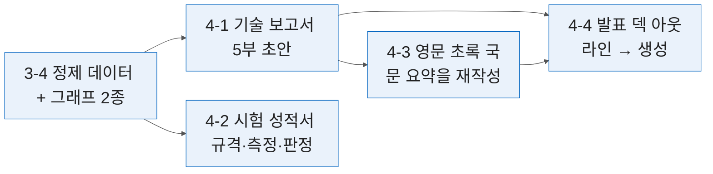
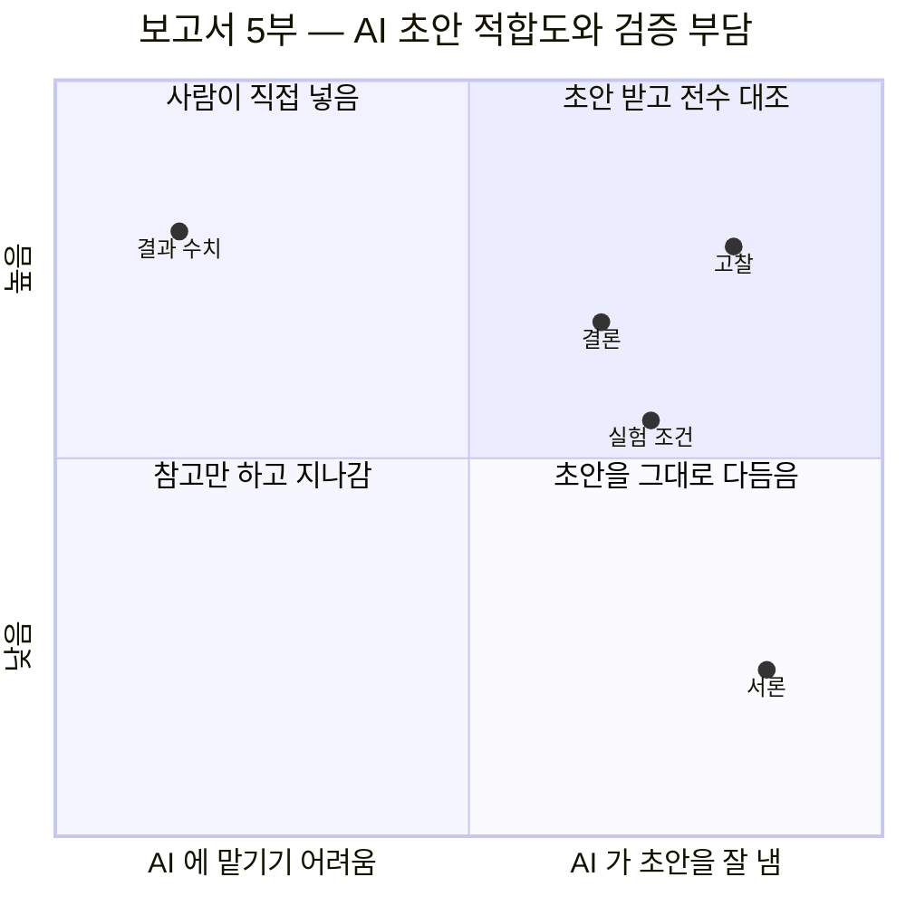
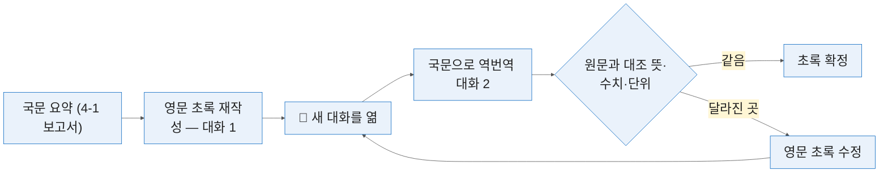

# 4일차 — 기술 보고서·시험 성적서·영문 자료
#layout-chapter

::: part
Day 4.
:::

---

#id-mg-day4
#layout-_mg

## 쓰기 — 정제 데이터에서 네 종류의 문서로

```mg
src: mg/04-day4
```

---

## 4-0. 여는 절 — 읽는 일에서 쓰는 일로
#layout-contents-full

3일차까지가 **읽는 시간**이었음. 4일차부터는 **쓰는 시간**임. 네 가지를 쓰는데 전부 **3일차에 만든 데이터**에서 출발함.

| 교시 | 내용                                   | 형태      | 입력 → 산출물                       |
| :--- | :------------------------------------- | :-------- | :---------------------------------- |
| 1    | 기술 보고서 5부 초안을 나눠 씀         | 실습 중심 | 3-4 정제 표·그래프 → 보고서 초안    |
| 2    | 시험 성적서 판정 표를 규칙으로 만듦    | 실습 중심 | 같은 데이터 → 규격·측정·판정 3열 표 |
| 3    | 영문 초록으로 바꾸고 역번역으로 검증함 | 실습 중심 | 4-1 국문 요약 → 영문 초록           |
| 4    | 발표 아웃라인과 덱을 만듦              | 실습 중심 | 4-1·4-3 산출물 → 발표 덱            |

* 4교시가 **직렬**임 — 1교시가 밀리면 뒤가 전부 밀림. 그래서 1교시 실습이 가장 빡빡하고, 산출물을 파일로 저장하는 습관이 4일차에 가장 중요함.
* 하루 종일 **부시 하나**를 씀. 3-4 에서 정리한 부시 마모 시험 데이터가 보고서·성적서·초록·덱까지 그대로 흘러감.

---

### 3일차까지 읽었음, 4일차부터 씀
#layout-contents
#id-day4-shift

::: htmlart step
* 1·2일차 — 읽기
  - 사양서·도면에서 값을 꺼냄
* 3일차 — 찾기와 모으기
  - 밖의 자료를 가져와 정리함
* 4일차 — 쓰기
  - 모은 것으로 문서를 만듦
:::

* 읽을 때는 **틀리면 보임**. 원문이 옆에 있어 대조하면 드러남. 쓸 때는 **틀려도 자연스러움** — 비교할 원문이 없음. 그것이 4일차의 위험임.
* 앞 사흘의 산출물이 전부 4일차의 입력임. 1일차 용어집은 문체 통일에, 2일차 비교표는 서론의 배경에, 3일차 논문 표는 고찰에, 3-4 데이터는 결과에 들어감.
* 쓰는 방식도 바뀜 — 읽기는 「무엇을 뽑을지」를 정했다면, 쓰기는 「무엇을 사람이 넣을지」를 먼저 정함.

---

### 쓰는 일에는 다른 위험이 있음 — 그럴듯한 거짓
#layout-contents
#id-day4-risk

::: htmlart explain
* 문장이 매끄러우면 검증을 건너뜀
* 읽을 때는 원문과 다르면 눈에 띔
* 쓸 때는 비교할 원문이 없음
* 그래서 숫자와 인용이 통과해 버림
* 4일차 검증은 전수 대조임
:::

* **보고서는 서명이 붙는 문서**임. 초안이 자연스러울수록 확인을 더 해야 함 — 잘 쓴 문장일수록 검토자의 눈이 미끄러짐.
* 1일차에 본 「정확성은 문장의 자연스러움이지 수치의 정확성이 아님」이 4일차에 가장 비싸게 드는 자리임. 보고서의 `0.35` 가 `약 0.4` 로 적혀도 문장은 매끄러움.
* 3일차에 본 「없는 논문 지어내기」가 보고서 고찰 절과 서론 배경에서 그대로 재현됨. 사고 유형은 새것이 아니고 **자리만 바뀜**.

---

### 4일차에 만드는 네 개의 산출물
#layout-contents-full
#id-day4-outputs

::: cards
* **기술 보고서 초안**
  - 5부 구조. 3일차 시험 데이터가 결과 절의 입력임
* **시험 성적서 판정 표**
  - 규격값·측정값·판정 3열. 경계값 규칙을 먼저 정함
* **영문 초록**
  - 번역이 아니라 재작성. 역번역으로 검증함
* **발표 덱**
  - 아웃라인을 먼저 쓰고 도구에 넘김
:::

* 넷 다 **초안**임. 그대로 제출하는 문서가 아니라 사람이 고쳐 쓰는 재료임. 넷 중 성적서만 **판정이 붙는 문서**라 검증 수위가 다름.
* 넷의 공통 규칙이 하나임 — **숫자는 사람이 넣음.** AI 에는 구조와 문장을 맡기고 값은 붙여 넣음.

---

### 4일차의 검증 원칙 — 숫자는 전부 대조함
#layout-contents
#id-day4-verify-rule

::: htmlart balance
* 앞선 사흘 — 표본
  - 3행만 열어 보면 됐음
  - 경향이 맞는지만 봄
* 4일차 — 전수
  - 숫자는 전부 대조함
  - 하나가 틀리면 문서 전체를 못 씀
  - 값은 사람이 붙여 넣음
:::

* 앞선 사흘의 검증은 **표본**이었음 — 3행만 열어 보면 표를 믿을지 말지가 정해졌음. 4일차는 다름. **숫자는 전부 대조함.** 보고서와 성적서에 들어간 값은 하나가 틀려도 문서 전체를 못 씀.
* 인용도 마찬가지임. 고찰 절의 선행 연구 인용은 3일차 방식대로 **제목을 직접 검색**해 실재를 확인함.
* 🔴 **숫자는 사람이 넣는 것**을 원칙으로 함. AI 에는 문장을 맡기고 값은 붙여 넣음. 전수 대조가 부담스러우면 **애초에 AI 가 숫자를 쓰지 않게** 하는 것이 더 싼 방법임.

---

### 하루가 직렬로 이어짐 — 3-4 데이터에서 발표 덱까지
#layout-contents-full
#id-day4-pipeline



* 왼쪽 하나에서 넷이 갈라짐. 보고서(4-1)가 **가운데 허브**라 그 절의 산출물을 저장하지 않으면 3·4교시가 시작되지 않음.
* 성적서(4-2)는 보고서를 거치지 않고 데이터에서 바로 나옴 — 같은 측정값에 **판정 열만 새로 붙는** 것임.
* 그림의 화살표가 곧 **파일을 여는 순서**임. 실습마다 「어느 파일을 열어 시작하는가」가 첫 단계에 적혀 있음.

---

### 🙋 실습 P4-0-1 — 3일차에 만든 시험 데이터 표를 꺼냄
#layout-exercise-small
#id-ex-p4-0-1

* **시간** 5분 | **목표** 네 절이 쓸 입력이 손에 있는지 확인함
* 단계 — 3일차에 저장한 정제 데이터 열기 → 그래프 이미지 2종 확인 → 논문 조건·결과 표 확인
* **완료조건** 표와 그래프가 온전히 남아 있음 ✅ 없으면 옆 사람 것을 복사해 진행함

---

## 4-1. 기술 보고서 초안 작성
#layout-contents

보고서는 **한 번에 다 쓰게 하지 않음**. 절마다 성격이 달라 한꺼번에 요구하면 전부 평범해짐.



* 오른쪽으로 갈수록 AI 초안이 쓸 만하고, 위로 갈수록 틀렸을 때 비쌈. **고찰**이 오른쪽 위임 — 초안은 잘 나오는데 지어내기가 가장 잦은 자리라 전수 대조가 붙음.

---

### 기술 보고서의 5부 구조
#layout-contents-full
#id-report-structure

::: htmlart hierarchy
* 기술 보고서
  - 서론
    - 배경 — 왜 이 시험이 필요했나
    - 목적 — 무엇을 확인하려 했나
  - 실험
    - 조건 — 하중·속도·온도·윤활
    - 방법 — 장비와 절차
  - 결과
    - 수치와 그래프. **사람이 넣음**
  - 고찰
    - 결과가 뜻하는 것. 🔴 가장 잘 틀리는 자리
  - 결론
    - 확인된 사실만. 과장 금지
:::

* 다섯 절이 **다른 성격**임 — 서론은 사실, 실험은 조건, 결과는 수치, 고찰은 해석, 결론은 확인된 것. 그래서 절마다 프롬프트가 다르고 검증도 다름.
* 학술 논문의 국제 관행은 **IMRAD**(서론·방법·결과·고찰) 네 덩어리이고, 여기 쓰는 다섯 절은 거기에 결론을 떼어 낸 **국내 기술보고서 형태**임. 해외 투고를 겸할 때는 4-3 에서 네 덩어리로 다시 묶음.

---

### 한 번에 다 쓰게 하지 않음
#layout-contents
#id-report-split

::: htmlart process
* 개요 합의
  - 절 제목만 먼저 정함
* 절 단위 작성
  - 한 절씩 요청함
* 수치 주입
  - 결과는 사람이 넣음
* 통합 검토
  - 용어와 문체를 맞춤
:::

* 한꺼번에 요구하면 **분량은 나오나 절마다 깊이가 같아짐.** 실험 절이 서론처럼 뭉뚱그려지고, 고찰이 결과를 되풀이함.
* 1일차 P1-1-6 「목차를 주고 글을 길게 쓰게 하기」와 1-3 의 3단계 요약이 같은 원리임 — 구조를 먼저 고정하고 채움. 보고서는 그 구조가 5부임.
* 네 단계 중 **셋째가 사람의 일**임. 나머지 셋은 AI 가 하고 사람이 확인함.

---

### 5부를 누가 쓰는가 — 절마다 AI 와 사람의 몫이 다름
#layout-contents-full
#id-report-who

| 절   | AI 가 초안을 냄           | 사람이 넣는 것               | 검증 방법                      |
| :--- | :------------------------ | :--------------------------- | :----------------------------- |
| 서론 | 배경·목적 문장            | 인용할 실제 문헌 · 고객 요구 | 인용 실재 확인 (3일차 방식)    |
| 실험 | 틀에 맞춘 조건 서술       | 조건 값 5종 · 장비명         | 「미기재」가 실제 미기재인가   |
| 결과 | 수치를 서술하는 문장 구조 | **수치 전부** · 그래프 파일  | 원본 표와 한 자씩 대조         |
| 고찰 | 해석 문장 · 추정 표시     | 인용 문헌 · 「추정」 판정    | 근거 없는 단정 0건 · 인용 실재 |
| 결론 | 확인된 사실의 요약        | 범위 한정 문구               | 평가 형용사 0건                |

* 세로로 읽으면 **사람이 넣는 열이 곧 검증 열**임 — 사람이 넣은 것만 대조하면 되고, AI 가 쓴 문장은 구조만 봄.
* 「결과」 행이 유일하게 **수치 전부**가 사람 몫임. 그래서 실습 P4-1-2 가 3일차 표를 붙여 넣는 것으로 시작함.

---

### 개요를 먼저 합의함
#layout-contents
#id-report-outline

* 절 제목과 각 절에 들어갈 항목을 **먼저 확정**함. 본문을 쓰기 전에 구조를 고정하는 것임.
* 1일차 P1-1-6 에서 해 본 것과 같은 방식임 — **목차를 주면 확장이 안정됨**. 개요 단계에서 **분량도 정함.** 절마다 몇 문단인지 적어 주면 균형이 맞음.
* 개요가 나오면 **항목을 빼고 더하는 것은 사람이 함.** 「확인하지 않는 것」을 목적 절에 넣는 식으로, 나중에 과장을 막을 장치를 개요 단계에 심음.

```text
아래 시험 개요로 기술 보고서 목차를 만들어라.
절 제목과 각 절에 들어갈 항목만 적고 본문은 쓰지 마라.
절마다 예상 분량(문단 수)을 함께 적어라.
```

---

### 서론 — 배경과 목적을 나누는 법
#layout-contents
#id-report-intro

::: htmlart bracket
* 배경 — 왜 필요했나
  - 고객 요구
  - 표준 개정
  - 경쟁사 동향
* 목적 — 무엇을 확인하나
  - 이 시험의 범위
  - 확인하지 않는 것
:::

* 배경과 목적이 섞이면 서론이 길어지기만 함. **배경은 왜 필요했나**, **목적은 무엇을 확인하나** 임.
* 배경에는 **외부 사실**이 들어감 — 고객 요구, 표준 개정(5일차 ISO 3547-2 개정이 그 예), 경쟁사 동향(2일차 비교표). 목적에는 **이 시험의 범위**가 들어가고, 확인하지 않는 것도 적어 두면 뒤에서 과장이 줄어듦.
* 배경에 인용이 들어가면 **3일차에서 본 지어내기**가 여기서 나옴. 인용은 실제 문헌만 씀 — 3-2 에서 확보한 논문 3편이 그 재료임.

---

### 실험 — 조건을 빠짐없이 적게 하는 틀 (하중·미끄럼속도·온도·윤활)
#layout-contents-full
#id-report-method

미끄럼 베어링 시험은 조건 다섯이 빠지면 재현이 안 됨. 틀을 주고 채우게 함.

```text
아래 틀에 맞춰 실험 절을 작성하라. 빈 항목은 "미기재"로 두고 추측하지 마라.

시험 하중 :
미끄럼 속도 :
시험 온도 :
윤활 조건 :
상대재 재질 :
시험 장비 :
시험 절차 :
```

* 3일차에서 논문 조건을 뽑을 때 쓴 축과 **같은 축**임. 비교가 가능해짐 — 고찰에서 「논문 B 는 그리스 윤활, 본 시험은 무윤활」 같은 문장이 이 축 덕에 나옴.
* 「미기재」로 남은 항목은 **시험 기록을 다시 찾아 채움.** AI 가 채우면 다음 달 재현 시험이 다른 조건으로 돌아감.

---

### 결과 — 수치는 사람이 넣음
#layout-contents
#id-report-results

::: htmlart callout
* 📌 결과 절의 원칙
* **문장은 AI** | 서술 구조를 만듦
* **숫자는 사람** | 값은 붙여 넣음
* **그래프는 3일차 것** | 새로 그리지 않음
:::

* 🔴 AI 에 수치를 맡기면 **그럴듯한 근사값**을 씀. 원본에 `0.35` 가 있어도 `약 0.4` 로 적힘. 3일차에 만든 표를 붙여 넣고 **「이 값을 그대로 쓰라」** 고 지시함.
* 그래프도 새로 그리게 하지 않음. 3-4 에서 규격선·건수를 붙여 저장한 이미지를 그대로 넣음 — 다시 그리면 축 단위가 바뀔 수 있음.
* 결과 절은 **해석을 담지 않음.** 「규격 대비 절반」 같은 평가는 고찰로 넘김. 결과에 해석이 섞이면 검증할 숫자와 판단할 문장이 한 문단에 섞임.

---

### 고찰 — AI 가 가장 잘 틀리는 자리
#layout-contents
#id-report-discussion

::: htmlart arrow
* 이 데이터로 말할 수 있는 것만 쓰라
  - 고찰에 넣는 한 줄
* 원인을 단정함
* 없는 선행 연구를 인용함
* 데이터가 말하지 않는 경향을 말함
:::

* 고찰은 **결과가 뜻하는 바**를 쓰는 절임. 근거 없이 쓰기 가장 쉬운 자리이기도 함. 흔한 사고 셋임 — 원인을 단정함, 없는 선행 연구를 인용함, 데이터가 말하지 않는 경향을 말함.
* 방어는 하나임 — **「이 데이터로 말할 수 있는 것만 쓰라」** 를 명시함. 추정은 **추정이라고 적게 함.** 「~로 판단됨」과 「~로 추정됨」을 구분해 쓰게 함.
* 3-2 에서 만든 논문 조건·결과 표가 고찰의 유일한 인용 재료임. 그 표에 없는 문헌이 고찰에 나오면 **지어낸 것**임.

---

### 결론 — 과장 표현을 걷어내는 문장
#layout-contents-full
#id-report-conclusion

::: columns

::: column {width="48%"}
```text
결론은 이 시험 조건 범위 안에서
확인된 사실만 적어라.
조건 범위를 넘는 일반화를 하지 마라.
"우수한", "획기적인" 같은 평가 표현을
쓰지 말고 수치로 적어라.
```
:::

::: column {width="48%"}
| 과장 표현          | 수치로 바꾼 문장                  |
| :----------------- | :-------------------------------- |
| 우수한 내마모성    | 500 h 마모량 0.21 mm (규격 0.20)  |
| 매우 안정적인 마찰 | 마찰계수 0.08~0.11, 표준편차 0.01 |
| 획기적인 수명 향상 | 비교품 대비 마모율 42% 감소 (n=6) |
:::

:::

* 결론에 **「우수한」·「획기적인」·「매우 안정적인」** 같은 표현이 들어가면 근거를 물어야 함. 확인된 사실만 적게 함 — 시험 조건 범위 안에서 무엇이 확인됐는지.
* 오른쪽 열처럼 **수치·조건·건수**가 붙어야 결론임. 왼쪽 열은 영업 문구이지 기술 보고서의 문장이 아님.

---

### 문체와 용어 일관성을 유지하는 법
#layout-contents
#id-report-style

::: htmlart funnel
* 절마다 따로 쓴 초안
* 용어집을 절마다 함께 줌
* 평서형 종결로 문체를 지정함
* 「용어와 어미만 통일하라」
:::

* 절마다 따로 쓰면 **용어가 갈림** — 「부시」와 「부싱」, 「마모량」과 「마멸량」이 섞임. 1일차에서 만든 **용어집을 다시 붙임.** 같은 용어집을 절마다 함께 줌.
* 문체도 지정함 — 보고서는 **평서형 종결**로 통일함. 절마다 어미가 달라지면 한 사람이 쓴 글로 안 보임.
* 마지막에 전체를 한 번에 주고 **「용어와 어미만 통일하라. 내용은 바꾸지 마라」** 를 요청함. 이 단계에서 **숫자가 바뀌지 않았는지** 다시 봄 — 문장을 다듬다 값이 바뀌는 일이 있음.

---

### Writing Block 으로 문단 단위 고쳐 쓰기
#layout-contents
#id-report-canvas

::: htmlart workflow
* 초안을 블록으로 받음
* 고칠 문단을 드래그함
* 그 부분만 지시함
* 숫자가 그대로인지 봄
* 사람이 확정함
:::

* Writing Block 은 답을 **문서처럼 열어 두고** 부분만 고치는 화면임. 전체를 다시 생성하지 않음. 고치고 싶은 문단을 **드래그해 선택**하고 그 부분만 지시함.
* 보고서처럼 **긴 문서를 여러 번 손보는 일**에 맞음. 채팅으로 왕복하면 앞 문단이 바뀜 — 결과 절의 숫자를 확인해 뒀는데 고찰을 고치다 결과가 다시 생성되는 사고가 그것임.
* 고친 뒤에는 **숫자가 그대로인지** 다시 봄. 문장을 다듬다 값이 바뀌는 일이 있음.
* 📌 예전 자료에 나오는 **Canvas** 가 이것임. 2026년 중반에 없어지고 **대화 안의 블록**으로 바뀜 — 옆에 따로 열리지 않고 답변 자리에 그대로 생김.

---

### 🙋 실습 P4-1-1 — 개요 합의와 서론·실험 초안
#layout-exercise
#id-ex-p4-1-1

* **시간** 8분 | **목표** 구조를 먼저 고정하고 앞 두 절을 받음
* 단계 — 시험 개요 입력 → 목차만 생성 → 목차 확정 후 서론·실험 절 요청
* **완료조건** 절 제목이 지시한 그대로 유지됨 ✅ 실험 조건 틀의 빈칸이 「미기재」로 표시됨 ✅

```text
아래 시험 개요로 기술 보고서 목차를 만들어라.
절 제목과 각 절에 들어갈 항목만 적고 본문은 쓰지 마라.
절마다 예상 분량(문단 수)을 함께 적어라.

목차가 확정되면 서론과 실험 절만 작성하라.
실험 절은 아래 틀을 그대로 지키고 빈 항목은 "미기재"로 두어라.
시험 하중 / 미끄럼 속도 / 시험 온도 / 윤활 조건 / 상대재 재질 / 시험 장비 / 시험 절차
```

---

### 🙋 실습 P4-1-2 — 결과·고찰·결론 작성
#layout-exercise
#id-ex-p4-1-2

* **시간** 8분 | **목표** 수치를 사람이 넣고 문장만 받는 순서를 익힘
* 단계 — 3일차 정제 표 붙여 넣기 → 결과 절 요청 → 고찰·결론 요청 (추정 표시 강제)
* **완료조건** 결과 절 수치가 **원본과 한 자도 다르지 않음** ✅ 결론에 평가 표현이 없음 ✅

```text
아래 표의 수치를 그대로 써서 결과 절을 작성하라.
값을 반올림하거나 "약" 을 붙이지 마라.

[3일차에 정제한 시험 데이터 표를 붙여 넣는다]

이어서 고찰과 결론을 작성하라.
고찰은 이 데이터로 말할 수 있는 것만 쓰고, 추정이면 "~로 추정됨" 이라 적어라.
결론은 시험 조건 범위 안에서 확인된 사실만 적고 평가 표현을 쓰지 마라.
```

---

### ✅ 검증 P4-1 — 수치와 인용 전수 대조
#layout-exercise-small
#id-verify-p4-1

::: htmlart numbered
* 모든 수치를 원본과 대조
* 인용 문헌을 실제로 검색해 실재 확인
* 고찰에 근거 없는 단정이 없는지 확인
:::

* **표본이 아니라 전수**임. 숫자 하나가 틀리면 보고서 전체를 못 씀.

---

## 4-2. 시험 성적서 양식 자동화와 합격 판정 표
#layout-contents

성적서는 보고서와 다름. **양식이 정해져 있고 판정이 붙음.** 자유도가 낮은 대신 정확도 요구가 높음.

::: htmlart gear
* 양식 — 칸이 먼저
* 규칙 — 문장으로
* 판정 — 값을 대조
:::

* 세 톱니가 맞물림 — 양식이 칸을 정하고, 규칙이 칸을 채우는 법을 정하고, 판정이 규칙대로 값을 비교함. 하나가 빠지면 나머지가 헛돎.
* 보고서가 「문장은 AI, 숫자는 사람」이었다면 성적서는 **「비교는 AI, 규칙과 서명은 사람」** 임.

---

### 성적서는 양식이 먼저임
#layout-contents
#id-cert-form

::: htmlart step
* 양식을 먼저 줌
  - 회사·고객이 정한 항목 순서
* 칸을 채우게 함
  - 「성적서를 써 줘」로 시작하지 않음
* 같은 형태로 나옴
  - 매달 같은 작업이 같은 결과로
* 자동화의 전제가 됨
:::

* 성적서는 **회사나 고객이 정한 양식**이 있음. 항목 순서와 표기가 고정돼 있음. 그래서 「성적서를 써 줘」로 시작하면 안 됨. **양식을 먼저 주고 칸을 채우게** 함.
* 양식이 고정되면 매달 같은 작업이 **같은 형태**로 나옴. 이것이 자동화의 전제이고, 이 절 끝의 「반복 성적서」가 그 자동화임.

---

### 양식을 AI 에 알려 주는 두 방법
#layout-contents
#id-cert-form-how

::: htmlart compare
* **파일로 주기** / 기존 성적서 첨부
  - 실제 양식이 그대로 전달됨
  - 표 구조·항목명이 보존됨
  - 이전 고객 정보가 섞이지 않게 지움
* **텍스트로 주기** / 항목을 나열
  - 빠르고 안전함
  - 표 구조는 따로 지정해야 함
  - 항목이 많으면 누락이 생김
:::

* 4일차 실습은 **텍스트로** 함. 사내 양식 파일에는 대개 고객 정보가 남아 있음 — 파일로 줄 때는 **비식별 처리가 먼저**임.
* 회사에서는 파일 방식이 정확함. 대신 **이전 고객명·로트 번호가 지워졌는지** 올리기 전에 확인함. 성적서 사고의 상당수가 이것임.

---

### 판정 규칙을 문장으로 적음
#layout-contents
#id-cert-rule

::: htmlart target
* 규격서
  - 원문이 기준임
* 판정 규칙 문장
  - "상한 이하이면 합격"
* 양쪽 한계
  - 둘 다 적음
* 사람이 대조함
:::

* 판정은 **규칙이 먼저**임. 규칙 없이 값을 주면 모델이 임의 기준으로 합격·불합격을 씀. 규칙은 문장으로 적음 — *"치수는 규격 상한 이하이면 합격"*, *"경도는 하한 이상이면 합격"*.
* **양쪽 한계가 있는 항목**은 둘 다 적음. 한쪽만 적으면 반대쪽이 무시됨 — 내경 `Ø50 H7` 은 `+0.025 / 0` 이라 위아래가 다 있음.
* 규칙을 적고 나면 **그 규칙이 규격서와 같은지** 사람이 확인함. 여기서 틀리면 전부 틀림 — 규칙 한 줄이 24행 판정을 전부 뒤집음.

---

### 규격값·측정값·판정 3열 구조 — 치수·경도·마모량
#layout-contents-full
#id-cert-columns

| 항목   | 규격값              | 측정값 | 판정   |
| :----- | :------------------ | :----- | :----- |
| 내경   | `Ø50 H7 (+0.025/0)` | 50.018 | 합격   |
| 외경   | `Ø60 h7 (0/-0.030)` | 59.994 | 합격   |
| 경도   | `HB 180 이상`       | 176    | 불합격 |
| 마모량 | `0.05 mm 이하`      | 0.050  | 경계값 |

* 세 열이 성적서의 본체임. 규격값은 규격서에서, 측정값은 3-4 정제 데이터에서, 판정은 규칙에서 나옴 — **열마다 출처가 다르고 그래서 검증도 열마다 함.**
* 마지막 행이 이 절의 주제임 — **상한과 같은 값**을 어떻게 판정할 것인가. 다음 두 장이 그 규칙과 그림임.

---

### 경계값·유효숫자·반올림 규칙
#layout-contents
#id-cert-boundary

::: htmlart hexagon
* 경계값
  - 「이하」는 합격 · 「미만」은 불합격
* 유효숫자
  - `0.0500` 을 `0.05` 로 줄이지 않음
* 반올림
  - 전·후 어느 쪽에서 판정할지 정함
:::

* **경계값** — 규격이 `이하` 면 같은 값은 합격이고, `미만` 이면 불합격임. 규격서 표현을 그대로 따름. 1일차 강제 수준(shall·should)처럼 **서술어 하나**가 판정을 가름.
* **유효숫자** — 측정값 `0.0500` 을 `0.05` 로 줄이면 판정이 바뀔 수 있음. 원본 자릿수를 유지함. **반올림** — 반올림 후 판정할지 반올림 전 판정할지 **규칙으로 정함**. 정하지 않으면 매번 달라짐.
* 이 셋을 프롬프트에 **먼저** 적음. 판정 결과를 보고 정하면 결론에 맞춘 규칙이 됨.
* 🔎 더 들어가면 **측정 불확도**가 있음. 측정값이 규격선에 바짝 붙으면 「불확도까지 고려해 판정한다」는 국제 규격(**ISO 14253-1**)이 따로 있고, 고객사가 이것을 요구하면 판정 규칙 자체가 달라짐. **AI 에 시키기 전에 우리 회사 규칙이 어느 쪽인지부터 확인**함.

---

### 경계값을 그림으로 봄 — 규격 띠와 측정점
#layout-contents-full
#id-cert-boundary-chart

```d3
const w = 1500, h = 400;
const svg = d3.select(el).append('svg').attr('viewBox', `0 0 ${w} ${h}`)
  .attr('width', '100%').attr('height', '100%');
const L = 130, R = 130, W = w - L - R, yL = 200;
const x = d3.scaleLinear().domain([0.0, 0.10]).range([L, L + W]);
const fs = '27px';
svg.append('rect').attr('x', x(0)).attr('y', yL - 70).attr('width', x(0.05) - x(0))
  .attr('height', 140).attr('fill', 'rgba(3,101,192,0.12)');
svg.append('text').attr('x', x(0.002)).attr('y', yL - 110).attr('text-anchor', 'start')
  .text('합격 구간 — 규격 「0.050 mm 이하」').style('font-size', fs).style('fill', '#0365C0');
svg.append('line').attr('x1', x(0.05)).attr('x2', x(0.05)).attr('y1', yL - 120).attr('y2', yL + 110)
  .attr('stroke', '#C82506').attr('stroke-width', 5).attr('stroke-dasharray', '12,8');
svg.append('text').attr('x', x(0.052)).attr('y', yL - 110)
  .text('상한 0.050').style('font-size', fs).style('fill', '#C82506');
svg.append('g').attr('transform', `translate(0,${yL + 120})`)
  .call(d3.axisBottom(x).ticks(5).tickFormat(d3.format('.3f')))
  .selectAll('text').style('font-size', fs).style('fill', '#333');
svg.selectAll('.domain, .tick line').style('stroke', '#888');
const pts = [
  {v: 0.032, l: '0.032 → 합격', c: '#0365C0', dy: 62},
  {v: 0.050, l: '0.050 → 경계값 · 「이하」면 합격', c: '#E0A800', dy: 60},
  {v: 0.061, l: '0.061 → 불합격', c: '#C82506', dy: -30},
  {v: 0.0496, l: '0.0496 → 반올림 규칙이 가름', c: '#7F8C8D', dy: -66}
];
svg.selectAll('circle').data(pts).enter().append('circle')
  .attr('cx', d => x(d.v)).attr('cy', yL).attr('r', 16).attr('fill', d => d.c);
svg.selectAll('.lab').data(pts).enter().append('text')
  .attr('x', d => x(d.v)).attr('y', d => yL + d.dy)
  .attr('text-anchor', d => d.dy > 0 ? 'start' : (d.v > 0.045 && d.v < 0.052 ? 'end' : 'middle'))
  .text(d => d.l).style('font-size', fs).style('fill', d => d.c);
```

* 파란 띠가 합격 구간이고 빨간 점선이 상한임(예시 값). 점 하나하나가 성적서의 한 행이고, 노란 점(상한과 같은 값)이 **규칙이 없으면 판정이 갈리는 자리**임.
* 회색 점 `0.0496` 은 반올림하면 `0.050` 이 됨 — 반올림 전에 판정하면 합격, 반올림 후 「미만」 규칙이면 불합격. **규칙을 먼저 정해야** 이 점의 판정이 하나로 고정됨.

---

### 🖥️ 시연 — 판정 로직을 Codex 에 시킴 — 규칙이 코드가 됨
#layout-contents-full
#id-demo-codex-judge

* 판정 규칙을 Codex 에 주면 **판정 스크립트**가 나옴. 다음 달 데이터에도 같은 규칙이 적용됨. 채팅으로 판정하면 이번 한 번이고, 스크립트로 만들면 **규칙이 파일로 남음.**
* 확인 방법은 하나임 — **손 계산과 같은 답이 나오는지** 봄. 경계값 샘플로 시험함. 🚫 코드를 읽을 필요는 없음. **같은 입력에 같은 답**이 나오는지만 확인함.
* 성적서 판정은 Codex 를 쓰는 근거가 가장 강한 일임 — **전수 재계산이 검증 포인트**인데, 사람이 24행을 손으로 다시 계산하는 것과 규칙을 코드로 고정해 돌리는 것은 신뢰도가 다름.

```text
아래 판정 규칙대로 측정값을 판정하는 스크립트를 만들어 줘.
치수는 규격 범위 안이면 합격. 경도는 하한 이상이면 합격.
마모량은 상한 "이하"이면 합격 — 같은 값은 합격이다.
반올림은 하지 말고 원본 자릿수 그대로 비교해 줘.
경계값(상한과 동일)은 별도 표시해 줘.
```

---

### 🔴 최종 합격 판정은 사람이 서명함
#layout-contents
#id-cert-sign

::: htmlart balance
* AI 가 하는 것
  - 규칙대로 값을 비교함
  - 경계값을 표시함
  - 표를 양식에 맞춰 채움
* 사람이 하는 것
  - 규칙이 규격서와 맞는지 확인
  - 경계값을 어떻게 처리할지 결정
  - **성적서에 서명함**
:::

* 🔴 성적서는 **법적 효력이 있는 문서**임. 1일차 「맡기지 않을 것」 칸에 있던 바로 그 작업임.
* AI 가 하는 셋은 전부 **기계적 비교**이고, 사람이 하는 셋은 전부 **결정**임. 경계값 처리를 AI 에 맡기는 순간 결정이 넘어감 — 그것이 서명의 근거를 무너뜨림.

---

### Word 템플릿 자동 채우기
#layout-contents
#id-cert-word

::: htmlart bend_process
* 사내 Word 양식을 엶
* 표 부분만 바꿔 끼움
* 텍스트만 유지로 붙임
* 반복은 스크립트로
* 이전 고객 정보를 지움
:::

* 사내 양식이 Word 파일이면 **표 부분만 바꿔 끼우는** 방식이 빠름. 서식은 건드리지 않음. 생성된 표를 **붙여 넣기 옵션에서 「텍스트만 유지」** 로 넣음. 그대로 붙이면 서식이 깨짐.
* 반복 항목이 많으면 Codex 에 **표를 Word 표로 변환하는 스크립트**를 시킬 수 있음. 템플릿에 남은 **이전 고객 정보**를 지웠는지 확인함. 성적서 사고의 상당수가 이것임.

---

### 반복 성적서를 한 번에 만드는 법
#layout-contents
#id-cert-batch

::: htmlart cycle
* 규칙 확정
  - 한 번만 정함
* 데이터 투입
  - 이번 달 측정값
* 판정 생성
  - 스크립트가 돌림
* 검증
  - 경계값만 사람이 봄
:::

* 두 번째 달부터는 **데이터만 갈아 끼움.** 규칙이 파일로 남아 있어 매번 정하지 않아도 됨. 1일차 「왜 Agentic Engineering 인가」의 「세 번째 달부터 남음」이 성적서에서 실현되는 모양임.
* 검증도 줄어듦 — 규칙이 같으면 전수 재계산은 첫 달에만 하고, 다음 달부터는 **경계값 행만** 사람이 봄. 규칙이 바뀌면 다시 전수임.

---

### 🙋 실습 P4-2-1 — 부시 판정 규칙 정의와 성적서 표 생성
#layout-exercise
#id-ex-p4-2-1

* **시간** 8분 | **목표** 규칙을 먼저 문장으로 적고 표를 받음
* 단계 — 규격값 4항목 정리 → 판정 규칙 문장화(경계값 포함) → 측정값 투입 → 3열 표 생성
* **완료조건** 규격값·측정값·판정 3열이 나오고 경계값이 표시됨 ✅

```text
아래 판정 규칙대로 성적서 표를 만들어라.
치수는 규격 범위 안이면 합격. 경도는 하한 이상이면 합격.
마모량은 상한 "이하" 이면 합격 — 상한과 같은 값은 합격이다.

열 구성은 다음을 그대로 지켜라.
항목 | 규격값 | 측정값 | 판정

상한·하한과 같은 값은 판정 옆에 "경계값" 이라 표시하라.
```

---

### 🙋 실습 P4-2-2 — 경계값 샘플 투입과 재판정
#layout-exercise
#id-ex-p4-2-2

* **시간** 8분 | **목표** 경계값이 규칙대로 처리되는지 확인함
* 단계 — 상한과 **정확히 같은 값** 2건 투입 → 판정 확인 → 규칙과 다르면 규칙을 다시 명시해 재요청
* **완료조건** 경계값 판정이 **규격서 표현(이하/미만)과 일치**함 ✅

```text
아래 측정값을 앞의 판정 규칙으로 다시 판정하라.
상한과 정확히 같은 값이 2건 들어 있다.

[경계값 샘플 2건을 포함한 측정값을 붙여 넣는다]

각 행이 왜 그 판정인지 규칙의 어느 문장을 적용했는지 함께 적어라.
```

---

### ✅ 검증 P4-2 — 판정 결과 전수 재계산
#layout-exercise-small
#id-verify-p4-2

::: htmlart numbered
* 모든 행을 손으로 다시 판정해 대조
* 경계값 행을 규격서 표현과 대조
* 스크립트와 손 계산 대조
:::

* **전수 재계산**임. 성적서는 표본 검증이 성립하지 않는 문서임.

---

## 4-3. 영문 초록과 해외 학회 투고용 변환
#layout-contents

영문 초록은 **번역이 아니라 재작성**임. 국문 요약을 그대로 옮기면 영어 학술 문체가 되지 않음.

::: htmlart workflow
* 사람이 국문 요약을 줌
* 대역어 사전을 붙여 재작성
* 같은 글을 국문으로 역번역
* 원문과 나란히 대조
* 사람이 용어를 확정함
:::

* 양 끝이 사람이고 가운데가 AI 임. 재작성과 역번역은 **다른 대화**에서 시킴 — 같은 대화에서 하면 앞의 국문을 기억해 검증이 되지 않음.
* 4-1 보고서의 국문 요약이 입력이고, 산출물인 영문 초록과 대역어 사전은 4-4 덱과 다음 논문에 재사용됨.

---

### 번역이 아니라 재작성임
#layout-contents
#id-abs-rewrite

::: htmlart compare
* **번역** / 문장을 옮김
  - 국문 구조가 그대로 남음
  - 주어가 길고 수동태가 어색함
  - ✕ 영어 학술 문체가 아님
* **재작성** / 내용을 옮김
  - 영문 초록 구조로 다시 씀
  - 문장이 짧고 능동적임
  - ✓ 투고 규정에 맞음
:::

* 프롬프트에 **「번역하지 말고 영문 초록으로 다시 쓰라」** 를 명시함. 「번역」이라 하면 국문 문장 순서를 그대로 따라감.
* 재작성이 바꾸는 것은 **문장 구조**이지 **내용**이 아님. 수치·조건·결론은 국문 요약 그대로여야 하고, 그것이 역번역 검증이 보는 자리임.

---

### 영문 초록의 표준 구조
#layout-contents-full
#id-abs-structure

::: htmlart bracket
* Background / Purpose
  - 왜 했는가. 1~2문장
* Methods
  - 조건과 방법. 2~3문장
* Results
  - 수치와 함께. 2~3문장
* Conclusion
  - 확인된 것. 1~2문장
:::

* 학회마다 이름은 다르지만 **네 덩어리**는 대체로 같음. 임의 구분이 아니라 **구조화 초록(structured abstract)** 이라는 국제 관행이고, 의학·공학 저널이 라벨을 붙여 요구하는 형태가 이것임. 투고 규정이 따로 있으면 그것을 따름.
* 4-1 보고서 5부와 대응함 — 서론이 Background, 실험이 Methods, 결과가 Results, 고찰+결론이 Conclusion. 보고서가 제대로 나뉘어 있으면 초록은 **각 절의 첫 문장을 모은 것**에 가까움.

---

### 용어를 고정하는 법 — 부시·베어링 대역어 사전을 먼저 줌
#layout-contents-full
#id-abs-glossary

* 같은 부품이 문단마다 다르게 번역됨 — `bush` · `bushing` · `sleeve bearing` 이 섞임. **대역어 사전을 먼저 줌.** 국문 용어와 영문 용어를 1:1 로 적은 표임.

::: columns

::: column {width="46%"}
```text
아래 대역어 사전을 반드시 따라라.
다른 표현으로 바꾸지 마라.
부시 → bush
미끄럼 베어링 → plain bearing
마모량 → wear loss
허용하중 → load capacity
미끄럼속도 → sliding velocity
```
:::

::: column {width="50%"}
| 국문          | 영문          | 근거                           |
| :------------ | :------------ | :----------------------------- |
| 부시          | bush          | ISO 3547 표제 `Wrapped bushes` |
| 미끄럼 베어링 | plain bearing | ISO 3547 표제 `Plain bearings` |
| 마모량        | wear loss     | 3-2 논문 3편 다수 표기         |
| PV 값         | PV value      | 1일차 데이터시트 원문          |
:::

:::

* 1일차에서 만든 용어집에 **영문 열을 더하면** 그대로 씀. 근거 열이 있으면 「왜 bushing 이 아니라 bush 인가」에 답할 수 있음 — 수요기업 주력 제품의 표준 표제가 정한 것임.

---

### 분량과 문체 지정
#layout-contents
#id-abs-length

::: htmlart hexagon
* 단어 수 제한
* 개수 자가 표기
* 학술체
* 약어 풀어 쓰기
:::

* 초록은 **단어 수 제한**이 있음. 흔히 150~250 단어지만 **학회마다 다르므로 투고 규정이 정답**임 — 「대개 200 단어」를 외우지 말고 규정을 열어 확인함. 지정하지 않으면 길어짐. 「단어 수를 세어 마지막에 적어라」를 넣으면 확인이 쉬움 — 다만 그 숫자도 **직접 세어 대조**함.
* 문체는 **학술체**로 지정함. 구어 표현과 과장 형용사를 금지함 — 4-1 결론의 「우수한·획기적인」 금지가 영문에서는 `excellent`·`remarkable` 금지임.
* 약어는 **처음 나올 때 풀어 씀.** 초록은 독립 문서라 본문의 정의를 못 씀. `PV value (pressure–velocity value)` 처럼 첫 등장에 붙임.

---

### 능동태·수동태와 학술 문체
#layout-contents-full
#id-abs-voice

::: columns

::: column {width="52%"}
::: htmlart tab
* Methods 절
  - 수동태가 자연스러움
  - 예전에는 이쪽이 표준이었음
* Results 절
  - 능동태가 짧음
  - 능동태를 권하는 학회가 늘었음
* 공통
  - 한 절 안에서 섞이면 번역투로 읽힘
  - 투고 규정을 먼저 보고 한 줄로 지정함
:::
:::

::: column {width="44%"}
* 예전에는 수동태가 표준이었으나 지금은 **능동태를 권하는 학회**가 많음. 투고 규정을 먼저 봄. Methods 절은 수동태가 자연스럽고, Results 절은 능동태가 짧음. **절마다 달라도 됨**.
* 중요한 것은 **일관성**임. 한 절 안에서 섞이면 번역투로 읽힘. 지정하지 않으면 모델이 임의로 섞음. 프롬프트에 한 줄로 적어 둠.
:::

:::

---

### 학회 투고 규정을 프롬프트에 넣음
#layout-contents-full
#id-abs-guideline

::: columns

::: column {width="36%"}
::: htmlart arrow
* 프롬프트에 함께 붙임
* 단어 수 제한
* 구조 규정
* 금지 사항
* 키워드 개수
:::
:::

::: column {width="60%"}
* 투고 규정에 적힌 **단어 수·구조·금지 사항**을 그대로 프롬프트에 붙임. 약어·참고문헌 포함 여부도 같음.
* 규정을 넣으면 **되돌리는 횟수가 크게 줄어듦** — 나중에 고치는 것보다 먼저 주는 것이 빠름. 영문 규정은 **그대로** 붙임(번역하면 뜻이 흐려짐).
* 1일차 6대 요소로 보면 규정은 **Form 과 Context** 임. 대역어 사전이 용어를, 규정이 형식을 고정함.
* 🔴 **AI 사용 사실을 밝히라는 규정이 늘고 있음.** 주요 학회·저널이 **「AI 는 저자가 될 수 없고, 썼으면 방법·사사에 적는다」**를 방침으로 둠. 투고 전 그 저널의 AI 항목을 확인함 — **숨기는 것이 문제지 쓰는 것이 문제는 아님.**
:::

:::

---

### 역번역으로 검증하는 법
#layout-contents-full
#id-abs-backtrans



* **새 대화에서** 역번역함. 같은 대화에서 하면 앞의 국문을 기억해 그대로 돌려줌 — 검증이 아니라 복사가 됨.
* 대조는 **세 축**임 — 뜻이 달라진 문장, 바뀐 수치, 바뀐 단위. 뜻이 달라진 곳은 영문을 고치고, 수치·단위가 바뀐 곳은 다음 장의 사고 유형임.
* 한 바퀴에 5분이면 됨. 달라진 곳이 0 이 될 때까지 도는 것이 아니라 **수치·단위 0건 + 뜻 차이 사람이 판단**에서 멈춤.

---

### 🔴 고유명사·수치·단위가 바뀌는 사고
#layout-contents
#id-abs-danger

::: htmlart block
* 회사명·제품명이 일반명사로 바뀜 — 고유명사는 그대로 둘 것을 지시함
* 소수점이 쉼표로 바뀜 — `0.05` 가 `0,05` 가 됨
* 단위가 환산됨 — `kgf` 가 `N` 으로 바뀜
* 숫자 단위 구분이 바뀜 — `1,000` 과 `1.000`
:::

* **수치와 단위는 원문 그대로** 를 명시함. 번역 과정에서 조용히 바뀜 — 1일차 「단위」 실패 유형이 언어를 건너며 다시 나오는 자리임.
* 유럽식 소수점(`0,05`)은 1일차 「쉼표 소수점」과 같은 함정임. 영문 초록에서는 **마침표 소수점**이 표준이고, 역번역에서 그것이 다시 뒤집히지 않았는지 봄.

---

### 🙋 실습 P4-3-1 — 국문 요약을 영문 초록으로 변환
#layout-exercise
#id-ex-p4-3-1

* **시간** 8분 | **목표** 번역이 아니라 재작성으로 받음
* 단계 — P4-1 보고서 요약 준비 → 구조·분량·문체 지정 → 영문 초록 생성 → 단어 수 확인
* **완료조건** 네 덩어리 구조가 갖춰지고 단어 수가 지정 범위 안임 ✅

```text
아래 국문 요약을 영문 초록으로 다시 써라. 번역하지 말고 재작성하라.
구조는 Background / Methods / Results / Conclusion 네 덩어리로 하라.
분량은 200단어 이내로 하고 마지막에 단어 수를 세어 적어라.
학술 문체로 쓰고 과장 형용사를 쓰지 마라.
수치와 단위는 원문 그대로 두고 환산하지 마라.
```

---

### 🙋 실습 P4-3-2 — 대역어 사전 적용과 재작성
#layout-exercise
#id-ex-p4-3-2

* **시간** 8분 | **목표** 용어 고정을 확인함
* 단계 — 1일차 용어집으로 대역어 사전 5항목 작성 → 사전 붙여 재요청 → 앞 결과와 비교
* **완료조건** 같은 부품이 **한 가지 영문 용어**로만 나옴 ✅

```text
아래 대역어 사전을 반드시 따라라. 다른 표현으로 바꾸지 마라.
부시 → bush
미끄럼 베어링 → plain bearing
마모량 → wear loss
허용하중 → load capacity
미끄럼속도 → sliding velocity

이 사전을 적용해 앞의 영문 초록을 다시 써라.
같은 부품을 두 가지 영문 용어로 부르지 마라.
```

---

### ✅ 검증 P4-3 — 역번역 대조
#layout-exercise-small
#id-verify-p4-3

::: htmlart numbered
* 새 대화에서 영문 초록을 국문으로 번역
* 뜻이 달라진 곳 확인
* 고유명사·수치·단위가 그대로인지 대조
:::

* **새 대화**가 조건임. 같은 대화에서는 검증이 되지 않음.

---

## 4-4. 학회·사내 발표 자료 자동 생성
#layout-contents

발표 자료는 **만드는 순서가 바뀜**. 슬라이드를 하나씩 그리던 일이 **원고를 먼저 쓰고 넘기는 일**이 됨.

::: htmlart target
* 보고서 전문
  - 4-1 에서 쓴 5부
* 요약
  - 한 쪽으로 줄임
* 아웃라인
  - 슬라이드 순서만
* 한 장 한 메시지
:::

* 바깥에서 안으로 좁혀 들어감 — 보고서 전문에서 요약으로, 요약에서 아웃라인으로, 아웃라인에서 장당 메시지 하나로. 생성 도구에 넘기는 것은 **맨 안쪽**임.
* 도구는 둘(Gemini 주력·Gamma 1회)이고 **원고는 하나**임. 도구를 바꿔도 원고는 그대로 씀.

---

### 발표 자료를 만드는 순서가 바뀜
#layout-contents
#id-deck-order

::: htmlart process
* 원고
  - 아웃라인을 텍스트로 씀
* 생성
  - 도구가 슬라이드로 만듦
* 손보기
  - 숫자·로고·출처를 고침
* 양식
  - 사내 템플릿으로 옮김
:::

* **첫 단계가 전부임.** 원고가 부실하면 어느 도구를 써도 부실한 덱이 나옴. 넷 중 시간이 가장 많이 드는 것도 첫 단계임.
* 셋째 단계가 4일차 검증 원칙의 자리임 — 생성 도구는 **숫자를 반올림하고 로고를 지어냄**. 보고서에서 대조한 숫자를 덱에서 한 번 더 대조함.

---

### 🔴 Gamma 는 별도 가입이 필요하고 크레딧이 1회성임
#layout-contents-full
#id-gamma-limit

::: columns

::: column {width="50%"}

:::

::: column {width="46%"}
::: htmlart block
* 별도 가입
  - 지급 계정과 무관함
* 400 크레딧
  - 한 번뿐, 갱신 없음
* 마음에 안 들어도 차감
  - 복구 불가
:::
:::

:::

* 가입 시 **400 크레딧**을 한 번 받고 **다시 채워지지 않음.** 유료 요금제만 매달 갱신됨.
* 🔴 핵심은 **「덱이 나왔는데 마음에 안 드는 경우」도 차감된다**는 것임. 미리보기로 보고 고를 수 없으므로 **원고를 다 고친 뒤에 누름.**
* 다만 **도구가 오류를 냈거나 되물은 것은 차감되지 않음** — 제조사가 문서로 밝힌 내용임. 무서워서 못 누를 일은 아니고, **다시 만들 때만** 값이 나감.
* 무료 사용자는 추천으로 **1건당 200 크레딧**을 더 받을 수 있음. 회사로 돌아가 계속 쓸 사람만 알아 두면 됨.

---

### 대체 경로 — Gemini 슬라이드 생성
#layout-contents
#id-deck-gemini

::: htmlart compare
* **Gamma** / 완성도가 높음
  - 디자인이 바로 쓸 만함
  - 크레딧 1회성
  - 별도 가입이 필요함
* **Gemini 슬라이드** / 제한이 덜함
  - 구글 계정으로 바로 씀
  - 여러 번 고칠 수 있음
  - 디자인은 손이 더 감
:::

* 4일차의 **주력은 Gemini**, Gamma 는 한 번 맛보는 경로임. 여러 번 고쳐 보며 배우는 것이 실습의 목적이라 제한이 덜한 쪽이 주력임.
* 두 도구의 입력이 **같은 아웃라인**임. 그래서 도구 비교가 곧 「같은 원고를 다르게 그린 것」의 비교가 됨.

---

### Gemini 로 만든 덱을 고치고 내보냄 — 화면
#layout-contents-full
#id-deck-gemini-screens

::: columns

::: column {width="48%"}

:::

::: column {width="48%"}

:::

:::

* 왼쪽이 **고치는 자리**임 — 장 하나를 지목해 「숫자를 0.21 로 바꿔라」 처럼 시키면 그 장만 바뀜. 전체를 다시 생성하지 않으므로 대조한 숫자가 흔들리지 않음.
* 오른쪽이 ① **내보내기**임. ② PPTX 로 받은 뒤 사내 템플릿에 붙일 때 「텍스트만 유지」로 넣는 것은 4-2 Word 템플릿과 같음.

---

### 원고를 먼저 씀 — 아웃라인 4스텝
#layout-contents-full
#id-deck-outline

* 발표 아웃라인은 **슬라이드 제목 + 그 장의 메시지**를 나열한 텍스트임. 네 걸음임 — **목적 정하기 → 메시지 나열 → 순서 잡기 → 장당 하나로 줄이기**.

::: columns

::: column {width="48%"}
```text
아래 보고서 요약으로 15분 발표용
아웃라인을 만들어라.
각 슬라이드마다 제목 한 줄과
그 장에서 말할 핵심 메시지 한 줄을 적어라.
슬라이드는 10장 이내로 하고
본문 문장은 쓰지 마라.
```
:::

::: column {width="48%"}
| 장  | 제목 = 메시지                    | 근거         |
| :-- | :------------------------------- | :----------- |
| 1   | 부시 마모 시험 — 규격 대비 결과  | —            |
| 2   | 시험 조건은 하중 10 MPa · 무윤활 | 4-1 실험 절  |
| 3   | 500 h 마모량 0.21 mm, 규격 초과  | 3-4 그래프 1 |
| 4   | 고하중 조건에서 편차가 커짐      | 3-4 그래프 2 |
:::

:::

* 이 텍스트가 그대로 생성 도구의 입력이 됨. 도구를 바꿔도 원고는 그대로 씀. 오른쪽처럼 **장마다 근거 파일**을 적어 두면 생성 뒤 손볼 때 어느 그래프를 넣을지가 정해져 있음.

---

### 슬라이드 한 장에 메시지 하나
#layout-contents
#id-deck-one-message

::: htmlart radial
* 한 장에 메시지 하나
* 제목이 곧 메시지
  - 「마모량이 규격의 절반이었음」
* 근거는 그래프 하나
  - 표를 통째로 올리지 않음
* 15분이면 10장 이내
  - 장당 1분을 넘기면 모자람
:::

* 한 장에 둘을 담으면 **둘 다 안 남음.** 발표 자료의 가장 흔한 실패임. 제목이 곧 메시지가 되게 씀 — 「시험 결과」가 아니라 「마모량이 규격의 절반이었음」.
* 근거는 **그래프 하나**로 충분함. 표를 통째로 올리면 읽히지 않음. 3-4 에서 규격선을 붙여 둔 그래프가 여기서 근거가 됨.
* 15분 발표면 **10장 이내**임. 장당 1분을 넘기면 시간이 모자람.

---

### 인포그래픽 4대 패턴
#layout-contents-full
#id-deck-infographic

::: columns

::: column {width="44%"}
::: htmlart block
* 비교 — 두 개를 나란히
* 흐름 — 순서가 있는 것
* 구성 — 부분과 전체
* 추이 — 시간에 따른 변화
:::
:::

::: column {width="52%"}
| 패턴 | 내용의 신호           | 부시 발표에서                    |
| :--- | :-------------------- | :------------------------------- |
| 비교 | 전후·경쟁사·조건별    | 3사 허용하중 막대                |
| 흐름 | 공정·절차·단계        | 시험 절차 5단계                  |
| 구성 | 구조도·분해도         | 부시 단면 — 슬리브·라이너·완충층 |
| 추이 | 시간·하중에 따른 변화 | 마모량 추이 선그래프             |
:::

:::

* 내용의 **구조가 패턴을 정함.** 예뻐 보이는 것을 고르면 내용과 어긋남. 왼쪽 네 패턴은 오른쪽 신호 열로 고름.
* 3일차에 만든 그래프는 **추이**임. 조건별 비교를 넣으려면 박스플롯 쪽을 씀. 2일차 비교표는 **비교** 패턴으로 막대 하나가 됨.

---

### 생성 후 손봐야 하는 곳 — 숫자·로고·출처
#layout-contents
#id-deck-fix

::: htmlart matrix
* 숫자
  - 반올림됨 · 원본과 대조
* 로고·회사명
  - 임의 로고 · 반드시 교체
* 출처
  - 빠지거나 엉뚱한 것이 붙음
* 이미지
  - 내용과 무관한 사진
:::

* **숫자** — 생성 과정에서 반올림되거나 바뀜. 원본과 대조함. **로고·회사명** — 도구가 임의 로고를 넣음. 사내 자료면 반드시 교체함.
* **출처** — 그래프 아래 출처가 빠지거나 엉뚱한 것이 붙음. **이미지가 내용과 무관한 경우**가 흔함. 도구가 분위기로 고른 사진임.
* 네 칸 중 **숫자만 4일차 검증 원칙에 걸리고** 나머지 셋은 눈으로 봄. 아웃라인에 근거 파일을 적어 두었으면 이미지 교체가 빠름.

---

### 내려받아 사내 양식에 옮기기
#layout-contents
#id-deck-export

::: htmlart tab
* Gamma·Gemini → PPTX
  - 내려받아 사내 템플릿에 옮김
  - 디자인은 화려하나 옮기는 수고가 있음
* 개요 → PowerPoint
  - 워드(.docx)로 넘기는 길이 가장 안전함
  - 텍스트(.txt)면 들여쓰기는 Tab
  - 사내 템플릿이 그대로 적용됨
:::

* 생성된 덱은 **PPTX 로 내려받아** 사내 템플릿에 옮김. 대개 사내 양식이 정해져 있음. **덱 생성 도구를 거치지 않는 경로**도 있음 — 개요 텍스트를 PowerPoint 가 직접 슬라이드로 바꿔 줌.
* PowerPoint 는 **`.docx`·`.rtf`·`.txt`** 를 개요로 받음. **워드로 넘기는 것이 가장 안전함** — 제목 수준 1이 슬라이드 제목, 수준 2가 불릿이 되고 인코딩 문제가 아예 없음. 단 **워드 파일을 닫아 둬야** 삽입됨.
* 텍스트 파일로 넘길 때는 **들여쓰지 않은 줄이 슬라이드 제목**이 되고 들여쓰기는 **Tab** 임. 한글이 깨지면 **유니코드로 저장**해 다시 넣음.
* 이 경로는 **사내 템플릿이 그대로 적용**되므로 옮기는 수고가 없음. 디자인은 덜 화려함.

---

### 🔴 누르기 전에 — 크레딧은 되돌릴 수 없음
#layout-contents
#id-deck-before-click

::: htmlart funnel
* 원고가 끝났는가
  - 10장 이내인가
* 숫자가 맞는가
  - 원본과 대조했는가
* 다시 만들면 또 나감
  - 400 에서 깎임
:::

* 여기서 3분 더 쓰는 것이 **크레딧 하나를 아낌.** 앞의 고지 두 장이 「어떻게 다룰 것인가」였다면 여기는 손이 버튼으로 가기 직전의 정지 신호임.
* 세 질문에 하나라도 「아니오」면 Gemini 로 먼저 만들어 보고 원고를 고친 뒤 Gamma 로 감.

---

### 🙋 실습 P4-4-1 — 보고서 요약을 발표 아웃라인으로
#layout-exercise
#id-ex-p4-4-1

* **시간** 8분 | **목표** 원고를 먼저 완성함
* 단계 — P4-1 보고서 요약 준비 → 아웃라인 생성(10장 이내) → 장당 메시지 하나로 다듬기
* **완료조건** 슬라이드 10장 이내이고 **제목이 곧 메시지**임 ✅

```text
아래 보고서 요약으로 15분 발표용 아웃라인을 만들어라.
각 슬라이드마다 제목 한 줄과 그 장에서 말할 핵심 메시지 한 줄을 적어라.
슬라이드는 10장 이내로 하고 본문 문장은 쓰지 마라.
제목이 곧 메시지가 되게 써라 — "시험 결과" 가 아니라 "마모량이 규격의 절반이었음" 처럼.
```

---

### 🙋 실습 P4-4-2 — Gamma 또는 Gemini 로 덱 생성
#layout-exercise
#id-ex-p4-4-2

* **시간** 8분 | **목표** 완성된 원고를 넘겨 덱을 받음
* 단계 — 아웃라인 최종 확인 → **Gemini 로 생성**(주력) → 여유가 있으면 Gamma 로 1회
* **완료조건** 덱이 생성되고 숫자·출처를 확인함 ✅ 🔴 Gamma 는 **1회로 끝냄**

```text
아래 아웃라인으로 발표 덱을 만들어라.
각 장의 메시지는 그대로 두고 본문만 채워라.
수치는 아웃라인에 적힌 값을 그대로 쓰고 새로 만들지 마라.

[P4-4-1 에서 완성한 아웃라인을 붙여 넣는다]
```

---

### ✅ 검증 P4-4 — 수치와 출처를 원본과 대조
#layout-exercise-small
#id-verify-p4-4

::: htmlart numbered
* 덱의 모든 수치를 보고서와 대조
* 그래프 출처와 로고가 맞는지 확인
* Gamma 생성 1회 확인
:::

* 생성물은 **초안**임. 사내 양식으로 옮기고 사람이 다듬어야 발표에 씀.

---

## 4-5. 닫는 절 — 4일차 정리
#layout-summary

4일차는 네 가지를 썼음. 전부 **초안**이고, 전부 **숫자는 사람이 넣었음**.

::: htmlart hexagon
* 보고서 초안
  - 5부를 절 단위로 나눠 씀
* 성적서 판정 표
  - 규칙을 먼저 문장으로 줌
* 영문 초록
  - 역번역으로 되짚음
* 발표 아웃라인
  - 원고가 먼저, 덱이 나중
:::

---

### 4일차 정리 — 쓰는 일의 네 산출물
#layout-summary
#id-day4-wrap

::: htmlart process
* 보고서
  - 절을 나눠 쓰고 수치는 주입함
* 성적서
  - 규칙을 먼저 정하고 판정함
* 영문 초록
  - 재작성하고 역번역으로 검증함
* 발표 덱
  - 원고를 먼저 쓰고 넘김
:::

* 네 절이 전부 **「구조를 먼저 주고 채운다」** 였음 — 5부 개요, 성적서 양식, 초록 4덩어리, 발표 아웃라인. 1일차 3단계 요약과 같은 원리가 쓰는 일에서도 그대로임.
* 검증만 달라졌음 — 표본이 아니라 **전수**. 쓰는 일에는 비교할 원문이 없기 때문임.

---

### 4일차에 반복해서 나온 규칙 — 숫자는 사람이 넣음
#layout-summary
#id-day4-rule

::: htmlart callout
* 📌 숫자는 사람이 넣음
* **보고서** | 결과 수치는 붙여 넣음
* **성적서** | 판정 규칙을 먼저 적음
* **영문 초록** | 수치·단위는 원문 그대로
:::

* 문장은 맡기고 **값은 지킴.** 4일차의 요지가 이 한 줄임. 발표 덱까지 포함해 네 절 모두 생성 뒤 **숫자 대조**로 끝났음.

---

### 산출물 보관과 다음 활용
#layout-summary
#id-day4-storage

::: cards
* **보고서 초안**
  - 5일차 볼트에 넣어 6일차 소스가 됨
* **성적서 판정 표**
  - 판정 규칙이 6일차 Gem 판정 조항이 됨
* **영문 초록**
  - 대역어 사전은 5일차 명세서 용어에 씀
* **발표 덱**
  - 6일차 지식베이스의 소스로 넣음
:::

---

### 자주 나온 질문
#layout-contents
#id-day4-faq

* **Q. 보고서를 통째로 맡기면 안 되는가** — 분량은 나오나 절마다 깊이가 같아짐. 나눠 쓰는 편이 빠름.
* **Q. 성적서를 AI 가 판정해도 되는가** — 규칙대로 비교하는 것까지임. **서명은 사람이 함**.
* **Q. 영문 초록을 그대로 투고해도 되는가** — 초안임. 역번역 검증 후 사람이 다듬어 냄.
* **Q. Gamma 크레딧을 다 쓰면** — Gemini 로 넘어감. 4일차 실습은 그쪽이 주력임.
* **Q. 경계값 규칙을 누가 정하는가** — 규격서 표현(이하·미만)이 정함. 규격서가 침묵하면 품질 부서가 정하고, AI 는 정하지 않음.

---

### 🎬 다음 시간 예고 — 명세서와 표준
#layout-contents
#id-day4-next

::: htmlart compare
* **4일차 — 사내 문서** / 안에서 씀
  - 보고서·시험 성적서
  - 영문 초록·발표 덱
* **5일차 — 나가는 문서** / 책임이 무거움
  - 특허 명세서·표준 개정
  - 회의록·검색되는 정리
:::

* 4일차에 쓴 것은 **사내 문서**였음. 5일차는 **밖으로 나가는 문서**라 사람이 사실을 붙이는 자리가 늘어남.
* 5일차의 재료도 앞에서 옴 — 3일차 특허 3건이 명세서 초안에, 1일차 강제 수준 표가 표준 개정 추적에, 4일차 보고서가 볼트 문서로 들어감.
