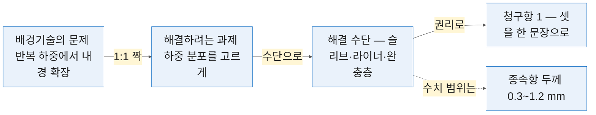
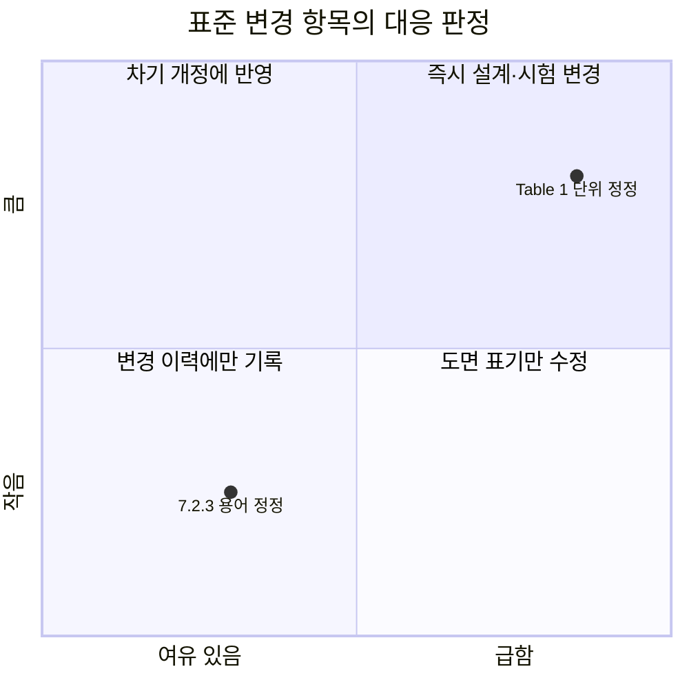
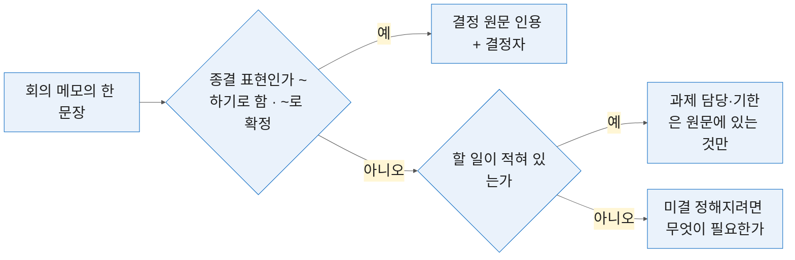
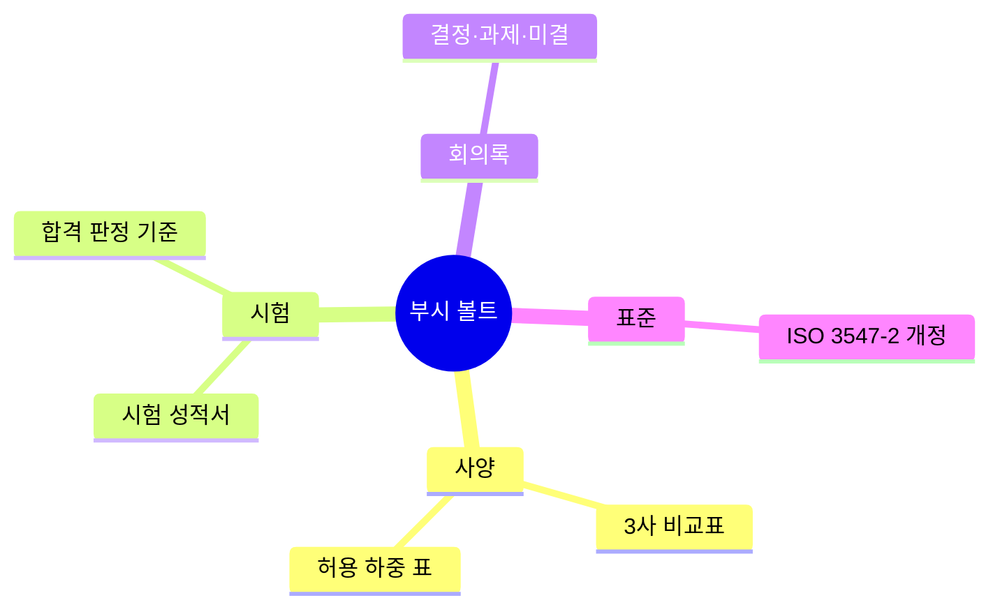

# 5일차 — 특허 명세서 초안·표준 모니터링
#layout-chapter

::: part
Day 5.
:::

---

#id-mg-day5
#layout-_mg

## 남기기 — 밖으로 나가는 문서 네 가지

```mg
src: mg/05-day5
```

---

## 5-0. 여는 절 — 책임이 무거운 문서
#layout-contents

4일차까지 다룬 문서는 틀리면 고치면 되는 것이었음. 5일차 네 주제는 성격이 다름.

::: htmlart radial
* 책임이 무거운 문서
* 특허 명세서 — 되돌릴 수 없음
* 표준 조항 — 놓치면 드러남
* 회의록 — 6개월 뒤의 근거
* 기술 문서 — 6일차의 소스
:::

* 특허 명세서는 출원하면 되돌릴 수 없음. 청구항 한 줄이 권리 범위를 정함. 표준 조항은 제품이 팔릴 수 있는가를 가름 — 개정을 놓치면 이미 만든 물건이 걸림.
* 회의록의 결정은 6개월 뒤에 근거가 됨. 없으면 같은 논의를 다시 함. 그래서 5일차의 실습에는 검증 장이 전부 붙어 있음 — AI 초안을 그대로 쓰는 절은 하나도 없음.

---

### 5일차의 네 주제
#layout-contents-full
#id-day5-topics

::: cards
* **명세서 초안**
  - 발명 설명을 배경·과제·해결 수단·청구항으로 펼침. 변리사 검토 전 단계까지
* **표준 모니터링**
  - ISO 3547-2 개정 이력을 읽고 구판·신판 차이를 뽑아 영향을 표로 냄
* **회의록 정리**
  - 결정·과제·미결을 갈라 담당자와 기한이 붙은 표로 만듦
* **문서 구조화**
  - 1~4일차 산출물을 Obsidian 볼트 하나로 묶음. 6일차 지식베이스의 소스가 됨
:::

* 앞의 셋은 만드는 일이고 넷째는 쌓는 일임. 넷째만 산출물이 6일차로 그대로 넘어감.
* 셋의 공통 구조가 **「사람이 틀을 채우고 → AI 가 칸으로 펼치고 → 원문과 대조」** 임. 4일차 「구조를 먼저 주고 채운다」에 **원문 대조**가 더해진 것임.

---

### AI 초안의 법적 위치
#layout-contents
#id-day5-legal

::: htmlart balance
* 밖으로 나가는 문서
  - 출원 서류 — 변리사 검토를 거침
  - 인증기관·고객사 제출물
  - 조항 번호와 발효일이 근거여야 함
* 안에서 도는 초안
  - 변리사에게 넘길 입력
  - 사내 판단 자료
  - 그렇게까지 하지 않아도 됨
:::

* 특허 명세서는 변리사 검토를 거쳐야 출원 서류가 됨. AI 초안은 변리사에게 넘길 입력을 빨리 만드는 수단임. 표준 영향 분석은 사내 판단 자료이고, 인증기관·고객사에 내는 문서는 표준 원문 조항 번호와 발효일이 근거여야 함.
* AI 가 만든 문장에는 출처가 없음. 출처는 사람이 원문에서 확인해 붙임.
* 판정 한 줄 — 밖으로 나가는 문서에 AI 문장을 검증 없이 싣지 않음. 안에서 도는 초안은 그렇게까지 하지 않아도 됨.

---

### 🔗 4번 산출물은 6일차 지식베이스의 소스임
#layout-contents
#id-day5-to-day6

::: htmlart chevron
* 5-4 — 볼트를 정리함
  - 메타 5줄을 붙임
* 6-1 — RAG 를 배움
  - 왜 검색되는지를 앎
* 6-2 — 볼트를 올림
  - 그대로 소스가 됨. 정리 품질이 답변 품질을 정함
:::

* 6일차 1번에서 RAG 를 배우고, 2번 실습에서 그 볼트의 마크다운 파일을 그대로 올림. 따라서 5-4 의 정리 품질이 6일차 실습의 답변 품질을 정함. 메타가 없는 문서는 6일차에 검색되지 않음.
* 5-0 의 실습에서 꺼내는 3일차 특허 검색 결과도 같은 볼트로 들어감. 정리가 6일차 준비라는 것을 알고 하는 것과 모르고 하는 것은 결과가 다름.

---

### 🙋 실습 P5-0-1 — 3일차 특허 검색 결과를 꺼냄
#layout-exercise-small
#id-ex-p5-0-1

* **시간** 5분 | **목표** 5일차 내내 쓸 특허 자료를 손에 올려 둠
* 단계 — 3일차 P3-1 특허 목록 열기 → 특허번호·청구항 1항 확인 → `AI실습/` 폴더에 둠 · 없으면 Google Patents 에서 WO2014129719A1 을 엶
* **완료조건** 특허번호와 청구항 원문이 화면에 있음 ✅

---

## 5-1. 발명 설명에서 특허 명세서 초안으로
#layout-contents-full

명세서는 정해진 칸이 있는 문서임. 칸을 알면 무엇을 채워야 하는지가 정해짐.

::: htmlart hierarchy
* 특허 명세서
  - 발명을 설명함
    - 기술분야
    - 배경기술
    - 해결하려는 과제
  - 발명을 특정함
    - 과제의 해결 수단
    - 발명의 효과
  - 권리를 정함
    - 청구범위
:::

* 권리를 정하는 것은 청구범위 하나임. 앞의 설명은 청구범위를 뒷받침하는 근거임 — 설명에 없는 것은 청구항에 쓸 수 없고, 청구항에 없는 것은 권리가 아님.

---

### 🔴 변리사 검토가 필수임 — 이 절의 전제
#layout-contents
#id-patent-attorney

이 절에서 만드는 것은 출원 서류가 아니라 변리사에게 넘길 입력임.

::: htmlart compare
* **담당자** / 발명 설명 정리
  - 구성요소 단위로 빠짐없이
  - 부실하면 넓게 못 씀
  - 초안이 검토 시간을 줄임
* **변리사** / 청구항 확정·출원
  - 문언 하나가 권리 범위를 정함
  - 출원하면 넓히지 못함
  - 판단은 여기서 함
:::

* 청구항 문언 하나가 권리 범위를 정하고, 한 번 출원하면 넓히지 못함. 담당자가 할 일은 발명을 빠짐없이·구성요소 단위로 적어 주는 것임. 그것이 부실하면 변리사도 넓게 못 씀.
* AI 를 쓰는 자리는 정리와 초안이지 판단이 아님. 3일차 「검색은 도구이고 판단은 사람」의 경계가 여기서는 「초안은 AI, 청구항 확정은 변리사」임.

---

### 발명 설명을 정리하는 틀
#layout-contents-full
#id-invention-frame

변리사에게 넘기기 전에 담당자가 채워야 하는 항목임.

::: htmlart tab
* 문제
  - 기존 방식의 불편
  - 언제·얼마나 나타나는가
* 바꾼 것
  - 바꾼 부분만
  - 구조·재료·치수 범위
* 결과
  - 좋아진 값을 수치로
  - 아는 선행기술
:::

* 이 다섯을 채운 뒤에 AI 에 넘김. 채우지 않고 넘기면 AI 가 빈칸을 지어냄 — 4일차 「숫자는 사람이 넣는다」가 명세서에서는 「발명은 사람이 적는다」임.
* 수치는 범위로 적음. 단일값으로 적으면 그 값에만 권리가 붙음. 「완충층 두께 0.8 mm」 가 아니라 「0.3~1.2 mm」 임.

---

### 명세서의 칸은 서로 묶여 있음 — 문제·과제·해결 수단·청구항의 1:1
#layout-contents-full
#id-spec-chain



* 왼쪽에서 오른쪽으로 **끊기지 않아야** 명세서임. 문제 없는 과제는 근거가 없고, 과제 없는 해결 수단은 자랑이고, 해결 수단에 없는 구성요소는 청구항에 못 들어감.
* 그래서 실습 P5-1-2 의 프롬프트가 **「배경의 문제와 과제를 1:1 로 짝지을 것」** 을 첫 조건으로 둠. 짝이 안 맞으면 심사에서 근거가 없다고 봄.
* 수치 범위는 독립항이 아니라 **종속항**으로 내려감 — 독립항에 넣으면 그 범위를 피해 가면 침해가 아님.

---

### 배경기술 — 선행기술을 쓰는 법
#layout-contents
#id-spec-background

배경기술은 기존 기술을 소개하는 칸이지만 쓰는 방식에 따라 권리가 줄어듦.

::: htmlart bracket
* 적는 것
  - 구체적 수치로 된 기존 문제
  - 공개된 자사 선행 제품
  - 공개번호와 공개일
* 적지 않는 것
  - 공개되지 않은 사내 기술
  - 과제와 무관한 자랑
:::

* 기존 기술의 문제를 구체적으로 적음. 「성능이 부족했다」가 아니라 「반복 하중 10만 회에서 내경이 0.05 mm 확장됐다」로 적음. 자사 선행 제품을 적을 때는 공개 여부를 먼저 봄.
* 인용하는 선행 문헌은 공개번호와 공개일을 함께 적음. ex) `WO 2014/129719 A1 · 2014-08-28`
* 번호 표기는 **국가코드 + 번호 + 종류코드** 순서가 국제 규약임. `A1`·`B1` 같은 꼬리 글자가 **공개공보인지 등록공보인지**를 가르므로 떼지 않고 그대로 옮김 — AI 가 이 꼬리를 자주 지움.
* 🔴 배경기술에 적은 내용은 출원인이 아는 것으로 간주됨. 과제와 무관한 자랑을 적으면 진보성 판단에서 불리해짐.

---

### 해결하려는 과제
#layout-contents
#id-spec-problem

과제는 배경기술의 문제와 1:1 로 짝을 이뤄야 함.

::: htmlart gear
* 배경기술의 문제
  - 반복 하중에서 내경이 확장됨
* 해결하려는 과제
  - 하중 분포를 고르게 해 변형을 억제함
* 청구항의 폭
  - 과제를 좁게 적으면 함께 좁아짐
:::

* 배경기술에서 든 문제가 셋이면 과제도 셋임. 짝이 안 맞으면 심사에서 근거가 없다고 봄. 과제는 기술적 문제로 적음 — 「원가를 낮춘다」는 단독으로는 과제가 되기 어려움. 「같은 하중에서 재료량을 줄인다」로 바꿔 적음.
* ex) 부시 개량 — 배경 「반복 하중에서 내경이 확장됨」 → 과제 「하중 분포를 고르게 해 내경 변형을 억제함」
* 과제를 좁게 적으면 해결 수단도 좁아지고, 결국 청구항이 좁아짐. 세 톱니가 같은 방향으로 도는 이유임.
* 이 「문제 → 과제 → 해결 수단」 짝짓기는 우리 관행이 아니라 **유럽 특허청이 진보성을 판단하는 표준 방법**(과제-해결 접근법)과 같은 틀임. 해외 출원을 염두에 둔다면 처음부터 이 형태로 적어 두는 편이 유리함.

---

### 과제의 해결 수단 — 구성요소로 적음
#layout-contents
#id-spec-means


* 해결 수단은 문장이 아니라 **부품 목록과 그 관계**로 적음 — 구성요소·결합 관계·작용. ex) 「외측 슬리브」「내측 라이너」「그 사이의 완충층」 셋을 두고, 완충층이 하중을 분산함.
* 구성요소 이름은 하나로 고정하고(「라이너」≠「내통」) 치수·재질은 범위로 적음 — 「완충층 두께 0.3~1.2 mm」. 도면 번호(화면 ①~③)가 이름과 1:1 로 대응해야 함.

---

### 청구항 작성 보조 — 독립항 하나부터
#layout-contents-full
#id-claim-independent

독립항은 없으면 발명이 성립하지 않는 구성요소만 모은 한 문장임.

::: columns

::: column {width="38%"}
::: htmlart numbered
* 전제부
* 구성요소
* 결합 관계
* 특징부
:::
:::

::: column {width="58%"}
| 부분   | 부시 예시                       |
| :----- | :------------------------------ |
| 전제부 | 회전축을 지지하는 부시에 있어서 |
| 구성 1 | 외측 슬리브                     |
| 구성 2 | 내측 라이너                     |
| 구성 3 | 슬리브와 라이너 사이의 완충층   |
| 특징부 | 완충층의 경도가 라이너보다 낮은 |
:::

:::

* 구성요소를 하나 더 넣을 때마다 권리는 좁아짐. 없어도 되는 것은 종속항으로 내림. 치수·재질·수치 범위는 대개 종속항 자리임 — 독립항에 넣으면 그 수치를 피해 가면 침해가 아님.

---

### 구성요소 하나에 권리는 이렇게 좁아짐 — 개념도
#layout-contents-full
#id-claim-tradeoff-chart

::: columns

::: column {width="54%"}
```chart
{
  "type": "line",
  "data": {
    "labels": ["2", "3", "4", "5", "6"],
    "datasets": [
      {
        "label": "권리 범위 (피해 가기 어려움)",
        "data": [95, 75, 55, 38, 25],
        "borderColor": "#0365C0",
        "backgroundColor": "rgba(3,101,192,0.15)",
        "borderWidth": 5,
        "pointRadius": 8,
        "tension": 0.3
      },
      {
        "label": "등록 가능성 (선행기술과 안 겹침)",
        "data": [20, 40, 60, 78, 90],
        "borderColor": "#C82506",
        "backgroundColor": "rgba(200,37,6,0.15)",
        "borderWidth": 5,
        "pointRadius": 8,
        "tension": 0.3
      }
    ]
  },
  "options": {
    "aspectRatio": 1.5,
    "plugins": {
      "title": { "display": true, "text": "독립항 구성요소 수와 두 지표 (개념도 · 실측 아님)", "font": { "size": 28 } },
      "legend": { "position": "bottom", "labels": { "font": { "size": 24 } } }
    },
    "scales": {
      "x": { "title": { "display": true, "text": "독립항의 구성요소 수", "font": { "size": 26 } }, "ticks": { "font": { "size": 24 } } },
      "y": { "min": 0, "max": 100, "ticks": { "font": { "size": 24 } }, "title": { "display": true, "text": "상대값", "font": { "size": 26 } } }
    }
  }
}
```
:::

::: column {width="42%"}
* 구성요소가 늘수록 **권리는 좁아지고 등록은 쉬워짐.** 두 선이 반대로 감.
* 실무는 독립항을 왼쪽(넓게)에 두고 종속항으로 오른쪽(좁게)으로 내려가는 **계단**을 만듦. 그러면 심사에서 독립항이 깎여도 종속항이 남음.
* 어디서 멈출지는 변리사가 함. 담당자가 답할 것은 **「어느 구성요소가 없으면 발명이 성립하지 않는가」** 라는 기술 질문임.
:::

:::

---

### 청구항을 넓게 쓰는 것과 좁게 쓰는 것
#layout-contents
#id-claim-broad-narrow

::: htmlart balance
* **넓은 청구항** / 구성요소가 적음
  - 피해 가기 어려움
  - 선행기술에 걸릴 위험이 큼
  - 심사에서 깎일 가능성
* **좁은 청구항** / 구성요소가 많음
  - 등록될 가능성이 큼
  - 하나만 빼면 침해를 벗어남
  - 권리로서 쓸모가 적어짐
:::

* 실무는 독립항을 넓게 두고 종속항으로 좁혀 내려가는 계단을 만듦. 판단은 변리사가 함.
* 담당자가 할 일은 어느 구성요소가 없으면 발명이 성립하지 않는지를 기술적으로 답해 주는 것임. 3일차 구성요소 분해가 남의 특허를 읽는 연습이었다면, 여기서는 **우리 발명을 같은 단위로 적는** 연습임.

---

### 🔴 AI 가 선행기술을 지어냄
#layout-contents
#id-spec-fake-prior


* 명세서 초안에서 가장 자주 나오고 가장 위험한 실패임. 공개번호를 형식만 맞춰 만들어 냄 — 없는 번호이거나, 있어도 다른 발명임.
* ex) ② `KR 10-2019-0123456` 은 형식이 맞아 눈으로 안 걸러지나 열면 ① 무관한 발명임. 공개일을 출원일보다 뒤로 적는 경우도 있음 — 그러면 선행기술 아님.
* 대응은 하나임 — 공개번호를 KIPRIS·Google Patents 에서 직접 열어 제목·출원인을 대조함.

---

### 인용된 번호를 직접 열면 이렇게 보임
#layout-contents-full
#id-spec-claims-screen


* 대조할 것은 셋임 — ① **제목**이 AI 설명과 같은가, ② **출원인**이 맞는가, **공개일**이 우리 출원일보다 앞인가. 하나라도 다르면 그 인용은 버림.
* ③ 청구항 원문을 복사해 P5-1-1 「아는 선행기술」 칸에 넣음. AI 가 요약한 청구항이 아니라 **원문**을 넣어야 뒤의 대비가 성립함.

---

### 🔴 미공개 발명을 어디에 넣으면 안 되는가
#layout-contents
#id-spec-confidential

::: htmlart compare
* **올려도 되는 것** / 이미 공개된 것
  - 공개공보·등록공보
  - 논문·카탈로그·표준 목차
  - 3일차에 찾은 특허 원문
* **올리지 않는 것** / 아직 공개 안 된 것
  - 출원 전 발명 내용
  - 사내 시험 데이터
  - 미공개 도면·사양
:::

* 출원 전 발명을 외부 LLM 에 올리면 신규성 상실 위험이 생김. 약관과 별개로 다툼의 여지를 만듦. 개인 요금제(Free·Plus)는 입력을 모델 개선에 쓰는 설정이 기본임 — 지급 계정 설정을 확인함.
* 그래서 이 과정의 실습은 가상 발명 1건으로 진행함. 각자의 실제 발명은 쓰지 않음. 사내 적용 시에는 회사 정책이 먼저임. 정책이 없으면 정책부터 만드는 것이 순서임.

---

### 🙋 실습 P5-1-1 — 발명 설명 정리 틀 채우기
#layout-exercise
#id-ex-p5-1-1

* **시간** 10분 | **목표** AI 에 넘기기 전에 사람이 채워야 하는 5항목을 채움
* 단계 — 배포된 가상 발명 설명(부시·핀 개량) 읽기 → 5항목 틀에 옮겨 적기 → 수치는 범위로 · 구성요소 이름은 하나로 → 「아는 선행기술」 칸에 3일차 특허번호 넣기
* **완료조건** 5항목이 빈칸 없이 채워졌고 구성요소 이름이 통일돼 있음 ✅

```text
(AI 에 넘기기 전에 사람이 채우는 틀 — 빈칸을 AI 에 맡기지 않는다)

1. 문제 — 기존 방식의 불편, 언제·얼마나 나타나는가
2. 바꾼 것 — 바꾼 부분만. 구조·재료·치수 범위
3. 결과 — 좋아진 값을 수치로
4. 구성요소 이름 — 하나로 고정
5. 아는 선행기술 — 공개번호·공개일
```

---

### 🙋 실습 P5-1-2 — 배경·과제·해결 수단 초안
#layout-exercise
#id-ex-p5-1-2

* **시간** 10분 | **목표** 채운 틀을 명세서 칸으로 펼침
* 단계 — 5항목 틀 붙여 넣기 → 아래 프롬프트 실행 → 배경 문제 수와 과제 수 대조
* **완료조건** 세 칸이 나왔고 배경 문제 수와 과제 수가 같음 ✅

```text
너는 특허 명세서 초안을 돕는 실무자다. 아래 발명 설명을 배경기술·해결하려는 과제·
과제의 해결 수단 세 칸으로 나눠 작성하라.
조건 — ① 배경기술의 문제와 과제를 1:1 로 짝지을 것 ② 해결 수단은 구성요소와
결합 관계로 적을 것 ③ 구성요소 이름은 입력에 쓰인 것을 그대로 쓸 것
④ 인용 문헌은 내가 준 특허번호만 쓰고 새로 만들지 말 것
[발명 설명 5항목 붙여넣기]
```

---

### ✅ 검증 P5-1 — 인용된 선행기술이 실재하는가
#layout-exercise-small
#id-verify-p5-1

::: htmlart numbered
* 공개번호를 열어 봤는가
* 제목·출원인이 설명과 같은가
* 배경 문제와 과제가 짝인가
:::

* 인용 번호는 **전부** 열어 봄. 명세서의 선행기술은 표본 검증이 아님.

---

## 5-2. 표준 변경 모니터링과 영향 분석
#layout-contents

수요기업의 주력 제품이 걸린 표준 하나를 따라가 봄.

::: htmlart timeline
* 1999 — **초판**
  - ISO 3547-2 Wrapped bushes 제정
* 2006 — **2판**
  - 초판을 대체함
* 2017 — **3판**
  - 기술적 개정
* 2023 — **4판**
  - 경미 개정 · 단위 정정
:::

* 24년 동안 네 판임. 개정이 있었다는 사실보다 **무엇이 바뀌었는가**가 실무의 질문임 — 4판은 경미 개정이지만 단위 정정이 하중 표를 읽는 방식을 바꿈.
* 이 절의 재료는 전부 **무료로 확인되는 범위**(표지·머리말·목차·상태 표시)임. 본문 전문 없이 개정 추적이 어디까지 되는지가 실습의 내용임.

---

### 판 사이 간격은 일정하지 않음 — 7년·11년·6년
#layout-contents-full
#id-std-interval-chart

::: columns

::: column {width="54%"}
```chart
{
  "type": "bar",
  "data": {
    "labels": ["1999 → 2006", "2006 → 2017", "2017 → 2023"],
    "datasets": [
      {
        "label": "판 사이 간격 (년)",
        "data": [7, 11, 6],
        "backgroundColor": ["rgba(3,101,192,0.75)", "rgba(3,101,192,0.75)", "rgba(200,37,6,0.8)"],
        "borderWidth": 0
      }
    ]
  },
  "options": {
    "aspectRatio": 1.5,
    "plugins": {
      "title": { "display": true, "text": "ISO 3547-2 개정 간격 — 평균 8년, 마지막은 6년", "font": { "size": 28 } },
      "legend": { "display": false }
    },
    "scales": {
      "x": { "ticks": { "font": { "size": 24 } } },
      "y": { "beginAtZero": true, "max": 12, "ticks": { "font": { "size": 24 }, "stepSize": 2 }, "title": { "display": true, "text": "년", "font": { "size": 26 } } }
    }
  }
}
```
:::

::: column {width="42%"}
* 평균 8년이지만 **주기가 일정하지 않음.** 「다음 개정은 2031년쯤」 같은 추정이 성립하지 않는 이유임.
* 그래서 예측이 아니라 **정기 확인**임 — 분기마다 표준 페이지의 상태 표시를 열어 보는 것이 이 절 끝의 「습관」임.
* 마지막 간격(빨간 막대)이 가장 짧음. 개정이 잦아지는 추세인지는 알 수 없으나, **가장 최근 판이 2023 년**이라는 사실이 지금 확인할 것임.
:::

:::

---

### 어디서 변경을 확인하는가
#layout-contents-full
#id-std-where

| 대상         | 확인처                          | 무료로 보이는 것                                   |
| :----------- | :------------------------------ | :------------------------------------------------- |
| KS           | e나라 표준인증 `standard.go.kr` | 표준번호·제정개정일·목차·고시 이력                 |
| ISO          | ISO 공식 `iso.org` 표준 페이지  | 판 번호·발행일·상태(Published·Withdrawn)·대체 관계 |
| ISO 미리보기 | ISO OBP · iTeh preview          | 표지·머리말·목차 — 본문은 없음                     |
| 사내         | 인증기관·고객사 통지문          | 적용 시점·유예 기간                                |

* 상태 표시가 먼저임 — `Withdrawn` 이면 그 판은 이미 대체된 것이고, 대체한 판 번호가 같은 자리에 적혀 있음. 다음 장이 그 화면임.
* 본문 전문은 유료임. 무료 범위(위 네 칸) 안에서 개정 추적이 성립함.
* 🔎 **e나라 표준인증의 「부합화」 검색** — `IDT`·`MOD`·`NEQ` 로 ISO 에 대응하는 KS 를 화면 하나로 찾음. 고객이 KS 로 요구할 때 쓰는 길이고 로그인이 없음.

---

### `Withdrawn` 표시 — 구판이 대체됐다는 신호
#layout-contents
#id-std-withdrawn


* 표준 페이지의 ① **상태 한 줄**이 개정 추적의 시작임. `Published` 면 현행, `Withdrawn` 이면 대체됨. 무료이고 로그인 없음.
* `Withdrawn` 아래 ② 링크(New version)가 신판임. 사내 도면이 인용하는 판 번호가 구판이면 **이 화면 하나로 확인이 끝남** — 본문을 사지 않고도 「낡은 판을 보고 있다」는 것은 앎.
* 분기 확인의 실체가 이 페이지를 여는 것임. 표준번호 목록을 고정해 두면 1인 30분이면 끝남.

---

### 개정 이력을 읽는 법 — cancels and replaces 한 줄
#layout-contents
#id-std-foreword-read

::: htmlart process
* 몇 판인가
  - fourth edition
* 무엇을 대체하는가
  - the third edition
* 개정의 성격은
  - minor revision
* 무엇이 바뀌었는가
  - 바로 아래 변경 목록
:::

* 읽는 순서는 셋임 — 몇 판인가(fourth) · 무엇을 대체하는가(the third edition) · 개정의 성격(minor revision / technically revised). 바로 아래에 변경 내역이 목록으로 붙음. 2023 판은 Table 1 단위 정정·7.2.3 용어 정정 두 줄임.
* 단위 정정은 사소해 보이지만 하중 표를 읽는 방식이 달라짐. 구판 기준으로 계산한 값이 그대로 통하지 않을 수 있음 — 1일차 `kg/cm²` ↔ `N/mm²` 가 표준 안에서도 일어난 것임.
* 이 한 줄과 변경 목록만으로 무엇을 다시 봐야 하는지가 정해짐. 본문 전문 없이도 여기까지는 감.

---

### 머리말 지면 — 이 한 줄이 개정 관계 전부임
#layout-contents-full
#id-std-foreword-screen


* 머리말은 미리보기 PDF 에 들어 있어 **무료**이고, 본문이 없어 **저작권 부담이 없음.** 실습 P5-2-1 이 이 지면 하나로 돌아가는 이유임.
* ① 「minor revision」 인데도 Table 1 단위가 바뀜. 개정 성격 한 단어로 영향을 판정하지 않고 ② 아래 목록을 항목별 표로 옮김.

---

### 구판과 신판의 차이를 뽑는 프롬프트
#layout-contents
#id-std-diff-prompt

::: htmlart compare
* **막연한 질문** / ISO 3547-2 뭐가 바뀌었어
  - AI 가 본문을 아는 척 답함
  - 조항 번호가 지어내진 채 나옴
  - 확인할 근거가 남지 않음
* **근거를 준 질문** / 머리말을 붙여 물음
  - 붙여 준 원문 안에서만 답하게 함
  - 없는 것은 「원문에 없음」이라 적게 함
  - 조항 번호를 그대로 옮기게 함
:::

* 표준은 AI 가 본문을 갖고 있지 않은 대표적인 문서임. 유료라서 학습 데이터에 들어가지 않음. 그래서 이 절의 프롬프트는 전부 **원문 붙여넣기 + 그 안에서만** 형태임.

```text
붙여 준 표준 머리말만 근거로 답하라. 항목·구판·신판·근거 위치 4열 표로 정리하라.
원문에 없는 것은 「원문에 없음」이라고 적고 추정하지 마라.
```

---

### 변경이 우리 제품에 미치는 영향
#layout-contents-full
#id-std-impact-quadrant

바뀐 항목마다 두 축으로 판정함 — 제품에 미치는 영향의 크기와 대응의 시급성임.



* 세로축이 제품에 미치는 영향, 가로축이 대응의 시급성임. 점은 실제 변경 2건임. 급한 것을 가르는 기준은 발효일과 인증 갱신일 중 빠른 쪽임. 유예 기간이 있으면 그 끝이 기한임.

---

### 강제 수준의 변화를 놓치지 않는 법
#layout-contents-full
#id-std-shall-should

| 표현                     | 뜻               | 바뀌면                                     |
| :----------------------- | :--------------- | :----------------------------------------- |
| shall · ~하여야 한다     | 요구사항         | 지키지 않으면 부적합                       |
| should · ~하는 것이 좋다 | 권고             | 근거를 남기면 다르게 해도 됨               |
| may · ~할 수 있다        | 허용             | 선택 사항                                  |
| can · ~할 수 있다        | 가능성 서술      | 의무 아님                                  |
| must                     | **표준 밖 제약** | 법령 등이 정한 것 — 표준의 요구사항이 아님 |

* 1일차 1-4 에서 만든 강제 수준 표가 여기서 기준이 됨. 구판 표와 신판 표를 같은 5열로 만들어 옆에 놓고 봄.
* 마지막 행이 함정임 — **`must` 를 「강한 shall」로 읽으면 안 됨.** 표준이 정한 필수는 `shall` 뿐이고 `must` 는 법령처럼 **문서 밖에서 오는 제약**을 가리킴. 영향 분석에서 대응 주체가 달라짐(설계 변경이 아니라 법무·인증 확인).
* 🔴 조항 번호가 그대로인데 서술어만 `should` → `shall` 로 바뀌는 개정이 가장 놓치기 쉬움. 번호만 대조하면 안 걸림.

---

### 영향 분석 보고를 한 장으로
#layout-contents
#id-std-report-onepage

::: htmlart block
* 표준번호 · 판 · 발효일
* 변경 항목과 구판·신판
* 우리 제품에 미치는 영향
* 대응과 기한
* 확인하지 못한 것
:::

* 경영·품질에 올리는 문서는 한 장이어야 읽힘. 머리에 표준번호 · 판 · 발효일 세 값을 둠 — 이것이 없으면 나머지가 근거를 잃음.
* 본문은 표 하나임 — 변경 항목 · 구판 · 신판 · 영향 · 대응 · 기한 6열. 각 행 끝에 조항 번호를 남김. 나중에 누가 물어도 그 자리로 되돌아갈 수 있음.
* 마지막 칸을 비우지 않음. 본문 전문을 못 본 항목은 못 봤다고 적는 것이 맞음 — 「원문에 없음」의 보고서 판임.

---

### 정기 모니터링을 습관으로
#layout-contents
#id-std-routine

::: htmlart cycle
* 목록 고정
* 분기 확인
* 변경 감지
* 영향 판정
:::

* 한 번에 다 하려 하면 안 굳음. 목록을 고정하는 것이 첫 일이고 그것만 해도 절반임 — 우리 제품이 걸린 표준번호 10개 안팎을 파일로 적어 둠.
* 분기 확인은 1인 30분 정도임. 표준 페이지의 상태 표시(`Published`·`Withdrawn`)만 봄. AI 에 맡기는 것은 변경 목록을 읽고 표로 옮기는 뒷부분임.
* 한 발 앞서 보려면 **기술위원회 페이지**를 봄. 미끄럼 베어링은 `ISO/TC 123` 이고, 그 페이지에 **개정 작업 중인 표준 목록**이 공개돼 있음 — 나온 뒤 아는 것과 나오기 전에 아는 것은 대응 기한이 다름.
* 3일차 KIPRIS Plus 와 같은 구조임 — 검색식·목록을 고정하고 주기적으로 돌림. 6일차 RAG 도입 판단의 「갱신할 사람」 항목이 여기서 나옴.

---

### 🔴 표준 원문은 유료임 — AI 가 본문을 안다고 믿지 않음
#layout-contents
#id-std-paid

::: htmlart callout
* 📌 표준과 AI
* **본문 없음** | 유료라 학습 안 됨
* **그럴듯함** | 조항 번호를 지어냄
* 근거는 사람이 붙임
:::

* AI 에 표준 조항을 물으면 없다고 답하지 않고 그럴듯한 조항을 만들어 냄. 번호 형식이 맞아 눈으로는 안 걸러짐 — 5-1 의 가짜 공개번호와 같은 모양임.
* 확인 가능한 것은 표준번호·판·발효일·목차·머리말까지임. 본문 인용은 구매한 원문에서만 함. 사내 문서에 조항을 인용할 때는 원문 쪽 번호를 함께 남김.

---

### 🙋 실습 P5-2-1 — ISO 3547-2 개정 전후 차이 정리
#layout-exercise
#id-ex-p5-2-1

* **시간** 10분 | **목표** 머리말 한 페이지만으로 개정 내용을 표로 만듦
* 단계 — 배포된 ISO 3547-2:2023 머리말 페이지 열기 → 대체 관계 한 줄과 변경 목록 찾기 → 그 부분만 붙여 넣고 아래 프롬프트로 표 받기
* **완료조건** 4열 표가 나왔고 「원문에 없음」이 필요한 칸에 적혀 있음 ✅

```text
붙여 준 표준 머리말만 근거로 답하라. 항목·구판·신판·근거 위치 4열 표로 정리하라.
원문에 없는 것은 「원문에 없음」이라고 적고 추정하지 마라. 조항 번호는 원문 표기를
그대로 옮겨라.
```

---

### 🙋 실습 P5-2-2 — 영향 분석 표 작성
#layout-exercise
#id-ex-p5-2-2

* **시간** 10분 | **목표** 차이 목록을 우리 제품 기준의 대응표로 바꿈
* 단계 — 앞 4열 표 이어 붙이기 → 영향·대응·기한 3열 추가 → 영향 판정 기준을 프롬프트에 적기 → 머리에 표준번호·판·발효일 적기
* **완료조건** 6열 표에 기한이 날짜로 들어갔고 머리 세 값이 있음 ✅

```text
아래 4열 차이 표에 영향·대응·기한 3열을 추가하라.
영향 판정 — 강제 수준이 올라갔고 해당하면 "높음",
수치만 바뀌었으면 "중간", 해당 없으면 "없음".
기한은 발효일 기준으로 역산하고,
표 머리에 표준번호·판·발효일을 적어라.
```

---

### ✅ 검증 P5-2 — 조항 번호와 발효일 확인
#layout-exercise-small
#id-verify-p5-2

::: htmlart numbered
* 조항 번호가 원문에 있는가
* 발효일이 원문과 같은가
* 강제 수준 변화를 잡았는가
:::

* 발효일은 ISO 공식 페이지에서 **직접 다시 봄.** 머리말에는 발효일이 없어 AI 가 채웠을 수 있음.

---

## 5-3. R&D 회의록에서 결정·과제·기한 뽑기
#layout-contents

회의는 매주 하는데 6개월 뒤에 「그때 왜 그렇게 정했더라」가 남음.

::: htmlart funnel
* 오간 말 — 2시간
* 회의록 원문 — 6쪽
* 논의 요약 — 1쪽
* 결정·과제·미결 — 12줄
:::

* 회의록이 없어서가 아님. 있는데 결정과 논의가 섞여 있어 찾지 못하는 것임. 과제는 적혔는데 담당자와 기한이 없어 아무도 안 하는 경우가 가장 많음.
* 미결 사항이 결정처럼 적혀 다음 회의에서 다시 다툼이 되는 경우도 잦음. AI 가 할 일은 섞여 있는 것을 가르는 일임. 새 내용을 만드는 일이 아님.

---

### 회의록에서 뽑아야 하는 세 가지
#layout-contents
#id-minutes-three

::: htmlart bracket
* 결정
  - 무엇을 하기로 했나
  - 누가 결정했나
  - 근거가 무엇인가
* 과제
  - 무엇을 하나
  - 누가 하나 · 언제까지
* 미결
  - 무엇이 안 정해졌나
  - 무엇이 있어야 정해지나
:::

* 셋을 한 문서에 섞지 않음. 성격이 다르고 읽는 사람이 다름 — 결정은 경영, 과제는 담당자, 미결은 다음 회의 주재자가 봄.
* 미결을 따로 뽑는 것이 핵심임 — 다음 회의의 안건이 여기서 나옴.

---

### 발언을 세 갈래로 가르는 규칙
#layout-contents-full
#id-minutes-classify



* 가르는 기준이 **말투**임 — 「~하기로 함」·「~로 확정」·「~은 제외」는 결정이고, 「~검토 필요」·「~인 것 같다」·「~하면 어떨까」는 결정이 아님. 이 규칙을 프롬프트에 그대로 적음.
* 과제로 갈 때 **담당·기한 칸은 원문에 있는 것만** 채움. 없으면 「기재 없음」·「기한 미정」임 — AI 가 채우면 그것이 그대로 약속이 됨.
* 미결에는 「무엇이 있어야 정해지는가」를 붙임. 그것이 다음 회의의 안건임.

---

### 녹취·메모·화이트보드 사진 — 입력의 형태
#layout-contents-full
#id-minutes-input

::: htmlart arrow
* 회의록 정리본 하나
* 텍스트 메모 — 가장 잘 다뤄짐
* 녹취 전사본 — 길고 중복이 많음
* 화이트보드 사진 — 비전 LLM
* 회의 중 채팅 — 시간순
:::

* 형태가 무엇이든 원문을 지우지 않음. 정리본과 원문을 함께 남겨야 나중에 되돌아감 — 검증이 「정리본의 각 항목을 원문에서 역으로 찾는 것」이기 때문임.
* 화이트보드 사진은 2일차 도면과 같은 경로임 — 이미지로 올리고, 손글씨는 「판독 불가」를 허용함. 녹취 전사본은 길어서 먼저 「결정 표현이 있는 문장만 추려라」 로 한 번 거름.

---

### 결정 사항을 찾아내는 프롬프트
#layout-contents
#id-minutes-decision-prompt

결정은 말투로 드러남. 그 말투를 프롬프트에 알려 줌.

```text
아래 회의 메모에서 결정 사항만 뽑아라.
결정으로 볼 것 — 「~하기로 함」 「~로 확정」 「~은 제외」 처럼 종결된 표현
결정이 아닌 것 — 「~검토 필요」 「~인 것 같다」 「~하면 어떨까」
각 결정에 근거가 되는 원문 문장을 그대로 인용하라. 근거가 없으면 적지 마라.
```

* 원문 인용을 강제하는 것이 이 프롬프트의 핵심임. 인용을 요구하면 지어내기가 크게 줄어듦 — 6일차 저감 장치 ②가 회의록에서 먼저 나오는 자리임.
* 결정한 사람이 적혀 있으면 함께 뽑게 함. 없으면 「기재 없음」으로 두고 회의 참석자에게 확인함.

---

### 과제와 담당자·기한을 표로
#layout-contents-full
#id-minutes-task-table

| 열   | 채우는 법                          | 비면                  |
| :--- | :--------------------------------- | :-------------------- |
| 과제 | 동사로 끝맺음 — 「시험 조건 확정」 | 무엇을 하는지 모름    |
| 담당 | 원문에 있는 이름만                 | 「기재 없음」 으로 둠 |
| 기한 | 원문에 있는 날짜만                 | 🔴 비워 둠            |
| 근거 | 원문 문장 인용                     | 과제가 아님           |
| 선행 | 무엇이 끝나야 되는가               | 공란 허용             |

* 🔴 기한을 AI 가 채우게 하지 않음. 「2주 내」 같은 말을 날짜로 바꾸는 것까지는 되지만, 원문에 없는 기한을 만들면 그것이 그대로 약속이 됨.
* 담당자 이름은 원문 표기 그대로 둠. 직함을 붙이거나 풀네임으로 바꾸면 대조가 안 됨. 「선행」 열이 있으면 과제 사이의 순서가 보여 다음 회의에서 무엇부터 물을지가 정해짐.

---

### 미결 사항을 별도로 분리함
#layout-contents
#id-minutes-open

::: htmlart cycle
* 회의에서 미결이 남음
* 무엇이 있어야 정해지는지 적음
* 다음 회의 안건으로 올라감
* 3회 연속이면 승격하거나 폐기함
:::

* 미결은 결정되지 않았다는 사실 자체가 정보임. 결정 목록에 섞이면 그 정보가 사라짐. 각 미결에 무엇이 있어야 정해지는가를 적음. ex) 「시험 성적서가 나와야 재질 확정」
* 미결 목록이 다음 회의 안건이 됨. 그래서 회의록의 마지막 절로 고정함. 미결이 3회 연속 남으면 과제로 승격하거나 폐기함. 계속 끌고 가면 목록만 길어짐.

---

### 🔴 말한 적 없는 결정이 생김
#layout-contents
#id-minutes-fake-decision

::: htmlart radial
* 회의록 정리의 함정
* 지어냄
  - 논의를 결정으로 격상
* 채움
  - 없는 기한·담당을 만듦
* 방어는 원문 인용 강제 하나
:::

* 「검토해 보자」가 「검토하기로 결정」으로 바뀌는 식임. 문장이 자연스러워 읽을 때 안 걸림. 참석자 이름이 여럿이면 발언을 엉뚱한 사람에게 붙이는 경우도 나옴.
* 검증은 반대 방향으로 함 — 정리본의 각 항목을 원문에서 역으로 찾음. 못 찾으면 지어낸 것임. 4일차 「숫자는 사람이 넣는다」가 회의록에서는 「기한과 담당은 원문이 넣는다」임.

---

### 회의록 표준 양식을 고정하는 법
#layout-contents
#id-minutes-template

::: htmlart hierarchy
* 회의록 양식
  - 머리 4줄
    - 일시 · 참석 · 안건 · 관련 문서
  - 본문 — 안건별
    - 논의 → 결정 → 과제
  - 미결 목록
    - 다음 회의 안건으로 올라감
:::

* 양식이 고정되면 AI 정리의 정확도가 올라감. 찾을 자리가 정해지기 때문임. 머리 4줄 — 일시 · 참석 · 안건 · 관련 문서. 이것만 있어도 검색이 됨.
* 본문은 안건별로 나눔. 안건 안에서 논의 → 결정 → 과제 순서를 지킴. 마지막에 미결 목록을 둠. 파일명 규칙을 함께 정함 — 5-4 에서 다루는 명명 규칙과 같은 것임.

---

### 누적된 회의록을 한 번에 훑기
#layout-contents
#id-minutes-history

::: htmlart process
* 모으기
  - 같은 과제의 회의록 전부
* 시간순 정렬
  - 날짜를 파일명에서 뽑음
* 변천 추적
  - 뒤집힌 지점을 찾음
* 현재 상태
  - 살아 있는 결정만 남김
:::

* 같은 항목이 여러 회의에서 다르게 결정된 경우가 있음. 가장 나중 결정이 유효하되 뒤집힌 사실을 남김. 파일명에 날짜가 앞에 있어야 둘째 단계가 자동으로 됨 — 5-4 의 명명 규칙이 여기서 값을 함.
* 이 작업의 산출물이 5-4 의 볼트로 들어가면 6일차에 「그 결정 언제 났지」를 물어볼 수 있게 됨.

---

### 🙋 실습 P5-3-1 — 부시 개발 과제 회의 메모에서 결정·과제 추출
#layout-exercise
#id-ex-p5-3-1

* **시간** 10분 | **목표** 섞여 있는 메모에서 결정과 과제를 갈라 냄
* 단계 — 배포된 가상 회의 메모(부시 개발 과제) 읽기 → 아래 프롬프트 실행 → 기한 칸이 원문에 있는 것만인지 확인
* **완료조건** 결정 목록과 과제 표가 나왔고 각 항목에 원문 인용이 붙어 있음 ✅

```text
첨부한 회의 메모에서 아래 셋을 갈라 내어라.
1) 결정 — 이미 정해진 것
2) 과제 — 누가 무엇을 언제까지
3) 미결 — 아직 정하지 못한 것

각 항목에 근거가 된 원문 문장을 그대로 인용해 붙여라.
원문에 없는 결정을 만들지 마라.
기한은 원문에 적힌 것만 쓰고 비어 있으면 "기한 미정" 이라 적어라.
```

---

### 🙋 실습 P5-3-2 — 과제 표와 미결 목록 분리
#layout-exercise
#id-ex-p5-3-2

* **시간** 10분 | **목표** 미결을 따로 뽑아 정해질 조건을 붙임
* 단계 — 같은 메모로 아래 프롬프트 실행 → 결정·과제와 겹치는지 대조 → 회의록 정리본으로 저장
* **완료조건** 미결 목록이 결정·과제와 겹치지 않고 각 항목에 필요 조건이 붙어 있음 ✅

```text
같은 회의 메모에서 이번에는 미결 사항만 뽑아라.
미결 = 논의됐으나 종결 표현이 없는 것. 각 미결에 ① 원문 인용 ② 정해지려면
무엇이 필요한가를 적어라. 필요한 것이 원문에 없으면 「원문에 없음」이라 적어라.
결정·과제는 이 목록에 넣지 마라.
```

---

### ✅ 검증 P5-3 — 원문에 없는 항목 찾아내기
#layout-exercise-small
#id-verify-p5-3

::: htmlart numbered
* 각 항목을 원문에서 되찾았는가
* 기한이 임의로 채워졌는가
* 논의가 결정으로 격상됐는가
:::

* 검증 방향이 **거꾸로**임 — 원문에서 정리본을 찾는 것이 아니라 정리본에서 원문을 찾음.

---

## 5-4. 사내에서 검색되는 형태로 기술 문서 정리
#layout-contents

이 절에서 만드는 것이 6일차 실습의 입력임.

::: htmlart pyramid
* 6일차 — 묶어서 물어봄
* 5-4 — 볼트 1개로 정리
* 1~4일차 — 문서를 만듦
:::

* 1~4일차에 만든 사양 표·비교표·보고서 초안이 각자의 폴더에 흩어져 있음. 그것을 그대로 지식베이스에 올리면 6일차에 「그 문서 어디 있지」부터 다시 시작함.
* 여기서 하는 일은 도구를 배우는 것이 아니라 다음 절에 쓸 재료를 만드는 것임. 앞 여섯 장은 도구와 무관한 원칙이고, 뒤 두 장이 도구(Obsidian)임.

---

### 검색되지 않는 문서의 공통점
#layout-contents
#id-doc-unsearchable

::: htmlart hexagon
* 이름에 내용이 없음
* 머리에 메타가 없음
* 제목 계층이 없음
* 글자가 이미지임
* 어디 뒀는지 규칙이 없음
* 다른 문서와 안 이어짐
:::

* 파일명이 `최종_최종2_진짜최종.xlsx` 임. 첫 줄이 바로 표라 제목도 날짜도 작성자도 없어 열어 봐야 알 수 있음. 20쪽짜리에 목차가 없으면 필요한 절을 찾지 못함. 스캔 PDF 라 글자가 이미지면 본문 검색에 걸리지 않음.
* 여섯 가지 모두 문서를 만들 때 1분이면 되는 일을 안 한 결과임. 뒤의 다섯 장이 이 여섯을 하나씩 고침.

---

### 파일명이 절반임
#layout-contents
#id-doc-filename

::: htmlart compare
* **못 찾는 이름** / 내용이 없음
  - `최종_v3_수정본.docx`
  - `회의록.docx`
  - `자료1.pdf`
* **찾아지는 이름** / 세 요소가 있음
  - `2026.05.12_부시_시험성적서_1차.pdf`
  - 날짜 · 대상 · 종류 순서 고정
  - 정렬하면 시간순으로 줄 섬
:::

* 순서를 고정하는 것이 규칙의 전부임 — 날짜 · 대상 · 종류 · 버전. 날짜를 앞에 두면 파일 탐색기 정렬만으로 이력이 보임 — 5-3 「누적 회의록 시간순 정렬」이 이것으로 자동이 됨.
* 대상은 제품·과제 이름임. 이것이 있어야 부서 밖 사람도 찾음. 3-4 에서 「이름을 바꿔 저장」하라 한 것이 이 규칙의 첫 적용이었음.

---

### 문서 앞머리에 붙이는 메타 5줄
#layout-contents-full
#id-doc-meta5

::: columns

::: column {width="48%"}
::: htmlart numbered
* 제목 — 무엇에 대한 문서인가
* 작성일·작성자 — 언제 누가
* 대상 — 제품·과제·표준번호
* 요약 3줄 — 결론부터
* 관련 문서 — 앞뒤로 이어지는 것
:::
:::

::: column {width="48%"}
```text
제목: 부시 3사 허용하중 비교표
작성: 2026.09.29 · 설계1팀 홍길동
대상: 건설기계용 미끄럼 베어링 부시 · SKF·MBI·GGB
요약: GGB 정하중 250 이 최대. MBI 는 kg/cm² 표기라
      환산 필요. SKF 값은 그래프에서 읽어 확인 필요.
관련: [[2026.09.22_부시_사양표]] [[2026.10.13_부시_시험성적서]]
```
:::

:::

* 문서 맨 위에 다섯 줄을 붙임. 쓰는 데 1분, 찾는 데 1초가 됨. 요약 3줄은 결론부터 적음 — 열어 보지 않고 목록에서 판단할 수 있게 하는 것이 목적임.
* 관련 문서 줄이 6일차에서 가장 크게 쓰임 — 문서 사이의 연결이 답변의 근거 경로가 됨. AI 에 맡길 수 있는 부분임. 본문을 붙여 주고 5줄 양식대로 뽑게 함.
* 임의로 만든 양식이 아님 — 제목·작성자·일자·대상은 **국제적으로 쓰이는 문서 메타 항목(Dublin Core)** 과 그대로 대응함. 사내 규칙을 세울 때 「왜 이 다섯인가」에 답이 됨.
* Obsidian 에서는 이 다섯 줄을 **속성(YAML)** 으로 넣으면 검색·필터가 걸림. 눈으로 읽는 머리글이 아니라 **기계가 거르는 필드**가 되어, 6일차에 올릴 때 인용 제목으로도 그대로 쓰임.

---

### 제목 계층·폴더 구조·명명 규칙
#layout-contents-full
#id-doc-structure

::: htmlart bracket
* 제목 계층
  - 1단계 — 문서 제목 하나
  - 2단계 — 절. 5~9개
  - 3단계까지만. 그 아래는 목록으로
* 폴더 구조
  - 과제별 · 제품별 중 하나만
  - 깊이 3단계 이내
* 명명 규칙
  - 날짜 · 대상 · 종류 · 버전
  - 공백 대신 밑줄
:::

* 폴더를 과제별과 제품별로 동시에 나누면 같은 문서가 두 곳에 생김. 하나만 고르고 나머지는 태그로 해결함. 깊이가 4단계를 넘으면 아무도 끝까지 안 들어감.
* 제목 계층은 6일차 청킹의 단위가 됨 — 절 단위로 잘리므로 절이 없으면 문서가 통째로 한 조각이 되어 검색에 걸리지 않음.

---

### 표·그림 설명과 스캔 문서 검색
#layout-contents
#id-doc-caption-ocr

::: htmlart tab
* 캡션을 붙임
  - 「표 3. 부시 3사 허용하중 비교 (단위 N/mm²)」
  - 대상과 단위를 함께 넣음
* OCR 로 글자층을 만듦
  - 구글 문서로 열면 글자를 뽑음
  - 정확도가 중요하면 Tesseract
  - 인용은 원문에서 함
:::

* 글자가 아닌 것은 검색에 안 걸림. 표와 그림에는 캡션 한 줄을 붙임 — 「표 3. 부시 3사 허용하중 비교 (단위 N/mm²)」 처럼 대상과 단위를 넣음.
* 스캔 PDF 는 OCR 을 걸어 글자층을 만듦. 구글 드라이브에서 「Google 문서로 열기」를 하면 텍스트가 추출됨. 2일차 Tesseract 로도 같은 일을 함. 도면처럼 정확도가 중요한 것은 그쪽을 씀.
* 🔴 OCR 결과는 원문을 대체하지 않음. 검색용 글자층일 뿐이고 인용은 원문에서 함.

---

### 규칙만으로는 안 굳음 — Obsidian 이라는 선택지
#layout-contents
#id-doc-obsidian-why

::: htmlart balance
* **규칙만 둠** / 문서로 공지함
  - 도입 비용이 없음
  - 두세 주면 안 지켜짐
  - 지켰는지 확인할 길이 없음
* **도구를 씀** / Obsidian 볼트
  - 링크·태그가 화면에 남음
  - 안 이어진 문서가 눈에 보임
  - 설치·배포 부담이 생김
:::

* 앞의 규칙 다섯은 맞는 말이지만 손으로만 지키면 두세 주 만에 무너짐. Obsidian 은 설치형 마크다운 편집기임. 파일은 평범한 `.md` 라 도구를 버려도 문서는 남음.
* 회사 서버·개인 PC 어디에 둬도 되고 계정 가입이 없음. 2025.02 부터 업무용도 무료임. 도구가 규칙을 대신하지는 않음. 규칙을 덜 힘들게 지키게 할 뿐임.

---

### 폴더·태그·양방향 링크와 그래프 뷰
#layout-contents-full
#id-doc-graph-mindmap



* 폴더는 하나만 고르게 하고 나머지 분류는 태그가 맡음. 이것이 「같은 문서가 두 곳에」 문제를 없앰. 양방향 링크는 5-3 의 회의록과 4일차 보고서를 잇는 데 씀 — 결정과 근거가 한 번에 따라감.
* 그래프 뷰에서 점 하나가 떨어져 있으면 그 문서는 아무 데도 연결되지 않은 것임 — 6일차에서 찾아지지 않음. 위 그림의 네 가지가 실습에서 만드는 폴더 3개 + 표준 1개임.

---

### 🙋 실습 P5-4-1 — Obsidian 설치와 볼트 만들기
#layout-exercise
#id-ex-p5-4-1

* **시간** 13분 | **목표** 볼트를 만들고 폴더 골격까지 세움
* 단계 — 사전 배포된 설치 파일로 설치 → 새 보관소 만들기 → 이름 `부시_기술문서` · 저장 위치 지정 → 폴더 3개 `01_사양` · `02_시험` · `03_회의록`
* **완료조건** 볼트가 열렸고 왼쪽에 폴더 3개가 보임 ✅ 🔴 설치가 막히면 손들어 알림 — ChatGPT 정리본 경로로 돌림


---

### 🙋 실습 P5-4-2 — 문서 3종에 메타·태그·양방향 링크 붙이기
#layout-exercise
#id-ex-p5-4-2

* **시간** 12분 | **목표** 1~4일차 산출물 3종을 볼트에 넣고 서로 잇기
* 단계 — 1일차 사양 표 · 2일차 비교표 · 5-3 회의록 정리본을 각 폴더에 `.md` 로 저장 → 맨 위에 메타 5줄 · 맨 아래에 태그 2~3개 → 회의록에서 사양 표를 `[[문서명]]` 으로 걸기
* **완료조건** 문서 3개에 메타·태그·링크가 있고 링크가 양쪽에서 보임 ✅

```text
(메타 5줄을 AI 에 뽑게 할 때 — 본문을 붙여 주고 양식대로만 채우게 한다)

아래 문서 본문을 읽고 메타 5줄을 채워라.
제목 / 작성일·작성자 / 대상 / 요약 3줄(결론부터) / 관련 문서
본문에 없는 작성자·날짜는 「기재 없음」이라 적고 만들지 마라.
```

---

### ✅ 검증 P5-4 — 그래프 뷰 확인과 3분 탐색
#layout-exercise-small
#id-verify-p5-4

::: htmlart numbered
* 그래프에 고립된 점이 없는가
* 태그로 걸러지는가
* 옆 사람이 3분 안에 찾는가
:::

* 셋째가 진짜 검증임 — 만든 사람이 아니라 **옆 사람**이 찾아야 검색되는 문서임.

---

### 그래프 뷰 — 고립된 점이 곧 안 찾아지는 문서임
#layout-contents-full
#id-doc-graph-screen


* ③ 오른쪽 그래프에서 선이 하나도 안 붙은 점이 있으면 그 문서는 관련 문서 줄이 빈 것임. ② 메타 5줄의 다섯째 줄을 채우면 선이 생김.
* 이 화면이 6일차 「그래프형 지식베이스」의 가장 작은 형태임. 6-1 시연에서 ① 같은 볼트가 graphify 로 다시 그려짐.

---

### 🔗 정리한 볼트를 6일차에 그대로 올림
#layout-contents
#id-day5-vault-handoff

::: htmlart timeline
* 5일차 종료
  - 메타 5줄이 붙은 문서 3개
* 이동
  - USB·개인 드라이브로 복사
* 6일차 2교시
  - 볼트 폴더를 그대로 소스로 올림
* 6일차 중
  - 각자 2~3개를 더해 5~6개로
:::

* 6일차 2번 실습에서 이 볼트 폴더를 그대로 Gemini Notebook 의 소스로 올림. 변환도 정리도 다시 하지 않음. 그래서 볼트를 USB 나 개인 드라이브에 복사해 둠 — 강의장 PC 는 회차마다 초기화될 수 있음.
* 문서가 3개뿐이어도 됨. 6일차에 각자 2~3개를 더 넣어 5~6개로 만듦. 메타 5줄이 빠진 문서는 6일차에 출처 표시가 안 붙음. 올리기 전에 다시 확인함.

---

## 5-5. 닫는 절 — 5일차 정리
#layout-summary

::: htmlart process
* 사람이 틀을 채움
* AI 가 칸으로 펼침
* 원문과 대조함
* 볼트에 남겨 넘김
:::

* 네 절이 이 네 걸음이었음. 명세서는 5항목 틀, 표준은 머리말 원문, 회의록은 메모 원문, 볼트는 메타 5줄 — 틀이 다를 뿐 순서는 같음.

---

### 5일차에 반복된 경계 — AI 초안과 사람의 책임
#layout-summary
#id-day5-boundary

::: htmlart compare
* **AI** / 형태를 바꿈
  - 흩어진 것을 칸으로 나눔
  - 원문을 표로 옮김
  - 메타 5줄·요약 3줄 생성
* **사람** / 사실을 붙임
  - 공개번호를 열어 확인함
  - 조항 번호·발효일 대조
  - 기한을 임의로 채우지 않음
:::

* 네 절 모두 같은 모양이었음 — AI 가 형태를 만들고 사람이 사실을 붙임. 밖으로 나가는 문서일수록 오른쪽 열이 길어짐.

---

### 🔗 6일차에 쓸 재료 목록
#layout-summary
#id-day5-materials

::: cards
* **Obsidian 볼트**
  - 5-4 산출. 6-2 실습의 소스로 그대로 올림. USB 에 복사해 둘 것
* **명세서 초안 3칸**
  - 5-1 산출. 6-4 할루시네이션 사례의 실제 재료로 다시 씀
* **영향 분석 표**
  - 5-2 산출. 6-1 에서 「근거가 붙은 답」의 예시가 됨
:::

* 셋 다 직접 만든 것임. 6일차 지식베이스는 남의 자료가 아니라 5일간의 산출물로 세움.

---

### 자주 나온 질문
#layout-contents
#id-day5-faq

* **Q. AI 가 쓴 명세서로 바로 출원할 수 있는가** — 안 됨. 변리사 검토가 필수임. 초안은 검토 시간을 줄이는 입력임.
* **Q. 표준 원문을 사지 않고 개정을 따라갈 수 있는가** — 표준번호·판·발효일·목차·머리말까지는 무료로 확인됨. 본문 인용이 필요하면 구매함.
* **Q. 회의록에 없는 기한을 AI 가 채우면 어떻게 아는가** — 정리본의 각 항목을 원문에서 역으로 찾음. 못 찾으면 지어낸 것임.
* **Q. Obsidian 대신 사내 위키를 써도 되는가** — 됨. 메타 5줄·태그·문서 간 링크 셋이 되면 도구는 무엇이든 상관없음.
* **Q. 우리 발명을 지급 ChatGPT 에 올려도 되는가** — 출원 전이면 올리지 않음. 회사 정책이 먼저이고, 실습은 가상 발명으로만 함.

---

### 🎬 다음 시간 예고 — 쌓인 문서를 하나로
#layout-contents
#id-day5-next

::: htmlart compare
* **5일차 — 한 건씩 씀** / 문서 단위
  - 명세서 초안·영향 분석 표
  - 회의 정리·볼트
* **6일차 — 묶어서 물음** / 지식베이스
  - 5일간 산출물이 소스가 됨
  - 답에 출처가 붙는 구조
:::

* 6일차는 5일간 만든 문서를 **묶어서 물어보는** 날임. 5-4 의 볼트가 그대로 소스가 되고, 5일차에 손으로 한 대조를 규칙으로 굳힘.
* 6일차 마지막 절(6-4)에서 6일 동안 프롬프트마다 붙였던 조항들을 **한 벌의 표준본**으로 모음. 그것이 회사로 가져가는 실물임.
