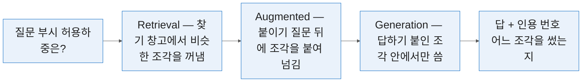
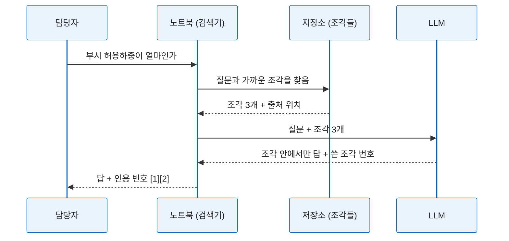

# 6일차 — RAG 기술 지식베이스 입문
#layout-chapter

::: part
Day 6.
:::

---

#id-mg-day6
#layout-_mg

## 쌓기 — 찾고 붙이고 답함

```mg
src: mg/06-day6
```

---

## 6-0. 여는 절 — 흩어진 것을 하나로
#layout-contents-full

::: htmlart timeline
* 1일차 — **읽기**
  - 사양서·매뉴얼·표준을 요약하고 표로 고정함
* 2일차 — **보기**
  - 도면을 이미지로 올려 부품·치수·기호를 읽힘
* 3일차 — **찾기**
  - 특허·논문을 검색하고 여러 자료를 묶어 물음
* 4일차 — **쓰기**
  - 보고서·성적서·영문 초록을 초안으로 받음
* 5일차 — **남기기**
  - 명세서 초안을 쓰고 문서를 볼트로 정리함
* 6일차 — **쌓기**
  - 그 볼트를 하나로 묶어 근거와 함께 물음
:::

* 1일차 첫 장의 그 그림임. 그때는 예고였고 지금은 산출물 목록임 — 여섯 칸 전부에 각자가 만든 파일이 있음.

---

### 6일차는 원리를 되짚음
#layout-contents
#id-day6-principle

::: htmlart target
* 도구를 씀
  - 앞의 5일
* 원리를 앎
  - 6일차 1번 소절
* 안 되는 것을 미리 가려냄
* 사내 도입을 판단함
:::

* 1~5일차는 도구를 손에 익히는 시간이었음. 6일차는 그 도구가 왜 그렇게 동작했는지를 봄. 3일차에 Gemini Notebook 에 자료를 올리고 물었을 때, 답 옆에 인용 번호가 붙었음. 그것이 어떻게 붙는지는 그때 다루지 않았음.
* 그 구조에 이름이 있고 RAG 라고 부름. 6일차 1번 소절이 그 이름을 푸는 절임. 원리를 알면 **안 되는 것을 미리 가려낼 수 있음**. 도구만 알면 안 될 때 이유를 모름.
* 사내 도입을 결정하는 자리에 앉게 되면 이 절의 내용이 판단 근거가 됨. 4교시(6-4)는 6일 내내 붙였던 검증 조항을 **한 벌로 모으는** 절임 — 회사로 가져가는 실물이 거기서 나옴.

---

### 🔗 3일차에 도구로 썼던 것을 원리로 되짚음
#layout-contents
#id-day6-revisit

::: htmlart venn
* 3일차 — 도구로 씀
  - 자료를 올림
  - 물어봄
  - 인용을 눌러 원문으로 감
* 6일차 — 원리로 봄
  - 잘라서 저장함
  - 비슷한 조각을 찾아옴
  - 찾은 것만 근거로 답함
* 같은 동작
  - 근거가 붙은 답
:::

* 같은 것을 두 번 만남. 3일차는 **손으로**, 6일차는 **머리로** 만짐 — 써 보고 나서 원리를 들으면 붙을 자리가 이미 있음.
* 3일차 검증 P3-3 「소스를 하나만 남기면 답이 달라진다」가 6일차에 이름을 얻음 — 검색(Retrieval)이 눈에 보인 자리였음.

---

### 6일차도 코드는 쓰지 않음 — 돌아가는 것은 봄
#layout-contents
#id-day6-nocode

::: htmlart balance
* 보는 것
  - 강사가 도구 두 개를 그 자리에서 돌림
  - 터미널과 출력이 화면에 뜸
  - 「되긴 되는구나」가 생김
* 쓰는 것
  - 6일 내내 하지 않은 일
  - 참조 구현은 링크로만 제시함
  - 열어 볼 사람만 엶
:::

* 6일 내내 지킨 선은 하나였음 — **코드를 직접 쓰지 않음**. 6일차도 같음. 다만 1번 소절 시연 장에서 강사가 도구 두 개를 **그 자리에서 실제로 돌림**. 터미널과 출력이 화면에 그대로 뜸.
* 보는 것과 쓰는 것은 다름. 돌아가는 것을 봐야 *"이게 되긴 되는구나"* 가 생김. 참조 구현 저장소도 링크로만 제시함. 열어 볼 사람은 열어 보고 나머지는 안 봐도 됨.

---

### 🙋 실습 P6-0-1 — 5일차 정리 문서 묶음 꺼내기
#layout-exercise-small
#id-ex-p6-0-1

* **시간** 5분 | **목표** 6일차 내내 쓸 소스를 손에 올려 둠
* 단계 — P5-4 볼트 `부시_기술문서` 열기 → 메타·태그·링크 확인 → 없으면 배포된 예시 볼트를 받아 대신 씀
* **완료조건** 볼트가 열리고 문서 3개에 메타 5줄이 보임 ✅

---

## 6-1. RAG 의 개념과 사내 적용 시나리오·한계
#layout-contents

문서가 열 개일 때는 문제가 없음. 문제는 쌓이고 나서 생김.

::: htmlart pyramid
* 답 1건
* 열어서 읽은 5건
* 검색에 걸린 30건
* 공유 폴더의 문서 3,000건
:::

* 부서 공유 폴더에 기술 문서가 3,000건 있다고 하면, 필요한 한 건을 찾는 데 걸리는 시간이 **읽는 시간보다 김**. 파일명으로 찾으려 하면 5일차에서 본 그 문제에 걸림 — 이름에 내용이 없음.
* 사람이 바뀌면 어디에 무엇이 있는지가 통째로 사라짐. 문서는 남고 지도가 없어짐. 검색이 되더라도 답이 아니라 **문서 목록**이 나옴. 열어서 읽는 일은 그대로 남음 — 피라미드의 아래 세 층을 기계가 맡고 맨 위만 사람이 읽게 하는 것이 RAG 가 겨냥하는 바임.

---

### LLM 이 우리 회사 문서를 모르는 이유
#layout-contents
#id-rag-why-unknown

::: htmlart arrow
* 우리 문서를 찾아서 붙여 주는 단계
  - 답을 만들기 전에 필요함
* 학습 시점까지의 공개 데이터
  - 사내 문서는 거기에 없음
* 모른다고 하지 않음
  - 비슷한 공개 자료로 답함
* 학습 이후의 일도 모름
  - ISO 3547-2 개정을 안다는 보장이 없음
:::

* ChatGPT 에 자사 부시 사양을 물으면 그럴듯한 답이 나오지만 우리 것이 아님. 모델은 **학습 시점까지의 공개 데이터**로 만들어짐. 사내 문서는 거기에 없음 — 1일차 「Pre-trained 가 핵심」이 그 이유임.
* 없는 것을 물으면 모른다고 하지 않고 **공개 자료에서 본 비슷한 것**으로 답함. 4번 소절의 환각이 여기서 나옴. 학습 시점 이후의 일도 모름. ISO 3547-2 가 2023년에 개정된 것을 모델이 안다는 보장이 없음.
* 그래서 답을 만들기 전에 **우리 문서를 찾아서 붙여 주는** 단계가 필요함.

---

### 학습시키는 길과 찾아서 주는 길
#layout-contents
#id-rag-two-ways

::: htmlart compare
* **학습시킴** / 모델을 다시 만듦
  - 문서를 모델 안에 넣음
  - 비용과 시간이 큼
  - 문서가 바뀌면 다시 해야 함
  - 어디서 나온 답인지 모름
* **찾아서 줌** / 모델은 그대로
  - 물어볼 때마다 문서를 붙임
  - 문서만 갈아 끼우면 됨
  - 바로 반영됨
  - 어느 문서에서 나왔는지 남음
:::

* 실무에서 쓰는 것은 거의 전부 **찾아서 주는 길**임. 그 길의 이름이 RAG 임.
* 오른쪽 넷째 줄이 R&D 에서 결정적임 — 「어느 문서에서 나왔는지 남음」이 곧 3일차부터 눌러 온 **인용 번호**임. 학습시키는 길에는 그것이 없음.

---

### RAG 세 글자의 뜻 — 찾고·붙이고·답함
#layout-contents-full
#id-rag-three-letters



* **Retrieval** — 질문과 비슷한 문서 조각을 창고에서 꺼냄. **Augmented** — 꺼낸 조각을 질문 뒤에 붙여 모델에 넘김. 모델은 그 안에서만 답하게 됨. **Generation** — 붙인 것을 근거로 답을 씀. 어느 조각을 썼는지 함께 남기면 그것이 인용임.
* 3일차에 노트북이 한 일이 정확히 이 셋임. 1일차 「올린 파일이 동작을 정한다」가 파일 단위였다면, RAG 는 그것을 **조각 단위로 자동으로** 하는 것임.

---

### 흔한 답 — 벡터 RAG
#layout-contents
#id-rag-vector

::: htmlart bend_process
* 문서를 잘게 자름
* 뜻을 숫자 묶음으로 바꿈
* 임베딩으로 저장해 둠
* 질문도 같은 방식으로 바꿈
* 숫자끼리 가까운 조각을 꺼냄
* 그 조각으로 답을 만듦
:::

* RAG 라고 하면 보통 벡터 방식을 뜻함. 지금 대부분의 제품이 이 방식임. 문서를 잘게 잘라 **뜻을 숫자 묶음으로 바꿔** 저장해 둠. 그 숫자 묶음을 임베딩이라 부름.
* 질문도 같은 방식으로 숫자로 바꿔, **숫자끼리 가까운 조각**을 꺼냄. 그래서 「부시」라고 안 쓰고 「베어링 슬리브」라고 쓴 문서도 걸림. 글자가 아니라 뜻으로 찾기 때문임.
* 반대로 뜻이 비슷하면 엉뚱한 것도 걸림. 다음 두 장이 그 그림과 한계임.

---

### RAG 를 이루는 세 부품 — 임베딩·벡터DB·검색
#layout-contents-full
#id-rag-parts

::: htmlart gear
* 임베딩 — 뜻을 숫자로
* 벡터DB — 숫자를 쌓아 둠
* 검색 — 가까운 것을 꺼냄
:::

| 부품   | 하는 일                    | 바꾸면                    |
| :----- | :------------------------- | :------------------------ |
| 임베딩 | 문장을 숫자 묶음으로 바꿈  | 전부 다시 만들어야 함     |
| 벡터DB | 숫자 묶음을 쌓고 빨리 찾음 | 옮기면 됨                 |
| 검색   | 가까운 조각 N 개를 꺼냄    | N 만 조정해도 답이 달라짐 |

* 셋 중 **임베딩을 바꾸는 것이 가장 비쌈**. 도입 전에 정하는 것이 「도입 전에 정해야 하는 것」 장의 내용임.

---

### 임베딩 공간을 그림으로 보면 — 뜻이 가까우면 점이 가까움
#layout-contents-full
#id-rag-embedding-chart

```d3
const w = 1500, h = 560;
const svg = d3.select(el).append('svg').attr('viewBox', `0 0 ${w} ${h}`)
  .attr('width', '100%').attr('height', '100%');
const fs = '26px';
const groups = [
  {c: '#0365C0', pts: [[260, 200, '부시 허용하중 표'], [340, 260, '베어링 슬리브 정격'], [220, 300, '부싱 면압 한계']]},
  {c: '#16A085', pts: [[1080, 170, 'ISO 3547-2 개정'], [1180, 250, 'KS B ISO 3547 목차']]},
  {c: '#7F8C8D', pts: [[1060, 430, '재질 확정 회의록'], [1160, 480, '시험 일정 회의록']]},
  {c: '#C82506', pts: [[600, 420, '마모량 0.05 mm'], [660, 450, '마모량 0.5 mm']]}
];
groups.forEach(g => {
  const cx = d3.mean(g.pts, p => p[0]), cy = d3.mean(g.pts, p => p[1]);
  svg.append('ellipse').attr('cx', cx).attr('cy', cy).attr('rx', 150).attr('ry', 100)
    .attr('fill', g.c).attr('opacity', 0.08).attr('stroke', g.c).attr('stroke-dasharray', '8,6').attr('stroke-width', 2);
  g.pts.forEach(p => {
    svg.append('circle').attr('cx', p[0]).attr('cy', p[1]).attr('r', 13).attr('fill', g.c).attr('opacity', 0.9);
    svg.append('text').attr('x', p[0] + 20).attr('y', p[1] + 9).text(p[2]).style('font-size', fs).style('fill', '#333');
  });
});
const q = [150, 250];
svg.append('path').attr('d', `M ${q[0] - 22} ${q[1] + 22} L ${q[0]} ${q[1] - 24} L ${q[0] + 22} ${q[1] + 22} Z`)
  .attr('fill', '#F1C40F').attr('stroke', '#7A6000').attr('stroke-width', 3);
svg.append('text').attr('x', 40).attr('y', 120).text('★ 질문 — 부시 허용 하중이 얼마인가').style('font-size', fs).style('fill', '#7A6000');
svg.append('text').attr('x', 560).attr('y', 500).text('🔴 숫자만 다른 두 조각이 「가깝게」 놓임').style('font-size', fs).style('fill', '#C82506');
svg.append('text').attr('x', 40).attr('y', h - 20).text('모식도 — 실제 임베딩은 수백 차원이고, 이 그림은 2차원으로 눌러 그린 것임').style('font-size', '22px').style('fill', '#777');
```

* 점 하나가 문서 조각 하나임. 뜻이 비슷한 조각끼리 **모여 있고**, 질문(★)도 같은 공간에 찍힘. 검색은 ★에서 가장 가까운 점 몇 개를 꺼내는 일임 — 그래서 「부시」로 물어도 「베어링 슬리브」 조각이 걸림.
* 빨간 두 점이 이 방식의 약점임. 「0.05 mm」와 「0.5 mm」는 **문장 뜻이 같아** 가깝게 놓임. 숫자 하나 차이를 이 공간은 잘 가르지 못함 — 다음 「한계」 표의 둘째 행임.

---

### 문서를 잘게 자르는 이유 — 청킹의 네 가지 결
#layout-contents
#id-rag-chunking

::: htmlart tab
* 왜 자르나
  - 문서 전체는 너무 커서 못 붙임
  - 통째로 넣으면 엉뚱한 곳이 섞임
* 어떻게 자르나
  - 길이로 — 500자씩
  - 문단·절로 — 구조를 따라
* 무엇이 갈리나
  - 너무 잘게 — 앞뒤 맥락이 끊김
  - 너무 크게 — 딴 얘기가 섞임
:::

* 기술 문서는 **절 단위로 자르는 것**이 대개 나음. 5일차에서 만든 제목 계층이 여기서 쓰임 — 계층이 없는 문서는 500자마다 기계적으로 잘려 표의 머리와 몸통이 갈림.
* 표는 자르면 머리행과 몸통이 갈려 못 쓰게 됨. 표는 통째로 한 조각으로 둠. 1일차 「병합 셀·각주 누락」이 RAG 에서는 청킹 문제로 다시 나타남.

---

### 🔗 3일차에 본 그 동작이 바로 이것임
#layout-contents-full
#id-rag-sequence



* 3일차에 인용 번호를 눌렀을 때 원문의 그 자리로 갔음. **꺼내 쓴 조각의 위치**였기 때문임. 3일차 실습에서 소스를 하나만 남기고 다시 물으면 답이 달라졌음. 꺼낼 창고가 바뀌었기 때문임.
* 위 그림에서 LLM 은 **저장소를 직접 보지 않음.** 검색기가 준 조각 3개만 봄. 그래서 조각에 없는 것은 답할 수 없고, 조각을 잘못 꺼내면 답도 틀림 — 검색이 답의 상한임.

---

### 벡터 RAG 의 한계
#layout-contents-full
#id-rag-limits

| 한계               | 무슨 일이 생기나                       | 설계·R&D 에서                     |
| :----------------- | :------------------------------------- | :-------------------------------- |
| 뜻이 비슷하면 걸림 | 다른 제품 사양이 섞여 나옴             | 부시 3사 자료가 한 답에 뒤섞임    |
| 숫자에 약함        | 「0.05 mm」와 「0.5 mm」가 가깝게 잡힘 | 🔴 치수·공차에서 치명적           |
| 조각 단위로만 봄   | 문서 전체의 흐름을 못 읽음             | 「이 조항이 왜 생겼나」에 못 답함 |
| 관계를 모름        | A 가 B 를 대체한다는 사실을 못 씀      | ISO 개정 이력 추적이 안 됨        |

* 🔴 **숫자와 관계가 약점**임. 둘 다 설계·R&D 문서의 본체라 **RAG 만으로 끝나지 않음** — 답은 시작점이고 확인은 원문에서 함.
* 둘째 줄(숫자)에는 **알려진 해법이 있음** — 뜻으로 찾는 방식에 **글자 그대로 찾는 방식**을 겹쳐 쓰는 것임(하이브리드 검색). `0.05` 라는 문자열을 그대로 맞춰 보므로 치수·품번처럼 **한 글자도 틀리면 안 되는 값**에 강함. 도구를 고를 때 **「키워드 검색을 함께 쓰는가」**를 물어보면 됨.
* 넷째 줄(관계)이 시연 장 「그래프형」의 이유임.

---

### 사내 적용 시나리오 네 종 — 부시 설계·품질·특허·표준
#layout-contents-full
#id-rag-scenarios

::: cards
* **설계 문의 대응**
  - 「이 부시 허용 하중이 얼마인가」에 사양서 근거와 함께 답함. 신입 교육 부담이 줄어듦
* **품질 이력 조회**
  - 「이 불량이 전에도 있었나」에 과거 성적서·회의록을 묶어 답함
* **특허 선행조사 보조**
  - 사내 특허 묶음에서 비슷한 청구항을 먼저 추림. 확정은 변리사가 함
* **표준 조항 확인**
  - 「이 항목의 강제 수준이 무엇인가」에 조항 번호와 함께 답함. 원문은 구매본에서 봄
:::

* 네 종 모두 **사람을 대신하는 것이 아니라 찾는 시간을 줄이는 것**임. 네 종이 곧 1~5일차의 네 갈래이고, 소스도 그때 만든 것 그대로임.

---

### 🖥️ 시연 — 벡터 말고 다른 결 — 위키형·그래프형
#layout-contents-full
#id-rag-demo-wiki-graph

::: htmlart compare
* **위키형** / llmwiki
  - 문서를 읽어 위키 문서로 다시 씀
  - 사람이 읽을 수 있는 형태로 남음
  - LLM 과금이 드는 것이 조건
* **그래프형** / graphify
  - 문서 사이의 관계를 그래프로 만듦
  - 「무엇이 무엇을 대체하나」에 답함
  - 코드 저장소 분석이 본래 용도
:::

* 강사가 이 자리에서 **직접 돌림**. 명령과 출력, 산출 화면을 그대로 띄움. 입력은 5일차에 직접 만든 **부시 문서 볼트**임 — 남의 자료가 아니라 자기 손으로 만든 것이 그래프가 되는 것을 봄.
* 5일차에 만든 볼트의 그래프 뷰가 **그래프형의 가장 작은 형태**임. 두 도구가 실습이 아닌 이유는 CLI 라서가 아님 — graphify 는 Python 런타임이 필요하고 6일차에 남는 시간이 없음. llmwiki 는 **API 키와 과금**이 들어 계정 조건을 벗어남.

---

### 도입 전에 정해야 하는 것
#layout-contents
#id-rag-before-adopt

::: htmlart numbered
* 어떤 문서를 넣을 것인가
* 누가 볼 수 있게 할 것인가
* 문서가 바뀌면 누가 갱신하나
* 틀린 답이 나오면 어디에 알리나
:::

* 네 가지 모두 기술이 아니라 **운영**의 문제임. 도구를 고르는 것보다 앞섬. 특히 세 번째가 실패 지점임. 갱신하는 사람이 없으면 6개월 뒤 낡은 답을 내놓음 — 5일차 표준 모니터링의 「분기 확인」 담당이 같은 사람임.
* 넷째는 검증 결과가 **돌아오는 길**임. 6-4 에서 만드는 표준 검증 프롬프트가 「틀린 답을 잡는 법」이라면, 이 항목은 잡은 것을 어디에 쌓는가임.
* 직접 만들 필요는 없음 — 주요 클라우드가 **문서를 넣으면 검색·인용까지 붙여 주는 관리형 서비스**를 내놓았음. 사내 도입 검토는 대개 「만들까」가 아니라 **「어느 것을 쓸까」**가 됨.
* 네 항목을 사내 규정으로 굳힐 때는 1일차에서 본 **ISO/IEC 42001** 이 그대로 뼈대가 됨. 새 규정을 발명하지 않아도 됨.

---

### 무엇이 RAG 로 풀리고 무엇이 안 풀리는가
#layout-contents
#id-rag-solvable

::: htmlart balance
* **풀림** / 찾아서 답하는 일
  - 어디에 적혀 있나
  - 이 값이 얼마인가
  - 전에 비슷한 사례가 있었나
* **안 풀림** / 판단하는 일
  - 이 설계가 안전한가
  - 이 값을 채택해도 되나
  - 이 청구항이 침해인가
:::

* 판정 한 줄 — **적혀 있는 것을 찾는 일은 풀리고, 적혀 있지 않은 것을 정하는 일은 안 풀림.**
* 1일차 「맡길 것·초안만·맡기지 않을 것」의 3구분이 RAG 에서는 2구분으로 줄어듦 — 초안 칸이 「찾아서 답함」으로 흡수되고, 맡기지 않는 칸은 그대로 남음.

---

### 더 파고 싶다면 — 참조 구현과 읽을거리
#layout-contents
#id-rag-refs

* 입문 범위는 여기까지임. 더 볼 사람을 위한 링크만 남김.
* RAG 아키텍처 · 벡터DB 5종 비교(Pinecone·Qdrant·Weaviate·Chroma·Milvus) · 임베딩 전략 · 청킹 전략 4종
* [github.com/Finfra/webDev_llm](https://github.com/Finfra/webDev_llm) 의 `part4.LlmAgent/4.10.Etc.md` §2
* 이 과정에서 그 코드를 돌리지는 않음. 관심 있으면 나중에 열어 보면 됨.

---

### 🙋 실습 P6-1-1 — 우리 부서 RAG 시나리오 1건 설계
#layout-exercise
#id-ex-p6-1-1

* **시간** 12분 | **목표** 도입을 상상이 아니라 **문장**으로 적어 봄
* 단계 — 네 시나리오 중 내 업무에 가까운 것 고르기 → 우리 부서 말로 바꾸기 → 넣을 문서 3종·대표 질문 3개 → 도입 전 4항목에 한 줄씩 답
* **완료조건** 시나리오 1건과 대표 질문 3개, 4항목 답이 적혀 있음 ✅

```text
(적는 틀 — AI 에 맡기지 않고 사람이 채운다)

시나리오: 우리 부서에서 「____」를 물으면 「____」 문서를 근거로 답한다
넣을 문서 3종: ____ / ____ / ____
대표 질문 3개: ____ / ____ / ____
도입 전 4항목: 문서 범위 · 열람 권한 · 갱신 담당 · 오류 신고처
```

---

### ✅ 검증 P6-1 — 그 시나리오가 정말 RAG 로 풀리는가
#layout-exercise-small
#id-verify-p6-1

::: htmlart numbered
* 적혀 있는 것을 찾는 질문인가
* 근거 문서를 댈 수 있는가
* 갱신할 사람이 정해졌는가
:::

* 첫째에서 걸리면 시나리오를 바꿈 — 「판단」이 들어간 질문은 RAG 의 일이 아님.

---

## 6-2. 사양서·매뉴얼 기반 Q&A 와 출처 검증
#layout-contents

5일차에 만든 볼트를 변환 없이 그대로 올림.

::: htmlart cycle
* 5일차에 볼트를 정리함
* 폴더째 소스로 올림
* 물으면 출처가 붙어 답함
* 빠진 것이 드러남
* 문서를 보태 다시 올림
:::

* Obsidian 볼트는 평범한 마크다운 파일 묶음임. Gemini Notebook 이 그대로 받음. 메타 5줄이 붙어 있으면 **인용에 제목과 날짜가 함께 나옴**. 붙이지 않은 문서는 파일명만 나옴.
* 5일차에 태그와 링크를 단 것이 여기서 값을 함. 문서가 3개뿐이어도 시작됨. 6일차에 각자 2~3개를 더 넣어 5~6개로 만듦 — 순환의 마지막 단계가 그것임.

---

### 소스를 고르는 기준
#layout-contents
#id-nb-source-criteria

::: htmlart funnel
* 부서에 있는 문서 전부
* 한 주제로 묶이는 것만
* 그중 최신본만
* 초안·메모를 뺀 확정본
* 공개 가능한 것만 올림
:::

* 무엇이든 올리면 되는 것이 아님. 고르는 기준이 답의 품질을 정함. **한 주제로 묶임** — 부시 사양과 회사 복리후생을 한 노트북에 넣지 않음. 섞이면 엉뚱한 곳에서 답을 끌어옴 — 임베딩 그림의 「뜻이 비슷하면 걸림」이 그것임.
* **최신본만** — 구판과 신판을 함께 올리면 어느 쪽으로 답할지 모름. 이력을 봐야 하면 판을 명시해 둠. **근거가 되는 것만** — 초안·메모는 빼고 확정본을 올림.
* 🔴 **자사 미공개 문서는 올리지 않음.** 이 실습은 공개 자료와 강사 제작 자료로만 함.

---

### 소스를 올리는 네 가지 길
#layout-contents-full
#id-nb-source-add


* 5일차 볼트는 ① **파일 업로드**로 올림 — `.md` 를 끌어다 놓음. 데이터시트 PDF 도 같음. ② 웹사이트는 로그인 뒤 페이지가 안 되므로 공개 카탈로그에만 씀.
* ④ 「복사된 텍스트」는 3일차 논문 표처럼 **표 하나만** 넣을 때 빠름. ①~④ 어느 길로 올리든 소스 목록에 **제목이 잡히는지**를 먼저 봄 — 파일명만 뜨면 메타 5줄이 빠진 것임.

---

### 올리기 전 정리 — 파일명·형식·크기
#layout-contents
#id-nb-prep

::: htmlart bracket
* 파일명
  - 날짜·대상·종류 순서
  - 공백 대신 밑줄
* 형식
  - 텍스트가 든 PDF·마크다운
  - 스캔본은 OCR 을 먼저
* 크기
  - 한 파일이 너무 크면 절로 나눔
  - 표는 쪼개지 않음
:::

* 5일차 5-4 에서 한 일이 그대로 준비 작업이 됨. **따로 할 일이 아님**. 스캔 PDF 를 그냥 올리면 글자가 없어 인용이 안 붙음. 2일차의 글자 인식이 여기서 쓰임.
* 「표는 쪼개지 않음」이 청킹 장의 그 규칙임 — 큰 문서를 절로 나눌 때 표가 걸쳐 있으면 표를 통째로 한쪽에 둠.

---

### 노트북 하나에 무엇까지 넣는가
#layout-contents
#id-nb-scope

::: htmlart hexagon
* 주제 하나에 노트북 하나
  - 「부시 사양」과 「표준 추적」은 나눔
* 한 주제에 5~20건
  - 적으면 빈약하고 많으면 섞임
* 팀이 하나를 같이 봄
  - 갱신 담당을 정함
* 질문의 종류로 나눔
  - 폴더가 기준이 아님
:::

* 주제 하나에 노트북 하나가 기본임. 문서가 너무 적으면 답이 빈약하고, 너무 많으면 엉뚱한 것이 섞임. **한 주제에 5~20건**이 다루기 좋음.
* 사람마다 만들지 않고 **팀이 하나를 같이 봄**. 갱신 담당을 정해 두는 것이 1번 소절 「도입 전에 정해야 하는 것」의 그 항목임. 노트북을 나누는 기준은 폴더가 아니라 **질문의 종류**임. 같은 질문을 받는 문서끼리 묶음.

---

### 질문을 던지는 세 가지 결
#layout-contents-full
#id-nb-three-questions

::: htmlart block
* 찾기 — 어디에 적혀 있나
* 모으기 — 여러 문서를 한 표로
* 견주기 — 무엇이 다른가
:::

| 결     | 질문 예                        | 주의                            |
| :----- | :----------------------------- | :------------------------------ |
| 찾기   | 이 부시의 허용 하중이 얼마인가 | 단위와 조건을 함께 물음         |
| 모으기 | 3사 허용 하중을 한 표로        | 분류 체계가 달라 그대로 못 겹침 |
| 견주기 | 구판과 신판이 무엇이 다른가    | 근거 위치를 함께 요구함         |

* 셋 다 **적혀 있는 것을 다루는 질문**임. 「이 값을 써도 되나」는 여기 없음. 「모으기」의 주의 열이 2일차 비교표의 그 문제임 — 3사가 정하중·동하중을 다르게 갈라 놓아 한 표로 겹치려면 조건 열이 필요함.

---

### 인용 번호를 클릭해 원문으로
#layout-contents
#id-nb-citation-click

::: htmlart bracket
* 인용이 붙은 문장
  - 누르면 원문 위치로 감
  - 문단이 강조돼 뜸
* 인용이 없는 문장
  - 모델이 스스로 덧붙인 것
* 인용이 여럿인 문장
  - 조각을 합쳐 쓴 것
  - 합치며 틀리는 경우가 있음
:::

* 노트북 답의 문장 끝에 붙는 작은 번호가 인용임. 누르면 그 문장의 근거가 된 **원문 위치**로 감. 인용이 안 붙은 문장은 **모델이 스스로 덧붙인 것**임. 그 문장은 근거가 없음.
* 한 문장에 인용이 여럿 붙으면 여러 조각을 합쳐 쓴 것임. 합치면서 틀리는 경우가 있어 각각 열어 봄. 3일차에 눌러 봤던 그 동작이고, 6일차에는 **왜 그 자리로 가는지**를 앎 — 시퀀스 그림의 「쓴 조각 번호」가 이것임.

---

### 출처가 없는 답은 답이 아님
#layout-contents
#id-nb-no-source

::: htmlart explain
* 인용 없음 = 근거 없음
* 근거는 원문에서 확인함
* 인용이 붙어도 뜻은 다를 수 있음
* 요약에서 조건절이 떨어져 나감
* 확인한 사람을 남김
:::

* 인용이 붙었다고 맞는 것은 아님. **그 조각이 정말 그 뜻인지**는 열어 봐야 앎. 요약하면서 조건절이 떨어지는 일이 잦음 — 5일차 표준 조항의 `shall`·`should` 가 그 예임.
* 사내 문서로 내보낼 때는 **인용 위치를 각주로 옮겨 적음**. 노트북 링크는 남에게 안 열림. 「확인한 사람을 남김」은 1일차 「검토 기록만이 근거」의 6일차 판임.

---

### 소스를 바꿔 가며 답의 변화를 봄
#layout-contents
#id-nb-toggle-sources

::: htmlart compare
* **전부 켜고 물음** / 소스 6건
  - 넓게 답함
  - 여러 문서가 섞임
  - 어느 것이 근거인지 흐려짐
* **하나만 켜고 물음** / 소스 1건
  - 그 문서 안에서만 답함
  - 없으면 없다고 함
  - retrieval 이 눈에 보임
:::

* 이 조작이 **RAG 의 동작을 직접 보는 방법**임. 창고를 바꾸면 답이 바뀜. 답이 이상할 때 범인을 찾는 방법이기도 함 — 하나씩 꺼 가며 어느 문서가 섞였는지 봄.
* 3일차 검증 P3-3 과 같은 조작이고, 이번에는 이름을 알고 함 — 소스를 끄는 것은 **저장소(조각들)를 줄이는 것**이고, 그래서 검색 결과가 달라짐.

---

### 노트북 공유와 권한
#layout-contents
#id-nb-share

::: htmlart hierarchy
* 노트북은 만든 계정의 것
  - 개인 구글 계정
    - 회사 자료를 공유하면 관리 밖으로 나감
    - 과정이 끝나면 정리를 권함
  - 회사 워크스페이스
    - 사내 도입은 이쪽으로 함
    - 관리자가 범위를 정함
:::

* 노트북은 만든 계정의 것이고, 링크로 공유하면 **받은 사람도 소스를 볼 수 있음**. 개인 구글 계정으로 만든 노트북에 회사 자료를 넣고 공유하면 **관리 밖으로 나감**. 이 과정에서 하지 않음.
* 사내 도입은 회사 워크스페이스 계정으로 함. 그때 관리자가 범위를 정함. 실습으로 만든 노트북은 각자의 개인 계정에 남음. **과정이 끝나면 정리하는 것을 권함** `(검증 필요 — 조직 정책 확인)`.

---

### 🙋 실습 P6-2-1 — 부시 데이터시트·매뉴얼 노트북 구축
#layout-exercise
#id-ex-p6-2-1

* **시간** 12분 | **목표** 5일차 볼트를 소스로 하는 노트북 하나를 만듦
* 단계 — 새 노트북 `부시_기술자료` 생성 → 5일차 볼트 `.md` 3건 + 배포 데이터시트 2건 올리기 → 소스마다 ① 제목이 잡히고 ② 켜졌는지 확인
* **완료조건** 소스 5건이 올라갔고 각 소스에 제목이 보임 ✅ 파일명만 나오면 메타 5줄이 빠진 것임


---

### 노트북 화면은 출처·채팅·스튜디오 셋으로 나뉨
#layout-contents-full
#id-nb-three-panes


* ① 출처 패널의 체크박스가 「소스 켜고 끄기」임. ② 가운데가 질문과 답이고, 답의 인용을 누르면 ①에 원문 조각이 뜸.
* ③ 오른쪽 스튜디오가 요약·오디오 같은 **생성 기능**임 — 3일차에 본 대로 횟수 한도가 있어 실습에서는 한 번만 눌러 봄.

---

### 🙋 실습 P6-2-2 — 통합 Q&A 와 인용 추적
#layout-exercise
#id-ex-p6-2-2

* **시간** 12분 | **목표** 세 가지 결로 물어보고 인용을 따라가 봄
* 단계 — 아래 순서로 질문 3개 → 각 답의 인용 번호 클릭 → 원문 조각 확인
* **완료조건** 3개 답을 받았고 인용을 최소 3건 눌러 원문을 확인함 ✅

```text
아래 순서로 묻는다.
1. 찾기 — 이 부시의 허용 하중은 얼마인가. 단위와 조건을 함께 밝혀라.
2. 모으기 — 소스에 있는 제조사별 허용 하중을 제조사·값·단위·조건 4열 표로 정리하라.
3. 견주기 — 세 제조사의 표기 방식이 어떻게 다른가. 근거 위치를 함께 적어라.
각 답의 인용 번호를 눌러 원문을 확인한다.
```

---

### ✅ 검증 P6-2 — 인용 원문 3건을 직접 확인
#layout-exercise-small
#id-verify-p6-2

::: htmlart numbered
* 인용 위치가 그 내용이 맞는가
* 단위·조건이 함께 옮겨졌는가
* 인용 없는 문장이 섞였는가
:::

* 셋째가 6-4 의 재료임 — 인용 없는 문장이 몇 개였는지 **숫자로** 적어 둠.

---

## 6-3. 우리 회사 기술 비서 만들어 보기
#layout-contents

기술 비서는 새 기술이 아니라 **지시와 자료를 기억하는 챗봇**임.

::: htmlart explain
* 지시와 자료를 기억하는 챗봇
* 역할은 한 번만 적음
* 6요소가 곧 지시문
* 자료는 붙여 둠
* 반복하는 일에 맞음
:::

* 매번 「너는 부시 설계를 검토하는 선임이다」를 붙이는 대신, 한 번 적어 두고 계속 씀. 1일차에 만든 프롬프트 6요소가 그대로 지시문이 됨. 새로 배울 것이 없음.
* 자료를 붙여 두면 물을 때마다 그 자료를 봄. 6-2 의 노트북과 겹치는 부분임. 차이는 **쓰는 방식**임 — 노트북은 자료를 파고들 때, 비서는 같은 일을 반복할 때.

---

### 🔴 GPTs 빌더는 개인 계정에서 만들 수 없음
#layout-contents
#id-gpts-blocked

::: htmlart callout
* 📌 계정 경계
* **닫힘** | 개인 계정 GPTs 생성
* **없어짐** | GPTs 자체가 종료 예정
* **열림** | Gemini Gems
:::

* 개인 ChatGPT 계정에서 **GPTs 신규 생성·게시가 차단**됐음. 지급 계정도 개인 플랜임. Claude Project 는 **계정 자체가 지급되지 않음**.
* 🔴 더 중요한 것은 **GPTs 가 단계적으로 없어진다**는 것임. 만드는 길만 막힌 것이 아니라 기능 자체가 **플러그인**으로 넘어감 — **지금 배워 둘 대상이 아님.**
* 그래서 실습은 **Gemini Gems** 로 함. 개인 구글 계정으로 되고 추가 과금이 없음. 앞의 두 도구는 **시연 2장**으로 「구조가 같다」는 것만 확인함 — 도구는 바뀌어도 **지시문과 자료라는 두 칸**은 남기 때문임.

---

### 🖥️ 시연 — 강사 계정의 GPT 를 열어 봄
#layout-contents-full
#id-demo-gpts


| 화면         | 무엇을 보나                                    |
| :----------- | :--------------------------------------------- |
| 빌더 첫 화면 | 이름·설명·지시문 칸의 구성                     |
| 지시문 칸    | 프롬프트 6요소가 그대로 들어가는 자리          |
| Knowledge    | 파일을 붙이는 자리. 붙인 파일이 답의 근거가 됨 |
| 대화 화면    | 지시를 기억한 채 답하는 모습                   |

* 보는 목적은 **구조가 같다는 것**을 확인하는 것임. Gems 도 이름만 다른 ② 세 칸임. ① 개인은 못 만들고 Business 는 아직 되나 플러그인으로 옮겨 감.

---

### 🖥️ 시연 — Claude Project 는 이렇게 생겼음
#layout-contents-full
#id-demo-claude-project


| 화면                | 무엇을 보나                                    |
| :------------------ | :--------------------------------------------- |
| 프로젝트 생성       | ① 이름·② 설명                                  |
| Project knowledge   | 자료를 올리는 자리. 대화마다 다시 안 올려도 됨 |
| Custom instructions | 지시문 칸                                      |
| 대화                | 올린 자료를 근거로 답하는 모습                 |

* 계정이 없어 실습에 쓰지 않지만 **구조가 같다는 것**은 같음 — 지시 한 벌 + 자료 한 묶음. 도구를 고르는 자리에 앉으면 셋 다 같은 것을 다르게 부른다는 점이 판단에 쓰임.

---

### 그래서 우리는 Gemini Gems 로 만듦
#layout-contents
#id-gems-choice

::: htmlart compare
* **GPTs · Claude Project** / 이 과정에서 못 씀
  - 개인 계정 생성 차단
  - Claude 는 계정 미지급
  - 시연으로만 봄
* **Gemini Gems** / 이 과정의 실습 도구
  - 개인 구글 계정으로 됨
  - 추가 과금 없음
  - 지시·자료 구조가 같음
:::

* 도구가 바뀌어도 **배우는 것은 같음** — 지시문을 어떻게 쓰고 자료를 어떻게 붙이는가. 회사에서 어느 도구를 쓰게 되든 6일차에 만든 지시문 6줄이 그대로 옮겨감.

---

### Gem 의 세 요소 — 역할·지시·자료
#layout-contents-full
#id-gem-three

::: columns

::: column {width="38%"}

:::

::: column {width="58%"}
| 요소 | 무엇을 적나                | 1일차 대응              |
| :--- | :------------------------- | :---------------------- |
| 역할 | 답하는 쪽의 입장과 전문성  | Persona                 |
| 지시 | 작업·출력 형태 + 금지 문장 | Task · Form · Tone 제약 |
| 자료 | 붙여 둘 파일               | Context                 |

* 1일차 프롬프트 6요소를 **한 번만 적고 계속 쓰는 것**이 Gem 임. 금지 문장은 지시 칸에 함께 적음 — 다음 장이 쓰는 법임.
:::

:::

---

### 지시문 쓰는 법 — 하지 말 것을 먼저
#layout-contents-full
#id-gem-instructions

지시문은 할 일보다 **하지 말 일**이 효과가 큼.

```text
너는 부시·핀 사양서를 검토하는 선임 엔지니어다.
항상 지킬 것
- 답의 각 항목에 근거 문서와 쪽 번호를 붙인다
- 붙인 자료에 없으면 「자료에 없음」이라고 적는다
- 단위는 원문 표기를 그대로 쓰고 임의로 환산하지 않는다
하지 말 것
- 자료에 없는 수치를 추정해서 적지 않는다
- 「일반적으로」로 시작하는 일반론을 쓰지 않는다
- 요약하면서 조건절을 빼지 않는다
```

* 금지 문장이 **환각 저감 장치**임. 4번 소절에서 이것을 네 갈래로 나눠 봄 — 위 여섯 줄 중 「근거·쪽 번호」가 ②, 「자료에 없음」이 ③, 「자료에 없는 수치 추정 금지」가 ①의 다른 표현임.

---

### 자료를 붙일 때의 한계
#layout-contents
#id-gem-files-limit

::: htmlart funnel
* 붙이고 싶은 자료 전부
* 파일 수와 크기 제한
* 자주 쓰는 것만 남김
* 자사 미공개 자료는 제외
:::

* 붙일 수 있는 파일 수와 크기에 제한이 있음. 전부 붙이려 하지 말고 **자주 쓰는 것만** 붙임. 자료가 많아지면 6-2 의 노트북 쪽이 나음. 비서는 **지시가 본체**이고 자료는 보조임.
* 기기에서 올린 파일은 바뀌면 **다시 올려야 함** — `.md`·PDF 가 그러함. 드라이브에서 붙인 Docs·Sheets 는 Gem 도 노트북도 **최신본을 따라감.**
* 🔴 자사 미공개 자료를 개인 계정 Gem 에 붙이지 않음. 5일차 5-1 의 그 경계와 같음.

---

### Gems 와 노트북은 어떻게 나눠 쓰는가
#layout-contents
#id-gem-vs-notebook

::: htmlart balance
* **Gem** / 같은 일을 반복할 때
  - 지시가 고정됨
  - 자료는 적고 오래 감
  - ex) 사양서 검토 체크
* **노트북** / 자료를 파고들 때
  - 질문이 매번 다름
  - 자료가 많고 자주 바뀜
  - ex) 표준 개정 추적
:::

* 판정 한 줄 — **지시가 고정이면 Gem, 자료가 본체면 노트북.** 축을 하나 더 대면 — **자료가 많고 자주 바뀌면 노트북**임. Gem 은 파일 수에 제한이 있음.
* 둘 다 6-4 의 표준 검증 프롬프트를 담을 수 있음 — Gem 은 지시문 칸에, 노트북은 질문 앞에 붙임.

---

### 🙋 실습 P6-3-1 — 우리 부서 기술 비서 Gem 만들기
#layout-exercise
#id-ex-p6-3-1

* **시간** 12분 | **목표** 내 업무에 쓰는 비서 하나를 만듦
* 단계 — Gemini 에서 새 Gem · 이름은 업무로(ex `사양서 검토 도우미`) → 역할 한 줄 + 「항상 지킬 것」 3줄 + 「하지 말 것」 3줄 → 6-2 소스 1~2건을 자료로 붙임
* **완료조건** Gem 이 만들어졌고 지시문에 금지 3줄이 들어 있음 ✅

```text
(Gem 의 「지시문」 칸에 넣을 내용이다)

너는 우리 부서의 사양서 검토 도우미다.
항상 — 근거 자료와 쪽수를 함께 적는다
항상 — 자료에 없으면 "자료에 없음" 이라 답한다
금지 — 자료 밖 지식으로 답을 채우지 않는다
금지 — 합격·불합격을 최종 판정하지 않는다
```

---

### Gem 만들기 화면의 세 칸
#layout-contents-full
#id-gem-screen


* ① 이름 밑 ② 「요청 사항」이 지시문 칸이고 그 아래 ③ 「지식」이 자료 칸임. GPTs 의 Instructions·Knowledge, Claude Project 의 Custom instructions·Project knowledge 와 **같은 두 칸**임.
* 오른쪽 미리보기에서 바로 묻고 지시문을 고침 — 실습 P6-3-2 가 이 왕복임.

---

### 🙋 실습 P6-3-2 — 지시문 다듬기와 자료 붙이기
#layout-exercise
#id-ex-p6-3-2

* **시간** 12분 | **목표** 실제로 물어보고 지시문을 고쳐 봄
* 단계 — 1일차 사양 표 작업을 Gem 에 시킴 → 답에서 마음에 안 드는 점 2가지 → 그것을 막는 문장을 「하지 말 것」에 추가 → 같은 질문을 다시 함
* **완료조건** 지시문을 1회 이상 고쳤고 전후 답의 차이를 말할 수 있음 ✅

```text
(만든 Gem 에 던지는 질문이다)

첨부한 사양서에서 허용하중·미끄럼속도·온도범위를 표로 정리해라.
각 칸에 근거 쪽수를 함께 적고, 없으면 "미기재" 라고 적어라.

(답을 받은 뒤 마음에 안 드는 점 2가지를 찾아
 「하지 말 것」에 문장으로 추가하고 같은 질문을 다시 던진다)
```

---

### ✅ 검증 P6-3 — 지시를 어기는 질문을 던져 봄
#layout-exercise-small
#id-verify-p6-3

::: htmlart numbered
* 없는 것에 없다고 하는가
* 단위를 임의로 환산하지 않는가
* 근거와 쪽 번호가 붙는가
:::

* 일부러 자료에 없는 것을 물음 — 「이 부시의 가격은」 처럼. 「자료에 없음」이 나오면 지시가 먹은 것임.

---

## 6-4. 인용 강제와 할루시네이션 저감
#layout-contents

6일 동안 프롬프트마다 붙였던 조항들을 **한 벌로 모음**. 이것이 회사로 가져가는 실물임.

::: htmlart chevron
* 자료 붙임
  - 1-3 · 2-2 · 6-2
* 인용 강제
  - 1-2 · 3-1 · 5-2
* 모름 허용
  - 원문에 없음 · 미기재 · 불명
* 자기 검토
  - 4-3 역번역 · 6-3 위반 질문
:::

* 네 장치는 새것이 아님. 1일차 「근거 강제」 프롬프트부터 5일차 「기한 미정」까지 매일 다른 이름으로 붙였던 것임. 여기서 그것을 **하나의 표준본**으로 모음.
* 검증 장에서는 **저감 전후의 오류 건수**를 숫자로 비교함. 2일차에 적어 둔 오독 건수·오독률이 그 비교의 기준임.

---

### 왜 그럴듯하게 틀리는가
#layout-contents
#id-halluc-why

::: htmlart funnel
* 질문이 들어옴
* 배운 것 전체에서 비슷한 것을 찾음
* 우리 자료는 거기 없음
* 가장 그럴듯한 다음 말을 고름
* 자연스러운 문장이 나옴 — 근거는 없음
:::

* 모델은 「다음에 올 말」을 배운 것에서 고르는 기계임. 우리 사양서를 배운 적이 없으면 **비슷한 남의 사양서**에서 고름 — 1일차 「학습한 것을 흉내 내는 성질」이 곧 환각의 기제임.
* 틀린 문장이 어색하지 않은 이유가 이것임. 문장은 배운 것에서 나오고, 사실만 우리 것이 아님. 그래서 문장의 자연스러움으로는 못 가르고 **근거의 유무**로만 가름.
* 네 장치는 이 깔때기의 **셋째 칸을 바꾸는 것**임 — 우리 자료를 넣어 주고(①), 어디서 골랐는지 적게 하고(②), 없으면 없다고 하게 하고(③), 고른 뒤 다시 보게 함(④).

---

### 6일 동안 만난 환각 사례 — 부시·핀 자료에서 나온 것들
#layout-contents-full
#id-halluc-cases

::: htmlart hexagon
* 1일차 — 단위
  - kg/cm² 를 N/mm² 로 조용히 환산
* 1일차 — 각주
  - 60 °C 기준 조건이 사라짐
* 2일차 — 부품번호
  - 풍선 번호에 없는 시일이 BOM 에
* 3일차 — 논문
  - 제목·저자·DOI 까지 갖춘 없는 논문
* 4일차 — 근사값
  - 0.35 가 「약 0.4」로
* 5일차 — 공개번호·기한
  - 형식만 맞는 특허번호 · 없는 기한
:::

* 여섯 칸은 1~5일차 검증에서 만난 **유형**임 — 각자 검증 때 적어 둔 실제 사례를 겹쳐 봄. 지어낸 예로는 「그럴듯하게 틀리는」 것이 안 보임.
* 여섯을 묶으면 셋임 — **없는 것을 만듦**(부품번호·논문·공개번호), **있는 것을 바꿈**(단위·근사값), **있는 것을 뺌**(각주·조건). 다음 네 장치가 셋을 각각 막음.

---

### 저감 장치 ① 자료를 붙임
#layout-contents
#id-halluc-device1

::: htmlart compare
* **붙이지 않음** / 배운 것에서 답함
  - 남의 사양서 값이 나옴
  - 틀려도 문장은 자연스러움
  - 확인할 원문이 없음
* **붙임** / 자료 안에서 답함
  - 우리 값이 나옴
  - 없으면 없다고 할 수 있음
  - 원문이 옆에 있어 대조가 됨
:::

* 가장 싼 장치이자 가장 큰 장치임. 1-3 파일 첨부, 2-2 이미지, 3-3·6-2 노트북, 6-3 Gem 의 자료 칸 — 이름은 달라도 전부 **「배운 것」 대신 「우리 것」을 보게 하는 일**임.
* 붙이는 것만으로 없어지지 않는 것이 있음 — 붙인 자료의 **일부만 읽고** 답하는 「선택적 이해」(1일차)와 파일 단위 「조용한 누락」(2일차). 그래서 ②가 필요함.

---

### 저감 장치 ② 인용을 강제함
#layout-contents
#id-halluc-device2

```text
답의 각 항목마다 근거가 된 자료명과 쪽 번호(또는 절·표 번호)를 함께 적어라.
근거를 적을 수 없는 항목은 답에 넣지 마라.
```

::: htmlart block
* 확인할 위치가 답 안에 들어옴 — 대조 비용이 내려감
* 근거 없는 문장이 걸러짐 — 「적을 수 없으면 넣지 마라」
* 없는 인용을 지어내는 것은 못 막음 — ③과 사람 확인이 필요함
:::

* 1일차 「근거 강제」 프롬프트 · 3일차 노트북 인용 번호 · 5일차 「조항 번호를 그대로 옮겨라」 가 전부 이 장치임. 1일차 P1-2-2 에서 **같은 질문을 전후로 두 번** 던져 본 것이 이 장치의 효과 측정이었음.
* 인용은 검증을 **가능하게** 하는 것이지 **대신하는** 것이 아님. 3일차 「없는 논문」은 인용까지 지어냄 — 그래서 인용 실재 확인이 검증 절차에 남음.

---

### 저감 장치 ③ 모르면 모른다고 하게 함
#layout-contents-full
#id-halluc-device3

| 일차 | 문구                                        | 어디에                           |
| :--- | :------------------------------------------ | :------------------------------- |
| 1    | 「원문에 없음」·「조건 불명」               | 사양서 요약 · 근거 강제 프롬프트 |
| 2    | 「미기재」·「불명」·「기호 판독 불가」      | 비교표 · 도면 요소 · 공차 추출   |
| 3    | 「명시 없음」·「판단 보류」                 | 논문 조건 표 · 특허 회피 판단    |
| 4    | 「미기재」·「~로 추정됨」                   | 실험 조건 틀 · 고찰              |
| 5    | 「원문에 없음」·「기한 미정」·「기재 없음」 | 표준 차이 표 · 회의록 과제 표    |
| 6    | 「자료에 없음」                             | Gem 지시문 · 노트북 답           |

* 6일 내내 **가장 자주 붙인 조항**임. 빈칸을 두지 말라고만 하면 AI 는 유사 제품의 일반값으로 칸을 채움 — 모른다고 답할 **길을 열어 주는 것**이 이 장치의 전부임.
* 판정 한 줄이 하나 더 붙음 — **「없음」이 0건이면 의심함.** 사양서 3종에서 모든 항목이 공개되는 일은 드물고, 도면에서 불명이 0건인 표는 모델이 자기 확신을 못 재는 것임.

---

### 저감 장치 ④ 스스로 검토하게 함
#layout-contents
#id-halluc-device4

::: htmlart cycle
* 1차 답을 받음
* 「①~③을 어긴 항목을 찾아라」
* 어긴 항목을 고침
* 사람이 원문과 대조함
:::

```text
방금 답한 내용을 다시 읽고, 근거가 없는 항목·자료에 없는 수치·
단위를 바꾼 곳이 있으면 목록으로 적고 고쳐라.
```

* 1일차 「Self-Refine」 패턴이 이것임. 4-3 역번역(**새 대화**에서 되돌려 대조)과 6-3 「지시를 어기는 질문」(일부러 없는 것을 물음)도 같은 갈래임. 자기 검토는 **사람 검토를 줄이는 것**이지 없애는 것이 아님 — 마지막 칸이 사람임.

---

### 네 장치를 한 프롬프트에 합치면
#layout-contents-full
#id-halluc-combined

::: columns

::: column {width="40%"}
::: htmlart arrow
* 표준 검증 프롬프트
* ① 자료를 붙임
* ② 인용을 강제
* ③ 없으면 없다고
* ④ 스스로 검토
:::
:::

::: column {width="56%"}
```text
[표준 검증 프롬프트 v1 — 모든 요청 앞에 붙인다]
① 첨부한 자료 안에서만 답하라.
   자료 밖 지식으로 채우지 마라.
② 각 항목에 근거 자료명과 쪽(절·표) 번호를 적어라.
③ 자료에 없으면 「자료에 없음」,
   조건이 불명하면 「조건 불명」이라 적어라.
   단위는 원문 그대로 쓰고 환산·반올림하지 마라.
④ 답을 낸 뒤 ①~③을 어긴 항목이 있는지
   스스로 점검해 목록으로 적어라.
```
:::

:::

* 다섯 줄이 6일의 결론임. 1-2 요약 프롬프트의 4조항이 이미 절반이고, 나머지는 2~5일차에서 하나씩 더해진 것임. 실습 P6-4-1 이 이것을 **각자의 업무 조항 한 줄**을 더해 자기 것으로 만드는 일임.

---

### 🔴 그래도 0 이 되지는 않음
#layout-contents
#id-halluc-not-zero

::: htmlart callout
* 📌 장치를 붙인 뒤에도
* **줄어듦** | 없어지지 않음
* **남는 몫** | 사람 검증의 자리
* 검증 항목이 있어야 확인이 일어남
:::

* 네 장치는 오류를 **줄이는** 것임. 인용을 강제해도 없는 인용을 지어내고, 자료를 붙여도 일부만 읽고 답하는 일이 남음. 그래서 검증 포인트가 실습마다 붙어 있었음 — 1일차 두 원칙의 첫째가 이것임.
* 남는 몫이 얼마인지는 **재 봐야** 앎. 다음 장이 그 숫자의 예시이고, 검증 P6-4 가 각자의 숫자를 재는 자리임.

---

### 저감 전후를 숫자로 — 검증 P6-4 가 재는 것
#layout-contents-full
#id-halluc-before-after-chart

::: columns

::: column {width="54%"}
```chart
{
  "type": "bar",
  "data": {
    "labels": ["단위 환산", "없는 인용", "근사값 표기", "빈칸 지어냄"],
    "datasets": [
      {
        "label": "장치 붙이기 전 (오류 건수)",
        "data": [6, 4, 5, 7],
        "backgroundColor": "rgba(200,37,6,0.75)"
      },
      {
        "label": "표준 검증 프롬프트 뒤",
        "data": [1, 1, 1, 0],
        "backgroundColor": "rgba(3,101,192,0.75)"
      }
    ]
  },
  "options": {
    "aspectRatio": 1.5,
    "plugins": {
      "title": { "display": true, "text": "같은 자료·같은 질문 — 저감 전후 오류 건수 (예시)", "font": { "size": 28 } },
      "legend": { "position": "bottom", "labels": { "font": { "size": 24 } } }
    },
    "scales": {
      "x": { "ticks": { "font": { "size": 24 } } },
      "y": { "beginAtZero": true, "ticks": { "font": { "size": 24 }, "stepSize": 2 }, "title": { "display": true, "text": "오류 건수", "font": { "size": 26 } } }
    }
  }
}
```
:::

::: column {width="42%"}
* 같은 자료·같은 질문을 **이식 전 프롬프트 / 이식 후 프롬프트**로 각각 돌려 오류를 셈. 왼쪽은 예시 값이고 각자의 값은 검증에서 나옴.
* 파란 막대가 **0 이 아닌 것**이 요점임. 줄어든 만큼이 장치의 효과이고, 남은 만큼이 사람 검증의 자리임.
* 세는 방법은 2일차와 같음 — 원문과 대조해 틀린 항목 수를 적음. 2일차 오독률이 「전」의 기준값임.
:::

:::

---

### 검증 비용과 절감 효과의 균형점
#layout-contents-full
#id-halluc-balance-chart

::: columns

::: column {width="52%"}
```chart
{
  "type": "line",
  "data": {
    "labels": ["0", "5", "10", "15", "20", "25", "30"],
    "datasets": [
      {
        "label": "남는 오류 (건)",
        "data": [7, 4, 2, 1, 1, 1, 1],
        "borderColor": "#C82506",
        "backgroundColor": "rgba(200,37,6,0.15)",
        "borderWidth": 5,
        "pointRadius": 8,
        "tension": 0.3,
        "yAxisID": "y"
      },
      {
        "label": "검증에 쓴 시간 (분)",
        "data": [0, 5, 10, 15, 20, 25, 30],
        "borderColor": "#0365C0",
        "borderWidth": 5,
        "pointRadius": 8,
        "borderDash": [8, 6],
        "yAxisID": "y1"
      }
    ]
  },
  "options": {
    "aspectRatio": 1.5,
    "plugins": {
      "title": { "display": true, "text": "검증 시간을 늘릴수록 남는 오류는 줄지만 곧 평평해짐 (개념도)", "font": { "size": 26 } },
      "legend": { "position": "bottom", "labels": { "font": { "size": 24 } } }
    },
    "scales": {
      "x": { "title": { "display": true, "text": "검증에 쓴 시간 (분)", "font": { "size": 26 } }, "ticks": { "font": { "size": 24 } } },
      "y": { "position": "left", "beginAtZero": true, "ticks": { "font": { "size": 24 } }, "title": { "display": true, "text": "남는 오류 (건)", "font": { "size": 26 } } },
      "y1": { "position": "right", "beginAtZero": true, "grid": { "drawOnChartArea": false }, "ticks": { "font": { "size": 24 } }, "title": { "display": true, "text": "시간 (분)", "font": { "size": 26 } } }
    }
  }
}
```
:::

::: column {width="44%"}
* 빨간 선이 **15분쯤에서 평평해짐** — 그 뒤는 시간을 더 써도 오류가 거의 안 줌. 그 무릎이 균형점임.
* 처음 10분이 가장 큼 — 표준 검증 프롬프트가 그 10분을 대신함.
* 마지막 1건이 비싼 문서(성적서)는 무릎 너머 전수까지, 사내 초안은 무릎에서 멈춤.
:::

:::

* 4일차 「표본 vs 전수」가 이 그림의 두 위치임. 어디서 멈출지를 **문서 종류마다 미리 정해 두는 것**이 회사로 가져갈 규칙임.

---

### 🙋 실습 P6-4-1 — 검증 프롬프트 표준본 만들기
#layout-exercise
#id-ex-p6-4-1

* **시간** 8분 | **목표** 네 장치를 한 프롬프트에 합치고 **내 업무 조항 한 줄**을 더함
* 단계 — 1-2 요약 프롬프트 4조항 꺼내기 → ①~④ 다섯 줄로 다시 쓰기 → 단위 환산 금지를 첫 줄에 → 내 업무에서 가장 자주 틀린 것 1줄 추가 → 파일로 저장
* **완료조건** 네 장치가 한 프롬프트에 들어갔고 내 조항이 1줄 이상 있음 ✅

```text
(위 「표준 검증 프롬프트 v1」 다섯 줄을 붙여 넣은 뒤 마지막에 더한다)

⑤ 내 업무 조항 — ex) 끼워맞춤 기호(H7·h7)는 대소문자를 바꾸지 마라
                    ex) 회의록의 기한은 원문에 적힌 날짜만 쓰라
```

---

### 🙋 실습 P6-4-2 — 1~5일차 프롬프트에 장치 이식
#layout-exercise
#id-ex-p6-4-2

* **시간** 8분 | **목표** 기존 프롬프트 2벌에 표준본을 이식하고 **전후를 나란히** 저장함
* 단계 — 1-2 요약 · 2-1 비교표 · 4-1 결과 절 · 5-2 표준 개정 중 2벌 고르기 → 표준본 다섯 줄을 앞에 붙이기 → 이식 전·후를 각각 저장
* **완료조건** 기존 프롬프트 2벌에 이식이 끝났고 전후 파일이 따로 있음 ✅

* 이미 조항이 들어 있는 프롬프트도 있음 — 그것을 발견하는 것도 성과임. 6일 동안 몸에 붙은 것이 무엇인지 보임.

---

### ✅ 검증 P6-4 — 저감 전후 오류 건수 비교
#layout-exercise-small
#id-verify-p6-4

::: htmlart numbered
* 같은 자료·같은 질문을 전후로 돌림
* 오류 건수를 숫자로 적어 비교
* 인용이 실제로 붙는가
:::

* 2일차에 적어 둔 오독 건수가 「전」의 기준임. 표준본은 **파일로 저장** — 6일 과정에서 현업으로 가져가는 실물임.

---

## 6-5. 닫는 절 — 6일 정리
#layout-summary

::: htmlart timeline
* 1일차 — 읽기
  - 3열 표 · 근거 강제 · 강제 수준
* 2일차 — 보기
  - 비교 축 · 이미지 경로 · 교차 검증
* 3일차 — 찾기
  - 청구항 분해 · 조건 추출 · 노트북
* 4일차 — 쓰기
  - 5부 초안 · 판정 규칙 · 역번역
* 5일차 — 남기기
  - 명세서 틀 · 개정 추적 · 볼트
* 6일차 — 쌓기
  - RAG · Gem · 표준 검증 프롬프트
:::

---

### 손에 남는 것 — 프롬프트 묶음과 문서 정리 규칙
#layout-summary
#id-day6-takeaways

::: cards
* **프롬프트 묶음**
  - 1일차 4벌부터 6-4 표준 검증 프롬프트까지. 전부 파일로 저장된 것
* **문서 정리 규칙**
  - 파일명 · 메타 5줄 · 제목 계층 · 태그·링크. 볼트 하나가 그 실물
* **검증 포인트 목록**
  - 실습마다 붙였던 ✅ 항목. 어디까지 믿고 어디서 확인하는가
* **도구 지도**
  - ChatGPT · 노트북 · Gem · Codex · Tesseract · Obsidian — 무엇을 언제 쓰는가
:::

* 넷 다 내 업무 문서로 채워 두면 회사에서 그대로 돌아감. 셋째가 가장 자주 잊히는 것임 — 산출물은 남기는데 검증 항목은 안 남김.

---

### 현업에서 먼저 할 세 가지
#layout-summary
#id-day6-first-three

::: htmlart process
* 표준 검증본을 붙임
  - 다음 주 첫 요청부터
* 문서 하나에 메타 5줄
  - 이번 주 만드는 것부터
* 검증 항목을 적어 둠
  - 문서 종류마다 어디서 멈추는가
:::

* 셋 다 도구 도입이 아니라 **습관**임. 도구는 회사 정책과 계정이 정해진 뒤에 고르면 되고, 습관은 지급 계정 하나로 지금부터 됨.
* 1일차에 말한 「세 번째 달부터 남는다」가 여기서 성립함 — 첫 달은 붙이는 일이 번거롭고, 둘째 달에 표준본이 손에 붙고, 셋째 달부터 검증 시간이 눈에 띄게 줆.

---

### 바뀌는 것과 바뀌지 않는 것
#layout-summary
#id-day6-change-unchange

::: htmlart compare
* **바뀌는 것** / 도구와 화면
  - 도메인 주소 · 계정 정책 · 크레딧
  - 모델 이름 · 한도 · 버튼 위치
  - 6개월이면 낡음
* **바뀌지 않는 것** / 순서와 경계
  - 먼저 추리고 확인함
  - 없으면 없다고 하게 함
  - 책임은 옮겨지지 않음
:::

* 이 과정에서 배운 것 중 왼쪽은 곧 낡음 — 노트북도 7월에 이름·주소가 바뀜. 오른쪽은 도구가 바뀌어도 그대로임. 1일차 두 원칙이 오른쪽 열의 첫 두 줄임.

---

### 자주 나온 질문
#layout-contents
#id-day6-faq

* **Q. 왜 GPTs 가 아니라 Gems 인가** — 개인 계정에서 GPTs 신규 생성·게시가 차단됐고 Claude Project 는 계정 자체가 지급되지 않음. 두 도구는 강사 시연으로만 봄.
* **Q. 인용이 붙었으면 맞는 것인가** — 아님. 요약하면서 조건절이 떨어지는 일이 잦음. 인용 번호를 눌러 원문을 열어 확인함.
* **Q. 치수·공차를 RAG 에 맡겨도 되는가** — 벡터는 숫자에 약해 「0.05 mm」와 「0.5 mm」가 가깝게 잡힘. 답은 시작점이고 확인은 원문에서 함.
* **Q. 사내 자료를 Gem 에 붙여도 되는가** — 자사 미공개 자료는 개인 계정 Gem 에 붙이지 않음. 자료가 많으면 노트북 쪽이 나음.
* **Q. 표준 검증 프롬프트를 붙이면 검증을 안 해도 되는가** — 줄어드는 것이지 없어지는 것이 아님. 남는 몫이 사람 검증의 자리임.

---

### 마무리와 Q&A
#layout-closing
#id-day6-close

6일 내내 같은 말이었음 — **답은 시작점이고 확인은 원문에서 함.**

질문은 강의노트 QnA 시트로 남김. 과정이 끝난 뒤에도 그 시트로 답함.
