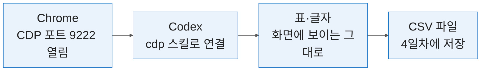

# 3일차 — 영업 제안서·견적·페인포인트 분석
#layout-chapter
#id-day3-cover

::: part
Day 3.
:::

---

#id-mg-day3
#layout-_mg

## 제안하기 — 상담 메모가 제안서 한 벌로

```mg
src: mg/03-day3
```

---

## 3-0. 여는 절 — 상담 메모에서 제안서까지 오는 길
#layout-contents-full
#id-day3-opening

::: htmlart timeline
* 3-1 — **뽑기**
  - 상담 메모 3건에서 페인포인트를 근거와 함께 표로 뽑음
* 3-2 — **쓰기**
  - 표를 제안서 초안으로 옮기고 솔루션을 이음
* 3-2 — **입히기**
  - pandoc 이 회사 양식을 입혀 `.docx` 로 바꿈
* 3-3 — **답하기**
  - 견적 회신과 후속 메일을 어조 두 벌로 받음
* 3-4 — **줄이기**
  - 의사결정자가 1분에 읽는 한 장으로 줄임
* 4일차 준비 — **열어 두기**
  - Chrome + CDP 를 열어 수집을 준비함
:::

* 2일차 사전 브리핑의 자리에 상담 메모가 들어옴 — 같은 5항목 틀에서 «접점 가설» 이 «페인포인트» 로 바뀜. 고객은 한솔건기(가상) 하나임.
* **받는 파일 → 만드는 파일** — `Day3` 폴더(상담 메모 3건·제품 정보·뼈대·양식) → `페인포인트표.md` → `제안서.md` → `제안서.docx`. 4일차로 넘기는 것은 차별점 한 줄과 `Chrome_CDP.bat` 임.
* 표기 — 🖥️ 시연은 보는 시간, 🙋 Practice 는 직접 치는 시간, ✅ 검증은 숫자 하나를 적는 시간임.

---

### 🔴 Codex 가 처음 일하는 날 — 승인 화면에서 읽을 것
#layout-contents
#id-codex-approval

::: htmlart numbered
* 폴더가 Day3 안인가
* 무엇을 지우거나 덮어쓰는가
* 내가 시킨 일에 필요한 명령인가
:::

* Codex 는 파일을 만들거나 명령을 실행하기 전에 승인을 물음. 승인 화면에서 위 셋을 읽고 허용함.
* 읽어도 모르겠으면 거절하고 «이 명령이 무슨 일을 하는지 한 줄로 설명해 줘» 라고 되물음.
* 🔴 Day3 폴더 밖 경로나 삭제 명령이 보이면 허용하지 않고 손을 듦.
* 한도 오류(`429 Too Many Requests` · «out of messages»)가 나오면 손을 듦. 모든 Practice 에서 ChatGPT 웹에 파일 내용을 붙이고 같은 프롬프트를 보내면 같은 결과를 받음.

---

### 🙋 Practice P3-0-1 — pandoc 과 AGENTS.md 규칙을 Codex 로 확인
#layout-exercise
#id-ex-p3-0-1

<div style="font-size:0.74em;line-height:1.35">

* **시간**: 15분 · **입력**: `Day3` 폴더 · 강사 USB 의 `pandoc-*-windows-x86_64.zip` · `AGENTS.md`
* **단계**: ① 드라이브 `_doc/Day3` 폴더를 바탕화면에 내려받기 ② USB 의 zip 을 `Day3` 안 `pandoc` 폴더로 풀기 ③ VSCode 로 `Day3` 폴더 열기 ④ Codex 에 프롬프트 ① 을 보내고 승인 화면에서 허용 ⑤ 이어서 프롬프트 ② 를 보냄 ⑥ 이어서 `룰로 분리해줘.` 를 보냄

```text
Day3 폴더 안의 pandoc 폴더에서 pandoc.exe 를 찾아서 버전을 출력해 줘.
첫 줄만 그대로 보여 주고, 파일은 만들거나 지우지 마.
그리고 이 폴더의 AGENTS.md 를 읽고 규칙이 몇 개인지와 첫 규칙을 그대로 보여 줘.
```

```text
다음부터, 제안서와 메일에서 레퍼런스·가격·납기 숫자는 지어내지 말고 [담당자 입력] 으로 남겨 줘.
```

* **기대 결과**: ① `pandoc` 으로 시작하는 버전 줄과 «규칙 5개» · 첫 규칙 ② 이어서 `룰로 분리해줘.` 를 보내면 `Day3` 안에 규칙 파일(`.md`) 하나가 생기고 `AGENTS.md` 에 그 파일을 가리키는 한 줄이 붙음
* **막히면**: 로그인이 풀렸으면 다시 로그인함 · 3분 안에 안 되면 손을 듦 · ②는 건너뛰어도 다음 Practice 에 지장 없음
* 📱 **필드 영업**: 보기 전용 — 옆자리 Codex 화면에서 규칙 5개와 새 규칙 파일이 생기는 것을 봄
* **완료조건**: 버전 줄과 규칙 개수가 보임 ✅

</div>

---

### 🖥️ 시연 — 상담 메모를 말로 남기기
#layout-contents
#id-demo-voice

| 단계   | PC (Windows)                      | 📱 휴대폰                   |
| :----- | :-------------------------------- | :-------------------------- |
| 켜기   | 메모 창을 클릭하고 Windows 키 + H | 키보드의 마이크 버튼        |
| 말하기 | 아래 세 문장을 또박또박 읽음      | 같음                        |
| 정리   | ChatGPT 에 붙여 «불릿 3줄로 정리» | ChatGPT 앱에 붙여 같은 요청 |

```text
한솔건기 구매팀 상담. 납기가 올해 두 번 밀렸는데 미리 알려 주지 않았다고 함.
견적 회신은 보통 사흘 넘게 걸린다고 함. 다음 주까지 견적 양식을 보내 달라고 요청함.
```

* 말로 남긴 메모도 3-1 의 상담 메모와 같은 재료임. 손이 바쁜 현장 상담일수록 말로 남기고 나중에 표로 뽑음.
* 실제 고객 이름·연락처는 말하지 않음 — 가상 고객으로만 연습함.

---

## 3-1. 고객 페인포인트 분석, 솔루션·차별점·기대효과 구조화
#layout-contents
#id-pain-opening

* 메모는 Codex 가 읽고, 표가 맞는지는 내가 판정함.
* 판정 기준은 하나임 — 표의 모든 칸에 메모 원문 근거가 붙어 있는가.

| 흐름         | 내용                                       |
| :----------- | :----------------------------------------- |
| 받는 것      | 상담 메모 3건 · `우리제품정보(가상).md`    |
| 만드는 것    | `페인포인트표.md` + «차별점:» 한 줄 (P3-1) |
| 다음에 쓸 곳 | 3-2 제안서 «배경» · 4일차 SNS 초안         |

---

### 🔗 2일차 브리핑 틀을 한솔건기(가상)에 그대로 적용
#layout-contents
#id-briefing-link

::: htmlart compare
* 2일차 — 출처가 공개 정보
  - 홈페이지·DART·뉴스에서 채움
  - 접점은 가설로만 적음
  - 모르는 것은 질문으로 남김
* 3일차 — 출처가 상담 메모
  - 같은 5항목을 메모에서 채움
  - 접점 자리에 페인포인트가 들어감
  - 질문 자리에 후속 요청이 들어감
:::

* 5항목은 회사 개요 · 주력 제품과 사업 · 최근 동향 · 접점 가설 · 첫 상담에서 물을 질문임. 틀은 그대로 쓰고 출처만 바뀜.
* 2일차에 추측으로 적던 접점이 3일차에는 고객이 직접 한 말로 바뀜. 그래서 제안서의 근거가 됨.

---

### 페인포인트란 — 고객이 겪는 불편과 업무에 드는 비용
#layout-contents
#id-pain-definition

::: htmlart bracket
* 시간을 잃는 불편
  - 납기가 밀려 라인이 대기함
  - 견적 회신이 늦어 비교 일정이 밀림
* 돈이 새는 불편
  - 남는 재고를 떠안음
  - 예산을 다시 짬
* 위험이 생기는 불편
  - 다른 로트와 섞일까 불안함
  - 공차 밖 부품으로 라인이 멈춤
:::

* 페인포인트는 고객이 직접 겪었다고 말한 불편·손실·위험임. 칭찬·사실·계획은 포함하지 않음.
* 같은 일을 두 번 말해도 1개로 셈. 전해 들은 이야기도 세지 않음.
* 불편 뒤에 따라붙는 영향을 함께 적어야 제안서에서 비용으로 읽힘.

---

### 한솔건기(가상) 상담 메모 3건과 페인포인트 표의 5열
#layout-contents-full
#id-memo-table

| 팀     | 파일                   | 상담 상대(가상)      | 주제      |
| :----- | :--------------------- | :------------------- | :-------- |
| 구매팀 | `상담메모1_구매팀.txt` | 팀장 · 구매 담당     | 거래 조건 |
| 설계팀 | `상담메모2_설계팀.txt` | 책임 · 선임          | 사양 검토 |
| 생산팀 | `상담메모3_생산팀.txt` | 생산팀장 · 라인 반장 | 현장 사용 |

* 표의 5열은 번호 · 팀 · 페인포인트 · 메모 근거 · 영향임.
* 근거 칸에는 메모 원문을 그대로 옮기도록 Codex 에 시킴. 근거가 비거나 메모에서 안 찾아지면 지어낸 칸이라는 신호임.
* 영향이 메모에 없으면 «메모에 없음» 으로 적도록 Codex 에 시킴.

---

### 페인포인트에서 솔루션·차별점·기대효과로 한 줄씩 잇기
#layout-contents
#id-pain-to-effect


* 한 줄씩 이으면 제안서의 한 문단이 됨. 앞 칸의 말만 다음 칸에서 받음.
* 기대효과에 숫자를 넣을 때는 메모나 제품 정보에 있는 숫자만 씀. 없으면 [담당자 입력] 으로 남김.
* 3-1 Practice 는 페인포인트와 차별점까지 만듦. 솔루션은 3-2 제안서, 기대효과는 3-4 원페이지에서 이어 씀.

---

### 차별점은 고객의 불편과 우리 강점이 겹치는 자리
#layout-contents
#id-differentiator

::: htmlart venn
* 고객이 겪는 불편
  - 상담 메모에 근거가 있음
* 차별점
  - 겹치는 자리만 씀
  - 한 줄 25자 안팎
* 우리가 할 수 있는 것
  - 제품 정보에 적혀 있음
:::

* 불편만 있고 우리가 못 하면 약속이 되지 못함. 우리 강점만 있고 고객 불편과 이어지지 않으면 자랑이 됨.
* 경쟁사가 못 하는 것은 2일차 비교표로 확인된 것만 덧붙임. 확인이 안 된 것은 차별점이 아니라 가설임.
* 차별점은 **한 줄**로 적어 표 아래에 붙임(P3-1-2). 이 한 줄을 4일차 SNS 초안(P4-2-2)에서 씀.

---

### 🙋 Practice P3-1-1 — Day3 폴더를 열고 Codex 에게 메모 읽히기
#layout-exercise
#id-ex-p3-1-1

<div style="font-size:0.74em;line-height:1.35">

* **시간**: 10분 · **입력**: `상담메모1_구매팀.txt` · `상담메모2_설계팀.txt` · `상담메모3_생산팀.txt`
* **단계**: ① VSCode 에서 `Day3` 폴더 열기 ② Codex 창에 프롬프트 붙여넣기 ③ 승인 화면에서 «읽기만 함» 확인 후 허용 ④ 팀별 요약 3개 확인

```text
Day3 폴더의 상담메모1_구매팀.txt, 상담메모2_설계팀.txt, 상담메모3_생산팀.txt 를 읽어 줘.
파일은 읽기만 하고 수정하거나 새로 만들지 마.
팀마다 고객이 직접 겪었다고 말한 불편을 3줄 이내로 요약하고, 줄마다 메모 원문을 따옴표로 붙여 줘. 메모에 없는 내용은 쓰지 마.
```

* **기대 결과**: 팀마다 3줄 이내 요약이 나오고 줄마다 따옴표 원문이 붙음 — ex) 구매팀 «납기가 올해 두 번이나 하루 이틀 밀렸는데 미리 알려 주지 않았음»
* **막히면**: 파일을 못 찾으면 왼쪽 탐색기에서 `Day3` 가 열렸는지 확인함 · 한도 오류면 ChatGPT 웹에 메모 3건 내용을 붙이고 «팀마다» 이하 문장을 보냄
* 📱 **필드 영업**: 드라이브 앱에서 메모 파일을 열어 내용을 복사하고 ChatGPT 앱에 붙여 같은 요청을 보냄
* **완료조건**: 요약 3개가 나오고 요약마다 메모 줄이 인용됨 ✅

</div>

---

### 🙋 Practice P3-1-2 — 페인포인트 표 만들기와 근거 칸 대조
#layout-exercise
#id-ex-p3-1-2

<div style="font-size:0.74em;line-height:1.35">

* **시간**: 15분 · **입력**: 상담 메모 3건 · `우리제품정보(가상).md`
* **단계**: ① 프롬프트 붙여넣기 ② 파일 생성 허용 ③ `페인포인트표.md` 를 열고 `Ctrl+Shift+V` 로 미리보기 ④ 근거 문장 하나를 복사해 메모 파일에서 `Ctrl+F` 로 검색

```text
상담 메모 3건에서 페인포인트 표를 만들어 Day3 폴더에 페인포인트표.md 로 저장해 줘.
열은 번호, 팀, 페인포인트, 메모 근거, 영향.
- 한 행은 페인포인트 하나, 반복해 말한 것은 합쳐
- 칭찬, 사실, 계획, 전해 들은 말은 제외해
- 메모 근거는 원문을 따옴표로 옮겨
- 영향이 없으면 «메모에 없음», 없는 내용은 추가하지 마
- 표 아래에 «차별점:» 으로 시작하는 한 줄을 붙여. 표의 불편을 풀면서 우리제품정보(가상).md 에 있는 약속만 쓰고 25자 안팎
```

* **기대 결과**: 5열 표가 저장되고 표 아래에 «차별점:» 줄이 붙음 — ex) `차별점: 납기 사전 통보·20개 소량 주문·STEP 제공`. 행 수는 사람마다 조금 달라도 정상임
* **막히면**: 5열이 아니면 «열을 번호, 팀, 페인포인트, 메모 근거, 영향으로 다시 맞춰 줘» · 차별점 줄이 없으면 «표 아래에 차별점 한 줄만 덧붙여 줘» · 3분 안에 안 되면 손을 들어 결과 파일 한 벌을 받음
* 📱 **필드 영업**: ChatGPT 앱에 메모 3건과 제품 정보를 붙여 같은 요청 → 나온 표의 근거 칸을 메모 앱에서 검색해 봄
* **완료조건**: 5열 표 저장 · 근거를 메모에서 찾음 · «차별점:» 한 줄 ✅

</div>

---

### ✅ 검증 P3-1 — 메모에 없는 내용이 들어간 칸 세기
#layout-exercise-small
#id-verify-p3-1

::: columns

::: column {width="43%"}
::: htmlart numbered
* 근거 칸 문장을 메모에서 검색
* 안 찾아지는 칸에 표시
* 표시한 칸 수를 Progress 에 적음
:::

* **확인 질문**: 메모에 없는 내용이 들어간 칸은 몇 개인가. 숫자 하나를 적음 ✅
:::

::: column {width="55%"}

:::

:::

---

## 3-2. 제조 고객용 영업 제안서 자동 작성(배경·솔루션·레퍼런스·가격)
#layout-contents
#id-proposal-opening

* 제안서는 마크다운으로 먼저 쓰고, 양식은 pandoc 이 입힘. 글과 양식을 따로 다루면 양식이 바뀌어도 글을 다시 쓰지 않음.

| 흐름         | 내용                                                   |
| :----------- | :----------------------------------------------------- |
| 받는 것      | `페인포인트표.md` · `제안서뼈대.md` · `reference.docx` |
| 만드는 것    | `제안서.md` → `제안서.docx` (P3-2)                     |
| 다음에 쓸 곳 | 3-3 회신 메일 · 3-4 원페이지                           |

---

### 제안서의 네 덩어리 — 배경, 솔루션, 레퍼런스, 가격
#layout-contents
#id-proposal-parts

::: cards
* **배경**
  - 고객이 겪는 일. 3-1 의 표가 재료임
* **솔루션**
  - 우리 제품 정보에 있는 약속만 씀
* **레퍼런스**
  - 실제 납품 사례. 사람이 채움
* **가격**
  - 가격 칸의 숫자. 사람이 채움
:::

* 앞의 둘은 AI 가 초안을 쓰고, 뒤의 둘은 숫자와 사실이라 사람이 채움.
* 빈칸을 두지 않으면 AI 가 그럴듯한 납품 사례와 단가·납기를 지어냄. 그래서 두 칸에는 [담당자 입력] 을 남기라고 Codex 에 시킴.
* 솔루션도 `우리제품정보(가상).md` 에 있는 항목만 씀. 파일에 없는 기능은 약속이 아니라 지어낸 말임.
* 뼈대 제목 8개 = 표제 + 1.배경 + 그 아래 구매·설계·생산 3 + 2.솔루션 + 3.레퍼런스 + 4.가격.

---

### 제안서는 마크다운으로 쓰고 pandoc 이 양식에 입힘
#layout-contents
#id-md-pandoc-docx

::: htmlart process
* 제안서.md
  - 글은 마크다운으로 씀
* pandoc
  - Codex 가 변환 실행
* 제안서.docx
  - reference.docx 양식
:::

* 마크다운의 `#` 는 제목 1, `##` 는 제목 2, `###` 는 제목 3이 됨. 글자 크기와 색은 `reference.docx` 가 정함.
* 변환 명령은 Codex 가 실행함. 승인 화면에서 `--reference-doc` 옵션이 붙었는지만 확인함.
* 🔴 변환 성공은 양식 일치가 아님. 옵션이 빠지면 제목이 전부 다르고, 견본이 낡았으면 일부 단계만 다름. 파일을 열어 제목 크기를 양식안내와 비교함(P3-2-2).

---

### 🙋 Practice P3-2-1 — 페인포인트 표로 제안서 초안 만들기
#layout-exercise
#id-ex-p3-2-1

<div style="font-size:0.74em;line-height:1.35">

* **시간**: 15분 · **입력**: `페인포인트표.md` · `제안서뼈대.md` · `우리제품정보(가상).md`
* **단계**: ① `페인포인트표.md` 가 `Day3` 안에 있는지 확인 ② 프롬프트 붙여넣기 ③ 파일 생성 허용 ④ `제안서.md` 를 미리보기로 열어 제목과 빈칸 확인

```text
Day3 폴더의 제안서뼈대.md 의 제목 8개는 글자 하나도 바꾸지 말고 그대로 두고, 제목 아래 본문만 채워서 제안서.md 로 저장해 줘.
- 1. 배경 아래 3개 제목에는 페인포인트표.md 의 팀별 내용만 불릿으로 써
- 2. 솔루션은 우리제품정보(가상).md 에 있는 항목만 써
- 3. 레퍼런스와 4. 가격 아래에는 [담당자 입력] 한 줄만 써
- 메모와 제품 정보에 없는 숫자나 사례는 쓰지 마
```

* **기대 결과**: 제목 8개가 뼈대와 글자까지 같고, 3. 레퍼런스와 4. 가격 아래는 `[담당자 입력]` 한 줄. 숫자는 제품 정보의 것만 나옴
* **막히면**: 표가 없으면 손을 들어 결과 파일 한 벌을 받음 · 제목이 바뀌었으면 «뼈대의 제목으로 다시 맞춰 줘» · 지어낸 숫자가 보이면 «메모와 제품 정보에 없는 숫자를 지워 줘»
* 📱 **필드 영업**: ChatGPT 앱에 뼈대와 표를 붙여 같은 요청 → 8개 제목과 빈칸 두 곳만 눈으로 확인
* **완료조건**: 제목 8개가 뼈대와 같고 레퍼런스·가격이 비어 있음 ✅

</div>

---

### 🙋 Practice P3-2-2 — pandoc 으로 .docx 변환과 양식 대조
#layout-exercise
#id-ex-p3-2-2

<div style="font-size:0.74em;line-height:1.35">

* **시간**: 15분 · **입력**: `제안서.md` · `reference.docx` · `pandoc` 폴더 · `양식안내.md`
* **단계**: ① 프롬프트 붙여넣기 ② 승인 화면에서 `--reference-doc` 확인 후 허용 ③ `제안서.docx` 를 Word 로 열기 ④ 제목 줄을 하나씩 클릭해 «글꼴 크기» 를 보고 `양식안내.md` 표와 비교

```text
Day3 폴더의 pandoc 폴더에 있는 pandoc.exe 로 제안서.md 를 제안서.docx 로 변환해 줘.
회사 양식은 Day3 폴더의 reference.docx 를 --reference-doc 옵션으로 지정해.
변환 뒤 제안서.docx 가 만들어졌는지만 알려 주고, 다른 파일은 건드리지 마.
```

* **기대 결과**: 1분 안에 `제안서.docx` 가 만들어지고 Word 에서 제목 8개가 보임 — 제목 1 22pt · 제목 2 15pt · 제목 3 12pt(모두 굵게)가 기준임
* **막히면**: Word 가 없거나 변환이 안 되면 손을 들어 완성 `제안서.docx` 를 받아 같은 대조를 함 · 다른 파일을 건드리면 중단시키고 손을 듦
* 📱 **필드 영업**: 변환은 PC 단계라 보기 전용 — 완성 `제안서.docx` 를 휴대폰으로 열어 제목 단계마다 모양이 같은지 눈으로 비교함
* **완료조건**: `제안서.docx` 가 열리고 제목 8개의 크기를 양식안내와 비교함 ✅

</div>

---

### ✅ 검증 P3-2 — 양식과 다른 제목 세기
#layout-exercise-small
#id-verify-p3-2

::: htmlart numbered
* 제목 8개를 차례로 클릭
* 양식안내와 다른 크기에 표시
* 표시한 제목 수를 Progress 에 적음
:::

* **확인 질문**: `.docx` 에서 제목 스타일이 양식과 다른 제목은 몇 개인가. 숫자 하나를 적음 ✅
* 기준은 `양식안내.md` 의 표 — 제목 1은 22pt, 제목 2는 15pt, 제목 3은 12pt 이며 모두 굵게임.

---

## 3-3. 견적 회신·조건 협의·후속 액션 메일, 어조 조절
#layout-contents
#id-quote-opening

| 메일      | 쓰는 법                                                   |
| :-------- | :-------------------------------------------------------- |
| 견적 회신 | 결론과 금액을 첫 줄에 둠 · 유효 기간을 한 줄 적음         |
| 조건 협의 | 받아들일 조건과 못 받는 조건을 가름 · 대안을 하나 함께 냄 |
| 후속 액션 | 다음 행동과 기한을 한 줄로 끝냄 · 누가 하는지 이름을 적음 |

* 메일 종류마다 첫 줄과 끝줄의 역할이 다름. 초안은 AI 가 쓰고 금액과 약속은 사람이 확정함.
* 조건 협의가 끝나면 메일뿐 아니라 제안서도 새 판으로 바뀜.

---

### 어조는 상대와 단계가 정함 — 관계 거리와 협상 긴장
#layout-contents
#id-tone-map


* 행은 협상 긴장, 열은 관계 거리임. 같은 내용이어도 관계가 가까울수록 부드럽게, 긴장이 높을수록 근거를 앞세움.
* 어조는 AI 에 «격식» «부드러움» 같은 말로 지시하고, 두 벌을 받아 사람이 고름.

---

### 🖥️ 시연 — 같은 견적 회신을 두 가지 어조로 받아 비교
#layout-contents
#id-demo-quote-tone

```text
제목: 보수용 부시 견적 요청
DG-DB 시리즈(가상) 표준형 부시 20개와 핀 20개 견적 부탁드립니다.
희망 납기는 3주 이내이고, 단가는 지난 분기보다 낮춰 줄 수 있는지 문의드립니다.
```

```text
위 견적 요청에 대한 회신 메일을 써 줘.
- 단가·납기 숫자는 지어내지 말고 [단가] [납기] 로 비워 둬
- 단가 인하 요청은 «내부 확인 후 회신» 으로 답해
- 어조만 달리해 두 벌: ① 격식 있는 공식 회신 ② 오래 거래한 담당자에게 쓰는 부드러운 협의체
- 각 벌의 마지막은 다음 행동(회신 기한) 한 줄로 끝내
```

| 볼 곳      | 정상 신호                           |
| :--------- | :---------------------------------- |
| 숫자 칸    | [단가] [납기] 가 비어 있음          |
| 단가 인하  | «내부 확인 후 회신» 으로만 답함     |
| 두 벌 차이 | 첫 문장 · 호칭 · 끝 문장에서만 갈림 |
| 마지막 줄  | 회신 기한 한 줄로 끝남              |

---

### 🖥️ 시연 — 조건 협의 뒤 제안서를 _v1.0.1 로 판올림
#layout-contents
#id-demo-version-up

```text
제안서.md 는 그대로 두고, 복사본을 제안서_v1.0.1.md 로 만들어 줘.
협의 결과로 «2. 솔루션» 에 «보수용 소량 주문은 20개 단위부터 가능» 한 줄을 추가하고, 파일 맨 위에 판 번호 v1.0.1 과 바뀐 내용 한 줄을 적어 줘.
```

| 볼 곳   | 정상 신호                        |
| :------ | :------------------------------- |
| 원본    | `제안서.md` 가 그대로 남음       |
| 새 파일 | `제안서_v1.0.1.md` 가 생김       |
| 바뀐 곳 | 솔루션의 한 줄과 맨 위 한 줄뿐임 |

* 판 번호는 `_v1.0.1` 처럼 파일명 끝에 붙임. 원본을 덮어쓰지 않아 이전 판으로 돌아갈 수 있음.
* 같은 요청이 매번 반복되면 «커맨드» 로 묶을 수 있음. 6일차 과제 카드에서 수단으로 고름.

---

## 3-4. 원페이지 제안 요약, 의사결정자용 핵심 메시지 정리
#layout-contents
#id-onepage-opening

::: cards
* **문제**
  - 고객이 겪는 일 한두 줄
* **해결**
  - 솔루션과 차별점 한두 줄
* **기대효과**
  - 근거 있는 효과만
* **다음 단계**
  - 결정이 필요한 것과 기한
:::

* 원페이지는 제안서를 줄인 것이 아니라 결정에 필요한 네 칸만 뽑은 것임.

---

### 의사결정자가 보는 세 가지 — 효과, 위험, 다음 단계
#layout-contents
#id-decision-maker

::: htmlart radial
* 의사결정자
* 효과가 얼마인가
* 위험은 무엇인가
* 지금 정할 것은 무엇인가
:::

* 의사결정자는 상세 사양을 읽지 않음. 세 질문에 한 줄씩 답이 있으면 다음 단계로 넘어감.
* 핵심 메시지는 한 줄 25자 안팎으로 세 줄 이내에 담음.

---

### 🖥️ 시연 — 제안서를 원페이지와 핵심 메시지 3줄로
#layout-contents
#id-demo-onepage

* 입력은 내가 만든 `제안서.md` 임(없으면 받은 예시 제안서).

```text
첨부한 제안서를 의사결정자가 1분에 읽는 원페이지로 줄여 줘.
- 칸 4개: 문제 / 해결 / 기대효과 / 다음 단계
- 제안서에 없는 숫자는 쓰지 마. 레퍼런스·가격은 [담당자 입력] 그대로 둬
- 마지막에 핵심 메시지 3줄을 따로 써 줘. 한 줄은 25자 이내.
```

| 볼 곳         | 정상 신호                    |
| :------------ | :--------------------------- |
| 레퍼런스·가격 | [담당자 입력] 이 그대로 남음 |
| 숫자          | 제안서에 있는 숫자만 나옴    |
| 핵심 메시지   | 3줄 · 한 줄 25자 이내        |

---

### 🖥️ 시연 — 원페이지를 인포그래픽 폴더로 저장
#layout-contents
#id-demo-infographic

```text
Day3 폴더의 제안서.md 핵심을 문제 / 해결 / 기대효과 / 다음 단계 네 칸 인포그래픽으로 만들어 줘.
제안서에 없는 숫자는 쓰지 말고, 레퍼런스·가격은 [담당자 입력] 그대로 둬.
Info Graphic포함 폴더 만들어서 저장해줘.
```

| 볼 곳 | 정상 신호                                         |
| :---- | :------------------------------------------------ |
| 폴더  | `Day3` 안에 인포그래픽 폴더가 새로 생김           |
| 파일  | 그림(PNG)과 고쳐 쓸 수 있는 파일(SVG)이 함께 있음 |
| 내용  | 네 칸 문구가 원페이지와 같고 없는 숫자가 없음     |

* 자주 쓰는 약어는 `AGENTS.md` 에 한 줄 적어 두면 다음부터 짧은 말로 같은 요청을 함 — ex) `ig: info Graphic`.
* `AGENTS.md` 는 가장 먼저 읽히는 파일이라 커지면 안 됨. 규칙은 짧게 두고 긴 것은 규칙 파일로 나눔.

---

### 🔗 4일차 준비 — Chrome + CDP 란, 밖에서 들어가는 문
#layout-contents
#id-cdp-what



* CDP(Chrome DevTools Protocol) 는 개발자 도구가 브라우저와 대화하는 규약임. 포트를 열어 두면 Codex 가 같은 문으로 들어가 읽고 누를 수 있음.
* 영업에서 쓰는 자리 — 전시회 참가업체 목록, 경쟁사·시장 자료의 공개 표, 같은 조회를 매주 반복하는 일. 로그인 뒤의 개인 데이터는 쓰지 않음.
* 전용 프로필 폴더로 열기 때문에 평소 쓰는 브라우저의 로그인·북마크와 섞이지 않음. 3일차는 **읽기만** 함.
* `cdp` 스킬은 한 번 만들어 두고 `cdp <주소> <할 일>` 한 줄로 부림. 그 페이지를 열어 할 일을 하고, 로그인·보안 경고 창이 나오면 멈추고, 결과와 만든 파일 경로를 알려 줌. Codex 창에 아래 한 줄을 보내 만듦.

```text
url과 할일을 적으면 해당 작업을 하는 cdp라는 범용 스킬 만들어줘.
```

---

### 🙋 Practice P3-0-2 — Chrome 을 CDP 로 열고 Codex 로 읽기
#layout-exercise
#id-ex-p3-0-2

<div style="font-size:0.74em;line-height:1.35">

* **시간**: 10분 · **입력**: `Chrome_CDP.bat` (더블클릭하면 가상 디렉토리 페이지가 열림)
* **단계**: ① 앞 장의 스킬 제작 한 줄을 Codex 에 보내기 ② `Chrome_CDP.bat` 더블클릭 — «더 보기» 는 누르지 않음 ③ 열린 창의 주소창 주소를 복사해 아래 `[ ]` 자리에 붙여 보내기 ④ 9222 포트만 연결하는지 읽고 허용

```text
cdp [CDP 창 주소창의 주소] 열린 탭의 제목과 주소, 그리고 표(table#dir)에 지금 보이는 데이터 행 수(머리글 제외)만 알려 줘.
브라우저 화면으로만 읽고 디스크의 html 파일은 열지 마. 파일은 만들지 말고 클릭이나 입력도 하지 마.
```

* **기대 결과**: Codex 가 탭 제목·주소와 «지금 보이는 데이터 행 수» 를 숫자로 답함. 표 아래의 «곳 표시 중» 글과 같은 숫자임
* **막히면**: ① 주소창에 `http://localhost:9222/json/version` 을 열어 글자(JSON)가 보이는지 봄 ② 보이는데 연결 실패면 «샌드박스 밖에서 실행하도록 승인을 요청해 줘» 를 보내고 9222 포트임을 읽고 허용 ③ 안 보이면 브라우저 창을 모두 닫고 `.bat` 을 다시 실행
* 📱 **필드 영업**: 보기 전용 — 옆자리 화면에서 표의 행 수가 답으로 나오는 것을 봄
* **완료조건**: 탭 제목과 보이는 행 수를 Codex 가 답함 ✅

</div>

---

## 3-5. 닫는 절 — 정답과 3일차 정리
#layout-summary
#id-day3-answers

::: htmlart compare
* P3-1 페인포인트표
  - 메모 속 실제 페인포인트는 12개
  - 메모에 없는 내용의 칸 수는 각자 다름
  - 근거 칸을 메모에서 검색하면 0~2개로 줄어듦
* P3-2 제목 스타일
  - 양식과 다른 제목은 3개
  - 제목 3 단계 전부가 해당함
  - 옵션을 빼먹으면 8개 전부 다름
:::

* 정답과 내 숫자를 비교해 Progress 시트에 O 또는 X 를 적음.
* P3-0-2 정답은 표 12행임 (위 페인포인트 12개와 별개) — «더 보기» 를 누르기 전 화면의 행 수. 4일차 수집에서 24행이 됨.

---

### 🔗 차별점 한 줄과 4일차 이후로 이어지는 길
#layout-summary
#id-day3-forward

| 단계   | 일차          | 다루는 것                    |
| :----- | :------------ | :--------------------------- |
| 수집   | 4일차         | 공개 표                      |
| 정리   | 5일차         | 엑셀                         |
| 시각화 | 5일차         | 차트 2개                     |
| 제안   | 6일차         | 원페이지                     |
| 배포   | 4일차 · 6일차 | Netlify 시안 · n8n 리드 분류 |

* **받는 파일 → 만드는 파일** — 4일차: «차별점:» 줄 · `Chrome_CDP.bat` → `site/` · SNS 초안 · `directory.csv`
* 도구 구분 — 파일 작업은 Codex, 공개 표 수집은 Codex + `cdp`, 문장 결은 ChatGPT, 금액·약속은 사람이 정함.
* 이어지는 일 — `directory.csv` → `후보분석.xlsx` → 차트 2개 → 원페이지. 목표는 수집이 아니라 근거 있는 제안임.
