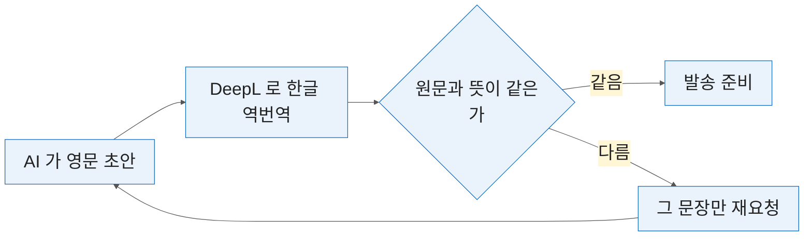

# 6일차 — 해외영업·고객 데이터 분석·CRM 자동화
#layout-chapter
#id-day6-cover

::: part
Day 6.
:::

---

#id-mg-day6
#layout-_mg

## 넓히기 — 번역 · 표 · 워크플로로

```mg
src: mg/06-day6
```

---

## 6-0. 여는 절 — 번역·표·워크플로로 이어지는 6일차
#layout-contents-full
#id-day6-open

::: htmlart process
* 번역
  - 6-1 · 6-2 · P6-1
* 표 정리
  - 6-3 · P6-2
* 근거 제안
  - 6-4 · P6-4
* 규칙 자동화
  - 6-5 · P6-3
* 과제 카드
  - 6-6
:::

* 시연은 두 번(합계 10분)이고 화면을 보기만 함. Practice 는 다섯 번이며 장표의 입력 파일·프롬프트·기대 결과를 따라 처음부터 끝까지 직접 침.
* 진행 순서는 P6-1 → P6-2 → P6-4 → P6-3 임. 6-5 가 n8n 이라 번호는 그대로 두고 순서만 이렇게 돎.
* 제출은 모든 Practice 가 같음 — 결과 파일을 `Day6` 폴더에 저장하고, 확인 질문의 숫자를 Progress 시트에 적음.
* 필드 영업은 장마다 📱 줄의 경로로 같은 확인 질문에 닿음. 막힌 단계 번호는 시트 비고에 적음.
* 🔗 **받는 파일 → 만드는 파일**: `번역/` → `카탈로그_영문.md` · `CRM.xlsx` → `CRM_정리.xlsx` · `후보분석.xlsx` → `원페이지제안.md` · `리드워크플로.json` → 결과 표 5행.
* 5일차 셋팅이 안 된 경우 `Day5/셋팅프롬프트.md` 의 마지막 1줄을 Codex 에 다시 넣음. 입력은 전부 가상 데이터이며 자사 고객·견적 데이터는 올리지 않음.

---

## 6-1. 영문 영업 메일·제안서와 수출 문의 응대
#layout-contents
#id-day6-s1

::: htmlart chevron
* 인사
* 답변
* 근거
* 다음 행동
:::

* 수출 문의 메일은 네 칸 순서로 답함 — 문의 확인, 질문에 직접 답변, 수치·조건 근거, 기한이 있는 다음 행동.
* 입력은 Pinecrest Equipment Parts(가상)가 보낸 영문 문의 3통이며 P6-1 에서 직접 응대 초안을 씀. 영문 제안서도 같은 네 칸에 길이만 늘림.
* AI 가 쓴 영문은 수량·납기·단가를 원문 숫자와 대조한 뒤에 보냄.

---

### 비즈니스 영어 어조 — 정중함의 세 단계
#layout-contents
#id-tone-three-levels

| 어조 | 쓰는 자리      | 예문                                                    |
| :--- | :------------- | :------------------------------------------------------ |
| 기본 | 내부·반복 거래 | `Please send the drawing.`                              |
| 정중 | 첫 문의 응대   | `Could you send the drawing?`                           |
| 격식 | 계약·클레임    | `We would appreciate it if you could send the drawing.` |

* 어조는 프롬프트에 한 줄로 지정함. 3일차 견적 회신의 어조 2종과 같은 방식임.
* 첫 문의 응대는 «정중» 이 기본이고, 계약·클레임 문서만 «격식» 으로 올림.

---

### DeepL 은 보조 — 역번역으로 어긋난 곳 찾기
#layout-contents
#id-deepl-backtranslate



* DeepL 은 로그인 없이 웹(deepl.com)에서 씀. 번역 주체가 아니라 **다른 눈으로 대조**하는 도구임.
* 역번역은 뜻만 맞춰 줌. 수량·날짜·단가는 역번역으로 못 거르므로 원문과 직접 대조함.
* 1일차의 할루시네이션 방어 한 줄(«비판한 뒤 고쳐 다시 써라»)을 영문 회신에도 한 번 더 걸 수 있음.
* 실습 메일은 가상이라 올려도 되지만, 실제 고객 메일은 붙여 넣지 않음.

---

## 6-2. 해외 바이어 발굴·후속 메일·다국어 카탈로그
#layout-contents
#id-day6-s2

| 구분             | 내용                                      | 시간 |
| :--------------- | :---------------------------------------- | ---: |
| 🖥️ 시연           | 바이어 발굴 목록과 전시회 후속 메일       |  5분 |
| 🙋 Practice P6-1 | 카탈로그 폴더 번역 → 문의 3통 응대 → 확인 | 30분 |

* 바이어 발굴은 공개 웹 정보로 후보의 **유형과 기준**을 잡는 일임. 특정 기업의 연락처 수집은 하지 않음.
* 전시회 후속 메일은 만난 직후 보내야 값이 큼 — 명함 메모 3줄이면 초안이 나옴.
* 다국어 카탈로그는 파일 하나씩이 아니라 **폴더째**, 용어집을 붙여 번역함.

---

### 🖥️ 시연 — 바이어 발굴 목록과 전시회 후속 메일
#layout-contents
#id-demo-buyer-followup

* 📱 같은 두 프롬프트는 ChatGPT 앱 대화에서도 그대로 됨.

```text
미국 건설기계 부품 유통사를 후보로 고를 때 볼 기준 5가지를 공개 웹 검색으로 정리하라.
출처 링크를 붙이고, 특정 기업의 연락처는 적지 마라.
```

```text
명함 메모: Pinecrest(가상) 구매 담당 James, DG-DB 60 부시에 관심, 샘플 요청 가능성.
전시회 후속 영문 메일 초안을 정중한 어조로 써라. 3일 안 회신 요청을 넣어라.
```

| 볼 곳          | 정상 신호                                |
| :------------- | :--------------------------------------- |
| 기준 5가지     | 출처 링크가 붙고 기업별 연락처는 없음    |
| 후속 영문 메일 | 정중한 어조 · James 호명 · «3일 안 회신» |

---

### 다국어 카탈로그 — 폴더째 번역하는 순서와 glossary
#layout-contents-full
#id-catalog-glossary

::: columns

::: column {width="42%"}
| 번역 폴더 | 원본 (읽기만)      | 결과 (새로 저장)   |
| :-------- | :----------------- | :----------------- |
| 본문      | `카탈로그_국문.md` | `카탈로그_영문.md` |
| 용어      | `glossary.md`      | `용어점검표.md`    |

* 순서는 용어집 읽기, 번역, 점검표 저장임.
* Codex 가 폴더 안 파일을 열어 결과를 새 파일로 저장하며 원본은 건드리지 않음.
:::

::: column {width="56%"}
| 한국어         | English                    | 쓰지 않는 표기       |
| :------------- | :------------------------- | :------------------- |
| 부시           | bushing                    | bush                 |
| 허용 면압      | allowable surface pressure | permissible pressure |
| 붐-아암 연결부 | boom-arm joint             | boom-arm connection  |
| 납기           | lead time                  | delivery time        |
| 최소 주문 수량 | MOQ                        | minimum order        |

* 용어 하나에 번역 하나로 고정함. 고정하지 않으면 한 카탈로그 안에서 용어가 흔들림.
* 실습 입력은 20행 초안임. 영문 외 언어는 언어 열만 하나 더함.
:::

:::

---

### 🙋 Practice P6-1-1 — 카탈로그 폴더 번역과 glossary 적용
#layout-exercise
#id-ex-p6-1-1

* **12분** · 입력 `번역/카탈로그_국문.md` · `glossary.md` (가상)

::: columns

::: column {width="44%"}
1. `Day6` 폴더를 내려받아 VSCode 로 엶
2. Codex 에 프롬프트를 붙여넣고 전송
3. 저장 승인 창이 뜨면 읽고 승인
4. `카탈로그_영문.md` 의 수치 120 · 150 을 원본과 대조
:::

::: column {width="54%"}
```text
번역 폴더의 glossary.md 를 먼저 읽어라.
카탈로그_국문.md 를 영어로 번역해 카탈로그_영문.md 로 저장하라.
glossary 의 English 열 표기만 쓰고 "쓰지 않는 표기" 열의 단어는 쓰지 마라.
표의 수치와 단위는 바꾸지 마라. 원본은 수정하지 마라.
번역 뒤 glossary 20행이 영문에서 어떻게 쓰였는지 용어점검표.md 로 저장하라.
```
:::

:::

* **기대 결과**: `카탈로그_영문.md` · `용어점검표.md` 생성, 원본 불변 ✅

---

### 🙋 Practice P6-1-2 — 문의 메일 3통 응대 초안과 역번역
#layout-exercise
#id-ex-p6-1-2

* **13분** · 입력 `번역/문의1_견적요청.txt` · `문의2_납기사양.txt` · `문의3_샘플.txt` · `카탈로그_국문.md`

::: columns

::: column {width="40%"}
1. 프롬프트 ① 전송 — 요약표와 회신 초안
2. 프롬프트 ② 전송 — 회신을 네 칸 순서로 정리
3. `회신2.txt` 를 deepl.com 에 붙여 한글로 역번역
4. 문의2 의 두 질문(6주 출하 · 표면처리)에 답이 있는지 대조
:::

::: column {width="58%"}
```text
① 번역 폴더의 문의1~3.txt 를 읽어라.
1) 문의마다 요청 품목, 수량, 질문을 한국어 표로 정리해 문의요약.md 로 저장하라.
2) 문의2 에 대한 영문 회신 초안을 회신2.txt 로 저장하라. 정중한 어조, glossary 표기를 써라.
3) 답은 카탈로그_국문.md 에 있는 내용만 써라. 단가는 "별도 견적" 이라 적고 없는 사실은 지어내지 마라.
```

```text
② 회신2.txt 를 문의 확인, 직접 답변, 수치 근거, 기한 있는 다음 행동의 네 칸 순서로 고쳐 저장하라.
```
:::

:::

* **기대 결과**: `문의요약.md` 3행 · `회신2.txt` 납기 8주 · 단가 «별도 견적» ✅

---

### ✅ 확인·복구 P6-1 — glossary 와 다르게 번역된 용어 세기
#layout-exercise-small
#id-verify-p6-1

::: columns

::: column {width="38%"}
::: htmlart numbered
* 용어점검표에서 어긋난 칸을 셈
* 의심 용어 둘을 Ctrl+F 로 확인
* 문의 3통 수량 합을 요약표와 대조
:::
:::

::: column {width="60%"}
| 막히면                | 복구                                                    |
| :-------------------- | :------------------------------------------------------ |
| 파일을 못 찾음        | 폴더를 `Day6` 로 다시 엶                                |
| Codex 한도 초과(429)  | chatgpt.com 에 파일을 첨부, «번역 폴더의» → «첨부한»    |
| 단가를 지어냄         | «없는 내용은 확인 불가, 단가는 별도 견적» 으로 재요청   |
| 📱 필드 영업          | ChatGPT 앱에 본문을 붙여 같은 요청 · 역번역은 DeepL     |
:::

:::

* **5분** · **확인 질문**: glossary 와 다르게 번역된 용어는 몇 개인가 — 숫자를 Progress 시트에 O/X 와 함께 적음. 대소문자 차이는 세지 않음.

---

## 6-3. 엑셀·CRM 영업 데이터 AI 정리와 전환율 분석
#layout-contents
#id-day6-s3

::: htmlart funnel
* 전체 리드 100건 (예시)
* 견적 이상 40건 — 40.0%
* 수주 15건 — 15.0%
:::

* 파이프라인은 리드가 거치는 단계의 줄이고, 전환율은 **한 단계 건수를 기준 건수로 나눈 값**임.
* 분모를 무엇으로 두느냐에 따라 값이 달라지므로 정의를 프롬프트에 먼저 씀. 이 과정의 정의는 (견적 + 수주) ÷ 전체이고, 실주는 분모에만 넣음.
* 위 숫자는 모양을 보이는 예시임. 내 데이터의 값은 P6-2 에서 직접 계산해 구함.

---

### CRM 정리의 세 함정 — 중복·표기 흔들림·과잉 병합
#layout-contents
#id-crm-three-traps


* 순서는 정의 먼저, 변환표 확인, 정리 실행임. 바꾼 표기 목록을 **먼저 보여 달라고** 요청함.

---

### 접수 트렌드 — 월별 접수 건수와 차트 요청법
#layout-contents-full
#id-trend-monthly-chart

::: columns

::: column {width="40%"}
```text
월별 접수 건수를 막대 차트로
그려 월별접수.png 로 저장하라.
한글이 네모로 깨지면 폰트를
Malgun Gothic 으로 지정해
다시 그려라.
```
:::

::: column {width="56%"}
```chart
{
  "type": "bar",
  "data": {
    "labels": ["1월", "2월", "3월", "4월", "5월", "6월", "7월", "8월", "9월(일부)"],
    "datasets": [
      {
        "label": "접수 건수",
        "data": [24, 22, 21, 26, 20, 18, 23, 22, 10],
        "backgroundColor": "#0365C0"
      }
    ]
  },
  "options": {
    "aspectRatio": 1.5,
    "plugins": {
      "title": { "display": true, "text": "월 접수는 18~26건 사이 — 9월은 일부", "font": { "size": 26 } },
      "legend": { "display": false }
    },
    "scales": {
      "x": { "ticks": { "font": { "size": 24 } } },
      "y": { "ticks": { "font": { "size": 24 } }, "title": { "display": true, "text": "건", "font": { "size": 26 } } }
    }
  }
}
```
:::

:::

* 한글이 깨지는 것은 차트 도구의 기본 폰트 문제임 — 프롬프트 한 줄이 해법임. 위 막대는 모양을 보이는 예시값임.
* 5일차 엑셀 차트와 길이 다름 — 엑셀 차트는 글자가 텍스트라 안 깨지고, `.png` 는 그림에 글자를 그려 넣어 폰트를 지정해야 함.
* 이 CRM 에는 금액 열이 없어 접수 **건수**까지만 봄. 금액 열이 있으면 같은 요청에서 건수를 월별 합계로 바꿔 매출 트렌드를 봄.

---

### 🙋 Practice P6-2-1 — 중복 제거와 단계 표기 통일
#layout-exercise
#id-ex-p6-2-1

* **12분** · 입력 `Day6/CRM.xlsx` (가상 리드 200행, 단계 표기가 섞여 있음)

::: columns

::: column {width="42%"}
1. `Day6` 폴더를 VSCode 로 열고 `CRM.xlsx` 를 엑셀로 훑음
2. Codex 에 프롬프트를 붙여넣고 전송
3. «바꾼 표기 목록» 을 읽고 이상한 변환이 없으면 승인
4. `CRM_정리.xlsx` 의 단계 열 필터를 확인
:::

::: column {width="56%"}
```text
Day6 폴더의 CRM.xlsx 를 읽어라. 원본은 수정하지 마라.
1) 회사명·담당자·제품군이 모두 같은 행은 첫 행만 남겨라. 앞뒤 공백은 무시하라.
2) 단계 표기를 리드·상담·견적·수주·실주 다섯 가지로 통일하라. 바꾼 표기 목록을 먼저 보여 줘라.
3) 결과를 CRM_정리.xlsx 로 저장하고 제거한 행 수와 남은 행 수를 알려라.
```
:::

:::

* **기대 결과**: `CRM_정리.xlsx` 생성 · 단계 열에 리드·상담·견적·수주·실주 다섯 가지뿐 ✅

---

### 🙋 Practice P6-2-2 — 전환율 계산과 월별 차트
#layout-exercise
#id-ex-p6-2-2

* **13분** · 입력 `CRM_정리.xlsx` (같은 대화에서 이어서)

::: columns

::: column {width="40%"}
1. 같은 대화에 프롬프트를 붙여넣고 전송
2. 답의 분자 · 분모 · 전환율 세 숫자를 읽음
3. `월별접수.png` 의 월 글자가 한글인지 확인
4. 여유가 있으면 수량 구간별 전환율도 요청
:::

::: column {width="58%"}
```text
CRM_정리.xlsx 로 아래를 계산하라.
1) 리드→견적 전환율 = (단계가 견적 또는 수주인 행) ÷ (전체 행). 실주는 분모에 넣고 분자에서 빼라.
2) 월별 접수 건수를 막대 차트로 그려 월별접수.png 로 저장하라. 제목은 결과를 담은 한 줄, 축 이름은 한글로 써라.
한글이 네모로 깨지면 폰트를 Malgun Gothic 으로 지정해 다시 그려라.
분자와 분모를 함께 보여 줘라.
```
:::

:::

* **기대 결과**: 분자·분모·전환율(%) 숫자 + `월별접수.png` 막대 9개와 한글 제목·축 ✅

---

### ✅ 확인·복구 P6-2 — 남은 행 수와 전환율
#layout-exercise-small
#id-verify-p6-2

::: columns

::: column {width="38%"}
::: htmlart numbered
* 제거한 행 수와 남은 행 수를 확인
* 단계 열을 필터로 열어 5종뿐인지 확인
* 분자 ÷ 분모를 직접 다시 나눔
:::
:::

::: column {width="60%"}
| 막히면               | 복구                                                          |
| :------------------- | :------------------------------------------------------------ |
| openpyxl·차트 오류   | `Day5/셋팅프롬프트.md` 의 마지막 1줄을 Codex 에 다시 넣음     |
| Codex 한도 초과(429) | chatgpt.com 에 `CRM.xlsx` 를 첨부, 결과 파일을 `Day6` 에 저장 |
| 전환율이 정의와 다름 | «분모는 전체 행, 실주 포함» 으로 재요청                       |
| 글자가 네모          | «Malgun Gothic 폰트로 다시 그려라» 한 번 더                   |
| 📱 필드 영업         | ChatGPT 앱에 파일을 첨부해 같은 프롬프트 · 차트는 건너뜀      |
:::

:::

* **5분** · **확인 질문**: 중복 제거 후 남은 행은 몇 개이고 리드→견적 전환율은 몇 %인가 — 두 숫자를 Progress 시트에 적음.

---

## 6-4. 5일차 후보분석으로 쓰는 근거 제안
#layout-contents
#id-section-evidence

::: htmlart pyramid
* 다음 단계 1개
* 타깃 표 1개
* 근거 숫자 3개
:::

* 제안이 설득력을 얻는 것은 문장이 아니라 **파일에서 찾을 수 있는 숫자**임. 4일 동안 끌고 온 후보 목록이 그 파일임.
* 숫자는 `후보분석.xlsx` 에 **적힌 값**이거나 그 값으로 **계산한 수**(식 병기)만 씀. 식으로 재현되지 않으면 «확인 필요» 임 — 1일차 할루시네이션 방어와 같은 원칙임.
* 근거 숫자 3개는 프롬프트에서 정의함 — 타깃 연매출 합계 · 그 합계의 OEM 비율 · 해외지사 합계. 비율은 큰 곳을 골랐으니 클 수밖에 없는 값이라 «시장 커버율» 로만 읽음.
* 3일차 원페이지와 같은 틀에서 «기대효과» 가 «근거 숫자 3개» 로 바뀜. 독자·요청·담당·기한이 있어야 읽는 사람이 움직임.
* **받는 것** `후보분석.xlsx`(5일차) → **만드는 것** `원페이지제안.md` — 1차 타깃 표 · 근거 숫자 3개(P6-4) → **다음에 쓸 곳** 6-6 과제 카드의 «검증 기준» 예시

---

### 🙋 Practice P6-4-1 — 1차 타깃을 고르고 원페이지 제안 쓰기
#layout-exercise
#id-ex-p6-4-1

* **15분** · 입력 `Day6/후보분석.xlsx` (시트 3개 — 5일차에 만든 파일이 있으면 그것을 씀)

::: columns

::: column {width="38%"}
1. `후보` 시트를 엑셀로 훑음
2. Codex 에 프롬프트를 붙여넣고 전송
3. `원페이지제안.md` 의 숫자 3개를 xlsx 값·식과 하나씩 대조
4. «확인 필요» 인 담당·기한 칸에 우리 쪽 담당자와 기한을 적음
:::

::: column {width="60%"}
```text
Day6 폴더의 후보분석.xlsx 에서 1차 타깃을 골라 줘. 규칙: 구분 OEM, 연매출 5000억원 이상, 해외지사 1곳 이상, '비공개' 제외.
DG-DB 시리즈(가상) 원페이지 제안을 원페이지제안.md 로 저장해. 독자는 타깃사 구매 책임자. 4덩어리:
1) 제목  2) 근거 숫자 3개 + DG-DB 적합 이유 1줄  3) 타깃 표(회사명·국가·연매출·해외지사)  4) 다음 단계(요청·담당·기한)
근거 숫자: ① 타깃 연매출 합계 ② ①÷OEM 연매출 합계(비공개 제외) ③ 타깃 해외지사 합계.
xlsx 값이거나 계산한 수만 쓰고 식을 병기. 재현 못 하면 '확인 필요'. 끝나면 저장한 파일 이름만 알려 줘.
```
:::

:::

* **기대 결과**: 4덩어리와 숫자 3개(식 병기). 담당·기한이 «확인 필요» 인 것은 정상 ✅

---

### ✅ 확인·복구 P6-4 — 1차 타깃 곳 수와 틀린 숫자 세기
#layout-exercise-small
#id-verify-p6-4

::: columns

::: column {width="38%"}
::: htmlart numbered
* 타깃 표의 줄 수 세기
* 근거 숫자 3개를 식으로 다시 계산
* 두 숫자를 Progress 에 적음
:::
:::

::: column {width="60%"}
| 막히면               | 복구                                                    |
| :------------------- | :------------------------------------------------------ |
| 숫자가 xlsx 와 다름  | «그 숫자의 식과 출처 셀을 알려 줘» 로 재요청            |
| 3분 넘게 막힘        | 손을 들어 완성본 파일을 받아 확인 질문만 진행           |
| Codex 한도 초과(429) | chatgpt.com 에 `후보분석.xlsx` 를 첨부                  |
| 📱 필드 영업         | ChatGPT 앱에 xlsx 를 첨부해 같은 프롬프트 · 화면에서 대조 |
:::

:::

* **5분** · **확인 질문**: 1차 타깃은 몇 곳이고, xlsx 값이나 식으로 재현되지 않는 근거 숫자는 몇 개인가.

---

## 6-5. n8n 리드 분류와 GPTs 종료·대안
#layout-contents
#id-day6-s4

::: columns

::: column {width="60%"}
* GPTs 는 종료 단계라 5분 안에 보고, 리드 자동 분류는 n8n Practice(P6-3)에서 직접 함.
* 개인 계정(Free·Go·Plus·Pro)은 신규 생성이 이미 막혔다는 보도가 있음. 지급 계정의 실제 상태는 ChatGPT 화면에서 확인함.
* **받는 것** `리드워크플로.json` · `리드규칙.md` · 테스트 리드 5건 → **만드는 것** 결과 표 5행 — A·B·C 등급(P6-3) → **다음에 쓸 곳** 6-6 과제 카드의 수단 «n8n»
* 종료 뒤 대체는 플러그인임. Actions(외부 API 연동)는 그대로 옮겨지지 않아 앱이나 MCP 서버로 다시 만들어야 하고, 옮긴 결과는 응답이 달라질 수 있어 재시험함.
:::

::: column {width="38%"}

:::

:::

---

### GPTs 대안 세 가지 — 프로젝트·플러그인·Gems
#layout-contents
#id-gpts-three-alternatives

::: cards
* **ChatGPT 프로젝트**
  - 지시문과 참고 파일을 한 곳에 저장
  - 지급 계정으로 바로 씀
* **플러그인**
  - 지시문·참고 자료·외부 연결을 묶음
  - 지급 계정에서 열리는지는 화면에서 확인함
* **Gemini Gems**
  - 개인 구글 계정으로 만듦
  - 지시문 중심
:::

* 공통 기준은 **지시문과 참고 파일을 한 번 저장해 두고 매번 꺼내 쓴다**는 것임. 이 기준을 채우면 이름이 바뀌어도 같은 방식으로 옮겨 감.
* 1일차 도구 비교에서 본 «프로젝트» 가 첫째 대안임. 이 과정의 지급 계정에서는 ChatGPT 프로젝트가 가장 가까움.

---

### n8n — 정해진 규칙으로 도는 워크플로
#layout-contents
#id-n8n-rule-workflow

::: htmlart process
* 리드 5건 유입
  - 테스트 리드
* 규칙으로 분류
  - A·B·C 세 등급
* 표에 자동 기록
  - 결과 표 5행
* 담당자 확인
  - 등급 열 보기
:::

* n8n 은 규칙으로 도는 일을 노드로 이어 붙이는 자동화 도구임. 코드를 쓰지 않음.
* 체험은 Cloud 14일 무료이고 카드 입력이 없음. 6일차에 가입하면 12.02 까지 씀.
* 체험 뒤에는 유료 Cloud(회사 결정) 또는 무료 Community Edition(사내 서버, IT 부서와 함께)임.
* Practice P6-3 은 준비된 워크플로를 붙여넣고 규칙 3줄로 등급을 나눠 표로 봄. AI 노드는 쓰지 않음.

---

### 🙋 Practice P6-3-1 — n8n 체험 가입과 워크플로 가져오기
#layout-exercise
#id-ex-p6-3-1

* **12분** · 입력 `Day6/리드워크플로.json` (가상) · 개인 이메일 1개

::: columns

::: column {width="52%"}
1. n8n.io → Cloud 무료 체험 — 이메일 · 비밀번호 · 인스턴스 이름 (카드 없음)
2. 인증 코드를 입력하고 설문은 Skip, 1분쯤 대기
3. 새 워크플로(빈 캔버스)를 만들고 `리드워크플로.json` 을 열어 전체 복사
4. 캔버스를 한 번 클릭하고 Ctrl+V — **한 번만**
:::

::: column {width="46%"}

:::

:::

* **기대 결과**: 캔버스에 노드 7개가 선으로 이어져 보임 ✅

---

### 🙋 Practice P6-3-2 — 규칙 3줄 보기와 실행
#layout-exercise
#id-ex-p6-3-2

* **13분** · 입력 가져온 워크플로 · `Day6/리드규칙.md` (규칙과 테스트 리드 5건, 가상)

::: columns

::: column {width="54%"}
1. `등급 규칙` 노드를 열어 `Routing Rule 1` · `2` 를 펼쳐 규칙을 읽음
2. 캔버스 아래 `Execute workflow` 를 **한 번** 누름
3. `결과 표` 노드의 `OUTPUT` 을 `Table` 로 봄 (순서는 A → B → C)
4. 선택: `1000` 을 `900` 으로 고쳐 다시 실행
:::

::: column {width="44%"}
```text
A: 수량 1000 이상 그리고
   유입경로 = 전시회
B: A 가 아니고 수량 300 이상
C: 그 밖의 전부
   (Fallback → Extra Output)
```
:::

:::

* **기대 결과**: 노드마다 초록 체크 · `결과 표` 에 5행과 등급 열(A·B·C) ✅

---

### ✅ 확인·복구 P6-3 — 테스트 리드 5건의 A 등급 수
#layout-exercise-small
#id-verify-p6-3

::: columns

::: column {width="38%"}
::: htmlart numbered
* `결과 표` 의 등급 열에서 A 를 셈
* 수량 999 와 1000 의 등급을 비교
* 규칙 3줄에 두 건을 직접 대입
:::
:::

::: column {width="60%"}
| 막히면                 | 복구                                                      |
| :--------------------- | :-------------------------------------------------------- |
| 붙여넣어도 반응 없음   | 캔버스를 한 번 더 클릭 · 노드가 두 벌이면 지우고 한 번만  |
| 인증 메일이 안 옴      | 스팸함 확인 후 재전송, 그동안 옆 화면으로 규칙 읽기       |
| 규칙이 접혀 있음       | `Routing Rule 1` · `2` 를 펼침                            |
| 가입이 끝내 막힘       | 시트 비고에 적고 시연 화면으로 결과 판정만                |
| 📱 필드 영업           | 실행 대신 테스트 리드 5건에 규칙 3줄을 손으로 대입        |
:::

:::

* **5분** · **확인 질문**: 테스트 리드 5건 중 A 등급은 몇 건인가 — 숫자를 Progress 시트에 O/X 와 함께 적음. 선택 실습을 했어도 바꾸기 전 1000 기준 숫자임.

---

### 🖥️ 시연 — n8n AI 분류 1건
#layout-contents
#id-demo-n8n-ai

* 자유 문장 문의 1건을 AI 노드로 A·B·C 에 분류함 — 규칙으로는 못 나누는 문장이 대상임.

| 구분      | 규칙 기반 (P6-3)       | AI 기반 (이 시연)       |
| :-------- | :--------------------- | :---------------------- |
| 같은 입력 | 항상 같은 결과         | 결과가 달라질 수 있음   |
| 맞는 문의 | 규칙 3줄로 나뉘는 문의 | 규칙으로 못 나누는 문장 |

| 볼 곳            | 정상 신호                           |
| :--------------- | :---------------------------------- |
| AI 노드의 출력   | A·B·C 중 하나와 이유 한 줄이 나옴   |
| 같은 문의 재실행 | 결과가 바뀔 수 있음을 눈으로 확인함 |

---

## 6-6. 닫는 절 — 과제 카드·6일 회고·로그아웃
#layout-contents-full
#id-day6-close-section

::: htmlart timeline
* 1일차 — **묻기**
  - 6요소 프롬프트 · 맥락 카드 · 가치 제안
* 2일차 — **조사하기**
  - 경쟁사 비교표 · 고객사 사전 브리핑
* 3일차 — **제안하기**
  - 페인포인트 표 · 제안서 문서
* 4일차 — **알리기**
  - 홈페이지 주소 · SNS 글 2종 · 수집 CSV
* 5일차 — **꾸미기**
  - 슬라이드 · 규격 사진 · 후보분석.xlsx · 엑셀 차트
* 6일차 — **넓히기**
  - 번역본 · 정리한 CRM · 근거 제안 · 리드 분류
:::

* 앞날의 결과가 다음 날의 재료였음 — 맥락 카드 → 브리핑 → 제안서 → 홈페이지·CSV → 시각물·차트 → 영문·CRM. 이제 이 사슬을 **우리 부서 일 1건**에 거는 것이 과제 카드임.
* 남은 시간은 정답 공개 → 수단 고르기 → 🙋 과제 카드 15분 → 🙋 회고·로그아웃 15분 순서임.

---

### 6일차 확인 질문 정답 공개
#layout-contents-full
#id-day6-answers

| 검증 | 확인 질문                               | 정답                                            |
| :--- | :-------------------------------------- | :---------------------------------------------- |
| P6-1 | glossary 와 다르게 번역된 용어 수       | 0개                                             |
| P6-2 | 중복 제거 후 남은 행 · 리드→견적 전환율 | 190행 · 30.0% (57 ÷ 190)                        |
| P6-3 | 테스트 리드 5건 중 A 등급               | 2건 (999 는 B, 1000 은 A)                       |
| P6-4 | 1차 타깃 곳 수 · 재현되지 않는 숫자     | 6곳 · 0개 (74,400억원 · 약 91% · 해외지사 28곳) |

* 시트에 정답과 내 숫자를 나란히 적고 Progress 를 O/X 로 정리함. P6-1 은 AI 출력에 따라 달라질 수 있어 내 숫자와 비교함.

---

### 과제 카드의 수단 — 대화는 프로젝트, 규칙은 n8n
#layout-contents
#id-tool-ladder


* 사다리는 바로 묻기 → 규칙·명령으로 고정 → 스킬로 맡기기 순임. 같은 일을 두 번째 치는 순간이 한 칸 올릴 때임.
* 한 줄 결론: 대화로 반복하면 프로젝트, 정해진 규칙이면 n8n, 웹 표를 반복해 모으면 Codex + CDP, 같은 지시를 파일마다 되풀이하면 Codex 스킬.
* Codex + CDP 는 공개된 페이지·약관이 허용하는 범위만 대상으로 함.

---

### 🙋 Practice 과제 — 우리 부서 과제 카드 작성
#layout-exercise
#id-ex-task-card

* **15분** · 입력 아래 양식 → 새 파일 `과제카드.md` · 자사 고객·견적 데이터는 쓰지 않고 파일 이름만 적음

::: columns

::: column {width="38%"}
```text
업무:
입력:
프롬프트 또는 규칙:
검증 기준:
수단:
```
:::

::: column {width="60%"}
```text
(작성 예)
업무: 전시회 뒤 후속 메일 작성
입력: 명함메모.txt (3줄)
프롬프트 또는 규칙: 정중한 어조 · 카탈로그 내용만 · 3일 안 회신 요청
검증 기준: 수량·납기가 원문과 같은가를 숫자로 대조
수단: ChatGPT 프로젝트
```
:::

:::

* 같은 일을 두 번 한 업무를 고르고 수단은 앞 장의 네 가지 중 하나를 고름. 검증 기준에는 «출처를 알려 줘»·«확인할 수 없으면 그렇게 답해»·원문 숫자 대조를 쓸 수 있음
* **기대 결과**: 다섯 칸이 모두 차고 검증 기준이 숫자·대조 방법으로 적힘 ✅
* **막히면**: 작성 예의 업무로 먼저 쓰고 · 📱 폰 메모 앱에 5줄을 써서 시트에 붙임

---

### 🙋 Practice 마무리 — 6일 회고와 로그아웃 6곳
#layout-exercise-small
#id-ex-retro-logout

* **소요** 15분 (회고 10 + 로그아웃 5) · **입력** 강의노트 회고 시트
* 바뀌는 것은 도구·크레딧·화면임 — 6-5 에서 본 GPTs 종료가 그 실례임. 바뀌지 않는 것은 확인·출처·사람의 서명임.
* 회고: 시트를 열어 세 줄 입력 — 쓸모 있던 것 · 현업에서 먼저 할 것 · 막혔던 것(내가 만난 AI 의 틀림 포함) ✅ 세 줄이 시트에 입력됨
* 로그아웃: ChatGPT → Google → Gamma → VSCode 의 ChatGPT(Codex) → Netlify → n8n 순서로 로그아웃하고 브라우저에 저장된 비밀번호도 지움 ✅ 여섯 곳 모두 로그인 화면으로 돌아감
* 렌탈 PC 를 다음 사용자에게 넘기기 전에 하는 일임. 폰은 해당 없음 📱 — 회고만 폰으로 입력해도 됨.
* 질문은 강의노트 QnA 시트로 남김. 과정이 끝난 뒤에도 그 시트로 답함. 더 보기: 공개 덱 저장소 [m2slide-deck](https://github.com/Finfra/m2slide-deck) 의 `decks/agentic-ai/`.
