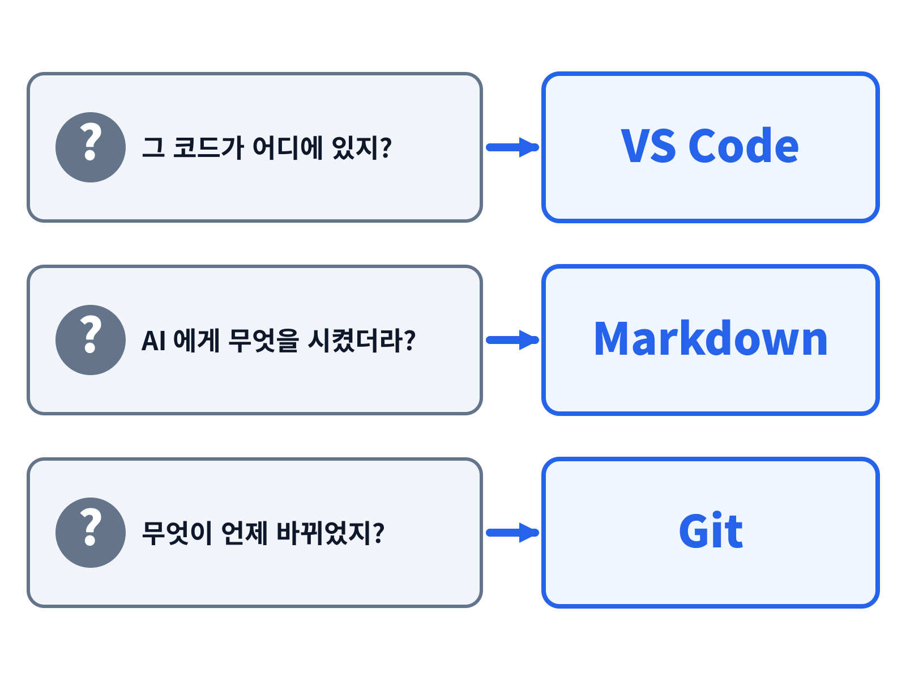
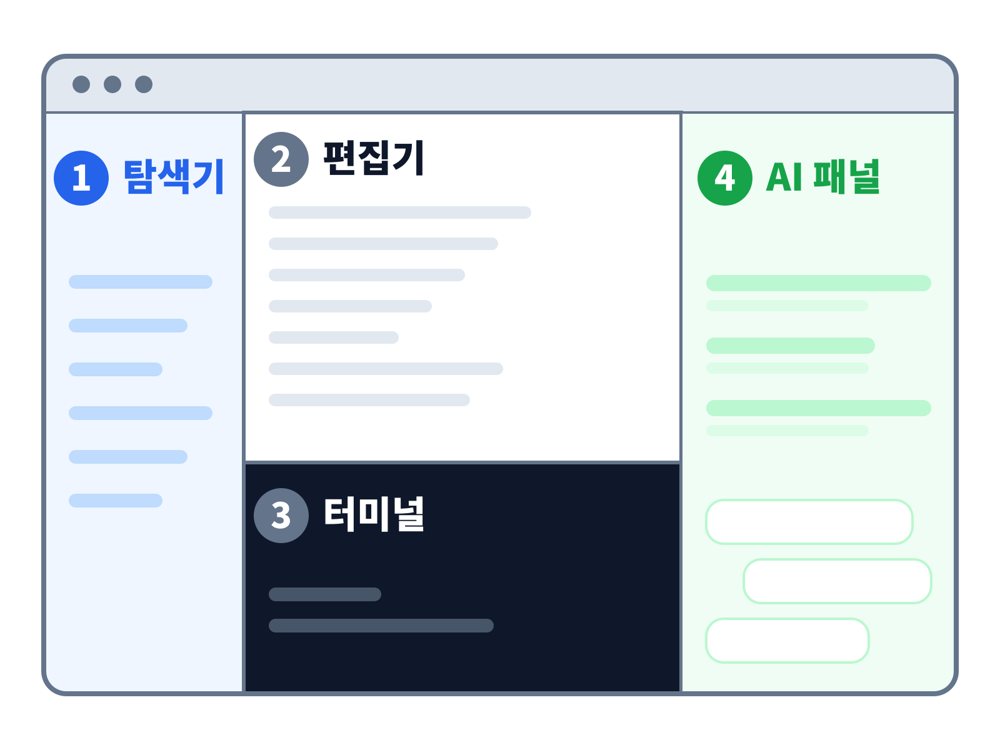
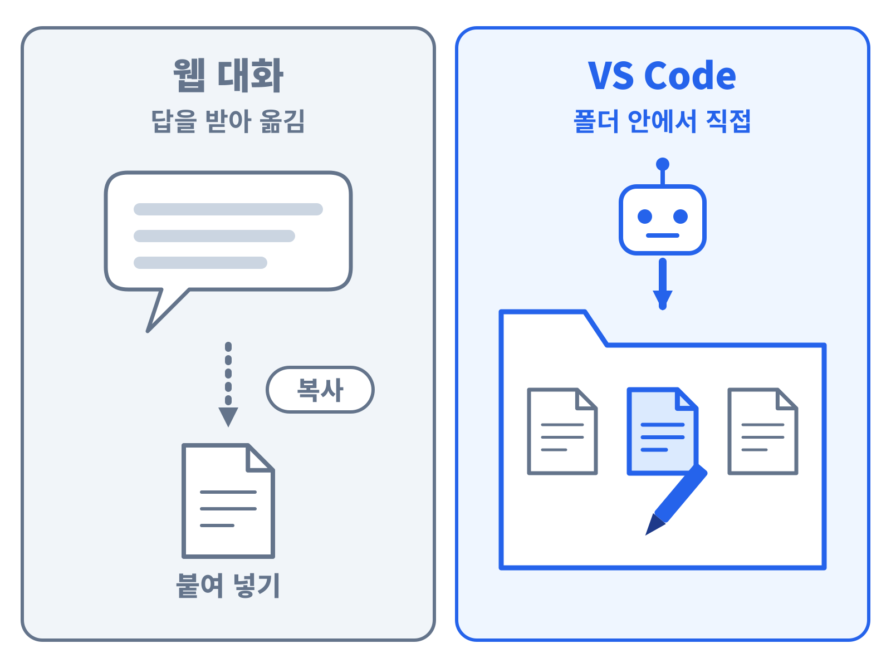
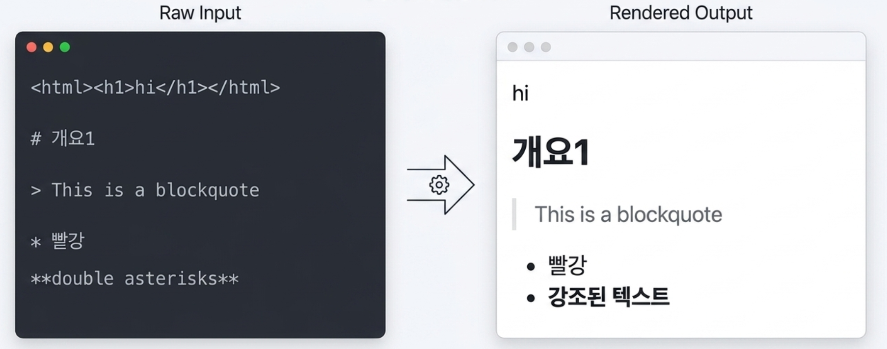
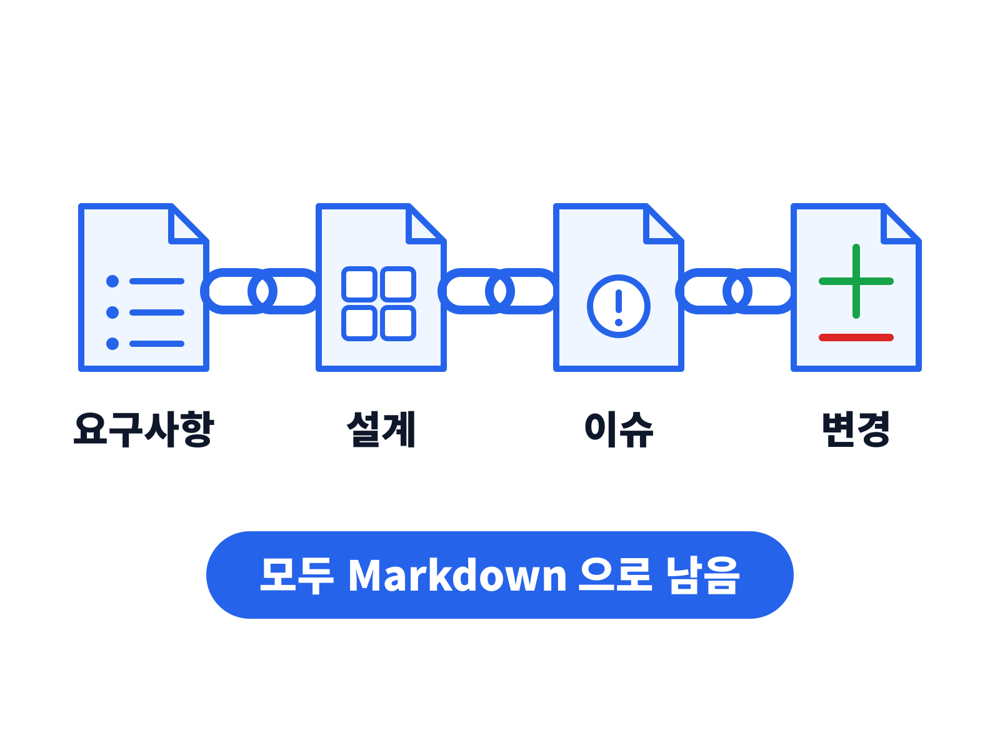
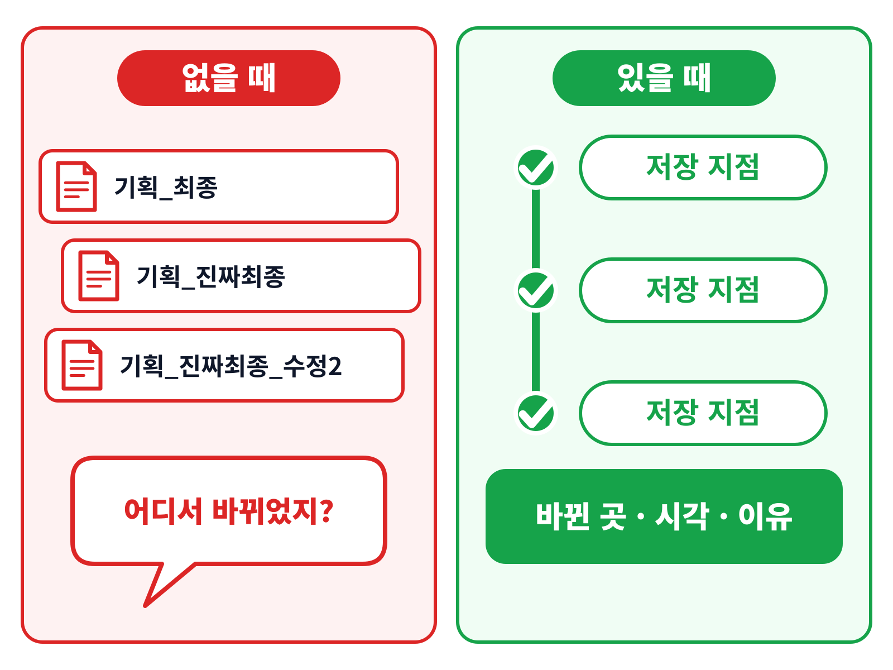
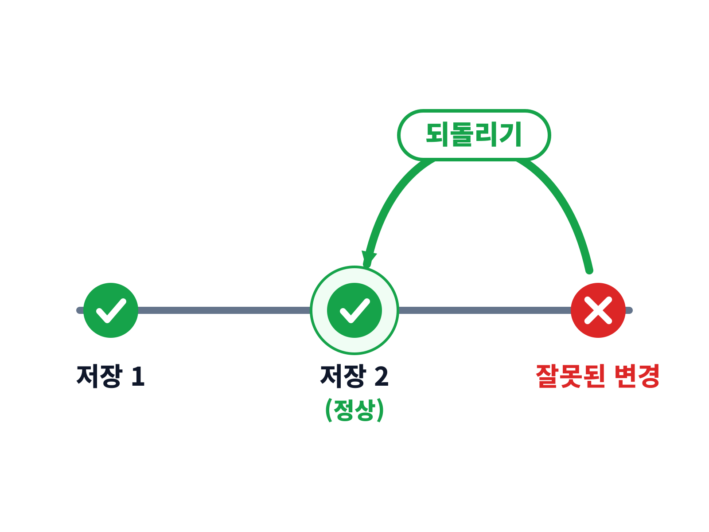
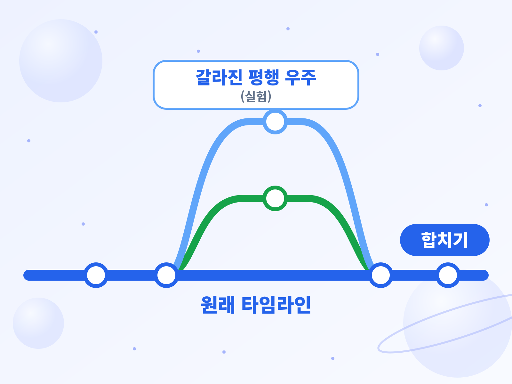
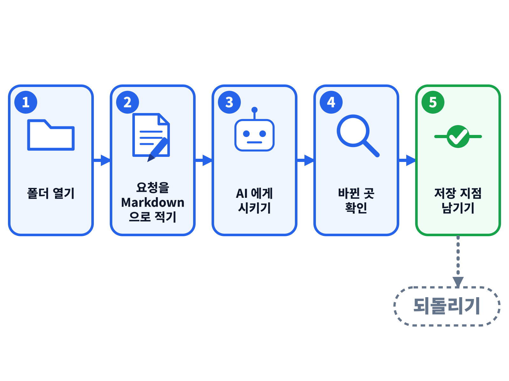
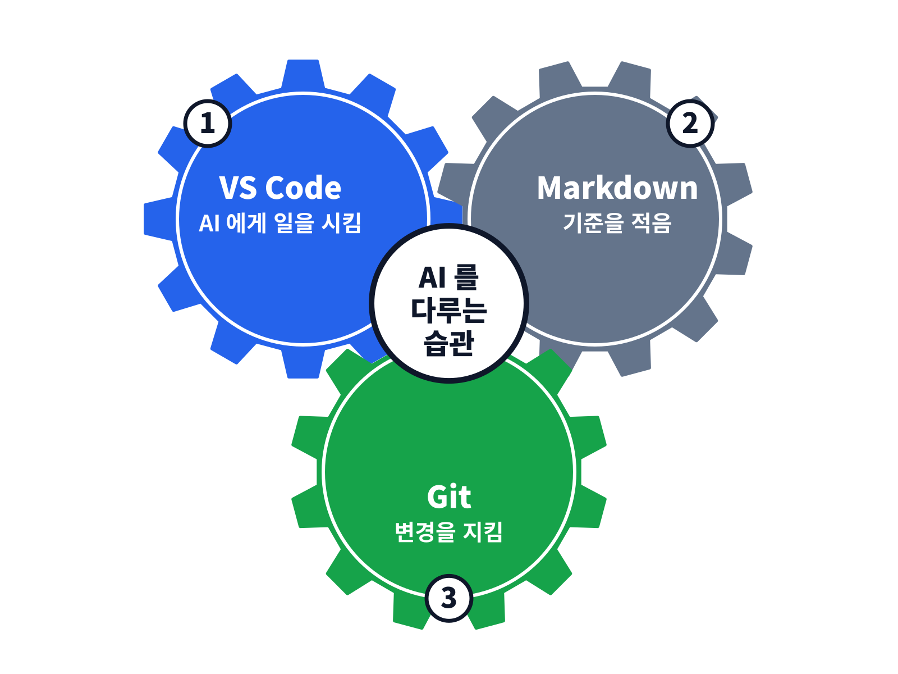

# 문제

<!--
  single mode 원고 — 본문 45장(챕터 오프닝 mg 3장 포함) + 질의응답 + 부록 3장, 50분, 화면 4:3. 주제 초점 = «왜 쓰는가».
  제목 구조: `# 챕터`(문제·VS Code·Markdown·Git·돌파구·부록)는 단독 장 + `---` — 덱에서는 빠지고 상단 헤더(head_left)로만 쓰임. 장 제목은 전부 `##`.
    H1 과 H2 를 한 장에 두면 그 장이 목차 카드로 바뀌어 덱에서 통째로 사라짐.
  [시연] = 현장 화면 시연. [줄임] = 시간이 모자랄 때 먼저 접는 장.
  모든 장에 시각물을 둠: 인포그래픽 PNG(img/ig-*) · mg(챕터 오프닝) · 그 밖의 장은 `::: htmlart`. 예외는 참고 자료(링크 표) 1장.
  이미지: img/ 의 자체 제작물만 사용. 외부 출처 이미지는 쓰지 않음.
  모션그래픽: mg/01-vscode · 02-markdown · 03-git — 각 챕터 앞 `#layout-_mg` 장(10초, 끝 화면에서 멈춤). 밝은 테마(흰 바탕).
  추가 모션그래픽: mg/04-flow(세 질문 다음) · 05-session(세션 분리 앞) · 06-chain(요구사항 사슬 앞) — 13~14초, 원본은 mg/_src(compose.js 로 scene.js 생성).
-->

<!-- ═══ 01 문제 — 0 ~ 5분 ═══ -->

---

## 프로젝트 중반, 다들 여기서 막힘
#id-intro

::: htmlart step
* AI 는 몇 초 만에 코드 수백 줄을 만들어 냄
* 처음엔 신기하지만, 쌓이고 나면 다음 질문에 답할 수 없게 됨
* 코딩을 몰라도 알아야 할 3가지 — VS Code · Markdown · Git
:::

---

## 쌓이고 나면 답할 수 없는 세 질문
#id-three-q



---

#layout-_mg
#id-mg-flow

## 세 질문 → 세 도구 → 하나의 습관

```mg
src: mg/04-flow
```

---

## 한 팀의 사례 — 웹 대화로 여기까지, 설계에서 막힘

::: htmlart process
* 웹 대화로 시작
  - 화면 · 데이터베이스 연동까지
* 관리자 화면
  - 설계가 필요해지며 멈춤
* 세 질문이 한꺼번에
  - 위치 · 지시 · 바뀐 것
:::

* 코드가 어디 있는지 · 무엇을 시켰는지 · 무엇이 바뀌었는지 — **세 질문이 한꺼번에** 나타남

---

<!-- ═══ 02 VS Code — 5 ~ 17분 ═══ -->

# VS Code

---

#layout-_mg
#id-mg-vscode

## VS Code — 흩어진 파일을 한 화면에

```mg
src: mg/01-vscode
```

---

## VS Code — 바이브코딩 플랫폼

* 비유: 코드를 위한 **「워드 프로그램」** 이자 작업대
* AI 에게 일을 시키는 **작업대**로 씀
* 프로젝트가 커질수록 필수

::: htmlart venn
* 워드 프로그램
  - 코드를 읽고 고침
* 작업대
  - AI 에게 일을 시킴
:::

---

## VS Code 란?

* Microsoft 가 만든 **무료 코드 편집기** — Windows · macOS · Linux 에서 같게 동작함

::: htmlart compare
* **메모장** / 파일 하나
  - 글자 하나의 파일을 다룸
  - 기능을 덧붙이기 어려움
* **VS Code** / 폴더 전체
  - 폴더 전체와 파일 수십 개를 다룸
  - 확장(extension)으로 기능을 덧붙임
  - ex) AI 도우미(Claude Code 확장)
:::

---

## 화면은 네 영역
#id-vscode-4



* ① 구조를 봄 · ② 읽고 고침 · ③ AI 가 실행함 · ④ 말로 지시함

---

## 웹 대화 대신 VS Code 를 쓰는 이유



* 웹 대화는 프로젝트가 커지면 **전체 모습을 놓침** — VS Code 는 바뀐 곳과 전체를 **같은 화면**에서 봄

---

## 흩어진 파일 수십 개를 한 화면에
#id-whole-folder

::: htmlart bracket
* 기획
  - 요구사항.md
  - 설계.md
* 화면
  - login.html
  - main.html
* 서버
  - api.py
  - db.sql
:::

* 폴더 전체를 열면 **파일 구조가 한눈에** 보임 — 웹 대화에서는 볼 수 없던 **«전체 모습»** 임

---

## AI 에게 말로 일을 시키고, 바뀐 것을 바로 확인
#id-talk-and-check

::: htmlart process
* 말로 지시
  - 무엇을 바꿀지
* AI 가 파일을 고침
  - 폴더 안에서 직접
* 고친 줄을 확인
  - 같은 화면에서 줄 단위로
* 저장 지점 남김
  - Git 과 이어짐
:::

* 마음에 안 들면 받아들이지 않음 — 확장이 변경을 추적해 **이전 상태로 되돌리는 기능**도 제공함

---

#layout-_mg
#id-mg-session

## 세션을 나누면 맥락이 깨끗함

```mg
src: mg/05-session
```

---

## 대화 한 개 vs 기능별 세션 분리
#id-session-split

::: htmlart compare
* **대화 한 개** / 한 줄기
  - 모든 기능을 한곳에서 지시
  - 맥락이 뒤엉킴
  - 앞의 지시를 AI 가 놓침
* **기능별 세션** / 나눠서
  - 기능마다 세션을 따로 엶
  - 각자 맥락이 깨끗함
  - 무엇을 시켰는지 추적됨
:::

---

## 같은 지시를 세 번 하면 Skill, 맥락이 다르면 Agent

::: htmlart compare
* **Skill** / 같은 지시를 세 번
  - 반복하는 지시를 저장함
  - 다음부터는 이름으로 부름
* **Agent** / 맥락이 다를 때
  - 맥락을 분리해 따로 맡김
  - 서로의 지시가 섞이지 않음
:::

* 팀이 같이 쓸 것은 **저장소**에 두어 모두가 공유함

<!-- [줄임] 시간이 모자라면 이 장부터 접음 -->

---

## 한 환경에서만 터진 결함

* 시행착오 사례: **Windows 에서만** 테스트가 실패함 — 설정 한 줄이 다른 운영체제의 문법이었음

::: htmlart chevron
* 원인 진단
* 이슈 등록
* 수정
:::

* 코드가 아니라 **환경의 차이**인 경우가 많음

<!-- [줄임] 시간이 모자라면 이 장을 접음 -->

---

## VS Code 정리 — 한 장 요약

::: htmlart radial
* VS Code
* 한 화면
  - 프로젝트 전체를 펼침
* 말로 시키고 바로 확인
  - 고친 줄을 그 자리에서
* 세션을 나눔
  - 기능마다 따로
* 커질수록 필수
  - 파일이 늘어도 한눈에
:::

---

<!-- ═══ 03 Markdown — 17 ~ 29분 ═══ -->

# Markdown

---

#layout-_mg
#id-mg-markdown

## Markdown — 사람도 AI 도 같은 문서를 읽음

```mg
src: mg/02-markdown
```

---

## Markdown — AI 의 문서 포맷

* 비유: AI 가 가장 잘 알아듣는 **「메모 양식」**
* 사람과 AI 가 **같은 문서**로 소통함
* 기호 몇 개로 쓰는 쉬운 문서

::: htmlart venn
* 사람이 읽음
  - 보기 쉬운 문서
* AI 가 읽음
  - 구조가 뚜렷한 문서
:::

---

## Markdown 이란?
#id-md-what

* **일반 텍스트에 기호를 붙여** 제목·목록·강조를 표시하는 문서 방식 — 2004년 존 그루버가 만듦
* 글꼴·색 같은 **서식이 아니라 구조**(제목·목록·표)를 적음
* 파일 이름은 `.md` — 어떤 편집기에서도 열림
* 프로그램이 읽어 **웹 화면·슬라이드로 바꿀 수 있음**



---

## 기호 몇 개로 쓰는 쉬운 문서
#id-md-syntax

<!-- 기호 범례(2026.10.25) — 줄머리 기호라 br 로 줄을 나눠 실제 Markdown 문서 모양으로 둠. 실제 문서 예시는 아래 -->
::: htmlart annotate
* target: #&nbsp;제목<br>-&nbsp;목록 &#42;&#42;굵게&#42;&#42;<br>>&nbsp;인용
* over purple: # → 큰 제목
* under blue: - → 글머리 목록
* over green: &#42;&#42;굵게&#42;&#42; → 굵은 글씨
* under red: > → 인용 블록
:::

<!-- 본문 | 미리보기 좌우 대조(2026.10.25 사용자 요청) — VS Code 편집기 탭과 미리보기 탭 모양. 위 범례의 기호 넷(# - ** >)을 예시가 모두 씀.
     오른쪽은 슬라이드 안에서 # 이 새 장을 만들지 않게 HTML 로 씀 -->
<div class="md-compare" style="display:flex;gap:4%;align-items:flex-start;text-align:left;">
<div style="flex:0 0 48%;max-width:48%;border:1px solid #d4d4d4;border-radius:8px;overflow:hidden;">
<div style="font-size:0.5em;background:#ececec;color:#555;padding:4px 14px;border-bottom:1px solid #d4d4d4;">VS Code 편집기 — <b style="color:#333;">회원가입.md</b></div>
<div style="padding:10px 22px;font-size:0.7em;line-height:1.5;background:#f5f6f8;font-family:ui-monospace,Menlo,monospace;">
<div style="color:#0b4fbf;font-weight:700;">#&nbsp;회원가입 기능</div>
<div><span style="color:#8a6d00;">-</span>&nbsp;이메일로 가입</div>
<div><span style="color:#8a6d00;">-</span>&nbsp;가입하면 <span style="color:#1a7f37;">&#42;&#42;환영 메일&#42;&#42;</span> 발송</div>
<div><span style="color:#c0392b;">&gt;</span>&nbsp;비밀번호는 8자 이상</div>
</div>
</div>
<div style="flex:0 0 48%;max-width:48%;border:1px solid #d4d4d4;border-radius:8px;overflow:hidden;">
<div style="font-size:0.5em;background:#ececec;color:#555;padding:4px 14px;border-bottom:1px solid #d4d4d4;">VS Code 미리보기 — 옆에 띄우기 <b style="color:#333;">⌘K V</b> (Windows <b style="color:#333;">Ctrl+K V</b>)</div>
<div class="md-render-demo" style="padding:10px 22px;font-size:0.7em;line-height:1.5;background:#fff;font-family:-apple-system,'Apple SD Gothic Neo','Noto Sans KR',sans-serif;">
<div style="font-size:1.4em;font-weight:800;line-height:1.3;padding-bottom:.1em;margin-bottom:.2em;border-bottom:1px solid #ddd;">회원가입 기능</div>
<div style="padding-left:.6em;">•&nbsp; 이메일로 가입</div>
<div style="padding-left:.6em;">•&nbsp; 가입하면 <span style="font-weight:800;color:#111;">환영 메일</span> 발송</div>
<div style="margin-top:.2em;border-left:4px solid #ccc;padding-left:.6em;color:#666;">비밀번호는 8자 이상</div>
</div>
</div>
</div>

* VS Code 한 화면에서 **쓰면서 바로 확인**함

---

## 왜 AI 가 잘 알아듣나

::: htmlart hexagon
* 구조가 뚜렷함
  - 기호로 제목·목록·표를 구분
* 텍스트만
  - 서식 없이 내용에 집중
* 그대로 주고받음
  - AI 의 답변도 같은 기호
* 제목을 달아 요청
  - 목표 · 조건 · 완료 기준
:::

---

## 워드·한글 파일과 무엇이 다른가

::: htmlart compare
* **워드·한글** / .docx · .hwp
  - 서식이 섞인 파일
  - 변경 비교는 전용 기능으로
  - AI 와는 복사·변환이 필요
  - 해당 프로그램이 있어야 열림
* **Markdown** / .md
  - 일반 텍스트
  - Git 으로 줄 단위 비교
  - AI 가 그대로 읽고 씀
  - 어떤 편집기든 열림
:::

* 문서의 변경도 코드처럼 **Git 으로 추적**됨

---

## 어디에 쓰이나

::: htmlart matrix
* README
  - 프로젝트를 소개하는 첫 장
* 기획 · 요구사항
  - AI 에게 주는 요청서
* AI 지침 파일
  - ex) CLAUDE.md — 매 대화 시작 때 읽음
* 이슈 · 보고
  - 작업의 기록
:::

<!-- [줄임] 시간이 모자라면 이 장을 접음 -->

---

## 지침 파일 — AI 에게 맡기는 «프로젝트 사용 설명서»

::: htmlart process
* CLAUDE.md 작성
  - 프로젝트의 규칙과 배경
* AI 가 읽음
  - 매 대화 시작 때
* 설명 반복 없음
  - 대화마다 다시 말하지 않음
* 저장소로 공유
  - 팀이 같은 지침을 씀
:::

* 팀이 같이 쓰는 지침은 **저장소에 두어** 모두가 같은 지침을 씀 — Git 과 이어짐

<!-- [줄임] 어디에 쓰이나 장과 함께 접을 수 있음 -->

---

## 기획과 요청을 적어 두면 AI 가 정확히 이해함
#id-write-down

::: htmlart compare
* **말로만 한 요청** / 흩어짐
  - 대화가 끝나면 사라짐
  - 무엇을 시켰는지 다시 찾기 어려움
* **적어 둔 요청** / 남음
  - AI 가 정확히 이해함
  - 나중에 다시 읽기 쉬움
:::

---

## 코드를 읽고 쓴 설계 문서의 함정

::: htmlart compare
* **코드 → 문서** / 거꾸로
  - 만들어진 코드를 보고 씀
  - 코드가 기준이 됨
  - 설계가 코드를 이끌지 못함
* **문서 → 코드** / 바로
  - 기준 문서를 먼저 씀
  - 문서가 기준이 됨
  - 설계가 코드를 이끎
:::

* 기준 문서는 코드보다 **먼저** 있어야 함

---

#layout-_mg
#id-mg-chain

## 기준 문서가 먼저 — 요구사항에서 변경까지 한 사슬

```mg
src: mg/06-chain
```

---

## 요구사항 → 설계 → 이슈 → 변경



* 기준 문서가 있어야 **이슈가 근거**를 가짐

---

## 작업 하나 = 이슈 하나

* 시행착오 사례: **이슈가 0건**인 채로 저장 지점만 쌓임 — 이유 없는 저장 지점은 나중에 따라갈 수 없음

::: htmlart process
* 이슈 하나 만들기
  - 작업을 시작할 때
* 작업
* 저장 지점 남기기
* 이슈에 이어 두기
  - 끝나면 연결
:::

<!-- [줄임] 시간이 모자라면 이 장을 접음 -->

---

## Markdown 정리 — 한 장 요약

::: htmlart hexagon
* 메모 양식
  - 사람과 AI 가 함께 읽음
* 적어 둔 요청
  - 남고 다시 읽힘
* 요구사항에서 시작
  - 사슬이 변경까지 이어짐
:::

---

<!-- ═══ 04 Git — 29 ~ 44분 ═══ -->

# Git

---

#layout-_mg
#id-mg-git

## Git — 되돌아갈 수 있으니, 마음껏 시도함

```mg
src: mg/03-git
```

---

## Git — 코드 공유
#id-git-open

* 비유: 문서의 **「버전 기록」** + **팀 공유 폴더**
* 코드가 바뀐 이력을 남기고, 팀이 같은 것을 나눠 가짐

::: htmlart venn
* 버전 기록
  - 바뀐 이력을 남김
* 팀 공유 폴더
  - 같은 것을 나눠 가짐
:::

---

## Git 이란?

* 파일의 **변경 이력을 기록하고 관리**하는 프로그램 — **버전 관리 시스템**

* 프로젝트 폴더 하나를 **저장소(repository)** 로 지정하면, 그 안의 변화가 이력으로 쌓임

::: htmlart process
* 커밋(commit)
  - 저장 지점 하나
* 브랜치(branch)
  - 갈라져 나온 작업 줄기
* 병합(merge)
  - 갈라진 줄기를 하나로 합침
:::

* 코드만의 도구가 아님 — 기획서·문서도 같은 방식으로 관리함

---

## Git 을 왜 쓰나 — 없을 때와 있을 때



* 없으면 망가졌을 때 **되돌아갈 기준**이 없고, 있으면 **같은 최신본**을 팀이 나눠 가짐

> AI 가 일하는 속도가 빠를수록 이력은 더 필요함

---

## 저장 지점(커밋) — AI 가 고칠 때마다 남김
#id-commit

* AI 가 코드를 고칠 때마다 **저장 지점**을 하나씩 남김 — 이것이 **커밋**임

::: htmlart radial
* 저장 지점 하나
* 바뀐 파일
  - 무엇이
* 바꾼 사람
  - 누가
* 시각
  - 언제
* 이유(메모)
  - 왜
:::

* 저장 지점이 이어진 목록이 곧 **프로젝트의 이력**임

---

## 되돌리기 — 망가지면 잘 되던 시점으로
#id-rollback

* 결과가 망가지면 **잘 되던 시점**으로 되돌림
* AI 가 자율로 고친 뒤에도 마찬가지임



---

## Git 과 GitHub 은 다름

::: htmlart compare
* **Git** / 내 PC 의 프로그램
  - 이력을 관리함
  - 저장 지점 · 브랜치 · 되돌리기
  - 비유: 문서의 버전 기록
* **GitHub** / 웹 서비스
  - 저장소를 올려 두고 공유함
  - 팀 공유 · 이슈
  - 비유: 팀 공유 폴더
:::

* 혼자 쓰면 Git 만으로 충분하고, **팀이 쓰면 GitHub 같은 공유 공간**이 더해짐

---

## 모두 코딩하고, 모두 문서 만들고, 모두 리뷰함

::: htmlart cycle
* 코딩
  - 모두가 함
* 문서 만들기
  - 모두가 함
* 리뷰
  - 모두가 함
:::

* 역할을 나눠 맡는 방식이 아님 — 그래서 팀원 모두가 **같은 최신본**을 나눠 가져야 함
* 한 사람의 PC 에만 있는 파일은 팀의 자산이 아님

---

## 같은 줄기에 동시에 올리면 덮어쓰기 위험
#id-same-trunk

::: htmlart process
* 원래 줄기에 직접
  - 첫 2주, 전부 main 에
* 같은 곳을 동시에
  - 두 사람이 함께 고침
* 한쪽이 사라짐
  - 덮어쓰기
* 줄기를 갈라서
  - 각자 갈래에서 작업
:::

* 시행착오 사례 — 변경이 전부 **원래 줄기(`main`)에 직접** 올라가던 시기의 일임

---

## 브랜치 = 멀티버스



* **`main`** 은 원래 타임라인, **브랜치**는 갈라진 평행 우주
* 실험은 갈라진 곳에서 하고, 마음에 들면 **병합**으로 합침
* 망가져도 원래 타임라인은 그대로임

---

## Git 작업 흐름 — 개요
#id-git-flow

::: htmlart process
* 저장소 만들기
* 저장 지점 남기기
* 갈라서 실험
* 병합
* 공유 공간에 올리기
:::

* 세부 명령보다 **다섯 단계의 순서**가 중요함
* 단계의 의미를 알면 **실제 조작은 AI 에게** 맡길 수 있음

---

## 접속 토큰 — 비밀번호 대신 쓰는 열쇠

::: htmlart hexagon
* 비밀번호 대신
  - 저장소에 접속할 때 토큰을 씀
* 남기지 않음
  - 문서 · 채팅 · 화면에 값을 두지 않음
* 노출되면 새로 발급
  - 한 번 노출되면 폐기함
:::

---

## Git 정리 — 한 장 요약

::: htmlart radial
* Git
* 저장 지점
  - 무엇이 언제 바뀌었지?
* 되돌리기
  - 어제 버전으로 돌아갈 수 있나?
* 같은 최신본
  - 팀이 같은 것을 보고 있나?
* 브랜치
  - 망가뜨리지 않고 실험할 수 있나?
* 병합
  - 실험한 것을 하나로 합칠 수 있나?
:::

---

<!-- ═══ 05 마무리 — 44 ~ 50분 ═══ -->

# 돌파구

---

## 왜 쓰는가 — 한 장 결론
#id-why-summary

::: htmlart compare
* **쓰지 않으면** / 흩어짐
  - VS Code — 복사·붙여넣기로 옮기다 전체를 놓침
  - Markdown — 말로만 한 요청이 흩어져 사라짐
  - Git — 무엇이 바뀌었는지 · 되돌릴 곳을 모름
* **쓰면** / 남음
  - VS Code — 폴더 전체를 보며 AI 에게 직접 시킴
  - Markdown — 적어 둔 요청이 남고 AI 가 정확히 읽음
  - Git — 이력이 남고, 망가져도 되돌리고, 공유함
:::

---

## 시연 — 요청 한 줄이 저장 지점이 되기까지
#id-demo-flow



* 단계마다 보는 화면: 탐색기(어디 있나) · 미리보기(무엇을 시켰나) · 이력(무엇이 바뀌었나)

---

## 시연에서 볼 화면 세 곳
#id-demo-screens

::: htmlart bracket
* 탐색기
  - 폴더 안 파일 전체
  - 그 코드가 어디에 있지?
* 변경 표시
  - AI 가 고친 줄이 색으로 표시됨
  - 무엇이 바뀌었지?
* 이력 목록
  - 저장 지점이 시각 순으로 이어짐
  - 어제 버전으로 돌아갈까?
:::

---

## 세 개가 맞물리는 그림



* **돌파구는 코딩 실력이 아니라, AI 를 다루는 습관**임
* 필요성을 **먼저** 따지고 기술을 도입함 — 확정할 것과 미룰 것을 가름

---

## 돌아가서 할 일 5가지

::: htmlart numbered
* VS Code 에서 폴더 전체를 열기
  - 기능마다 세션을 나눔
* 기획·요구사항을 Markdown 한 장으로
  - 작업마다 이슈 하나를 만듦
* 작업 폴더를 Git 저장소로 만들기
  - 첫 저장 지점을 남김
* 변경은 브랜치를 따서
  - 마음에 들면 병합함
* 이번에 확정할 것과 미룰 것을 가르기
  - 목록으로 정리함
:::

---

## 질의응답
#id-qna

::: htmlart cycle
* 어디 있나
  - VS Code
* 무엇을 시켰나
  - Markdown
* 무엇이 바뀌었나
  - Git
:::

---

## 참고 자료

| 주제               | 자료                                                                                   |
| :----------------- | :------------------------------------------------------------------------------------- |
| VS Code · 세션     | Claude Code 공식 문서 — Use Claude Code in VS Code (`code.claude.com/docs/en/vs-code`) |
| Markdown · 지침    | Claude Code 공식 문서 — Best practices (`code.claude.com/docs/en/best-practices`)      |
| 요구사항 → 이슈    | 저자 블로그 — nPTiR · SCAR 공용 정의 (`finfra.kr/jg`)                                  |
| Git                | Pro Git 한국어판 — 1.1 버전 관리란? · 3.1 브랜치란 무엇인가 (`git-scm.com/book/ko/v2`) |
| Markdown 원고 공유 | 저자 GitHub — m2slide · m2slide-deck · fpm (`github.com/Finfra`)                       |

---

<!-- ═══ 부록 — 질의응답에서 꺼내는 여유 장 ═══ -->

# 부록

---

## 부록 — 배포 전 보안 점검 3가지

::: htmlart numbered
* 함수별 권한 확인
  - 빠진 곳이 없는지 점검함
* 외부 호출 한도
  - 한도가 걸려 있는지 점검함
* 외부 라이브러리 버전 고정
  - 버전을 고정함
:::

---

## 부록 — 데이터 활용 권한은 보유 주체가 정함

::: htmlart process
* 보유 주체 확인
  - 누가 보유한 자료인지
* 자료별 표 정리
  - 출처 · 공개 여부 · 근거 · 승인자
* 승인받기
:::

---

## 부록 — 막히는 확인 사항은 일찍 담당 부서에

::: htmlart compare
* **일찍 물음** / 바로 진행
  - 연결 작업 전체를 막는 사항을 먼저 찾음
  - ex) 외부 클라우드를 쓸 수 있는지 여부
* **늦게 물음** / 돌아감
  - 작업 뒤에야 막힘이 드러남
  - 늦게 묻는 만큼 돌아가야 하는 길이 길어짐
:::
