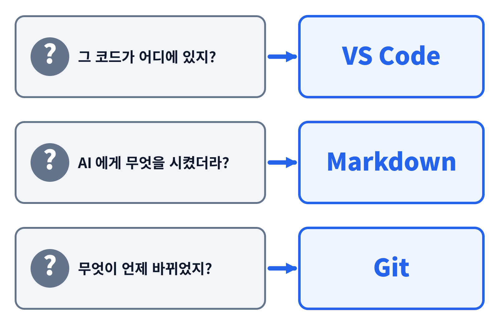
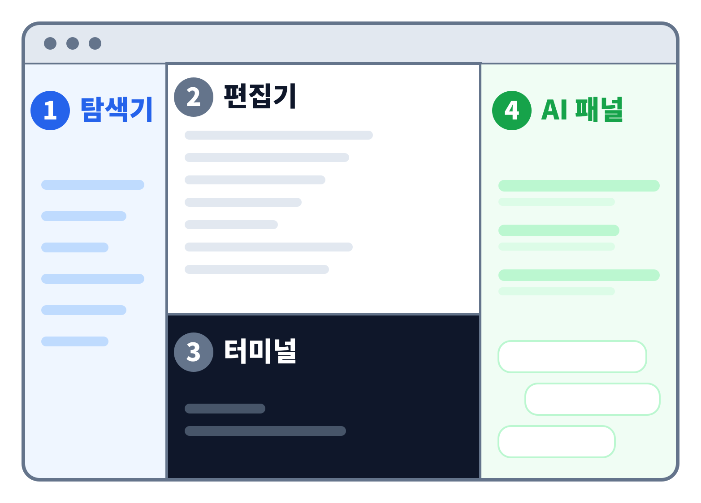
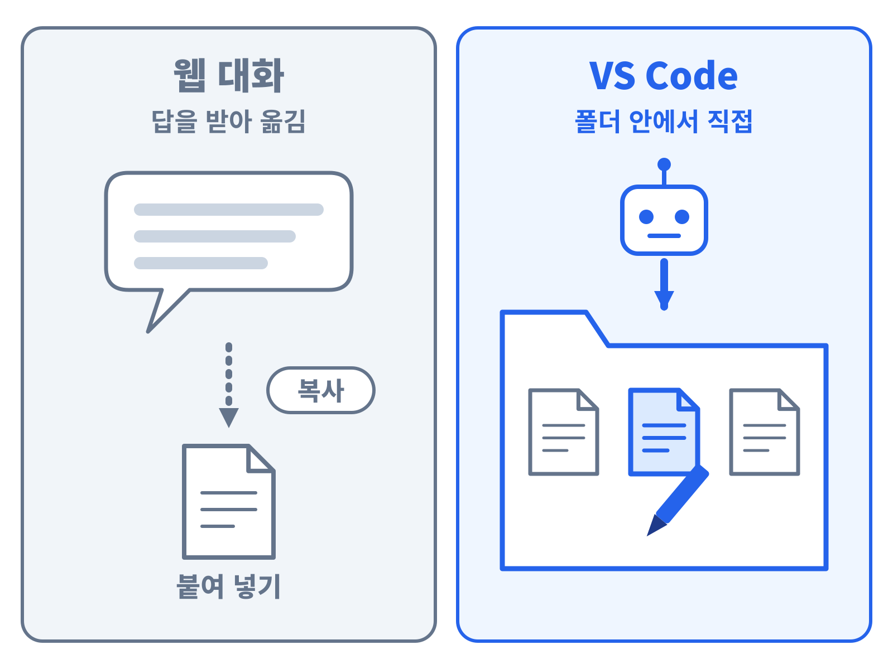
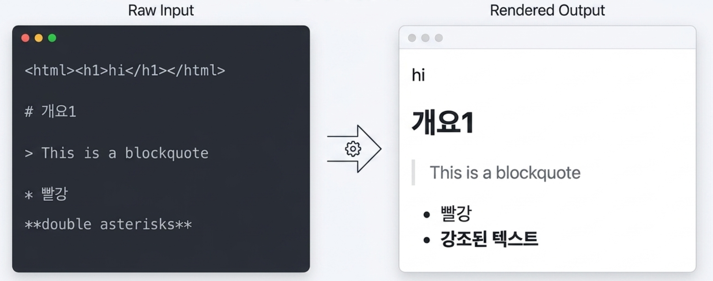
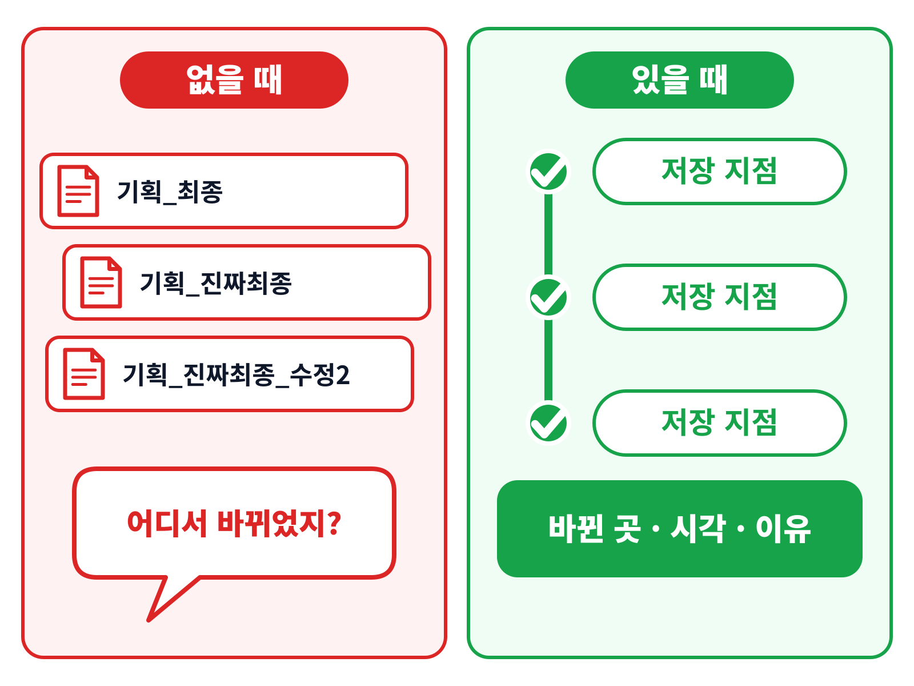
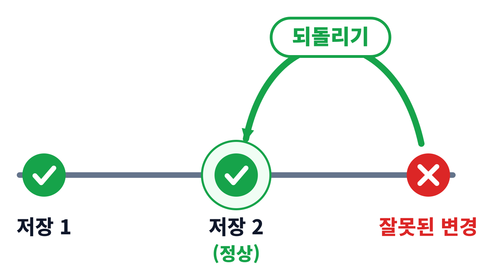
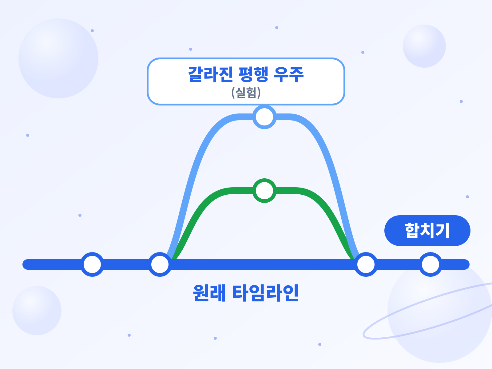
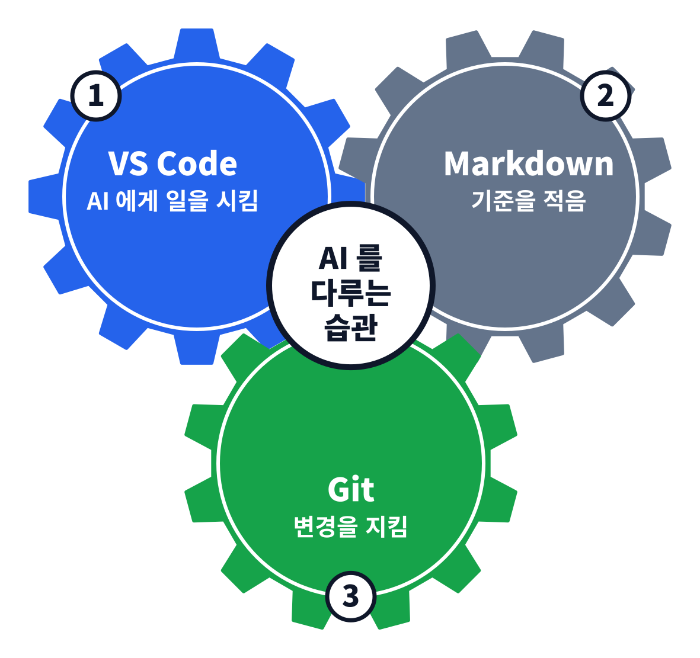
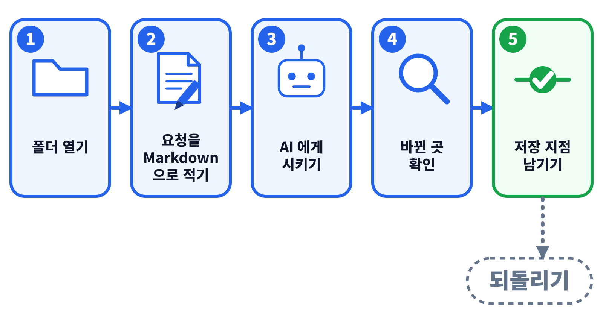

#layout-blank
#background-image-./img/cover.png
#background-size-cover

<!-- 화면 구현 메모(장 수 계약·표지·요점 등장 시점 눈금): _tools/README.md · 그림 출처: img/SOURCES.md -->

<div class="vmg-cover">
<div class="vmg-chip">AI 입문 강의</div>
<div class="vmg-title"><span class="c-blue">VS Code</span> ·<br><span class="c-purple">Markdown</span> · <span class="c-green">Git</span></div>
<div class="vmg-sub">AI 와 일하려면 알아야 할 세 도구</div>
<div class="vmg-note">코딩을 몰라도 괜찮습니다</div>
<div class="vmg-by">남중구 (핀프라)</div>
</div>
<style>.reveal .vmg-cover{max-width:46%;margin:12% 0 0 6%;text-align:left;font-family:'Apple SD Gothic Neo',sans-serif} .reveal .vmg-chip{display:inline-block;padding:0.2em 0.9em;border-radius:999px;background:#F5C518;color:#0F172A;font-size:0.62em;font-weight:800;letter-spacing:0.06em} .reveal .vmg-title{margin:0.35em 0 0.3em;color:#0F172A;font-size:2.5em;font-weight:900;line-height:1.12;letter-spacing:-0.02em} .reveal .vmg-title::after{content:"";display:block;width:1.36em;height:0.056em;margin:0.28em 0 0.1em;border-radius:999px;background:#F5C518} .reveal .vmg-sub{color:#1E293B;font-size:1.12em;font-weight:700;line-height:1.4} .reveal .vmg-note{margin-top:0.35em;color:#475569;font-size:0.82em;font-weight:600} .reveal .vmg-by{margin-top:1.6em;color:#334155;font-size:0.7em;font-weight:700} .reveal .c-blue{color:#2563EB}.reveal .c-purple{color:#7C3AED}.reveal .c-green{color:#16A34A}.reveal .c-amber{color:#8A6400} .reveal img.vmg-fig,.reveal .m2-cols img.vmg-fig{display:block;width:100%;height:auto;max-height:640px;object-fit:contain;margin:0 auto} .reveal .m2-cols:has(img.vmg-fig){align-items:center} .reveal .vmg-fig.round{border-radius:24px;box-shadow:0 12px 36px rgba(15,23,42,0.14)} .reveal .vmg-pts{display:flex;flex-direction:column;gap:0.5em;margin:0 0 0 0.6em;text-align:left;font-family:'Apple SD Gothic Neo',sans-serif} .reveal .vmg-pt{padding:0.42em 0.75em 0.42em 0.9em;border-left:0.24em solid #F5C518;background:#F8FAFC;border-radius:0 0.55em 0.55em 0;color:#0F172A;font-size:0.92em;font-weight:600;line-height:1.38} .reveal .vmg-pt.blue{border-left-color:#2563EB;background:#EFF5FF}.reveal .vmg-pt.purple{border-left-color:#7C3AED;background:#F5F0FF}.reveal .vmg-pt.green{border-left-color:#16A34A;background:#EEF9F2}.reveal .vmg-pt.slate{border-left-color:#94A3B8} .reveal .vmg-pt b{font-weight:800} .reveal .vmg-pt .n{display:inline-block;min-width:1.45em;margin-right:0.35em;padding:0.02em 0;border-radius:999px;background:#0F172A;color:#fff;font-size:0.82em;text-align:center} .reveal .vmg-tick{display:none} .reveal .vmg-pts>p,.reveal .vmg-chips>p{display:none;margin:0} .reveal .vmg-chips{display:flex;justify-content:center;gap:0.7em;margin:22px 0 0;font-family:'Apple SD Gothic Neo',sans-serif} .reveal .vmg-chips div{padding:0.32em 0.8em;border-radius:0.6em;background:#F5F0FF;border:2px solid #C4B5FD;color:#0F172A;font-size:0.78em;font-weight:700} .reveal .vmg-chips code{padding:0.05em 0.35em;margin-right:0.3em;border-radius:0.3em;background:#7C3AED;color:#fff;font-family:'Menlo',monospace;font-weight:700} .reveal .vmg-credit{margin-top:14px;text-align:center;color:#64748B;font-size:0.5em} .reveal .vmg-mid{width:100%;margin:auto 0} .reveal .vmg-mid>p{margin:0} .reveal .vmg-sum>p{display:none;margin:0} .reveal .vmg-sum{width:100%;margin:auto 0;font-family:'Apple SD Gothic Neo',sans-serif} .reveal .vmg-cards{display:grid;grid-template-columns:repeat(3,1fr);gap:56px;margin:0 20px} .reveal .vmg-card{position:relative;padding:112px 40px 86px;border-radius:28px;background:#fff;border-top:12px solid #2563EB;box-shadow:0 10px 34px rgba(15,23,42,0.11);text-align:center} .reveal .vmg-card .n{position:absolute;top:-44px;left:50%;transform:translateX(-50%);width:80px;height:80px;line-height:80px;border-radius:50%;background:#2563EB;color:#fff;font-size:0.9em;font-weight:900} .reveal .vmg-card .t{color:#0F172A;font-size:1.78em;font-weight:900;line-height:1.25;letter-spacing:-0.01em} .reveal .vmg-card .d{margin-top:0.6em;color:#475569;font-size:1.1em;font-weight:600;line-height:1.4} .reveal .vmg-sum.purple .vmg-card{border-top-color:#7C3AED} .reveal .vmg-sum.purple .vmg-card .n{background:#7C3AED} .reveal .vmg-sum.green .vmg-card{border-top-color:#16A34A} .reveal .vmg-sum.green .vmg-card .n{background:#16A34A} .reveal .vmg-answer{display:table;margin:60px auto 0;padding:0.42em 1.3em;border-radius:999px;background:#0F172A;color:#fff;font-size:0.92em;font-weight:700} .reveal .vmg-answer .q{color:#F5C518} .reveal .vmg-sum .vmg-answer{margin-top:84px;font-size:1.12em} .reveal .vmg-next{margin-top:26px;text-align:center;color:#475569;font-size:0.78em;font-weight:600} .reveal .vmg-cmp{display:grid;grid-template-columns:1fr 96px 1fr;align-items:stretch;margin:0 30px;font-family:'Apple SD Gothic Neo',sans-serif} .reveal .vmg-col{padding:64px 70px 80px;border-radius:28px;background:#F8FAFC;border-top:12px solid #94A3B8;text-align:left} .reveal .vmg-col .sub{color:#64748B;font-size:0.86em;font-weight:700;letter-spacing:0.02em} .reveal .vmg-col .head{margin:0.06em 0 0.4em;color:#0F172A;font-size:2.3em;font-weight:900;letter-spacing:-0.01em} .reveal .vmg-col .it{position:relative;margin-top:0.62em;padding-left:1.05em;color:#1E293B;font-size:1.28em;font-weight:600;line-height:1.4} .reveal .vmg-col .it::before{content:'';position:absolute;left:0;top:0.52em;width:0.42em;height:0.42em;border-radius:50%;background:#94A3B8} .reveal .vmg-col.blue{background:#EFF5FF;border-top-color:#2563EB} .reveal .vmg-col.blue .head{color:#1D4ED8} .reveal .vmg-col.blue .it::before{background:#2563EB} .reveal .vmg-col.purple{background:#F5F0FF;border-top-color:#7C3AED} .reveal .vmg-col.purple .head{color:#6D28D9} .reveal .vmg-col.purple .it::before{background:#7C3AED} .reveal .vmg-col.green{background:#EEF9F2;border-top-color:#16A34A} .reveal .vmg-col.green .head{color:#15803D} .reveal .vmg-col.green .it::before{background:#16A34A} .reveal .vmg-col.amber{background:#FFF8E1;border-top-color:#F5C518} .reveal .vmg-col.amber .head{color:#8A6400} .reveal .vmg-col.amber .it::before{background:#F5C518} .reveal .vmg-col.dark{background:#F1F5F9;border-top-color:#0F172A} .reveal .vmg-col.dark .it::before{background:#0F172A} .reveal .vmg-vs{align-self:center;text-align:center;color:#94A3B8;font-size:1.05em;font-weight:900} .reveal .vmg-flow{display:flex;align-items:stretch;justify-content:center;margin:0 20px;font-family:'Apple SD Gothic Neo',sans-serif} .reveal .vmg-step{position:relative;flex:1 1 0;max-width:410px;padding:72px 24px 46px;border-radius:28px;background:#fff;border:3px solid #E2E8F0;box-shadow:0 10px 30px rgba(15,23,42,0.08);text-align:center} .reveal .vmg-step .n{position:absolute;top:-34px;left:50%;transform:translateX(-50%);width:62px;height:62px;line-height:62px;border-radius:50%;background:#0F172A;color:#fff;font-size:0.72em;font-weight:900} .reveal .vmg-step .t{color:#0F172A;font-size:1.12em;font-weight:900;line-height:1.3} .reveal .vmg-step .d{margin-top:0.5em;color:#475569;font-size:0.76em;font-weight:600;line-height:1.4} .reveal .vmg-step .d code{padding:0.05em 0.35em;border-radius:0.3em;background:#7C3AED;color:#fff;font-family:'Menlo',monospace;font-size:0.92em} .reveal .vmg-arw{flex:0 0 64px;align-self:center;text-align:center;color:#94A3B8;font-size:1.6em;font-weight:900} .reveal .vmg-flow.blue .vmg-step{border-color:#BFDBFE} .reveal .vmg-flow.blue .vmg-step .n{background:#2563EB} .reveal .vmg-flow.purple .vmg-step{border-color:#DDD6FE} .reveal .vmg-flow.purple .vmg-step .n{background:#7C3AED} .reveal .vmg-def{display:table;margin:0 auto 70px;padding:0.35em 1em;border-radius:0.6em;background:#F5F0FF;border:2px solid #C4B5FD;color:#0F172A;font-size:0.86em;font-weight:700}</style>

---

## AI 가 만든 코드, 쌓이고 나면
#id-intro

::: columns
::: {.column width="56%"}

:::
::: {.column width="44%"}
<div class="vmg-pts">
<i class="fragment vmg-tick" data-fragment-index="1">·</i><i class="fragment vmg-tick" data-fragment-index="2">·</i><i class="fragment vmg-tick" data-fragment-index="3">·</i><i class="fragment vmg-tick" data-fragment-index="4">·</i><i class="fragment vmg-tick" data-fragment-index="5">·</i><i class="fragment vmg-tick" data-fragment-index="6">·</i><i class="fragment vmg-tick" data-fragment-index="7">·</i><i class="fragment vmg-tick" data-fragment-index="8">·</i><i class="fragment vmg-tick" data-fragment-index="9">·</i>
<div class="vmg-pt">몇 초 만에 <b>코드 수백 줄</b></div>
<div class="vmg-pt slate fragment" data-fragment-index="4">결과물이 쌓이면<br>파일은 늘고, 대화는 길어짐</div>
<div class="vmg-pt fragment" data-fragment-index="7"><b>간단한 질문</b>에도<br>답하기 어려워짐</div>
</div>
:::
:::

---

## 답할 수 없게 되는 세 질문
#id-three-q

::: columns
::: {.column width="58%"}

:::
::: {.column width="42%"}
<div class="vmg-pts">
<i class="fragment vmg-tick" data-fragment-index="1">·</i><i class="fragment vmg-tick" data-fragment-index="2">·</i><i class="fragment vmg-tick" data-fragment-index="3">·</i><i class="fragment vmg-tick" data-fragment-index="4">·</i><i class="fragment vmg-tick" data-fragment-index="5">·</i><i class="fragment vmg-tick" data-fragment-index="6">·</i><i class="fragment vmg-tick" data-fragment-index="7">·</i><i class="fragment vmg-tick" data-fragment-index="8">·</i><i class="fragment vmg-tick" data-fragment-index="9">·</i>
<div class="vmg-pt slate">결과물이 쌓이면<br>답하기 어려운 <b>세 질문</b></div>
<div class="vmg-pt fragment" data-fragment-index="4"><b>코딩 실력</b>과는<br>상관이 없음</div>
<div class="vmg-pt fragment" data-fragment-index="7">위치 <b class="c-blue">VS Code</b><br>지시 <b class="c-purple">Markdown</b> · 변경 <b class="c-green">Git</b></div>
</div>
:::
:::

---

## 세 질문, 세 도구, 하나의 습관
#layout-_mg
#id-mg-flow

```mg
src: mg/04-flow
```

---

## VS Code, 흩어진 파일을 한 화면에
#layout-_mg
#id-mg-vscode

```mg
src: mg/01-vscode
```

---

## 화면은 네 영역으로 나뉩니다
#id-vscode-4

::: columns
::: {.column width="58%"}

:::
::: {.column width="42%"}
<div class="vmg-pts">
<i class="fragment vmg-tick" data-fragment-index="1">·</i><i class="fragment vmg-tick" data-fragment-index="2">·</i><i class="fragment vmg-tick" data-fragment-index="3">·</i><i class="fragment vmg-tick" data-fragment-index="4">·</i><i class="fragment vmg-tick" data-fragment-index="5">·</i><i class="fragment vmg-tick" data-fragment-index="6">·</i><i class="fragment vmg-tick" data-fragment-index="7">·</i><i class="fragment vmg-tick" data-fragment-index="8">·</i><i class="fragment vmg-tick" data-fragment-index="9">·</i>
<div class="vmg-pt blue fragment" data-fragment-index="1"><span class="n">1</span><b>탐색기</b> — 폴더 구조</div>
<div class="vmg-pt blue fragment" data-fragment-index="2"><span class="n">2</span><b>편집기</b> — 읽고 고침</div>
<div class="vmg-pt blue fragment" data-fragment-index="4"><span class="n">3</span><b>터미널</b> — AI 가 실행</div>
<div class="vmg-pt blue fragment" data-fragment-index="5"><span class="n">4</span><b>AI 패널</b> — 말로 지시</div>
<div class="vmg-pt fragment" data-fragment-index="8">네 영역이 <b>한 화면</b>에</div>
</div>
:::
:::

---

## 웹 대화 대신 VS Code 를 쓰는 이유
#id-web-vs-vscode

::: columns
::: {.column width="58%"}

:::
::: {.column width="42%"}
<div class="vmg-pts">
<i class="fragment vmg-tick" data-fragment-index="1">·</i><i class="fragment vmg-tick" data-fragment-index="2">·</i><i class="fragment vmg-tick" data-fragment-index="3">·</i><i class="fragment vmg-tick" data-fragment-index="4">·</i><i class="fragment vmg-tick" data-fragment-index="5">·</i><i class="fragment vmg-tick" data-fragment-index="6">·</i><i class="fragment vmg-tick" data-fragment-index="7">·</i><i class="fragment vmg-tick" data-fragment-index="8">·</i><i class="fragment vmg-tick" data-fragment-index="9">·</i>
<div class="vmg-pt slate fragment" data-fragment-index="1"><b>웹 대화</b> — 복사해 붙여 넣기</div>
<div class="vmg-pt slate fragment" data-fragment-index="4">커지면 <b>전체 모습</b>을 놓침</div>
<div class="vmg-pt blue fragment" data-fragment-index="7"><b>VS Code</b> — AI 가<br>파일을 직접 고침</div>
<div class="vmg-pt blue fragment" data-fragment-index="9">바뀐 곳과 전체를 <b>한 화면</b>에</div>
</div>
:::
:::

---

## 말로 시키고, 바뀐 것을 바로 확인
#id-talk-and-check

<div class="vmg-mid">
<i class="fragment vmg-tick" data-fragment-index="1">·</i><i class="fragment vmg-tick" data-fragment-index="2">·</i><i class="fragment vmg-tick" data-fragment-index="3">·</i><i class="fragment vmg-tick" data-fragment-index="4">·</i><i class="fragment vmg-tick" data-fragment-index="5">·</i><i class="fragment vmg-tick" data-fragment-index="6">·</i><i class="fragment vmg-tick" data-fragment-index="7">·</i><i class="fragment vmg-tick" data-fragment-index="8">·</i><i class="fragment vmg-tick" data-fragment-index="9">·</i>
<div class="vmg-flow blue">
<div class="vmg-step fragment" data-fragment-index="2"><div class="n">1</div><div class="t">말로 지시</div><div class="d">무엇을 바꿀지</div></div>
<div class="vmg-arw fragment" data-fragment-index="3">›</div>
<div class="vmg-step fragment" data-fragment-index="3"><div class="n">2</div><div class="t">AI 가<br>파일을 고침</div><div class="d">폴더 안에서 직접</div></div>
<div class="vmg-arw fragment" data-fragment-index="5">›</div>
<div class="vmg-step fragment" data-fragment-index="5"><div class="n">3</div><div class="t">고친 줄을<br>확인</div><div class="d">색으로 표시됨</div><div class="d fragment" data-fragment-index="6">마음에 안 들면 거절</div></div>
<div class="vmg-arw fragment" data-fragment-index="7">›</div>
<div class="vmg-step fragment" data-fragment-index="7"><div class="n">4</div><div class="t">저장 지점<br>남김</div><div class="d">Git 과 이어짐</div></div>
</div>
<div class="vmg-answer fragment" data-fragment-index="8">AI 가 고치고 · <span class="q">사람이 확인하고 결정</span></div>
</div>

---

## 기능마다 세션을 나눕니다
#layout-_mg
#id-mg-session

```mg
src: mg/05-session
```

---

## 반복은 Skill, 다른 맥락은 Agent
#id-skill-agent

<div class="vmg-mid">
<i class="fragment vmg-tick" data-fragment-index="1">·</i><i class="fragment vmg-tick" data-fragment-index="2">·</i><i class="fragment vmg-tick" data-fragment-index="3">·</i><i class="fragment vmg-tick" data-fragment-index="4">·</i><i class="fragment vmg-tick" data-fragment-index="5">·</i><i class="fragment vmg-tick" data-fragment-index="6">·</i><i class="fragment vmg-tick" data-fragment-index="7">·</i><i class="fragment vmg-tick" data-fragment-index="8">·</i><i class="fragment vmg-tick" data-fragment-index="9">·</i>
<div class="vmg-cmp">
<div class="vmg-col amber fragment" data-fragment-index="1"><div class="sub">같은 지시를 세 번</div><div class="head">Skill</div><div class="it fragment" data-fragment-index="3">지시에 <b>이름</b>을 붙여 저장</div><div class="it fragment" data-fragment-index="4">다음부터 이름으로 부름</div></div>
<div class="vmg-vs">vs</div>
<div class="vmg-col blue fragment" data-fragment-index="6"><div class="sub">맥락이 다를 때</div><div class="head">Agent</div><div class="it fragment" data-fragment-index="7">따로 일하는 AI 도우미</div><div class="it fragment" data-fragment-index="9">서로의 지시가 섞이지 않음</div></div>
</div>
</div>

---

## VS Code 정리
#id-vscode-sum

<div class="vmg-sum blue">
<i class="fragment vmg-tick" data-fragment-index="1">·</i><i class="fragment vmg-tick" data-fragment-index="2">·</i><i class="fragment vmg-tick" data-fragment-index="3">·</i><i class="fragment vmg-tick" data-fragment-index="4">·</i><i class="fragment vmg-tick" data-fragment-index="5">·</i><i class="fragment vmg-tick" data-fragment-index="6">·</i><i class="fragment vmg-tick" data-fragment-index="7">·</i><i class="fragment vmg-tick" data-fragment-index="8">·</i><i class="fragment vmg-tick" data-fragment-index="9">·</i>
<div class="vmg-cards">
<div class="vmg-card fragment" data-fragment-index="1"><div class="n">1</div><div class="t">한 화면</div><div class="d">프로젝트 전체를 펼침</div></div>
<div class="vmg-card fragment" data-fragment-index="3"><div class="n">2</div><div class="t">말로 시키고<br>바로 확인</div><div class="d">고친 줄을 그 자리에서</div></div>
<div class="vmg-card fragment" data-fragment-index="5"><div class="n">3</div><div class="t">세션을 나눔</div><div class="d">기능마다 따로</div></div>
</div>
<div class="vmg-answer fragment" data-fragment-index="8"><span class="q">«그 코드가 어디에 있지?»</span> → VS Code</div>
</div>

---

## Markdown, 사람도 AI 도 읽는 문서
#layout-_mg
#id-mg-markdown

```mg
src: mg/02-markdown
```

---

## 기호 몇 개로 쓰는 문서
#id-md-syntax

<div class="vmg-mid">

<div class="vmg-chips">
<i class="fragment vmg-tick" data-fragment-index="1">·</i><i class="fragment vmg-tick" data-fragment-index="2">·</i><i class="fragment vmg-tick" data-fragment-index="3">·</i><i class="fragment vmg-tick" data-fragment-index="4">·</i><i class="fragment vmg-tick" data-fragment-index="5">·</i><i class="fragment vmg-tick" data-fragment-index="6">·</i><i class="fragment vmg-tick" data-fragment-index="7">·</i><i class="fragment vmg-tick" data-fragment-index="8">·</i><i class="fragment vmg-tick" data-fragment-index="9">·</i>
<div class="fragment" data-fragment-index="2"><code>#</code>제목</div>
<div class="fragment" data-fragment-index="3"><code>-</code>목록</div>
<div class="fragment" data-fragment-index="4"><code>**</code>굵은 글씨</div>
<div class="fragment" data-fragment-index="7"><code>.md</code>어디서나 열림</div>
</div>
</div>

---

## 워드·한글 파일과 무엇이 다를까
#id-md-vs-word

<div class="vmg-mid">
<i class="fragment vmg-tick" data-fragment-index="1">·</i><i class="fragment vmg-tick" data-fragment-index="2">·</i><i class="fragment vmg-tick" data-fragment-index="3">·</i><i class="fragment vmg-tick" data-fragment-index="4">·</i><i class="fragment vmg-tick" data-fragment-index="5">·</i><i class="fragment vmg-tick" data-fragment-index="6">·</i><i class="fragment vmg-tick" data-fragment-index="7">·</i><i class="fragment vmg-tick" data-fragment-index="8">·</i><i class="fragment vmg-tick" data-fragment-index="9">·</i>
<div class="vmg-cmp">
<div class="vmg-col slate fragment" data-fragment-index="1"><div class="sub">.docx · .hwp</div><div class="head">워드·한글</div><div class="it">서식이 섞인 파일</div><div class="it fragment" data-fragment-index="3">그 프로그램이 있어야 열림</div><div class="it fragment" data-fragment-index="4">AI 에게는 복사·변환</div></div>
<div class="vmg-vs">vs</div>
<div class="vmg-col purple fragment" data-fragment-index="6"><div class="sub">.md</div><div class="head">Markdown</div><div class="it">서식 없는 일반 텍스트</div><div class="it">어떤 편집기든 열림</div><div class="it fragment" data-fragment-index="7">AI 가 그대로 읽고 씀</div><div class="it fragment" data-fragment-index="9">바뀐 줄을 <b>Git</b> 으로 비교</div></div>
</div>
</div>

---

## 지침 파일, AI 의 프로젝트 설명서
#id-md-guide

<div class="vmg-mid">
<i class="fragment vmg-tick" data-fragment-index="1">·</i><i class="fragment vmg-tick" data-fragment-index="2">·</i><i class="fragment vmg-tick" data-fragment-index="3">·</i><i class="fragment vmg-tick" data-fragment-index="4">·</i><i class="fragment vmg-tick" data-fragment-index="5">·</i><i class="fragment vmg-tick" data-fragment-index="6">·</i><i class="fragment vmg-tick" data-fragment-index="7">·</i><i class="fragment vmg-tick" data-fragment-index="8">·</i><i class="fragment vmg-tick" data-fragment-index="9">·</i>
<div class="vmg-flow purple">
<div class="vmg-step fragment" data-fragment-index="1"><div class="n">1</div><div class="t">지침 파일<br>작성</div><div class="d fragment" data-fragment-index="3">규칙과 배경을 한 장에</div><div class="d fragment" data-fragment-index="4">ex) <code>CLAUDE.md</code></div></div>
<div class="vmg-arw fragment" data-fragment-index="6">›</div>
<div class="vmg-step fragment" data-fragment-index="6"><div class="n">2</div><div class="t">AI 가 읽음</div><div class="d">대화를 시작할 때마다</div></div>
<div class="vmg-arw fragment" data-fragment-index="7">›</div>
<div class="vmg-step fragment" data-fragment-index="7"><div class="n">3</div><div class="t">설명 반복<br>없음</div><div class="d">매번 말하지 않아도 됨</div></div>
</div>
<div class="vmg-answer fragment" data-fragment-index="8">여럿이 함께 쓰면 → <span class="q">모두 같은 지침</span></div>
</div>

---

## 기준 문서가 먼저입니다
#layout-_mg
#id-mg-chain

```mg
src: mg/06-chain
```

---

## 작업 하나에 이슈 하나
#id-one-issue

<div class="vmg-mid">
<i class="fragment vmg-tick" data-fragment-index="1">·</i><i class="fragment vmg-tick" data-fragment-index="2">·</i><i class="fragment vmg-tick" data-fragment-index="3">·</i><i class="fragment vmg-tick" data-fragment-index="4">·</i><i class="fragment vmg-tick" data-fragment-index="5">·</i><i class="fragment vmg-tick" data-fragment-index="6">·</i><i class="fragment vmg-tick" data-fragment-index="7">·</i><i class="fragment vmg-tick" data-fragment-index="8">·</i><i class="fragment vmg-tick" data-fragment-index="9">·</i>
<div class="vmg-def fragment" data-fragment-index="1"><b>이슈</b> = 할 일 하나를 적은 작은 문서</div>
<div class="vmg-flow purple">
<div class="vmg-step fragment" data-fragment-index="2"><div class="n">1</div><div class="t">이슈 하나<br>만들기</div><div class="d">작업을 시작할 때</div></div>
<div class="vmg-arw fragment" data-fragment-index="3">›</div>
<div class="vmg-step fragment" data-fragment-index="3"><div class="n">2</div><div class="t">작업</div><div class="d">AI 와 함께</div></div>
<div class="vmg-arw fragment" data-fragment-index="4">›</div>
<div class="vmg-step fragment" data-fragment-index="4"><div class="n">3</div><div class="t">저장 지점<br>남기기</div><div class="d">끝나면</div></div>
<div class="vmg-arw fragment" data-fragment-index="4">›</div>
<div class="vmg-step fragment" data-fragment-index="4"><div class="n">4</div><div class="t">이슈에<br>이어 두기</div><div class="d fragment" data-fragment-index="7">왜 바꿨는지 남음</div></div>
</div>
<div class="vmg-answer fragment" data-fragment-index="8">AI 에게 <span class="q">«이 이슈를 읽고 일해»</span></div>
</div>

---

## Markdown 정리
#id-md-sum

<div class="vmg-sum purple">
<i class="fragment vmg-tick" data-fragment-index="1">·</i><i class="fragment vmg-tick" data-fragment-index="2">·</i><i class="fragment vmg-tick" data-fragment-index="3">·</i><i class="fragment vmg-tick" data-fragment-index="4">·</i><i class="fragment vmg-tick" data-fragment-index="5">·</i><i class="fragment vmg-tick" data-fragment-index="6">·</i><i class="fragment vmg-tick" data-fragment-index="7">·</i><i class="fragment vmg-tick" data-fragment-index="8">·</i><i class="fragment vmg-tick" data-fragment-index="9">·</i>
<div class="vmg-cards">
<div class="vmg-card fragment" data-fragment-index="1"><div class="n">1</div><div class="t">메모 양식</div><div class="d">사람과 AI 가 함께 읽음</div></div>
<div class="vmg-card fragment" data-fragment-index="3"><div class="n">2</div><div class="t">적어 둔 요청</div><div class="d">남고 다시 읽힘</div></div>
<div class="vmg-card fragment" data-fragment-index="4"><div class="n">3</div><div class="t">요구사항에서 시작</div><div class="d">변경까지 이어짐</div></div>
</div>
<div class="vmg-answer fragment" data-fragment-index="6"><span class="q">«AI 에게 무엇을 시켰더라?»</span> → Markdown</div>
<div class="vmg-next fragment" data-fragment-index="8">그 변경을 지키는 것은 → <b class="c-green">Git</b></div>
</div>

---

## Git, 되돌아갈 수 있으니 마음껏
#layout-_mg
#id-mg-git

```mg
src: mg/03-git
```

---

## Git 이 없을 때와 있을 때
#id-git-why

::: columns
::: {.column width="56%"}

:::
::: {.column width="44%"}
<div class="vmg-pts">
<i class="fragment vmg-tick" data-fragment-index="1">·</i><i class="fragment vmg-tick" data-fragment-index="2">·</i><i class="fragment vmg-tick" data-fragment-index="3">·</i><i class="fragment vmg-tick" data-fragment-index="4">·</i><i class="fragment vmg-tick" data-fragment-index="5">·</i><i class="fragment vmg-tick" data-fragment-index="6">·</i><i class="fragment vmg-tick" data-fragment-index="7">·</i><i class="fragment vmg-tick" data-fragment-index="8">·</i><i class="fragment vmg-tick" data-fragment-index="9">·</i>
<div class="vmg-pt slate fragment" data-fragment-index="1"><b>없을 때</b> — 파일 이름에 버전</div>
<div class="vmg-pt slate fragment" data-fragment-index="2">최종 · 진짜 최종 ·<br>진짜 최종 수정본</div>
<div class="vmg-pt green fragment" data-fragment-index="5"><b>있을 때</b> — 저장 지점마다 기록</div>
<div class="vmg-pt green fragment" data-fragment-index="7">바뀐 곳 · 시각 · <b>이유</b>까지</div>
</div>
:::
:::

---

## 저장 지점과 되돌리기
#id-commit-rollback

::: columns
::: {.column width="58%"}

:::
::: {.column width="42%"}
<div class="vmg-pts">
<i class="fragment vmg-tick" data-fragment-index="1">·</i><i class="fragment vmg-tick" data-fragment-index="2">·</i><i class="fragment vmg-tick" data-fragment-index="3">·</i><i class="fragment vmg-tick" data-fragment-index="4">·</i><i class="fragment vmg-tick" data-fragment-index="5">·</i><i class="fragment vmg-tick" data-fragment-index="6">·</i><i class="fragment vmg-tick" data-fragment-index="7">·</i><i class="fragment vmg-tick" data-fragment-index="8">·</i><i class="fragment vmg-tick" data-fragment-index="9">·</i>
<div class="vmg-pt green fragment" data-fragment-index="1">고칠 때마다 <b>저장 지점</b></div>
<div class="vmg-pt green fragment" data-fragment-index="3">저장 지점 = <b>커밋</b></div>
<div class="vmg-pt slate fragment" data-fragment-index="4">무엇을 · 누가 · 언제 · 왜</div>
<div class="vmg-pt fragment" data-fragment-index="6">망가지면 잘 되던 커밋으로<br><b>되돌리기</b></div>
</div>
:::
:::

---

## Git 과 GitHub 은 다릅니다
#id-git-github

<div class="vmg-mid">
<i class="fragment vmg-tick" data-fragment-index="1">·</i><i class="fragment vmg-tick" data-fragment-index="2">·</i><i class="fragment vmg-tick" data-fragment-index="3">·</i><i class="fragment vmg-tick" data-fragment-index="4">·</i><i class="fragment vmg-tick" data-fragment-index="5">·</i><i class="fragment vmg-tick" data-fragment-index="6">·</i><i class="fragment vmg-tick" data-fragment-index="7">·</i><i class="fragment vmg-tick" data-fragment-index="8">·</i><i class="fragment vmg-tick" data-fragment-index="9">·</i>
<div class="vmg-cmp">
<div class="vmg-col green fragment" data-fragment-index="1"><div class="sub">내 컴퓨터의 프로그램</div><div class="head">Git</div><div class="it">이력을 관리함</div><div class="it fragment" data-fragment-index="3"><b>저장소</b> — Git 이 관리하는 폴더</div><div class="it fragment" data-fragment-index="3">저장 지점 · 브랜치 · 되돌리기</div></div>
<div class="vmg-vs">vs</div>
<div class="vmg-col dark fragment" data-fragment-index="4"><div class="sub">웹 서비스</div><div class="head">GitHub</div><div class="it">저장소를 올려 나눔</div><div class="it fragment" data-fragment-index="7">여럿이 함께 쓸 때</div><div class="it fragment" data-fragment-index="8">서로 검토 · 이슈를 남김</div></div>
</div>
<div class="vmg-next fragment" data-fragment-index="6">혼자 쓸 때는 <b>Git</b> 만으로 충분</div>
</div>

---

## 브랜치는 멀티버스입니다
#id-branch

::: columns
::: {.column width="56%"}

:::
::: {.column width="44%"}
<div class="vmg-pts">
<i class="fragment vmg-tick" data-fragment-index="1">·</i><i class="fragment vmg-tick" data-fragment-index="2">·</i><i class="fragment vmg-tick" data-fragment-index="3">·</i><i class="fragment vmg-tick" data-fragment-index="4">·</i><i class="fragment vmg-tick" data-fragment-index="5">·</i><i class="fragment vmg-tick" data-fragment-index="6">·</i><i class="fragment vmg-tick" data-fragment-index="7">·</i><i class="fragment vmg-tick" data-fragment-index="8">·</i><i class="fragment vmg-tick" data-fragment-index="9">·</i>
<div class="vmg-pt green fragment" data-fragment-index="1"><b>브랜치</b> — 갈라져 나온 작업 줄기</div>
<div class="vmg-pt purple fragment" data-fragment-index="3">원래 줄기는 원래 타임라인,<br>브랜치는 <b>평행 우주</b></div>
<div class="vmg-pt green fragment" data-fragment-index="6">마음에 들면 <b>병합(머지)</b></div>
<div class="vmg-pt fragment" data-fragment-index="7">실험이 망가져도<br><b>원본은 그대로</b></div>
</div>
:::
:::

---

## Git 정리
#id-git-sum

<div class="vmg-sum green">
<i class="fragment vmg-tick" data-fragment-index="1">·</i><i class="fragment vmg-tick" data-fragment-index="2">·</i><i class="fragment vmg-tick" data-fragment-index="3">·</i><i class="fragment vmg-tick" data-fragment-index="4">·</i><i class="fragment vmg-tick" data-fragment-index="5">·</i><i class="fragment vmg-tick" data-fragment-index="6">·</i><i class="fragment vmg-tick" data-fragment-index="7">·</i><i class="fragment vmg-tick" data-fragment-index="8">·</i><i class="fragment vmg-tick" data-fragment-index="9">·</i>
<div class="vmg-cards">
<div class="vmg-card"><div class="n">1</div><div class="t">저장 지점</div><div class="d">무엇이 언제 바뀌었나</div></div>
<div class="vmg-card fragment" data-fragment-index="2"><div class="n">2</div><div class="t">되돌리기</div><div class="d">잘 되던 버전으로</div></div>
<div class="vmg-card fragment" data-fragment-index="4"><div class="n">3</div><div class="t">브랜치 · 공유</div><div class="d">원본을 지키며 실험<br>같은 최신본</div></div>
</div>
<div class="vmg-next fragment" data-fragment-index="6">명령어는 AI 에게 — 순서만 알면 충분</div>
<div class="vmg-answer fragment" data-fragment-index="8"><span class="q">«무엇이 언제 바뀌었지?»</span> → Git</div>
</div>

---

## 세 도구가 맞물리는 그림
#id-cycle

::: columns
::: {.column width="52%"}

:::
::: {.column width="48%"}
<div class="vmg-pts">
<i class="fragment vmg-tick" data-fragment-index="1">·</i><i class="fragment vmg-tick" data-fragment-index="2">·</i><i class="fragment vmg-tick" data-fragment-index="3">·</i><i class="fragment vmg-tick" data-fragment-index="4">·</i><i class="fragment vmg-tick" data-fragment-index="5">·</i><i class="fragment vmg-tick" data-fragment-index="6">·</i><i class="fragment vmg-tick" data-fragment-index="7">·</i><i class="fragment vmg-tick" data-fragment-index="8">·</i><i class="fragment vmg-tick" data-fragment-index="9">·</i>
<div class="vmg-pt blue fragment" data-fragment-index="1"><b class="c-blue">VS Code</b> 로 일을 시킴</div>
<div class="vmg-pt purple fragment" data-fragment-index="3"><b class="c-purple">Markdown</b> 으로 기준을 적음</div>
<div class="vmg-pt green fragment" data-fragment-index="4"><b class="c-green">Git</b> 으로 변경을 지킴</div>
<div class="vmg-pt fragment" data-fragment-index="7">돌파구는 코딩 실력이 아니라<br><b>AI 를 다루는 습관</b></div>
</div>
:::
:::

---

## 오늘부터 해 볼 다섯 단계
#id-five-steps

<div class="vmg-mid">

<div class="vmg-credit">목소리: This audio was created with Boson AI's Higgs Audio — https://www.boson.ai/higgs-audio</div>
</div>
