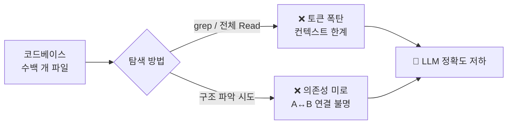
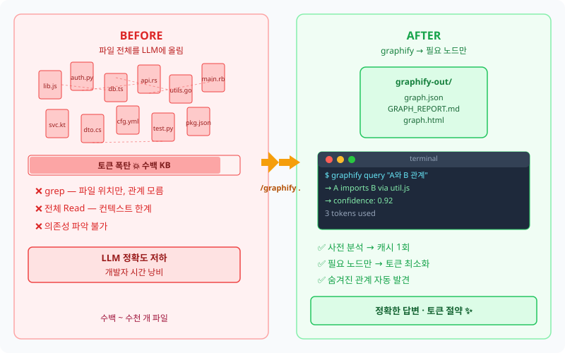
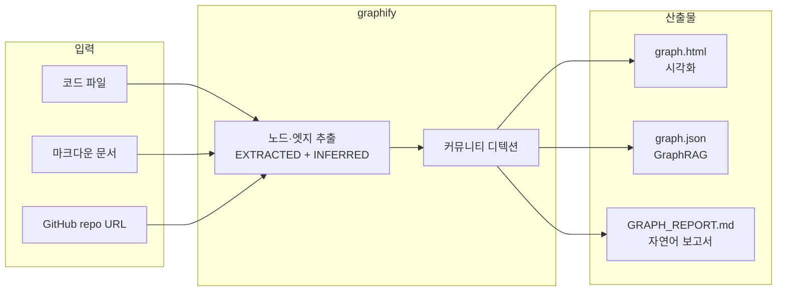
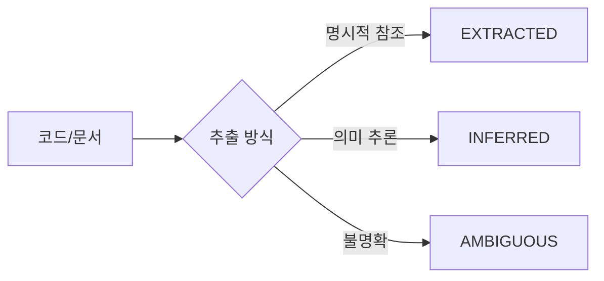
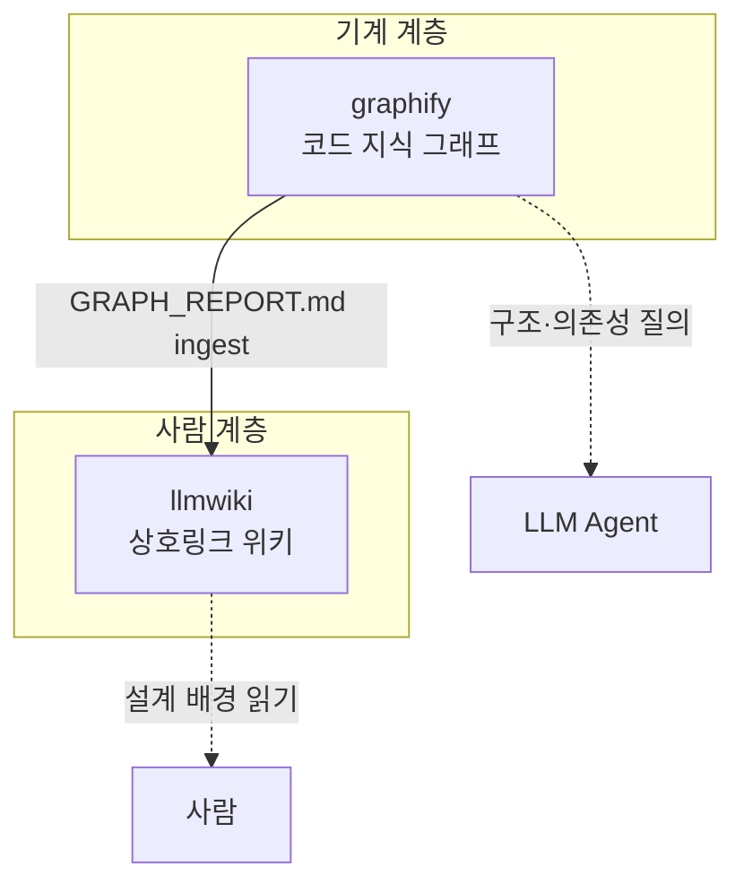
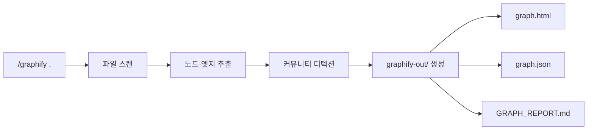
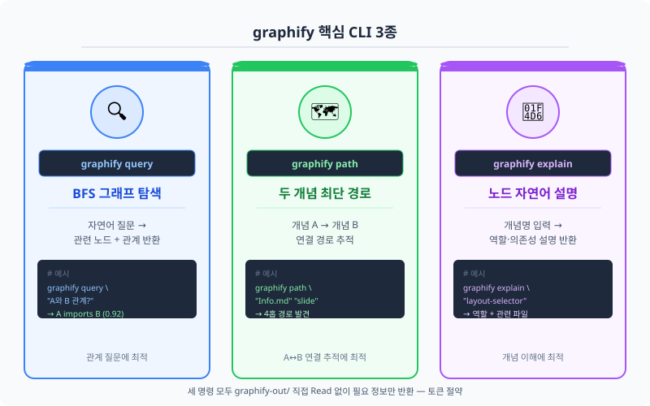
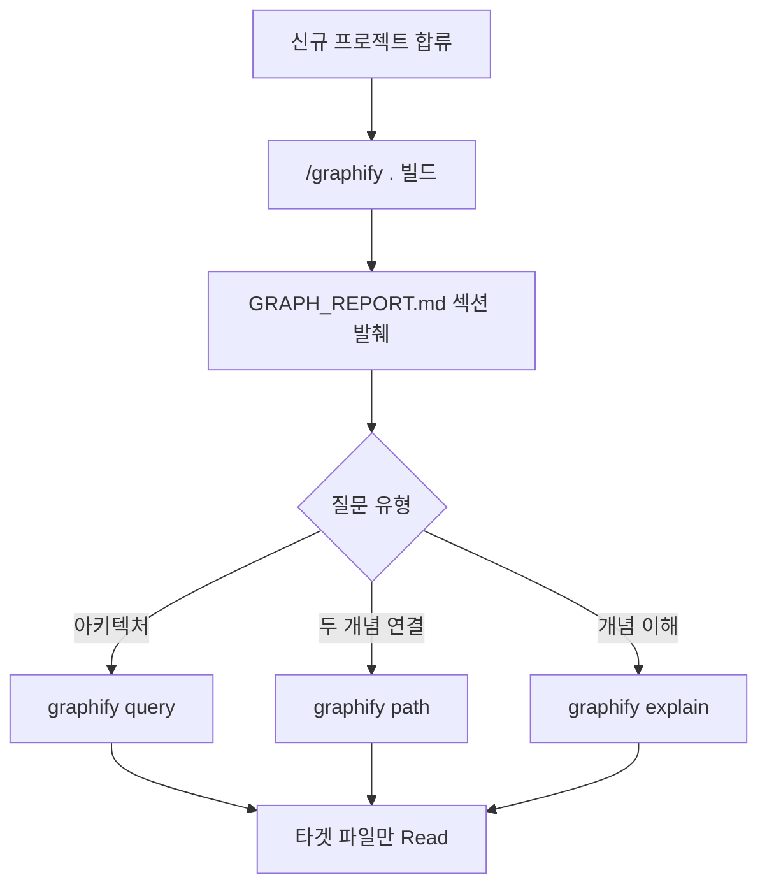
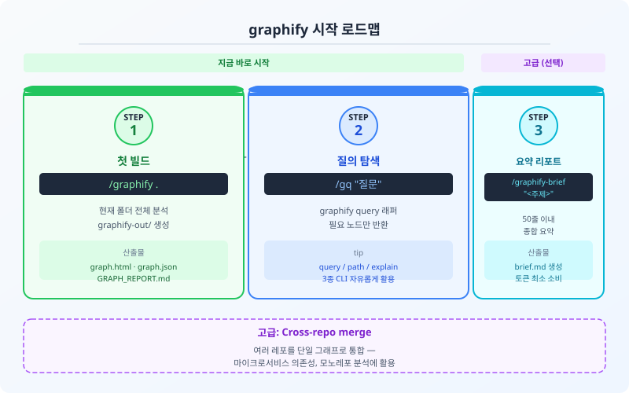

# 들어가며 — 왜 graphify인가

#layout-_mg

## 15분 입문 — 문제에서 실전 워크플로까지

```mg
src: mg/00-flow
```

---

## 대규모 코드베이스의 문제
#layout-contents

* 파일 수백 개, 모듈 의존성 복잡
* "A와 B가 어떻게 연결돼 있지?" → grep은 한계
* **컨텍스트 창 낭비**: 파일 전체를 LLM에 올리면 토큰 폭탄



---

## graphify가 해결하는 문제
#layout-contents

* 코드·문서 전체를 **사전 분석** → knowledge graph 캐시
* 질의 시 필요한 노드만 가져옴 → **토큰 최소화**
* EXTRACTED + INFERRED edge로 숨겨진 연결 발견



---

# graphify란 무엇인가

## 정의 & 산출물
#layout-contents

* **정의**: 임의 폴더·repo·URL 입력 → community detection + knowledge graph 생성 **독립 CLI**
    - 저자 Safi Shamsi · `pip install graphifyy` (Claude Code에서는 `/graphify` skill로 래핑)
* **3대 산출물**:
    - `graph.html` — 인터랙티브 시각화 (사람용)
    - `graph.json` — GraphRAG 백엔드용 (CLI 경유만)
    - `GRAPH_REPORT.md` — 자연어 보고서 (섹션별 발췌)



---

#layout-_mg

## 폴더 하나 → knowledge graph → 3대 산출물

```mg
src: mg/01-pipeline
```

---

## 세 개념 구분 — 혼동 주의
#layout-contents

혼동하기 쉽지만 셋 사이에 **종속·모듈 관계는 없음**.

| 항목                        | 정체                    | 저자            |
| :-------------------------- | :---------------------- | :-------------- |
| Karpathy LLM Wiki           | 패턴 (프롬프트 아이디어) | Andrej Karpathy |
| llm-wiki-compiler (`llmwiki`) | 그 패턴의 한 구현 (npm) | atomicstrata    |
| graphify (`pip graphifyy`)  | 코드 지식 그래프 도구    | Safi Shamsi     |

* Karpathy LLM Wiki = "RAG로 매번 긁지 말고 한 번 컴파일해 영속 위키로 유지"라는 **아이디어**
* graphify는 위 위키의 모듈이 **아님** — 저자·저장소·목적이 전부 다름

---

## 흔한 오해 정정
#layout-contents

* ❌ "graphify가 LLM Wiki에 적용된 모듈이다"
    - → 틀림. 저자·저장소·목적이 다른 **독립 도구**
* ❌ "graphify는 Obsidian에서 흔히 쓰는 모듈이다"
    - → 부분 오해. Obsidian graph view와 별개인 **CLI/skill 도구**
    - Obsidian용 "Karpathy LLM Wiki"는 이름만 비슷한 **또 다른 커뮤니티 플러그인**
* ✅ "Karpathy가 LLM Wiki 개념을 만들었다"
    - → 맞음 (gist로 공개한 패턴)

---

## 핵심 개념: edge 신뢰도
#layout-contents



* EXTRACTED → 신뢰도 높음 (함수 호출, import 등)
* INFERRED → 문맥 기반 추론 (avg confidence: 0.7)

---

#layout-_mg

## edge 신뢰도 — EXTRACTED · INFERRED · AMBIGUOUS

```mg
src: mg/02-edge
```

---

# 다른 도구와의 관계

## graphify vs Obsidian graph view
#layout-contents

| 항목      | Obsidian graph view | graphify                  |
| :-------- | :------------------ | :------------------------ |
| 정체      | 노트 앱 내장 시각화 | 독립 CLI 도구 (별개 저자) |
| 입력      | `[[wikilink]]`      | 임의 파일·repo·URL        |
| 관계 추출 | 명시적 링크만       | 의미 추출 + 추론          |
| 대상      | 마크다운 노트       | 코드·문서·멀티모달        |
| 탐색      | GUI 시각화          | CLI query/path/explain    |

* 이름·형태가 비슷해 보여도 **다른 도구** — graphify는 Obsidian 플러그인이 아님

---

## 그래프 vs 위키 — graphify와 llmwiki
#layout-contents



* graphify = 그래프(**기계 탐색 백엔드**) — 구조·의존성 추출에 강함
* llmwiki = 위키(**사람 읽기 프론트엔드**) — 사람용 문서 컴파일에 강함
* 강한 지식 시스템은 그래프 계층과 위키 계층을 **둘 다** 가짐

---

# 설치 & 첫 빌드

## 설치 방법
#layout-contents

```bash
# graphify 자체는 독립 CLI — Claude Code 없이도 동작
pipx install graphifyy          # 또는 pip install graphifyy
pipx upgrade graphifyy          # 최신 (2026-07 기준 0.9.4)

# Claude Code에서는 /graphify skill 래퍼 제공 (편의 진입점)
/graphify .                     # 현재 폴더 풀 파이프라인
/graphify <github-url>          # repo clone 후 빌드
```

* 도구 = `graphifyy` (pip 패키지), `/graphify` = 이 저장소의 skill wrapper

---

## 첫 빌드 흐름
#layout-contents



* 최초 빌드만 토큰 소비 → 이후 `graphify update .` (AST-only, 무비용)

---

# 토큰 절약 — 스마트 탐색 전략

## 절대 하지 말 것
#layout-contents

```bash
# ❌ 토큰 폭탄 — 수백 KB 파일 직접 Read
Read graphify-out/graph.json
Read graphify-out/GRAPH_REPORT.md   # 300+ 줄
Read graphify-out/graph.html
```

* `graph.json` = 수백 KB — **절대 금지**
* `GRAPH_REPORT.md` = 300+ 줄 — bash 발췌만 허용

---

## 권장 탐색 패턴
#layout-contents

```bash
# ✅ 그래프 탐색 — 필요한 노드만
graphify query "X와 Y의 관계"
graphify path "moduleA" "moduleB"
graphify explain "개념명"

# ✅ GRAPH_REPORT 섹션 발췌
sed -n '/^## Community Hubs/,/^## /p' \
  graphify-out/GRAPH_REPORT.md | head -50
```

* 허용: `GRAPH_REPORT.brief.md` (≤100줄), `wiki/index.md`, `wiki/{community}.md` (1~2개)

---

#layout-_mg

## 전체 Read 대신 — 필요한 노드만

```mg
src: mg/03-token
```

---

# CLI 실전: query / path / explain

## 세 가지 핵심 명령
#layout-contents

| 명령                            | 용도                              |
| :------------------------------ | :-------------------------------- |
| `graphify query "<질문>"`       | BFS 그래프 탐색 (자연어 질의)     |
| `graphify path "A" "B"`         | 두 개념 최단 경로                 |
| `graphify explain "<concept>"`  | 노드 자연어 설명                  |

---

## 명령별 역할 카드
#layout-blank



---

## query 사용 예시
#layout-contents

```bash
# 아키텍처·의존성 질문
graphify query "generate-slides.js가 어떤 모듈을 사용하나?"

# 관계 질문
graphify query "theme과 layout의 관계는?"

# 기능 위치 질문
graphify query "슬라이드 변환 핵심 함수는 어디?"
```

* 일반 grep: 파일 위치만 찾음
* graphify query: 관계 맥락까지 설명

---

## path & explain 사용 예시
#layout-contents

```bash
# 두 개념 연결 탐색
graphify path "Info.md" "slide/index.html"
# → Info.md → agenda-designer → AGENDA.md → generate-slides.js → slide/index.html

# 개념 설명
graphify explain "layout-selector"
# → layout-selector agent가 하는 일, 관련 파일, 의존 데이터 설명
```

---

# graphify + llmwiki 병용

## 같은 저장소, 두 계층
#layout-contents

```bash
graphify .                                      # 1) 코드 그래프 → graphify-out/
llmwiki ingest graphify-out/GRAPH_REPORT.md     # 2) 그래프 산출 + 문서 원본 적재
llmwiki compile                                 # 3) 위키 컴파일 → wiki/
```

* 폴더가 달라 **충돌 없음** (graphify는 `graphify-out/`, llmwiki는 최상위 `wiki/`·`.llmwiki/`)
* wiki 폴더가 둘 — `graphify-out/wiki/` vs 최상위 `wiki/` (경로는 다르나 이름 같아 혼동 주의)
* `.gitignore` 권장: `graphify-out/`, `.llmwiki/`

---

## 누가 무엇을 보나 — 언제 llmwiki인가
#layout-contents

| 계층             | 주 소비자                    | 반대쪽도 씀                   |
| :--------------- | :--------------------------- | :---------------------------- |
| graphify(그래프) | LLM Agent (토큰 싼 구조 질의) | 사람도 `graph.html` 열람      |
| llmwiki(위키)    | 사람 (설계 배경·읽는 설명)   | Agent도 위키 페이지 읽음      |

* **코드 중심 프로젝트 → llmwiki 불필요**: `_doc_arch/`가 이미 사람용 위키 역할
* **문서 중심 프로젝트 → llmwiki 도입 가치**: 기획서·논문·transcript 등 미정리 원본 축적 시
* 조회 진입점: 구조·의존성 `/gq`(graphify) · 개념·설계 설명 `/wq`(llmwiki)

---

# 실전 워크플로

## 코드베이스 탐색 워크플로
#layout-contents



---

## 업데이트 정책
#layout-contents

```bash
# 코드 수정 후 — AST only, 무비용
graphify update .

# 또는 post-commit hook 설치 (자동화)
# .git/hooks/post-commit에 graphify update . 추가
```

* 전체 재빌드 (`/graphify .`)는 비용 큼 → `--update` 증분 필수
* wiki 생성: `--wiki` 옵션 (agent가 크롤 가능한 구조화 wiki)

---

# 정리 & 다음 단계

## 오늘 학습한 내용
#layout-summary

* **graphify가 무엇인가**
    - 코드·문서 → knowledge graph (EXTRACTED + INFERRED edge)
    - 독립 CLI 도구 (`pip graphifyy`, Safi Shamsi) — LLM Wiki·Obsidian 모듈 **아님**
* **세 개념 구분**
    - Karpathy LLM Wiki(패턴) / llmwiki(구현) / graphify(별개 도구)
* **토큰 절약 + CLI 실전**
    - `graph.json`·`GRAPH_REPORT.md` 직접 Read 금지 → query / path / explain
* **병용**
    - graphify(그래프·기계) + llmwiki(위키·사람) 상호보완

---

## 다음 단계
#layout-summary

* `/graphify .` — 지금 작업 중인 프로젝트에 바로 적용
* `/gq <질문>` — graphify query 래퍼 (더 짧은 명령)
* `/graphify-brief <주제>` — 50줄 요약 리포트
* **병용 심화** — `llmwiki ingest` → `compile`로 사람용 위키 계층 추가 (문서 중심 프로젝트)



---

## 참고자료 & 출처
#layout-summary

* **Karpathy LLM Wiki (개념 원본)**: [gist.github.com/karpathy](https://gist.github.com/karpathy/442a6bf555914893e9891c11519de94f)
* **graphify (GitHub)**: [github.com/safishamsi/graphify](https://github.com/safishamsi/graphify)
* **llm-wiki-compiler (GitHub)**: [github.com/atomicstrata/llm-wiki-compiler](https://github.com/atomicstrata/llm-wiki-compiler)
* **소개 영상**: [71.5배 토큰 절감 — graphify가 LLM 비용은 낮추고 정확도는 높이는 방법](https://www.youtube.com/watch?v=Ma8e25AOtao)
