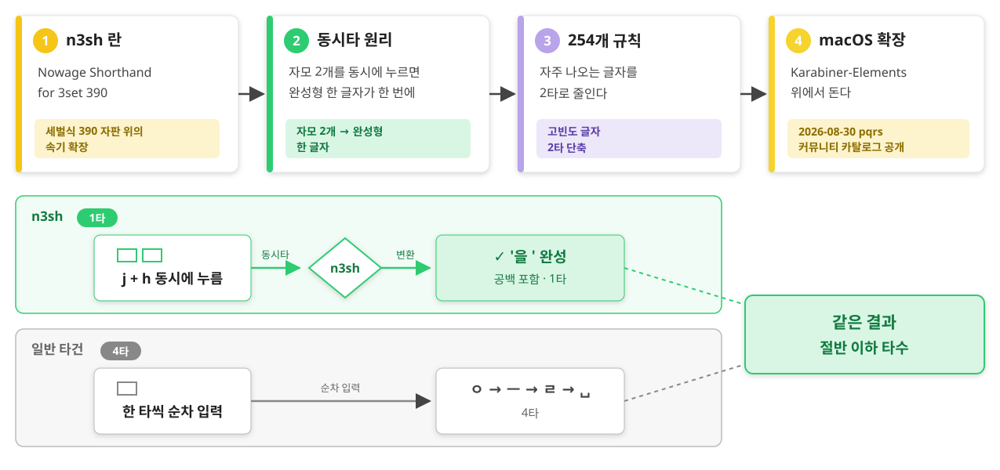
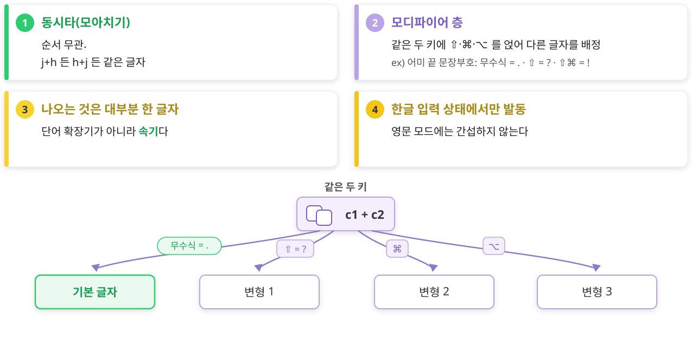
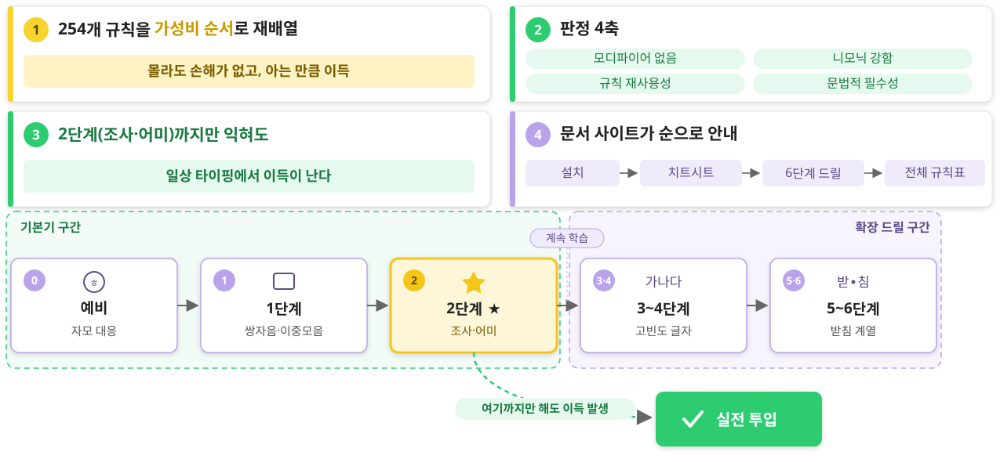

# n3sh 란 무엇인가

## 자모 2개 → 완성형 한 글자
#layout-contents

---

## 얼마나 줄어드나
#layout-contents

* 조사·어미는 **뒤 공백까지 함께** 나온다 — 문장을 이어 칠 때 진짜 이득
* 10년 넘게 개인 환경에서 다듬어 온 체계를 공개한 것

| 누르면    | 나온다 | 일반 타건             | 절감    |
| :-------- | :----- | :-------------------- | :------ |
| `j` + `h` | 을␣    | 4타 (ㅇ ㅡ ㄹ ␣)      | 절반    |
| `y` + `u` | 를␣    | 4타                   | 절반    |
| `h` + `l` | 는␣    | 4타                   | 절반    |
| `k` + `m` | 고␣    | 3타 (ㄱ ㅗ ␣)         | 1/3 ↓   |
| `j` + `i` | 있     | 3타 (ㅇ ㅣ ㅆ)        | 1/3 ↓   |

---

# 작동 원리

## 모아치기 + 모디파이어 층
#layout-contents

---

## 전제 조건
#layout-contents

* **세벌식 390 배열** — 자모의 물리 위치가 규칙의 전제. 두벌식에서는 동작하지 않는다
* **macOS + Karabiner-Elements** — complex modification 으로 동작
* **외우는 시간** — 254개는 바로 쓰는 분량이 아니다 → 그래서 **학습 커리큘럼**이 함께 있다

---

# 학습 커리큘럼

## 예비 + 6단계 드릴
#layout-contents

---

# 설치와 생태계

## 3분 설치
#layout-contents

1. Karabiner-Elements 설치
2. [pqrs 카탈로그](https://ke-complex-modifications.pqrs.org/?q=n3sh)에서 `n3sh` 검색 → import
3. 세벌식 390 배열 + 한글 입력 상태에서 바로 발동

* 배우려면 → [n3sh 문서 사이트](https://finfra.github.io/karabiner-extensions/)

---

## karabiner-extensions 저장소
#layout-contents

* n3sh 는 [Finfra/karabiner-extensions](https://github.com/Finfra/karabiner-extensions) 의 대표 확장
* **md 정본 → JSON 생성** 데이터 파이프라인 — 사람이 마크다운 표를 고치면 도구가 규칙 JSON 을 만든다
* 버전은 `VERSION` 파일이 SSOT — 규칙 이름에 자동 각인 (`n3sh : v2026.08.30`)
* 형제 확장: 12Key2Knob · engCharOnKor · footPedal · remoteDesktop

---

# 정리

## n3sh 한 장 요약
#layout-contents

* **무엇**: 세벌식 390 전용 — 자모 2개 동시타 → 완성형 한 글자 (254 규칙)
* **왜**: 조사·어미를 절반 타수로, 공백까지 한 번에
* **어떻게**: pqrs 카탈로그 import → 2단계까지 드릴 → 몸에 붙는 만큼 확장
* **어디서**: <https://finfra.github.io/karabiner-extensions/>
