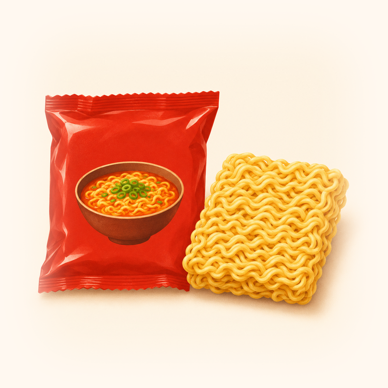
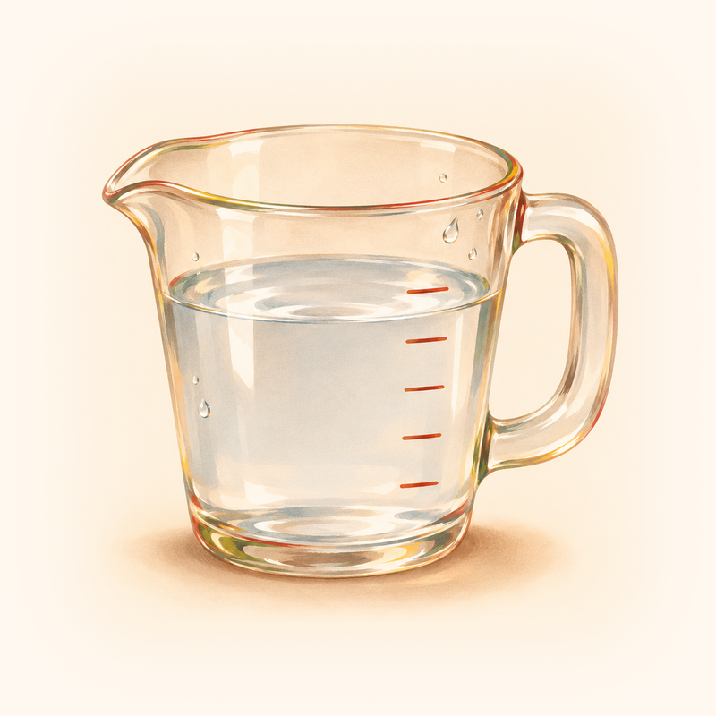
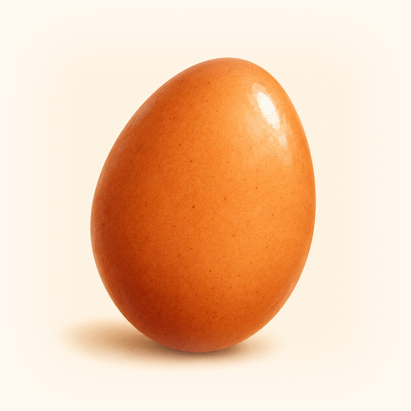
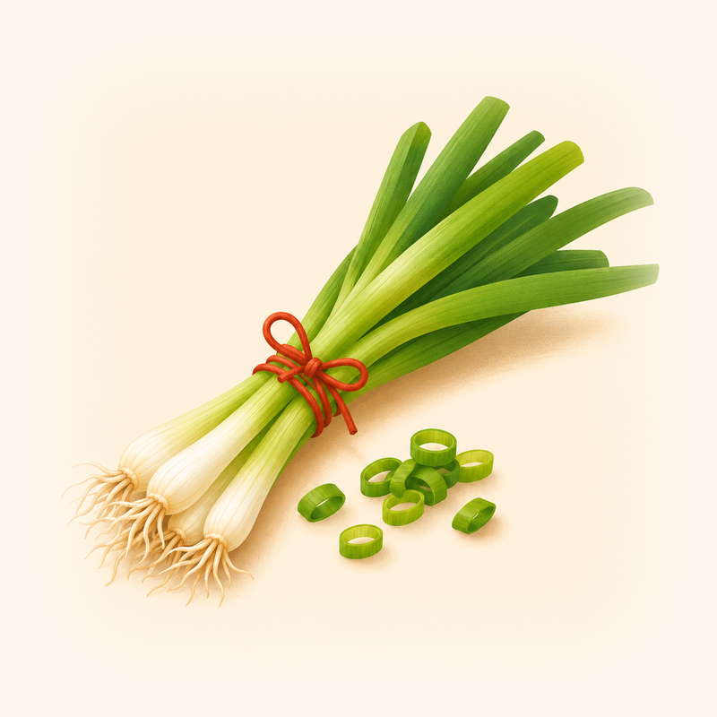
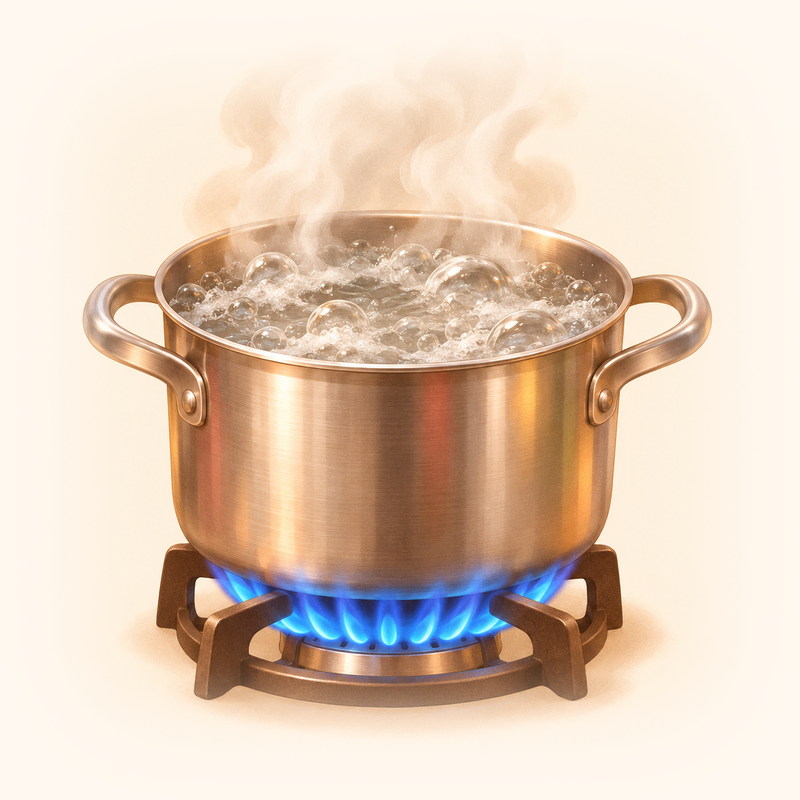
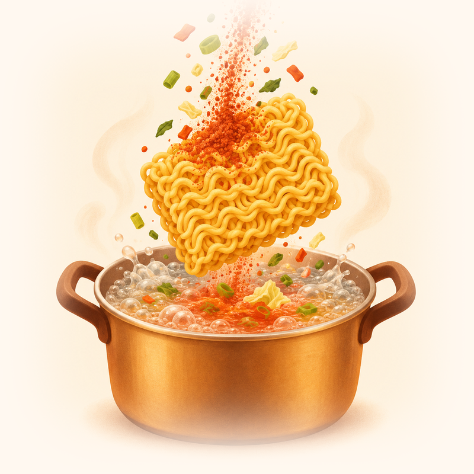
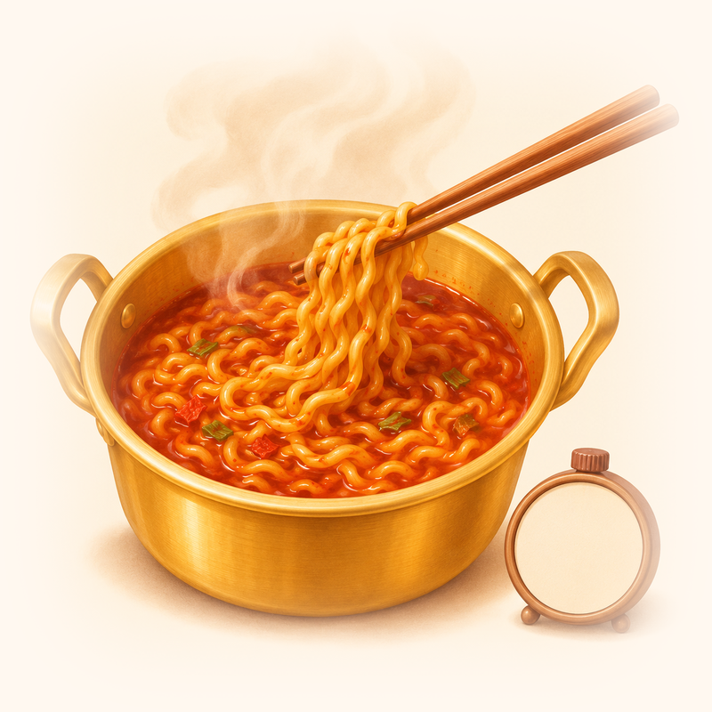
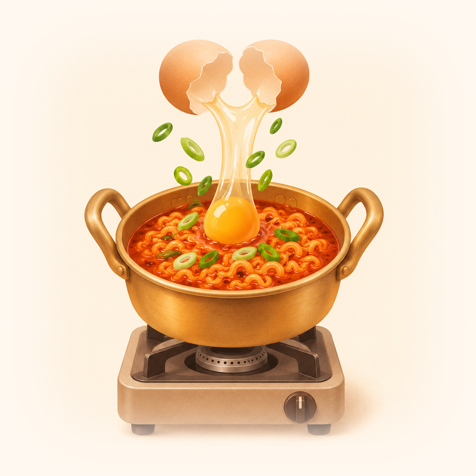
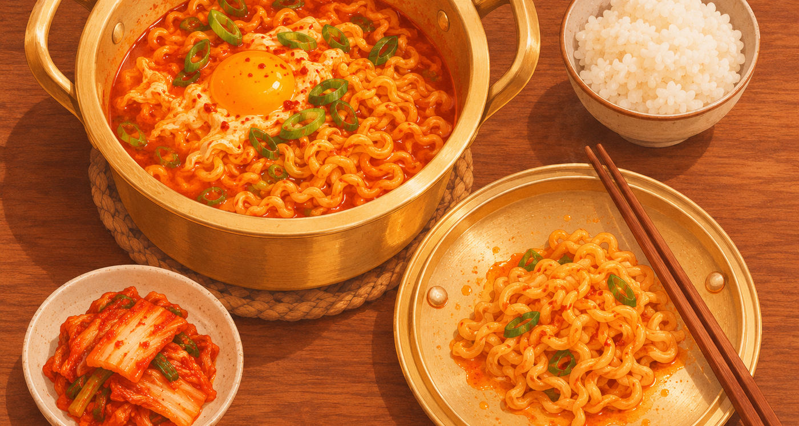

#layout-blank
#background-image-./img/cover.png
#background-size-cover

3분 레시피

라면끓이기

3분 안에 완성하는 인생 라면 레시피

---

## 준비물
#background-color-FFF8F0

::: columns
::: {.column width="25%"}

라면 1봉지

:::
::: {.column width="25%"}

물 550ml

:::
::: {.column width="25%"}

계란 1개

:::
::: {.column width="25%"}

대파 약간

:::
:::

---

## 끓이는 법
#background-color-FFF8F0

::: columns
::: {.column width="25%"}

1물 끓이기

550ml · 센 불

:::
::: {.column width="25%"}

2면·스프 넣기

분말·건더기 동시에

:::
::: {.column width="25%"}

34분 30초

면을 저으며

:::
::: {.column width="25%"}

4마지막 30초

계란·대파 올리고 불 끄기

:::
:::

---

## 마무리
#background-color-FFF8F0

::: columns
::: {.column width="54%"}

:::
::: {.column width="46%"}
::: htmlart numbered
* 그릇 대신 냄비째 먹으면 더 맛있다
* 김치와 찬밥은 선택이 아닌 필수
:::
:::
:::
